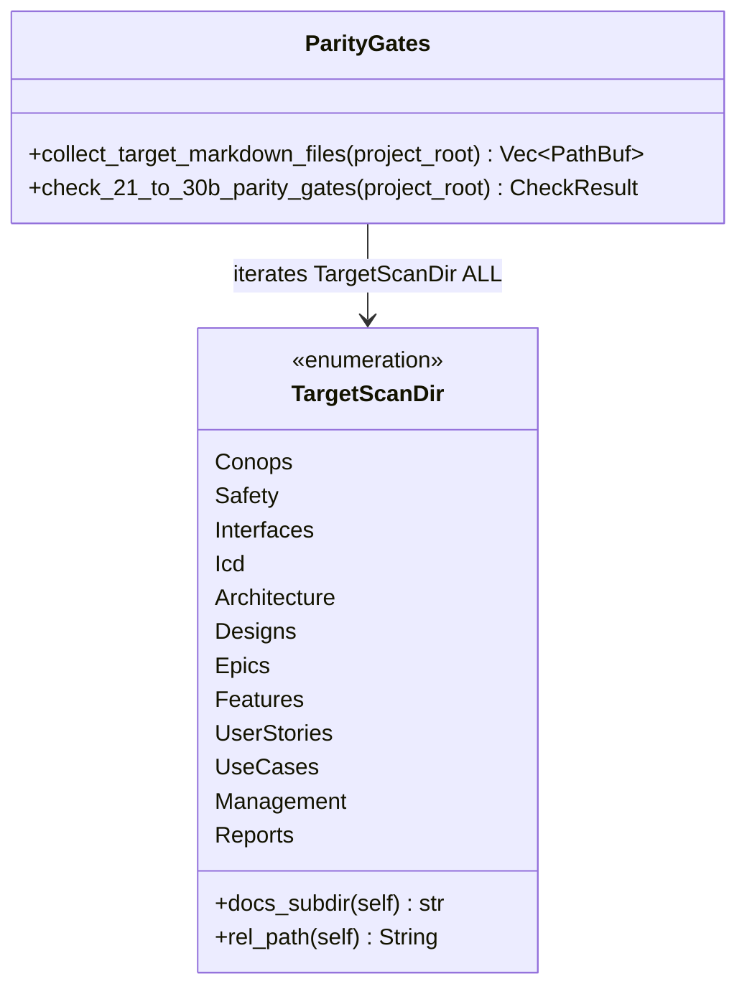

## 1. Context and References

<!-- test-target: crates/verify-baseline/src/checks/parity_gates.rs -->

- **File**: `crates/verify-baseline/src/checks/parity_gates.rs:329-395`
- **Pillar**: Semantic Traceability
- **Symptom**: `TargetScanDir` (`crates/verify-baseline/src/checks/parity_gates.rs:329-341`), `TargetScanDir::ALL` (`crates/verify-baseline/src/checks/parity_gates.rs:344-356`), and `TargetScanDir::docs_subdir` (`crates/verify-baseline/src/checks/parity_gates.rs:380-394`) enumerate only 11 `docs/` subdirectories (`conops`, `safety`, `interfaces`, `icd`, `architecture`, `epics`, `features`, `user-stories`, `use-cases`, `management`, `reports`) and omit `"designs"`, causing all engineering design blueprints under `docs/designs/blueprint-01..06-*.md` to be silently skipped by every `TargetScanDir::ALL`-driven parity and traceability gate (Checks 21, 22, 23, 25, 26, 27, 29, 30, 30A, and 30B).
- **Test-Target**: `crates/verify-baseline/src/checks/parity_gates.rs`

## 2. Root Cause Analysis (5 Whys)

1. **Why are `docs/designs/blueprint-01..06-*.md` files excluded from Checks 21, 22, 23, 25, 26, 27, 29, 30, 30A, and 30B during parity verification?** Because those checks discover markdown specifications by iterating over `TargetScanDir::ALL` (`crates/verify-baseline/src/checks/parity_gates.rs:344-356`), which does not include a variant for `docs/designs`.
2. **Why does `TargetScanDir::ALL` not include a variant for `docs/designs`?** Because `TargetScanDir` (`crates/verify-baseline/src/checks/parity_gates.rs:329-341`) and `TargetScanDir::docs_subdir` (`crates/verify-baseline/src/checks/parity_gates.rs:380-394`) were authored with 11 static enum variants prior to or independently from the addition of the `docs/designs/` blueprint taxonomy enforced by Check 46 (`check_blueprint.rs`).
3. **Why was `TargetScanDir` not updated when `docs/designs/` was introduced as a canonical specification directory?** Because `check_blueprint.rs` resolves `docs/designs/` via its own dedicated directory path scan rather than sharing `TargetScanDir` as the single source of truth for `docs/` subdirectory enumeration.
4. **Why did existing unit and acceptance tests not catch the omission of `"designs"` from `TargetScanDir::ALL`?** Because no semantic traceability test asserted that every canonical `docs/` specification subdirectory governed by `.pipeline/constitution.md` (including `docs/designs/`) is represented in `TargetScanDir::ALL`.
5. **Why was there no cross-check between `.pipeline/constitution.md` artifact directories and `TargetScanDir::ALL`?** Because `TargetScanDir` lacked an invariant test binding its enumerated `docs_subdir()` values to the full taxonomy of version-controlled `docs/` specification directories (`conops`, `safety`, `interfaces`, `icd`, `architecture`, `designs`, `epics`, `features`, `user-stories`, `use-cases`, `management`, `reports`).

## 3. Correctness Analysis

In `crates/verify-baseline/src/checks/parity_gates.rs:329-341`, `TargetScanDir` defines the closed set of `docs/` subdirectories scanned across the parity gate suite. `TargetScanDir::ALL` (`crates/verify-baseline/src/checks/parity_gates.rs:344-356`) exposes the static slice of all variants, and `TargetScanDir::docs_subdir` (`crates/verify-baseline/src/checks/parity_gates.rs:380-394`) maps each variant to its subdirectory name under `docs/`.

Per `.pipeline/constitution.md:155` (Repository Artifact Management Mandate) and `skills/spec-blueprint-engineering/SKILL.md`, engineering design blueprints reside at `docs/designs/blueprint-XX-<slug>.md`. However, because `TargetScanDir` omits `Self::Designs => "designs"`, `collect_target_markdown_files` never traverses `docs/designs/`. Consequently, any defect inside `docs/designs/blueprint-01..06-*.md` -- such as unverified behavioral triggers (Check 21), unmapped safety constraints (Check 22), broken signal dictionary bindings (Check 23), invalid LUMI tokens (Check 25), broken traceability links (Check 26/27), unrecorded constitutional amendments (Check 29), or invalid/hallucinated source references and derivation annotations (Checks 30, 30A, 30B) -- passes `verify-baseline` silently without triggering a gate failure. This violates the `REQ-TARGET-SCAN-DIR-SUBDIR` 1:1 specification taxonomy coverage invariant (`crates/verify-baseline/src/checks/parity_gates.rs:364-379`).

## 4. UML Diagrams



## 5. Affected Callers / Downstream Impact

- `collect_target_markdown_files` (`crates/verify-baseline/src/checks/parity_gates.rs`) -- skips `docs/designs/` completely when enumerating `TargetScanDir::ALL`.
- `Check 21`, `Check 22`, `Check 23`, `Check 25`, `Check 26`, `Check 27`, `Check 29`, `Check 30`, `Check 30A`, and `Check 30B` (`crates/verify-baseline/src/checks/parity_gates.rs`) -- fail to audit `docs/designs/blueprint-01..06-*.md` for behavioral triggers, safety traceability, interface parity, LUMI compliance, and source reference integrity.

## 6. Proposed Correction

<!-- MUST NOT use regex (Check 34: deterministic linear slice/char scanning, no regex crate). MUST be domain-agnostic for upstream crates (Check 19). -->

```rust
#[derive(Debug, Clone, Copy, PartialEq, Eq)]
pub enum TargetScanDir {
    Conops,
    Safety,
    Interfaces,
    Icd,
    Architecture,
    Designs,
    Epics,
    Features,
    UserStories,
    UseCases,
    Management,
    Reports,
}

impl TargetScanDir {
    pub const ALL: &'static [Self] = &[
        Self::Conops,
        Self::Safety,
        Self::Interfaces,
        Self::Icd,
        Self::Architecture,
        Self::Designs,
        Self::Epics,
        Self::Features,
        Self::UserStories,
        Self::UseCases,
        Self::Management,
        Self::Reports,
    ];

    pub const fn docs_subdir(self) -> &'static str {
        match self {
            Self::Conops => "conops",
            Self::Safety => "safety",
            Self::Interfaces => "interfaces",
            Self::Icd => "icd",
            Self::Architecture => "architecture",
            Self::Designs => "designs",
            Self::Epics => "epics",
            Self::Features => "features",
            Self::UserStories => "user-stories",
            Self::UseCases => "use-cases",
            Self::Management => "management",
            Self::Reports => "reports",
        }
    }
}
```

## 7. Relationship to Existing Issues

Discovered in audit -- new finding.

## Audit Source

Adversarial Semantic Traceability Audit
SEVERITY: Important
FILE_LOCATION: crates/verify-baseline/src/checks/parity_gates.rs:329-395
