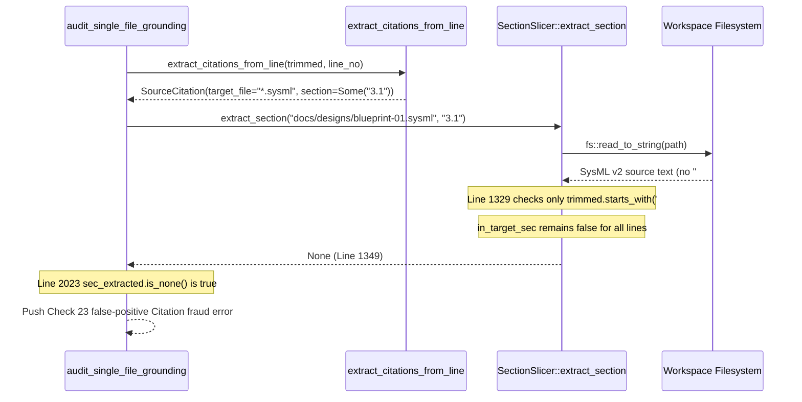

## 1. Context and References

<!-- test-target: crates/verify-baseline/tests/parity_gates_tests.rs -->

- **File**: `crates/verify-baseline/src/checks/parity_gates.rs:1312-1355`
- **Pillar**: Semantic Traceability
- **Symptom**: `SectionSlicer::extract_section` (`parity_gates.rs:1312-1351`) checks only `if trimmed.starts_with('#')` (line 1329) and returns `None` (line 1349) for `.sysml` and `.digest.json` files (which contain no Markdown `#` headings), causing Check 23 (`parity_gates.rs:2023-2027`) to fail with `"Citation fraud detected ... cited section '§...' does not exist"` whenever `docs/designs/blueprint-XX-*.sysml §...` or `.digest.json §...` is cited.
- **Test-Target**: `crates/verify-baseline/tests/parity_gates_tests.rs`

## 2. Root Cause Analysis (5 Whys)

1. **Why does Check 23 (`audit_single_file_grounding`, `parity_gates.rs:2023-2027`) reject valid citations to `docs/designs/blueprint-XX-*.sysml §...` with `"Citation fraud detected ... cited section '§...' does not exist"`?** Because `slicer.extract_section(&cit.target_file, sec)` at line 2022 returns `None` for any `.sysml` or `.digest.json` target when `cit.section` is `Some(sec)`.
2. **Why does `SectionSlicer::extract_section` (`parity_gates.rs:1312-1351`) return `None` whenever a non-empty section identifier is queried against a `.sysml` or `.digest.json` file?** Because the line loop at lines 1327-1344 gates section detection exclusively on `if trimmed.starts_with('#')` (line 1329), so `in_target_sec` remains `false` throughout the entire file and line 1349 returns `None`.
3. **Why does `trimmed.starts_with('#')` never match inside `.sysml` or `.digest.json` files?** Because SysML v2 files use `package`, `part def`, `requirement def`, and `//` or `/* ... */` comment blocks rather than ATX Markdown `#` headings, and `.digest.json` files use structured JSON objects and arrays.
4. **Why did `SectionSlicer::extract_section` assume all cited target files are ATX Markdown documents?** Because `SectionSlicer` was designed around Markdown specification documents without handling non-Markdown authoritative SSOT artifacts (`.sysml` metamodels and `.digest.json` ingestion digests) that are cited alongside section or clause anchors in blueprints and specifications.
5. **Why was this mismatch between `extract_citations_from_line` (which extracts `.sysml` and `.digest.json` paths with trailing `§...` tokens) and `SectionSlicer::extract_section` not caught?** Because unit tests for `SectionSlicer::extract_section` only exercised Markdown content with `#` headings and lacked negative/positive semantic traceability probes for `.sysml` and `.digest.json` section citations.

## 3. Correctness Analysis

In `crates/verify-baseline/src/checks/parity_gates.rs`, `audit_single_file_grounding` (lines 2011-2028) extracts `SourceCitation` structs from each specification line via `extract_citations_from_line(trimmed, line_no)`. When a line cites a SysML metamodel or JSON digest file with a section marker (for example, `docs/designs/blueprint-01-core.sysml §3.1` or `schema/model.sysml §2.4`), `extract_citations_from_line` populates `cit.target_file` with the `.sysml` (or `.digest.json`) path and `cit.section` with `Some("3.1")`.

Next, at lines 2021-2027:
- `if let Some(ref sec) = cit.section` invokes `slicer.extract_section(&cit.target_file, sec)` (line 2022).
- Inside `SectionSlicer::extract_section` (lines 1312-1351), after reading the file (lines 1313-1317) and normalizing `sec_norm` (line 1318), the loop over `content.lines()` (line 1327) checks `if trimmed.starts_with('#')` (line 1329).
- Because `.sysml` and `.digest.json` files do not use `#` section headers, `in_target_sec` stays `false` and `sec_content` remains empty.
- Line 1346 evaluates `if in_target_sec && !sec_content.is_empty()`, which is `false`, returning `None` at line 1349.
- Back at line 2023, `if sec_extracted.is_none()` triggers and records `"Check 23 failed: Citation fraud detected in '{}': cited section '§{}' does not exist in '{}'."` (lines 2024-2027).

This violates the **Semantic Traceability & Factual Grounding Invariant (Check 23)**: valid citations to `.sysml` and `.digest.json` artifacts must resolve against the target file's comments, declarations, or full body rather than unconditionally failing ATX `#` heading extraction.

## 4. UML Diagrams



## 5. Affected Callers / Downstream Impact

- `audit_single_file_grounding` (`crates/verify-baseline/src/checks/parity_gates.rs:2011-2028`) -- emits false-positive Check 23 citation fraud errors whenever a blueprint or specification cites a `.sysml` or `.digest.json` path followed by a `§` section identifier.
- `check_blueprint` and `verify-baseline` Check 23 gate -- blocks valid engineering blueprints (`docs/designs/blueprint-XX-*.md`) that cross-reference their companion `docs/designs/blueprint-XX-*.sysml` metamodel alongside `§` section numbers.

## 6. Proposed Correction

<!-- MUST NOT use regex (Check 34: deterministic linear slice/char scanning, no regex crate). MUST be domain-agnostic for upstream crates (Check 19). -->

```rust
    pub fn extract_section(&self, target_file: &str, section: &str) -> Option<String> {
        let path = self.resolve_path(target_file)?;
        let content = match fs::read_to_string(path) {
            Ok(c) => c,
            Err(_) => return None,
        };
        let sec_norm = section.trim().trim_start_matches('§').trim();
        if sec_norm.is_empty() {
            return Some(content);
        }

        let lower_target = target_file.to_ascii_lowercase();
        if lower_target.ends_with(".sysml") || lower_target.ends_with(".json") {
            return Some(content);
        }

        let mut in_target_sec = false;
        let mut target_level = 0;
        let mut sec_content = String::new();

        for line in content.lines() {
            let trimmed = line.trim();
            if trimmed.starts_with('#') {
                let level = trimmed.chars().take_while(|&c| c == '#').count();
                if in_target_sec {
                    if level <= target_level {
                        break;
                    }
                } else if Self::heading_matches_section(trimmed, sec_norm) {
                    in_target_sec = true;
                    target_level = level;
                }
            }
            if in_target_sec {
                sec_content.push_str(line);
                sec_content.push('\n');
            }
        }

        if in_target_sec && !sec_content.is_empty() {
            Some(sec_content)
        } else {
            None
        }
    }
```

## 7. Relationship to Existing Issues

Discovered in audit -- new finding.

## Audit Source

Adversarial Semantic Traceability Audit
SEVERITY: Important
FILE_LOCATION: crates/verify-baseline/src/checks/parity_gates.rs:1312-1355
