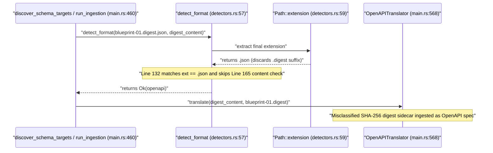

## 1. Context and References

<!-- test-target: crates/ingest-sysml/tests/code_ingestion_tests.rs -->

- **File**: `crates/ingest-sysml/src/detectors.rs:57-173`
- **Pillar**: Semantic Traceability
- **Symptom**: `detect_format` (`crates/ingest-sysml/src/detectors.rs:58-63`, `132-134`) extracts only the terminal file extension via `Path::extension()` (`".json"`) and unconditionally returns `Ok("openapi".to_string())` at line 133 prior to content inspection at line 165, misclassifying cryptographic sidecar files such as `docs/designs/blueprint-01..06-*.digest.json` and `.pipeline/schema-digest.json` as OpenAPI 3.0/3.1 specifications.
- **Test-Target**: `crates/ingest-sysml/tests/code_ingestion_tests.rs`

## 2. Root Cause Analysis (5 Whys)

1. **Why does `detect_format` misclassify `.digest.json` and `schema-digest.json` cryptographic sidecars as `"openapi"` specifications?** Because line 132 checks `if ext == ".json" || ext == ".yaml" || ext == ".yml"` and unconditionally returns `Ok("openapi".to_string())` at line 133 without inspecting the compound filename suffix or JSON payload structure.
2. **Why does line 132 only see `".json"` for compound sidecar filenames like `blueprint-01-core.digest.json`?** Because lines 58-63 compute `ext` using `Path::new(schema_path).extension()`, which extracts only the final dot-delimited component (`"json"`) and discards the preceding `.digest` stem suffix and `-digest.json` filename pattern.
3. **Why does the extension check at line 132 execute before the OpenAPI content check at line 165?** Because Stage 2 (`// 2. Extension-based categorization`, lines 113-137) short-circuits on bare file extensions before Stage 3 (`// 3. Content-based fallback inspection`, lines 139-167) can check whether `content` actually contains `"openapi"`, `"swagger"`, or `"\"paths\":"`.
4. **Why was `.json` treated as an unambiguous indicator of an OpenAPI specification in Stage 2?** Because the detector assumed any `.json` file inside a scanned directory is an OpenAPI specification and failed to account for pipeline-generated JSON metadata sidecars (`*.digest.json`, `schema-digest.json`) co-located in design or schema directories.
5. **Why did existing unit tests in `crates/ingest-sysml/src/detectors.rs:504-546` fail to catch this semantic traceability defect?** Because `test_detect_format_by_extension` (`detectors.rs:511`) asserts `detect_format("api.json", "").unwrap() == "openapi"` with an empty content string and never tests negative invariant probes against `.digest.json` or `schema-digest.json` sidecar artifacts.

## 3. Correctness Analysis

In `crates/ingest-sysml/src/detectors.rs`, the module safety header (lines 8-15) establishes the core safety invariant that input format classification is a DO-178C / DO-330 TQL-4 preprocessing gate where erroneous format detection causes silent specification corruption or invalid downstream translation.

Tracing the execution path when a cryptographic digest sidecar path (such as `docs/designs/blueprint-01-sysml-ingestion.digest.json` or `.pipeline/schema-digest.json`) is passed to `detect_format(schema_path, content)`:
1. At `crates/ingest-sysml/src/detectors.rs:58-63`, `Path::new(schema_path).extension()` extracts only the final extension segment `"json"`, normalizing `ext` to `".json"`.
2. At `crates/ingest-sysml/src/detectors.rs:66-111`, Stage 1 checks for Markdown extensions or GFM pipe table headers/delimiters. A JSON digest sidecar contains no Markdown table headers or pipe delimiters, so execution proceeds to Stage 2.
3. At `crates/ingest-sysml/src/detectors.rs:132-134`, `if ext == ".json" || ext == ".yaml" || ext == ".yml"` evaluates to `true` and immediately returns `Ok("openapi".to_string())`.
4. The content inspection guard at `crates/ingest-sysml/src/detectors.rs:165-167` (`if content.contains("openapi") || content.contains("swagger") || content.contains("\"paths\":")`) is dead code for every `.json`, `.yaml`, and `.yml` file because lines 132-134 unconditionally return early.
5. Similarly, during directory discovery in `discover_schema_targets` (`crates/ingest-sysml/src/detectors.rs:349`, `399`, `402-408`) and `find_files_with_ext` (`crates/ingest-sysml/src/detectors.rs:489-493`), any `.digest.json` or `schema-digest.json` file is matched by `ext == "json"` and routed to `OpenAPITranslator::translate` (`crates/ingest-sysml/src/main.rs:568-570`), violating the **Pure Schema-Driven Classification** and **Semantic Traceability** invariants (`[REQ-0001/detect_format]`).

## 4. UML Diagrams



## 5. Affected Callers / Downstream Impact

- `crates/ingest-sysml/src/detectors.rs:309` (`discover_schema_targets`) -- When invoked on a single `.digest.json` or `schema-digest.json` file with `format_hint = None` or `"auto"`, `detect_format` misclassifies the cryptographic sidecar as `"openapi"` instead of rejecting it.
- `crates/ingest-sysml/src/detectors.rs:349`, `399`, `489-493` (`discover_schema_targets` and `find_files_with_ext`) -- Directory scans for `"json"` collect `*.digest.json` and `schema-digest.json` sidecar artifacts alongside or in place of actual specifications.
- `crates/ingest-sysml/src/main.rs:460`, `568-570` (`run_ingestion_with_code`) -- Dispatches `OpenAPITranslator::new().translate(&content, basename)` on misclassified `.digest.json` sidecars, producing an empty or corrupted `PackageDef` AST from SHA-256 metadata.

## 6. Proposed Correction

<!-- MUST NOT use regex (Check 34: deterministic linear slice/char scanning, no regex crate). MUST be domain-agnostic for upstream crates (Check 19). -->

```rust
fn is_digest_sidecar_path(path: &Path) -> bool {
    let Some(file_name) = path.file_name().and_then(|s| s.to_str()) else {
        return false;
    };
    let lower = file_name.to_ascii_lowercase();
    lower.ends_with(".digest.json")
        || lower.ends_with("-digest.json")
        || lower == "schema-digest.json"
}

pub fn detect_format(schema_path: &str, content: &str) -> Result<String, String> {
    let path = Path::new(schema_path);
    if is_digest_sidecar_path(path) {
        return Err(format!(
            "Unsupported schema format for '{}': cryptographic digest sidecar files (.digest.json / schema-digest.json) are not ingestible specifications.",
            schema_path
        ));
    }

    let ext = path
        .extension()
        .and_then(|s| s.to_str())
        .map(|s| format!(".{}", s.to_ascii_lowercase()))
        .unwrap_or_default();

    // ... [Stage 1 Markdown and Stage 2 non-JSON extensions unchanged] ...

    if ext == ".json" || ext == ".yaml" || ext == ".yml" {
        let trimmed = content.trim();
        if trimmed.is_empty()
            || content.contains("openapi")
            || content.contains("swagger")
            || content.contains("\"paths\":")
            || content.contains("paths:")
        {
            return Ok("openapi".to_string());
        }
        return Err(format!(
            "Unsupported JSON/YAML file '{}' lacking OpenAPI/Swagger root markers.",
            schema_path
        ));
    }
```

## 7. Relationship to Existing Issues

Discovered in audit -- new finding.

## Audit Source

Adversarial Semantic Traceability Audit
SEVERITY: Important
FILE_LOCATION: crates/ingest-sysml/src/detectors.rs:57-173
