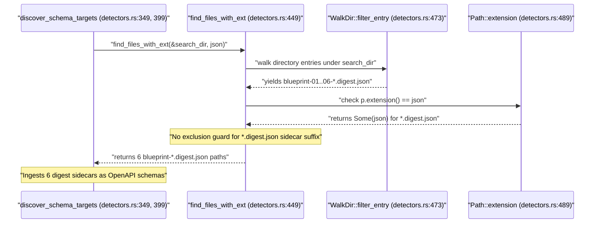

## 1. Context and References

<!-- test-target: crates/ingest-sysml/tests/code_ingestion_tests.rs -->

- **File**: `crates/ingest-sysml/src/detectors.rs:340-466`
- **Pillar**: Semantic Traceability
- **Symptom**: `find_files_with_ext(&search_dir, "json")` (`crates/ingest-sysml/src/detectors.rs:449-497`, invoked by `discover_schema_targets` at lines `349`, `354-357`, `399`, `403`) checks only whether the terminal extension `p.extension()` equals `"json"` (`detectors.rs:489-493`) without excluding `*.digest.json` sidecar files, causing directory discovery to ingest the 6 `docs/designs/blueprint-01..06-*.digest.json` cryptographic sidecars as OpenAPI schemas.
- **Test-Target**: `crates/ingest-sysml/tests/code_ingestion_tests.rs`

## 2. Root Cause Analysis (5 Whys)

1. **Why does directory schema discovery ingest the 6 `blueprint-01..06-*.digest.json` sidecar files as OpenAPI schemas?** Because `discover_schema_targets` calls `find_files_with_ext(&search_dir, "json")` (lines `349`, `356`, `399`, `403`), which returns every regular file whose final extension is `.json`, including `*.digest.json` sidecars.
2. **Why does `find_files_with_ext(&search_dir, "json")` match `*.digest.json` sidecar files?** Because `find_files_with_ext` (`crates/ingest-sysml/src/detectors.rs:449-497`) inspects only `p.extension()` (`lines 489-493`), and `std::path::Path::extension()` returns `Some("json")` for any compound `.digest.json` filename without checking whether the file stem ends with `.digest`.
3. **Why does `EXCLUDED_DIRS` in `find_files_with_ext` (`detectors.rs:450-467`) not prevent scanning `docs/designs/blueprint-01..06-*.digest.json`?** Because `docs/designs/` is an active specification directory containing authoritative design blueprints (`blueprint-01..06-*.md`), so `designs` cannot be excluded at the directory level when scanning `docs/` or the workspace root.
4. **Why did `discover_schema_targets` and `find_files_with_ext` lack a file-level filter for `.digest.json` sidecar artifacts?** Because `discover_schema_targets` only filters out `README.md` (`line 358`) and generated output `.sysml` files (`is_output_sysml` at `lines 362, 378`), omitting an equivalent exclusion predicate for pipeline-generated `*.digest.json` cryptographic sidecars.
5. **Why did existing unit tests in `crates/ingest-sysml/src/detectors.rs` and `crates/ingest-sysml/tests/code_ingestion_tests.rs` fail to catch this defect?** Because existing discovery tests (`test_discover_schema_targets_precedence_and_fallback` and `test_find_files_with_ext_recurses_into_subdirectories`) never populate `.digest.json` sidecars inside the scanned directory tree to verify that sidecar metadata is excluded from `"openapi"` target discovery.

## 3. Correctness Analysis

In `crates/ingest-sysml/src/detectors.rs`, `discover_schema_targets` (`lines 298-417`) and `find_files_with_ext` (`lines 449-497`) implement `[REQ-0001/discover_schema_targets]` and `[REQ-0001/find_files_with_ext_recursive]`. The postcondition requires returning only legitimate target schema files under `search_dir` for the resolved format.

Tracing the data flow from caller to failure:
1. In Branch A (explicit format hint `"openapi"`, `crates/ingest-sysml/src/detectors.rs:349-357`), `exts` is bound to `&["yaml", "yml", "json"]` (`line 349`), and `for ext in exts` (`lines 355-357`) invokes `find_files_with_ext(&search_dir, "json")`.
2. In Branch B (auto-discovery fallback, `crates/ingest-sysml/src/detectors.rs:392-408`), `format_exts` maps `("json", "openapi")` (`line 399`), and `line 403` invokes `find_files_with_ext(&search_dir, "json")`.
3. Inside `find_files_with_ext` (`crates/ingest-sysml/src/detectors.rs:449-497`), `WalkDir::new(dir)` traverses non-hidden subdirectories not listed in `EXCLUDED_DIRS` (`lines 450-467`). When walking a directory tree containing blueprint sidecars (`blueprint-01..06-*.digest.json`), each sidecar passes `filter_entry` (`lines 473-485`).
4. At `crates/ingest-sysml/src/detectors.rs:488-494`, `p.is_file()` is `true` and `p.extension()` returns `Some("json")`, which satisfies `e.to_string_lossy().eq_ignore_ascii_case("json")` (`line 490`) and pushes every `*.digest.json` path into `results` (`line 491`).
5. `discover_schema_targets` returns `Ok(("openapi".to_string(), matching_files))` containing the 6 `blueprint-01..06-*.digest.json` files, violating the **Pure Schema-Driven Compiler** and **Semantic Traceability** invariants by routing SHA-256 digest sidecars into `OpenAPITranslator`.

## 4. UML Diagrams



## 5. Affected Callers / Downstream Impact

- `crates/ingest-sysml/src/detectors.rs:349, 354-357` (`discover_schema_targets` Branch A) -- Explicit `--format openapi` directory discovery collects all `*.digest.json` sidecar files under `search_dir` as OpenAPI schema inputs.
- `crates/ingest-sysml/src/detectors.rs:399, 403-408` (`discover_schema_targets` Branch B) -- Auto-discovery fallback (`format_exts` entry `("json", "openapi")`) misidentifies a directory containing only `*.digest.json` sidecars as an OpenAPI schema repository and returns all sidecars for ingestion.
- `crates/ingest-sysml/src/main.rs:460, 568-570` (`run_ingestion_with_code`) -- Iterates over the discovered file list and invokes `OpenAPITranslator::new().translate(&content, basename)` on each `.digest.json` sidecar file, polluting the synthesized SysML v2 model.

## 6. Proposed Correction

<!-- MUST NOT use regex (Check 34: deterministic linear slice/char scanning, no regex crate). MUST be domain-agnostic for upstream crates (Check 19). -->

```rust
fn is_digest_sidecar(path: &Path) -> bool {
    let Some(name) = path.file_name().and_then(|s| s.to_str()) else {
        return false;
    };
    let lower = name.to_ascii_lowercase();
    lower.ends_with(".digest.json")
        || lower.ends_with("-digest.json")
        || lower == "schema-digest.json"
}

fn find_files_with_ext(dir: &Path, ext: &str) -> Vec<PathBuf> {
    const EXCLUDED_DIRS: &[&str] = &[
        "target",
        "node_modules",
        "build",
        "Pods",
        "vendor",
        "dist",
        "ephemeral",
        "generated",
        "epics",
        "features",
        "user-stories",
        "use-cases",
        "safety",
        "conops",
        "interfaces",
        "management",
    ];
    let mut results = Vec::new();
    let walker = walkdir::WalkDir::new(dir)
        .follow_links(false)
        .sort_by_file_name()
        .into_iter()
        .filter_entry(|e| {
            if e.depth() == 0 {
                return true;
            }
            let name = e.file_name().to_string_lossy();
            if name.starts_with('.') || name.starts_with('#') {
                return false;
            }
            if e.file_type().is_dir() && EXCLUDED_DIRS.contains(&name.as_ref()) {
                return false;
            }
            true
        });
    for entry in walker.flatten() {
        let p = entry.path();
        if p.is_file() {
            if is_digest_sidecar(p) {
                continue;
            }
            if let Some(e) = p.extension() {
                if e.to_string_lossy().eq_ignore_ascii_case(ext) {
                    results.push(p.to_path_buf());
                }
            }
        }
    }
    results
}
```

## 7. Relationship to Existing Issues

Discovered in audit -- new finding.

## Audit Source

Adversarial Semantic Traceability Audit
SEVERITY: Important
FILE_LOCATION: crates/ingest-sysml/src/detectors.rs:340-466
