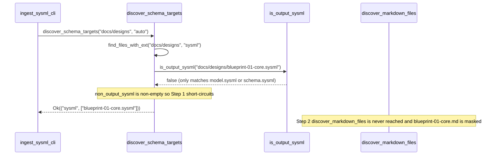

## 1. Context and References

<!-- test-target: crates/ingest-sysml/tests/reproducer_tests.rs -->

- **File**: `crates/ingest-sysml/src/detectors.rs:201-390`
- **Pillar**: Semantic Traceability
- **Symptom**: `is_output_sysml` in `crates/ingest-sysml/src/detectors.rs:201-207` only matches `"model.sysml"` and `"schema.sysml"`, so when `discover_schema_targets` scans `docs/designs/` in auto mode (`detectors.rs:374-390`), generated `blueprint-01..06-*.sysml` artifacts satisfy `!is_output_sysml(p)` (`detectors.rs:378`), causing Step 1 (`detectors.rs:380-383`) to return `Ok(("sysml", non_output_sysml))` and short-circuit before Step 2 (`discover_markdown_files`, `detectors.rs:386-389`), completely masking co-located `docs/designs/blueprint-01..06-*.md` specification files.
- **Test-Target**: `crates/ingest-sysml/tests/reproducer_tests.rs`

## 2. Root Cause Analysis (5 Whys)

1. **Why does `discover_schema_targets` fail to discover `docs/designs/blueprint-01..06-*.md` when invoked on `docs/designs/` in `auto` mode?** Because Step 1 of Branch B (`crates/ingest-sysml/src/detectors.rs:376-383`) finds `blueprint-01..06-*.sysml` in `non_output_sysml` and returns `Ok(("sysml", non_output_sysml))` immediately, short-circuiting before Step 2 (`discover_markdown_files` at `detectors.rs:386-389`) can execute.
2. **Why are generated `blueprint-01..06-*.sysml` files placed into `non_output_sysml` during Step 1 partitioning?** Because `sysml_files.into_iter().partition(|p| !is_output_sysml(p))` at `crates/ingest-sysml/src/detectors.rs:377-378` classifies every `.sysml` file for which `is_output_sysml(p)` returns `false` as a primary native SysML input model.
3. **Why does `is_output_sysml(p)` return `false` for `blueprint-01..06-*.sysml` companion files?** Because `is_output_sysml` (`crates/ingest-sysml/src/detectors.rs:201-207`) checks only exact filename equality `name == "model.sysml" || name == "schema.sysml"` and does not recognize `blueprint-*.sysml` companion artifacts or `.sysml` files that have a co-located `.md` source file with the same stem.
4. **Why were `blueprint-*.sysml` companion files not excluded alongside `model.sysml` and `schema.sysml`?** Because `is_output_sysml` was originally written assuming `schema/` only ever contained single-file `model.sysml` or `schema.sysml` compiler outputs, predating the `docs/designs/blueprint-XX-<slug>.sysml` metamodel persistence contract where each markdown blueprint co-exists with a generated `.sysml` companion file in the same directory.
5. **Why does this violate Semantic Traceability?** Because automated Level 0 ingestion (`ingest-sysml`) relies on `discover_schema_targets` in `auto` mode to deterministically locate and parse authoritative markdown design blueprints in `docs/designs/`, and any test or caller that runs after `.sysml` companions are emitted silently ingests the companion `.sysml` files instead of exercising markdown blueprint extraction on `docs/designs/blueprint-*.md`.

## 3. Correctness Analysis

When `discover_schema_targets(search_dir, "auto")` executes in `crates/ingest-sysml/src/detectors.rs`, Branch B (`detectors.rs:374-390`) implements auto-discovery precedence across directory inputs:
1. At `detectors.rs:376`, `find_files_with_ext(&search_dir, "sysml")` collects all `.sysml` files under `search_dir`.
2. At `detectors.rs:377-378`, those paths are partitioned by `!is_output_sysml(p)`, where `is_output_sysml` (`detectors.rs:201-207`) evaluates:
   `name == "model.sysml" || name == "schema.sysml"`.
3. In `docs/designs/`, each design blueprint `blueprint-XX-<slug>.md` is persisted alongside its companion `blueprint-XX-<slug>.sysml` file (per the `spec-blueprint-engineering` metamodel persistence contract). Because `blueprint-XX-<slug>.sysml` is neither `"model.sysml"` nor `"schema.sysml"`, `is_output_sysml(p)` returns `false`, placing all `blueprint-01..06-*.sysml` files into `non_output_sysml`.
4. At `detectors.rs:380-383`, `if !non_output_sysml.is_empty()` evaluates to `true` and returns `Ok(("sysml".to_string(), non_output_sysml))`.
5. Consequently, Step 2 (`let md_files = discover_markdown_files(&search_dir);` at `detectors.rs:386-389`) is dead code whenever companion `blueprint-*.sysml` files exist in `docs/designs/`.

This violates the **Deterministic Source Discovery & Markdown Blueprint Traceability Invariant** (`REQ-INGEST-SYSML-DETECTORS-IS-OUTPUT-SYSML` and `REQ-INGEST-SYSML-DETECTORS-DISCOVER-MARKDOWN-FILES`), which requires generated SysML output artifacts and companion persistence files to be excluded from Step 1 native `.sysml` override so co-located source `.md` blueprints are deterministically discovered.

## 4. UML Diagrams



## 5. Affected Callers / Downstream Impact

- `discover_schema_targets` (`crates/ingest-sysml/src/detectors.rs:344-434`) -- returns `("sysml", ...)` instead of `("markdown", ...)` when scanning `docs/designs/` in `"auto"` mode whenever `blueprint-*.sysml` files are present alongside `blueprint-*.md`.
- `run_ingestion` / `main` (`crates/ingest-sysml/src/main.rs`) -- invokes `discover_schema_targets` with `"auto"` format default, causing `ingest-sysml` on `docs/designs/` to skip markdown blueprint ingestion (`extract_from_markdown`) whenever companion `.sysml` files already exist on disk.

## 6. Proposed Correction

<!-- MUST NOT use regex (Check 34: deterministic linear slice/char scanning, no regex crate). MUST be domain-agnostic for upstream crates (Check 19). -->

```rust
fn is_output_sysml(p: &Path) -> bool {
    if let Some(name) = p.file_name().and_then(|s| s.to_str()) {
        if name == "model.sysml" || name == "schema.sysml" {
            return true;
        }
        if name.starts_with("blueprint-") && name.ends_with(".sysml") {
            return true;
        }
        if p.with_extension("md").exists() {
            return true;
        }
        false
    } else {
        false
    }
}
```

## 7. Relationship to Existing Issues

Discovered in audit -- new finding.

## Audit Source

Adversarial Semantic Traceability Audit
SEVERITY: Important
FILE_LOCATION: crates/ingest-sysml/src/detectors.rs:201-390
