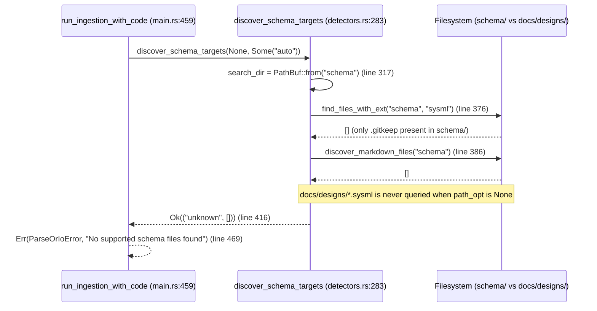

## 1. Context and References

<!-- test-target: crates/ingest-sysml/src/detectors.rs -->

- **File**: `crates/ingest-sysml/src/detectors.rs:283-417`
- **Pillar**: Semantic Traceability
- **Symptom**: `discover_schema_targets(None, None)` defaults `search_dir` exclusively to `PathBuf::from("schema")` at line 317 without falling back to `docs/designs/` when `schema/` contains only `.gitkeep`, causing auto-discovery to fall through all candidate branches and return `Ok(("unknown".to_string(), Vec::new()))` at line 416 even when authoritative `.sysml` or blueprint `.md` specification models reside in `docs/designs/`.
- **Test-Target**: `crates/ingest-sysml/src/detectors.rs`

## 2. Root Cause Analysis (5 Whys)

1. **Why does `discover_schema_targets(None, None)` return `Ok(("unknown".to_string(), Vec::new()))` in workspaces where `schema/` contains only `.gitkeep` and `.sysml` models reside in `docs/designs/`?** Because `discover_schema_targets` scans only `search_dir`, which defaults exclusively to `PathBuf::from("schema")` (`crates/ingest-sysml/src/detectors.rs:315-317`), and finds zero candidate files when `schema/` is an empty landing zone.
2. **Why is `search_dir` bound only to `PathBuf::from("schema")` when `path_opt` is `None`?** Because lines 315-317 evaluate `path_opt.map(PathBuf::from).unwrap_or_else(|| PathBuf::from("schema"))` as a single fixed directory instead of evaluating a prioritized list of default schema search roots (`schema` followed by `docs/designs`).
3. **Why does scanning only `schema/` fail in upstream or blueprint-driven repositories?** Because the Upstream Clean Landing Zone Invariant (`.pipeline/constitution.md:51`) mandates that `schema/` contain only `.gitkeep` while architectural design blueprints and Companion SysML v2 metamodels are persisted under `docs/designs/`.
4. **Why was this omission not caught by existing unit tests in `crates/ingest-sysml/src/detectors.rs`?** Because existing tests such as `test_find_files_with_ext_excludes_build_and_generated_backlog_dirs` (`crates/ingest-sysml/src/detectors.rs:780-806`) invoke `find_files_with_ext(&guard.0, "md")` with an explicit root path `Some(&guard.0)` rather than exercising `discover_schema_targets(None, None)` when `schema/` has only `.gitkeep` and `docs/designs/` holds `.sysml` files.
5. **Why did the test suite lack a Semantic Traceability assertion for default multi-root discovery?** Because `discover_schema_targets` was originally implemented assuming all Level 0 inputs reside under `schema/`, and when `docs/designs/` was introduced as a canonical specification location, default search root fallback semantics were never linked to `discover_schema_targets(None, _)`.

## 3. Correctness Analysis

When a caller invokes `discover_schema_targets(None, None)` (or `run_ingestion_with_code` in `crates/ingest-sysml/src/main.rs:459-461` is executed without `--schema`), control enters `discover_schema_targets` at `crates/ingest-sysml/src/detectors.rs:283`:

1. `path_opt` is `None`, so the single-file fast path at lines 292-313 is skipped.
2. At lines 315-317, `search_dir` is initialized via:
   ```rust
   let search_dir = path_opt
       .map(PathBuf::from)
       .unwrap_or_else(|| PathBuf::from("schema"));
   ```
3. In workspaces adhering to the clean `schema/` landing zone convention where `schema/` exists on disk with only `.gitkeep` and `.sysml` files exist under `docs/designs/`, `search_dir.exists()` at line 319 evaluates to `true`.
4. In Branch B (auto-discovery precedence, lines 374-414), `find_files_with_ext(&search_dir, "sysml")` (line 376), `discover_markdown_files(&search_dir)` (line 386), the secondary format loop (lines 392-408), and the `output_sysml` fallback (lines 411-414) all inspect only `schema/` and return empty vectors.
5. Execution falls through to line 416 and returns `Ok(("unknown".to_string(), Vec::new()))`.
6. Downstream in `crates/ingest-sysml/src/main.rs:463-473`, `disc_files.is_empty()` triggers an immediate `IngestExitCode::ParseOrIoError` (`"No supported schema files found in schema/ or schema/extracted/"`), violating the **Level 0 Schema Discovery Completeness Invariant** (`[REQ-0001/discover_schema_targets]`).

## 4. UML Diagrams



## 5. Affected Callers / Downstream Impact

- `crates/ingest-sysml/src/main.rs:459-473` (`run_ingestion_with_code`) -- Invokes `discover_schema_targets(args.schema.as_deref(), Some(&args.format))`. Whenever `--schema` is omitted (`None`) in a workspace where `schema/` contains only `.gitkeep` and `.sysml` specifications reside in `docs/designs/`, `ingest-sysml` fails with exit code `1` (`No supported schema files found in schema/ or schema/extracted/`).
- Direct library callers of `ingest_sysml::detectors::discover_schema_targets(None, None)` or `discover_schema_targets(None, Some("sysml"))` -- Receive `Ok(("unknown", vec![]))` or an empty file list instead of discovering `.sysml` models under `docs/designs/`.

## 6. Proposed Correction

<!-- MUST NOT use regex (Check 34: deterministic linear slice/char scanning, no regex crate). MUST be domain-agnostic for upstream crates (Check 19). -->

When `path_opt` is `None`, evaluate candidate default directories in deterministic priority order (`schema` first, then `docs/designs`) and return the first candidate root that yields discovered schema targets:

```rust
pub fn discover_schema_targets(
    path_opt: Option<&Path>,
    format_hint: Option<&str>,
) -> Result<(String, Vec<PathBuf>), String> {
    if let Some(explicit_path) = path_opt {
        return discover_schema_targets_in_dir(explicit_path, format_hint);
    }

    let default_roots = [Path::new("schema"), Path::new("docs/designs")];
    for candidate_root in default_roots {
        if candidate_root.exists() {
            let (fmt, files) = discover_schema_targets_in_dir(candidate_root, format_hint)?;
            if !files.is_empty() {
                return Ok((fmt, files));
            }
        }
    }

    Ok(("unknown".to_string(), Vec::new()))
}
```

## 7. Relationship to Existing Issues

Discovered in audit -- new finding.

## Audit Source

Adversarial Semantic Traceability Audit
SEVERITY: Important
FILE_LOCATION: crates/ingest-sysml/src/detectors.rs:283-417
