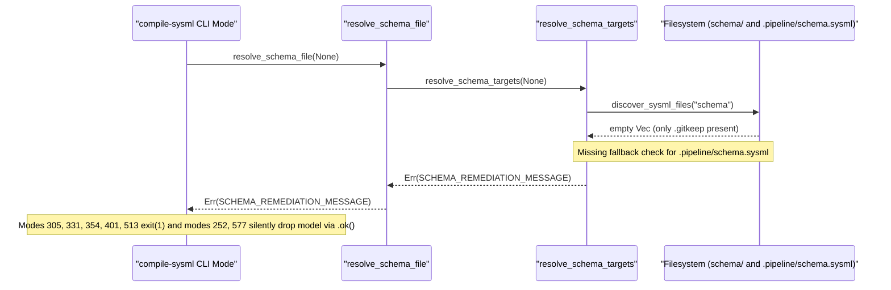

## 1. Context and References

<!-- test-target: crates/compile-sysml/tests/reproducer_tests.rs -->

- **File**: `crates/compile-sysml/src/main.rs:819-904`
- **Pillar**: Semantic Traceability
- **Symptom**: When `compile-sysml` is invoked without `--schema` (`explicit_path == None`) in a downstream workspace where the Single Source of Truth resides at `.pipeline/schema.sysml` and `schema/` contains only `.gitkeep`, `resolve_schema_targets(None)` (`crates/compile-sysml/src/main.rs:836-849`) inspects only `Path::new("schema")` (line 837) and returns `Err(SCHEMA_REMEDIATION_MESSAGE.to_string())` (line 848), causing `--compile`, `--export-mbd` (line 305), `--slice-package` (line 331), `--emit-flutter-contracts` (line 354), `--stpa-transpile` (line 401), and `--forward-sync` (line 513) to exit with code 1 while `--inject-safety-docstrings` (line 252) and `--reverse-sync` (line 577) silently drop the schema model.
- **Test-Target**: `crates/compile-sysml/tests/reproducer_tests.rs`

## 2. Root Cause Analysis (5 Whys)

1. **Why do `--compile`, `--export-mbd`, `--slice-package`, `--emit-flutter-contracts`, `--stpa-transpile`, and `--forward-sync` fail with exit code 1 (and `--inject-safety-docstrings` and `--reverse-sync` silently drop the model) when `.pipeline/schema.sysml` is present and `schema/` contains only `.gitkeep`?** Because `resolve_schema_targets(None)` and `resolve_schema_file(None)` (`crates/compile-sysml/src/main.rs:819-904`) fail to resolve `.pipeline/schema.sysml` when `schema/` contains no `.sysml` files, returning `Err(SCHEMA_REMEDIATION_MESSAGE.to_string())`.
2. **Why does `resolve_schema_targets(None)` return `Err(SCHEMA_REMEDIATION_MESSAGE.to_string())` when `schema/` contains only `.gitkeep`?** Because lines 836-849 only inspect `Path::new("schema")` via `discover_sysml_files(schema_dir)` and immediately fall through to `Err(SCHEMA_REMEDIATION_MESSAGE.to_string())` when the discovered `.sysml` vector is empty.
3. **Why did `resolve_schema_targets` check only `Path::new("schema")` for default discovery?** Because `resolve_schema_targets` and `SCHEMA_REMEDIATION_MESSAGE` (`crates/compile-sysml/src/main.rs:62-68`) were originally authored under the assumption that all `.sysml` files reside inside `schema/` rather than the canonical `.pipeline/schema.sysml` Single Source of Truth location.
4. **Why do `--inject-safety-docstrings` (line 252) and `--reverse-sync` (line 577) silently drop the schema model instead of failing or loading `.pipeline/schema.sysml`?** Because those callers wrap `resolve_schema_file(args.schema.clone()).ok()` into an `Option<PathBuf>`, converting the `Err` from `resolve_schema_targets` into `None` and proceeding with an empty or absent SysML model.
5. **Why was this discrepancy between `.pipeline/schema.sysml` SSOT governance and `compile-sysml` default target discovery not caught by semantic traceability tests?** Because unit tests for `resolve_schema_targets` exercised explicit file paths or populated `schema/` directories without verifying fallback resolution to `.pipeline/schema.sysml` when `schema/` holds only `.gitkeep`.

## 3. Correctness Analysis

Under `.agents/AGENTS.md` (Repository Role & Scope Classification), downstream projects store their authoritative SysML v2 Single Source of Truth at `.pipeline/schema.sysml`, while `schema/` may remain a clean landing zone containing only `.gitkeep`.
1. In `crates/compile-sysml/src/main.rs:819-864`, `resolve_schema_targets(explicit_path)` handles both `Some(path)` and `None`.
2. When `explicit_path` is `None` (lines 836-849 in the unpatched baseline), `let schema_dir = Path::new("schema");` checks `schema_dir.is_dir()` and calls `discover_sysml_files(schema_dir)`. When `schema/` contains only `.gitkeep`, `files.is_empty()` is true, and execution reaches `Err(SCHEMA_REMEDIATION_MESSAGE.to_string())` (`crates/compile-sysml/src/main.rs:62-68`), which misdirects the user that no `.sysml` schema file was found in `schema/`.
3. Similarly, if a caller passes `Some(PathBuf::from("schema"))` when `schema/` contains only `.gitkeep`, `discover_sysml_files(&path)` returns an empty vector and fails unless `.pipeline/schema.sysml` is checked as a fallback.
4. All callers relying on `resolve_schema_targets` or `resolve_schema_file` (`crates/compile-sysml/src/main.rs:893-904`) and `load_schema_package` (`crates/compile-sysml/src/main.rs:906-928`) are impacted:
   - Hard abort (`process::exit(1)`): `--export-mbd` (line 305), `--slice-package` (line 331), `--emit-flutter-contracts` (line 354), `--stpa-transpile` (line 401), `--forward-sync` (line 513), and default `--compile`.
   - Silent model drop (`resolve_schema_file(...).ok()`): `--inject-safety-docstrings` (line 252) and `--reverse-sync` (line 577) discard the error and run without the `.pipeline/schema.sysml` AST model, violating the **Pure Schema-Driven Compiler Invariant** and **Semantic Traceability** pillar.

## 4. UML Diagrams



## 5. Affected Callers / Downstream Impact

- `run_cli` (`--inject-safety-docstrings` mode, `crates/compile-sysml/src/main.rs:252`) -- calls `resolve_schema_file(args.schema.clone()).ok()`, silently dropping the schema model when `args.schema` is `None` and only `.pipeline/schema.sysml` exists.
- `run_cli` (`--export-mbd` mode, `crates/compile-sysml/src/main.rs:305`) -- calls `load_schema_package(args.schema.clone())` -> `resolve_schema_targets`, exiting with code 1.
- `run_cli` (`--slice-package` mode, `crates/compile-sysml/src/main.rs:331`) -- calls `load_schema_package(args.schema.clone())` -> `resolve_schema_targets`, exiting with code 1.
- `run_cli` (`--emit-flutter-contracts` mode, `crates/compile-sysml/src/main.rs:354`) -- calls `resolve_schema_file(args.schema.clone())`, exiting with code 1.
- `run_cli` (`--stpa-transpile` mode, `crates/compile-sysml/src/main.rs:401`) -- calls `resolve_schema_file(args.schema.clone())`, exiting with code 1.
- `run_cli` (`--forward-sync` mode, `crates/compile-sysml/src/main.rs:513`) -- calls `resolve_schema_file(args.schema.clone())`, exiting with code 1.
- `run_cli` (`--reverse-sync` mode, `crates/compile-sysml/src/main.rs:577`) -- calls `resolve_schema_file(args.schema.clone()).ok()`, silently dropping the schema model.
- `run_cli` (default `--compile` mode, `crates/compile-sysml/src/main.rs:640`) -- calls `resolve_schema_targets(args.schema.clone())`, exiting with code 1.

## 6. Proposed Correction

<!-- MUST NOT use regex (Check 34: deterministic linear slice/char scanning, no regex crate). MUST be domain-agnostic for upstream crates (Check 19). -->

```rust
const SCHEMA_REMEDIATION_MESSAGE: &str = "\
Error: No .sysml schema file found in schema/ or .pipeline/schema.sysml.
If starting from unstructured OEM prose manuals, PDF documentation, or BOM markdown tables:
  1. Place your OEM documentation or extract tables into schema/ or schema/extracted/.
  2. Execute Step 0.0 Level 0 OEM Ground Truth Ingestion:
     ./target/release/ingest-sysml --schema <path_to_markdown> --format markdown --out .pipeline/schema.sysml
  3. Re-run ./target/release/compile-sysml --compile to satisfy the compilation gate.";

pub fn resolve_schema_targets(explicit_path: Option<PathBuf>) -> Result<SchemaTarget, String> {
    if let Some(path) = explicit_path {
        if path.is_file() {
            return Ok(SchemaTarget::SingleFile(path));
        } else if path.is_dir() {
            let files = discover_sysml_files(&path);
            if files.is_empty() {
                if path.file_name().is_some_and(|n| n == "schema") {
                    let ws_root = path
                        .parent()
                        .filter(|p| !p.as_os_str().is_empty())
                        .unwrap_or_else(|| Path::new("."));
                    let fallback = ws_root.join(".pipeline").join("schema.sysml");
                    if fallback.is_file() {
                        return Ok(SchemaTarget::SingleFile(fallback));
                    }
                }
                return Err(format!(
                    "Error: No .sysml files found in directory: {}",
                    path.display()
                ));
            }
            if let [only] = files.as_slice() {
                return Ok(SchemaTarget::SingleFile(only.clone()));
            }
            return Ok(SchemaTarget::Directory(path, files));
        }
        return Err(format!(
            "Error: Schema file does not exist: {}",
            path.display()
        ));
    }

    let schema_dir = Path::new("schema");
    if schema_dir.is_dir() {
        let files = discover_sysml_files(schema_dir);
        if !files.is_empty() {
            if let [only] = files.as_slice() {
                return Ok(SchemaTarget::SingleFile(only.clone()));
            }
            return Ok(SchemaTarget::Directory(schema_dir.to_path_buf(), files));
        }
    }

    let pipeline_fallback = Path::new(".pipeline/schema.sysml");
    if pipeline_fallback.is_file() {
        return Ok(SchemaTarget::SingleFile(pipeline_fallback.to_path_buf()));
    }

    Err(SCHEMA_REMEDIATION_MESSAGE.to_string())
}
```

## 7. Relationship to Existing Issues

Discovered in audit -- new finding.

## Audit Source

Adversarial Semantic Traceability Audit
SEVERITY: Important
FILE_LOCATION: crates/compile-sysml/src/main.rs:819-904
