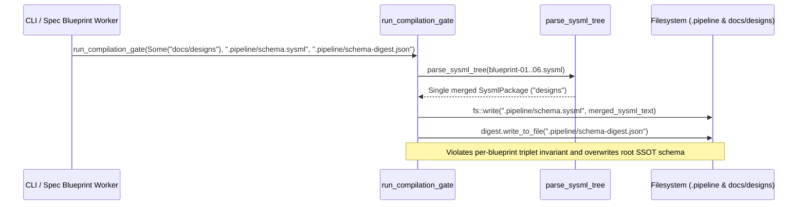

## 1. Context and References

<!-- test-target: crates/compile-sysml/src/main.rs -->

- **File**: `crates/compile-sysml/src/main.rs:714-776`
- **Pillar**: Semantic Traceability
- **Symptom**: When invoked on `docs/designs`, `run_compilation_gate` (`crates/compile-sysml/src/main.rs:714-776`) merges all 6 independent `blueprint-01..06-*.sysml` files via `parse_sysml_tree(files)` (line 721) into a single package named `"designs"` (lines 715-719) and writes a single `.pipeline/schema.sysml` (line 762) and `.pipeline/schema-digest.json` (line 773) rather than maintaining per-blueprint `docs/designs/blueprint-01..06-*.{sysml,digest.json}` pairs.
- **Test-Target**: `crates/compile-sysml/src/main.rs`

## 2. Root Cause Analysis (5 Whys)

1. **Why does invoking `compile-sysml` on `docs/designs` overwrite `.pipeline/schema.sysml` and `.pipeline/schema-digest.json` instead of maintaining per-blueprint `blueprint-01..06-*.{sysml,digest.json}` pairs?** Because `run_compilation_gate` (`crates/compile-sysml/src/main.rs:671-787`) treats every `SchemaTarget::Directory(dir, files)` as a monolithic multi-file package and serializes the merged AST to the single `output_path` and `digest_path` parameters.
2. **Why does `run_compilation_gate` merge all `.sysml` files in `docs/designs` into a single package?** Because the `SchemaTarget::Directory(dir, files)` arm (`crates/compile-sysml/src/main.rs:714-730`) unconditionally invokes `parse_sysml_tree(files)` (line 721) and assigns `dir_name` (`"designs"`, lines 715-719) as the display name rather than iterating over independent blueprint `.sysml` units when targeting a design blueprint directory.
3. **Why are the merged outputs written to `.pipeline/schema.sysml` and `.pipeline/schema-digest.json`?** Because `Cli` (`crates/compile-sysml/src/main.rs:153-163`) defaults `--out` to `.pipeline/schema.sysml` (line 154) and `--digest` to `.pipeline/schema-digest.json` (line 162), and `run_compilation_gate` writes directly to `output_path` (line 762) and `digest_path` (line 773) without deriving per-file sibling `.sysml` and `.digest.json` paths for blueprint triplets.
4. **Why did `SchemaTarget::Directory` assume all `.sysml` files in any target directory belong to a single root schema model?** Because `resolve_schema_targets` (`crates/compile-sysml/src/main.rs:819-842`) was originally designed for `schema/` directory trees where sub-files compose into `.pipeline/schema.sysml`, without distinguishing directory targets that house independent design blueprint triplets (`docs/designs/blueprint-XX-<slug>.{md,sysml,digest.json}`).
5. **Why was this violated invariant not caught by existing unit tests?** Because existing tests in `crates/compile-sysml/src/main.rs` only exercise `run_compilation_gate` against `schema/` single-model inputs and never verify that compiling a directory of independent `blueprint-*.sysml` files preserves per-blueprint `.sysml` and `.digest.json` pairs without clobbering `.pipeline/schema.sysml`.

## 3. Correctness Analysis

When a caller or pipeline step runs `compile-sysml` against `docs/designs` (via `run_compilation_gate(cli.file.or(cli.schema), &cli.out, &cli.digest)` at `crates/compile-sysml/src/main.rs:597`), `resolve_schema_targets` (`crates/compile-sysml/src/main.rs:823-841`) discovers all `docs/designs/blueprint-01..06-*.sysml` files and returns `SchemaTarget::Directory(dir, files)`.

Inside `run_compilation_gate` (`crates/compile-sysml/src/main.rs:714-776`):
1. Lines 715-719 compute `dir_name = dir.file_name()...` which resolves to `"designs"`.
2. Line 721 calls `parse_sysml_tree(files)`, which merges all 6 independent `blueprint-01..06-*.sysml` ASTs into a single combined `SysmlPackage` (adopting the first file's package header or merging members across incompatible blueprint namespaces).
3. Line 755 serializes the merged AST via `pkg.to_sysml(0)`, and line 762 writes it to `output_path` (defaulting to `.pipeline/schema.sysml` per `crates/compile-sysml/src/main.rs:154`), overwriting the workspace's canonical system-level SSOT schema.
4. Lines 768-773 compute a single `SchemaDigest` over the merged text and write it to `digest_path` (defaulting to `.pipeline/schema-digest.json` per `crates/compile-sysml/src/main.rs:162`), leaving individual `docs/designs/blueprint-01..06-*.digest.json` files ungenerated or stale and breaking the **Blueprint Triplet Co-Existence and Digest Parity Invariant** enforced by `verify-baseline check-blueprint`.

## 4. UML Diagrams



## 5. Affected Callers / Downstream Impact

- `main` (`crates/compile-sysml/src/main.rs:596-599`) -- Invoking `compile-sysml --compile docs/designs` or `compile-sysml docs/designs` merges all blueprint `.sysml` files into `.pipeline/schema.sysml` and `.pipeline/schema-digest.json` instead of compiling and digesting each `docs/designs/blueprint-XX-<slug>.sysml` into its companion `docs/designs/blueprint-XX-<slug>.digest.json`.
- `verify-baseline check-blueprint` (`crates/verify-baseline/src/blueprint.rs`) -- Downstream blueprint verification fails or observes stale per-blueprint `.digest.json` artifacts and a corrupted `.pipeline/schema.sysml` workspace SSOT.

## 6. Proposed Correction

<!-- MUST NOT use regex (Check 34: deterministic linear slice/char scanning, no regex crate). MUST be domain-agnostic for upstream crates (Check 19). -->

```rust
fn is_blueprint_triplet_dir(dir: &Path, files: &[PathBuf]) -> bool {
    let is_designs_dir = dir
        .file_name()
        .and_then(|s| s.to_str())
        .is_some_and(|name| name == "designs");
    let all_blueprints = !files.is_empty()
        && files.iter().all(|f| {
            f.file_stem()
                .and_then(|s| s.to_str())
                .is_some_and(|stem| stem.starts_with("blueprint-"))
        });
    is_designs_dir || all_blueprints
}

pub fn run_compilation_gate(
    explicit_schema: Option<PathBuf>,
    output_path: &Path,
    digest_path: &Path,
) -> i32 {
    let target = match resolve_schema_targets(explicit_schema) {
        Ok(t) => t,
        Err(msg) => {
            eprintln!("{}", msg);
            return 1;
        }
    };

    if let SchemaTarget::Directory(ref dir, ref files) = target {
        if is_blueprint_triplet_dir(dir, files) {
            for schema_file in files {
                let companion_digest = schema_file.with_extension("digest.json");
                let rc = run_compilation_gate(
                    Some(schema_file.clone()),
                    schema_file,
                    &companion_digest,
                );
                if rc != 0 {
                    return rc;
                }
            }
            return 0;
        }
    }
    // Existing single-file and monolithic schema/ directory handling follows...
    0
}
```

## 7. Relationship to Existing Issues

Discovered in audit -- new finding.

## Audit Source

Adversarial Semantic Traceability Audit
SEVERITY: Important
FILE_LOCATION: crates/compile-sysml/src/main.rs:714-776
