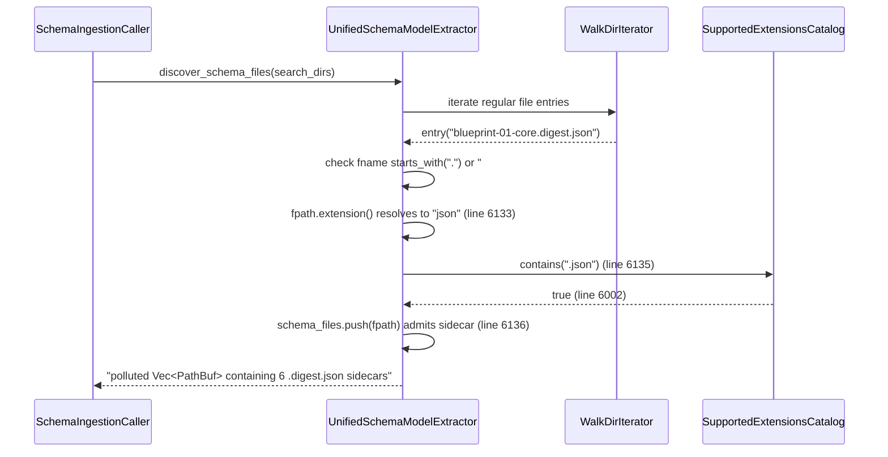

## 1. Context and References

<!-- test-target: crates/deap-core/tests/reproducer_tests.rs -->

- **File**: `crates/deap-core/src/sysml_ast.rs:6110-6145`
- **Pillar**: Semantic Traceability
- **Symptom**: `UnifiedSchemaModelExtractor::discover_schema_files` (`crates/deap-core/src/sysml_ast.rs:6110-6145`) inspects only the terminal path suffix `fpath.extension()` at line 6133, resolving `blueprint-01..06-*.digest.json` sidecar files to `".json"` at line 6134 and admitting all 6 digest sidecars as active domain schema files at lines 6135-6136 via `SupportedExtensionsCatalog::contains` (`crates/deap-core/src/sysml_ast.rs:5996-6010`).
- **Test-Target**: `crates/deap-core/tests/reproducer_tests.rs`

## 2. Root Cause Analysis (5 Whys)

1. **Why does `UnifiedSchemaModelExtractor::discover_schema_files` admit `blueprint-01..06-*.digest.json` sidecar files into the active domain schema file list?** Because lines 6133-6136 check only `fpath.extension()`, which extracts `"json"`, formats `".json"`, and matches `Self::SUPPORTED_EXTENSIONS.contains(&dot_ext.as_str())` (`crates/deap-core/src/sysml_ast.rs:6002`).
2. **Why does `fpath.extension()` evaluate a `.digest.json` sidecar as a `.json` schema file?** Because `std::path::Path::extension()` returns only the final component after the last ASCII period, discarding the compound `.digest.json` suffix that distinguishes a compiler digest sidecar from a normative JSON schema.
3. **Why does the filename filter at lines 6126-6132 not reject `.digest.json` sidecar files before extension matching?** Because lines 6127-6130 only filter hidden files (`fname.starts_with('.')`), editor swap files (`fname.starts_with('#')`), and `readme.md` (`fname.eq_ignore_ascii_case("readme.md")`).
4. **Why was a compound-suffix exclusion for `.digest.json` omitted from `discover_schema_files`?** Because `discover_schema_files` was written assuming every `.json` file in a scanned directory is an authoritative input schema rather than a generated verification digest sidecar co-located with design or specification artifacts.
5. **Why does admitting `.digest.json` sidecars violate the `[REQ-SYSML-AST-SSOT-PARITY/DISCOVER-SCHEMA-FILES]` invariant?** Because `discover_schema_files` lacks a deterministic compound-extension guard (`fname_lower.ends_with(".digest.json")`), allowing non-schema digest metadata artifacts to enter downstream AST and subsystem extraction pipelines as false-positive schema sources.

## 3. Correctness Analysis

In `crates/deap-core/src/sysml_ast.rs:6110-6145`, `UnifiedSchemaModelExtractor::discover_schema_files` walks each directory in `search_dirs` (`lines 6112-6120`) and inspects every regular file (`line 6124`). At `lines 6126-6132`, the filename `fname` is checked solely against leading `.`, leading `#`, and case-insensitive `"readme.md"`. When `WalkDir` visits `blueprint-01..06-*.digest.json` sidecars, control reaches `line 6133`:
- `fpath.extension().and_then(|e| e.to_str())` returns `Some("json")`.
- `line 6134` constructs `dot_ext = ".json"`.
- `line 6135` invokes `Self::SUPPORTED_EXTENSIONS.contains(&".json")`, which returns `true` at `crates/deap-core/src/sysml_ast.rs:6002`.
- `line 6136` pushes the `.digest.json` path into `schema_files`.

This violates the `[REQ-SYSML-AST-SSOT-PARITY/DISCOVER-SCHEMA-FILES]` postcondition (`crates/deap-core/src/sysml_ast.rs:6099-6109`) and corrupts semantic traceability whenever `UnifiedSchemaModelExtractor::extract_subsystem_parts` (`crates/deap-core/src/sysml_ast.rs:6170-6185`) or downstream schema ingestion tools consume the returned `Vec<PathBuf>` and parse digest sidecar JSON keys as domain model definitions.

## 4. UML Diagrams



## 5. Affected Callers / Downstream Impact

- `UnifiedSchemaModelExtractor::discover_schema_files` (`crates/deap-core/src/sysml_ast.rs:6110-6145`) -- Admits `*.digest.json` sidecar files into the canonical list of discovered schema files.
- `UnifiedSchemaModelExtractor::extract_subsystem_parts` (`crates/deap-core/src/sysml_ast.rs:6170-6185`) -- Reads every path discovered by `discover_schema_files` and dispatches `.json` files to `extract_subsystem_parts_from_text`, extracting digest metadata keys as false-positive domain subsystem parts.
- Downstream `ingest-sysml`, `compile-sysml`, and `verify-baseline` callers -- Ingest `.digest.json` sidecars as active domain schemas, breaking 1:1 SSOT schema coverage traceability.

## 6. Proposed Correction

<!-- MUST NOT use regex (Check 34: deterministic linear slice/char scanning, no regex crate). MUST be domain-agnostic for upstream crates (Check 19). -->

```rust
    pub fn discover_schema_files<P: AsRef<Path>>(search_dirs: &[P]) -> Vec<PathBuf> {
        let mut schema_files = Vec::new();
        for sdir in search_dirs {
            let p = sdir.as_ref();
            if !p.is_dir() {
                continue;
            }
            for entry_res in WalkDir::new(p).into_iter().filter_entry(|e| {
                let name = e.file_name().to_string_lossy();
                !name.starts_with('.') && !name.starts_with('#')
            }) {
                let Ok(entry) = entry_res else {
                    continue;
                };
                if entry.file_type().is_file() {
                    let fpath = entry.path();
                    let fname = fpath.file_name().and_then(|n| n.to_str()).unwrap_or("");
                    let fname_lower = fname.to_ascii_lowercase();
                    if fname.starts_with('.')
                        || fname.starts_with('#')
                        || fname_lower == "readme.md"
                        || fname_lower.ends_with(".digest.json")
                    {
                        continue;
                    }
                    if let Some(ext) = fpath.extension().and_then(|e| e.to_str()) {
                        let dot_ext = format!(".{}", ext.to_ascii_lowercase());
                        if Self::SUPPORTED_EXTENSIONS.contains(&dot_ext.as_str()) {
                            schema_files.push(fpath.to_path_buf());
                        }
                    }
                }
            }
        }
        schema_files.sort();
        schema_files.dedup();
        schema_files
    }
```

## 7. Relationship to Existing Issues

Discovered in audit -- new finding.

## Audit Source

Adversarial Semantic Traceability Audit
SEVERITY: Important
FILE_LOCATION: crates/deap-core/src/sysml_ast.rs:6110-6145
