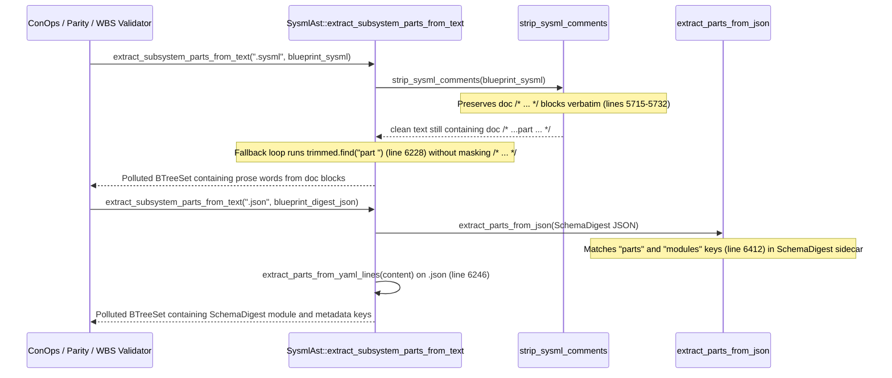

## 1. Context and References

<!-- test-target: crates/deap-core/tests/extract_subsystem_parts_doc_and_digest_tests.rs -->

- **File**: `crates/deap-core/src/sysml_ast.rs:5715-6468`
- **Pillar**: Semantic Traceability
- **Symptom**: `SysmlAst::extract_subsystem_parts_from_text` (`crates/deap-core/src/sysml_ast.rs:6214-6246`) extracts false-positive English prose words from `doc /* ... */` blocks in `.sysml` files (including `blueprint-01..06-*.sysml`) because `strip_sysml_comments` (`lines 5715-5732`) preserves `doc /* ... */` comments while the fallback scanner (`lines 6226-6239`) performs an unmasked, unanchored `trimmed.find("part ")` search; additionally, the `.json` branch (`lines 6240-6246, 6395-6468`) and `extract_subsystem_parts` (`lines 6170-6186`) ingest `blueprint-01..06-*.digest.json` (`SchemaDigest` sidecars) and extract `"parts"` and `"modules"` keys and YAML-fallback tokens as domain subsystem parts.
- **Test-Target**: `crates/deap-core/tests/extract_subsystem_parts_doc_and_digest_tests.rs`

## 2. Root Cause Analysis (5 Whys)

1. **Why does `SysmlAst::extract_subsystem_parts_from_text` inject bogus subsystem names from `.sysml` documentation blocks and `.digest.json` artifacts into the required subsystem part set?** Because the `.sysml` fallback scanner (`crates/deap-core/src/sysml_ast.rs:6226-6239`) matches `"part "` anywhere inside preserved `doc /* ... */` comments, and the `.json` path (`lines 6240-6246, 6395-6468`) unconditionally extracts `"parts"` and `"modules"` entries and runs raw YAML line scanning on JSON sidecars.
2. **Why are `doc /* ... */` block comments still present in `clean` after calling `strip_sysml_comments(content)` at `sysml_ast.rs:6219`?** Because `strip_sysml_comments` (`sysml_ast.rs:5715-5732`) checks `trimmed_before.ends_with("doc")` (`lines 5715-5721`) and intentionally preserves the entire `/* ... */` block in `out` (`lines 5723-5732`) so `parse_part_defs` can associate `doc` strings with AST nodes.
3. **Why does the fallback line scanner at `sysml_ast.rs:6226-6239` extract prose words following `"part "` inside `doc /* ... */` blocks in `blueprint-01..06-*.sysml`?** Because `if let Some(pos) = trimmed.find("part ")` (`line 6228`) neither strips `/* ... */` blocks nor requires `part` to appear at a statement boundary followed by `def <Ident>` or `<Ident> :` / `<Ident> :>`, so any prose phrase such as `"part of"` or `"counterpart "` inside `doc /* ... */` matches and extracts the subsequent token (`lines 6229-6237`).
4. **Why does `.json` extraction (`sysml_ast.rs:6240-6246, 6395-6468`) extract `"parts"` and `"modules"` entries and keys from `blueprint-01..06-*.digest.json`?** Because `extract_subsystem_parts` (`lines 6170-6186`) does not exclude `.digest.json` sidecar files, `extract_parts_from_json` (`lines 6412-6456`) treats any JSON object with `"parts"` or `"modules"` keys (including `SchemaDigest` sidecars containing `"format_version"` and `"source_hash"`) as a domain component manifest, and `extract_parts_from_yaml_lines` (`line 6246`) runs unconditionally on `.json` text even after `serde_json::from_str` succeeds.
5. **Why were `doc /* ... */` stripping, keyword-boundary validation, and `SchemaDigest` JSON filtering omitted from `extract_subsystem_parts_from_text`?** Because the fallback scanner assumed `strip_sysml_comments` removed all block comments and assumed all `.json` files in `schema/` were user-authored topology schemas rather than compiler-emitted `blueprint-01..06-*.digest.json` `SchemaDigest` artifacts.

## 3. Correctness Analysis

- **Violated Invariant**: `REQ-SYSML-AST-SSOT-PARITY/EXTRACT-SUBSYSTEM-PARTS-TEXT` (`crates/deap-core/src/sysml_ast.rs:6195-6213`) and the Pure Schema-Driven Compiler Invariant (`.pipeline/constitution.md:50`). `SysmlAst::extract_subsystem_parts` and `SysmlAst::extract_subsystem_parts_from_text` must return only declared structural subsystem/component identifiers from authoritative schema definitions.
- **Data Flow 1 -- Unmasked `doc /* ... */` Prose Extraction in `.sysml` (`sysml_ast.rs:5715-5732, 6218-6239`)**:
  1. `SysmlAst::extract_subsystem_parts` (`sysml_ast.rs:6170-6186`) reads a `.sysml` file (such as `schema/blueprints/blueprint-01..06-*.sysml`) and invokes `Self::extract_subsystem_parts_from_text(".sysml", &content)` (`line 6181`).
  2. At `sysml_ast.rs:6219`, `strip_sysml_comments(content)` is called. Whenever `/*` is preceded by `doc` (`lines 5715-5721`), `is_doc_block` is `true` and lines `5723-5732` push `/* ... */` verbatim into `clean`.
  3. At `sysml_ast.rs:6226-6239`, the fallback loop iterates over `clean.lines()`. On line `6228`, `trimmed.find("part ")` searches the raw line without tracking whether the line is inside a `/* ... */` block or string literal, and without verifying that `"part "` is a standalone keyword at the start of a declaration (`part def <Ident>` or `part <Ident> :` / `part <Ident> :>`).
  4. When a `doc /* ... */` block in `blueprint-01..06-*.sysml` contains prose such as `"This element is part of the subsystem"` or `"Each counterpart Module handles..."`, `trimmed.find("part ")` matches `"part "` (including the suffix of `"counterpart "`), slices `rest` at `pos + 5` (`line 6229`), strips an optional `"def "` prefix (`line 6230`), takes the next alphanumeric identifier (`lines 6231-6234`), and inserts `"of"` or `"Module"` into `part_names` (`line 6236`).
- **Data Flow 2 -- `SchemaDigest` `.digest.json` Sidecar Extraction (`sysml_ast.rs:6170-6186, 6240-6246, 6395-6468`)**:
  1. During schema directory traversal, `blueprint-01..06-*.digest.json` files carry extension `.json`, so `extract_subsystem_parts` (`lines 6175-6181`) dispatches them to `extract_subsystem_parts_from_text(".json", &content)`.
  2. At `sysml_ast.rs:6242-6243`, `serde_json::from_str` parses the `SchemaDigest` JSON and calls `Self::extract_parts_from_json(&json_val, &mut part_names)`.
  3. `extract_parts_from_json` (`lines 6395-6468`) inspects `"subsystems"`, `"components"`, `"parts"`, and `"modules"` on every JSON object (`line 6412`) and recurses across all child values (`lines 6457-6460`). Because `SchemaDigest` serializes top-level `"modules"` (`Vec<ModuleDigest>`) and `"parts"` (`Vec<PartDigest>`) arrays (as well as any nested object maps keyed by `"parts"` or `"modules"` at `lines 6439-6446`), package/module names from `"modules"` and nested keys from `.digest.json` are extracted as subsystem parts.
  4. Furthermore, at `sysml_ast.rs:6246`, `Self::extract_parts_from_yaml_lines(content, &mut part_names)` is unconditionally called even when `norm_ext == ".json"` and `serde_json::from_str` already succeeded, scanning raw JSON lines under `"parts":` and `"modules":` headers.

## 4. UML Diagrams



## 5. Affected Callers / Downstream Impact

- `SysmlAst::extract_subsystem_parts` (`crates/deap-core/src/sysml_ast.rs:6170-6186`) -- aggregates extracted part identifiers across schema files (`blueprint-01..06-*.sysml` and `blueprint-01..06-*.digest.json`), propagating false-positive prose tokens and `SchemaDigest` module names to all callers.
- `verify-baseline` Check 19 / Model Coverage & ConOps / WBS Subsystem Parity Validators (`crates/verify-baseline/src/lib.rs`, `crates/assemble-conops/src/lib.rs`, `crates/deap-core/src/wbs.rs`) -- false-positive subsystem identifiers extracted from `doc /* ... */` prose or `.digest.json` sidecars cause phantom "uncovered subsystem part" failures because downstream specifications and FMECA/ConOps tables do not model English prose words or `SchemaDigest` package headers as physical subsystem parts.

## 6. Proposed Correction

<!-- MUST NOT use regex (Check 34: deterministic linear slice/char scanning, no regex crate). MUST be domain-agnostic for upstream crates (Check 19). -->

```rust
    fn strip_all_block_comments_and_strings(input: &str) -> String {
        let mut out = String::with_capacity(input.len());
        let mut chars = input.chars().peekable();
        let mut in_string = false;
        while let Some(c) = chars.next() {
            if in_string {
                if c == '\\' {
                    let _ = chars.next();
                } else if c == '"' {
                    in_string = false;
                    out.push(' ');
                }
                continue;
            }
            if c == '"' {
                in_string = true;
                out.push(' ');
                continue;
            }
            if c == '/' && chars.peek() == Some(&'*') {
                let _ = chars.next();
                out.push(' ');
                while let Some(nc) = chars.next() {
                    if nc == '\n' {
                        out.push('\n');
                    } else if nc == '*' && chars.peek() == Some(&'/') {
                        let _ = chars.next();
                        break;
                    }
                }
                continue;
            }
            out.push(c);
        }
        out
    }

    pub fn extract_subsystem_parts<P: AsRef<Path>>(file_paths: &[P]) -> BTreeSet<String> {
        let mut part_names = BTreeSet::new();
        for fp in file_paths {
            let p = fp.as_ref();
            let file_name = p
                .file_name()
                .and_then(|n| n.to_str())
                .unwrap_or("")
                .to_ascii_lowercase();
            if file_name.ends_with(".digest.json") {
                continue;
            }
            if let Ok(content) = std::fs::read_to_string(p) {
                let ext = p
                    .extension()
                    .and_then(|e| e.to_str())
                    .unwrap_or("")
                    .to_ascii_lowercase();
                let dot_ext = format!(".{}", ext);
                let extracted = Self::extract_subsystem_parts_from_text(&dot_ext, &content);
                part_names.extend(extracted);
            }
        }
        part_names
    }

    pub fn extract_subsystem_parts_from_text(ext: &str, content: &str) -> BTreeSet<String> {
        let mut part_names = BTreeSet::new();
        let norm_ext = ext.to_ascii_lowercase();

        if norm_ext == ".sysml" {
            let clean = strip_sysml_comments(content);
            for p in parse_part_defs(&clean) {
                if !p.name.is_empty() {
                    part_names.insert(p.name);
                }
            }
            let no_doc = Self::strip_all_block_comments_and_strings(&clean);
            for line in no_doc.lines() {
                let trimmed = line.trim();
                let after_vis = trimmed
                    .strip_prefix("public ")
                    .or_else(|| trimmed.strip_prefix("private "))
                    .or_else(|| trimmed.strip_prefix("protected "))
                    .or_else(|| trimmed.strip_prefix("abstract "))
                    .unwrap_or(trimmed)
                    .trim_start();
                if let Some(rest) = after_vis.strip_prefix("part ") {
                    let rest = rest.trim_start();
                    let (is_def, rest) = if let Some(after_def) = rest.strip_prefix("def ") {
                        (true, after_def.trim_start())
                    } else {
                        (false, rest)
                    };
                    let ident: String = rest
                        .chars()
                        .take_while(|c| c.is_ascii_alphanumeric() || *c == '_')
                        .collect();
                    let trailing = rest.get(ident.len()..).unwrap_or("").trim_start();
                    let valid_usage = is_def
                        || trailing.starts_with(':')
                        || trailing.starts_with('{')
                        || trailing.starts_with('[')
                        || trailing.starts_with(';');
                    if valid_usage
                        && !ident.is_empty()
                        && ident != "def"
                        && is_valid_subsystem_identifier(&ident)
                    {
                        part_names.insert(ident);
                    }
                }
            }
        } else if norm_ext == ".json" {
            if let Ok(json_val) = serde_json::from_str::<serde_json::Value>(content) {
                let is_schema_digest = json_val.as_object().is_some_and(|m| {
                    m.contains_key("format_version")
                        && m.contains_key("source_hash")
                        && !m.contains_key("schema_nodes")
                });
                if !is_schema_digest {
                    Self::extract_parts_from_json(&json_val, &mut part_names);
                }
            }
        } else if norm_ext == ".yaml" || norm_ext == ".yml" {
            if let Ok(json_val) = serde_json::from_str::<serde_json::Value>(content) {
                Self::extract_parts_from_json(&json_val, &mut part_names);
            }
            Self::extract_parts_from_yaml_lines(content, &mut part_names);
        }
        part_names
    }
```

## 7. Relationship to Existing Issues

Discovered in audit -- new finding.

## Audit Source

Adversarial Semantic Traceability Audit
SEVERITY: Important
FILE_LOCATION: crates/deap-core/src/sysml_ast.rs:5715-6468
