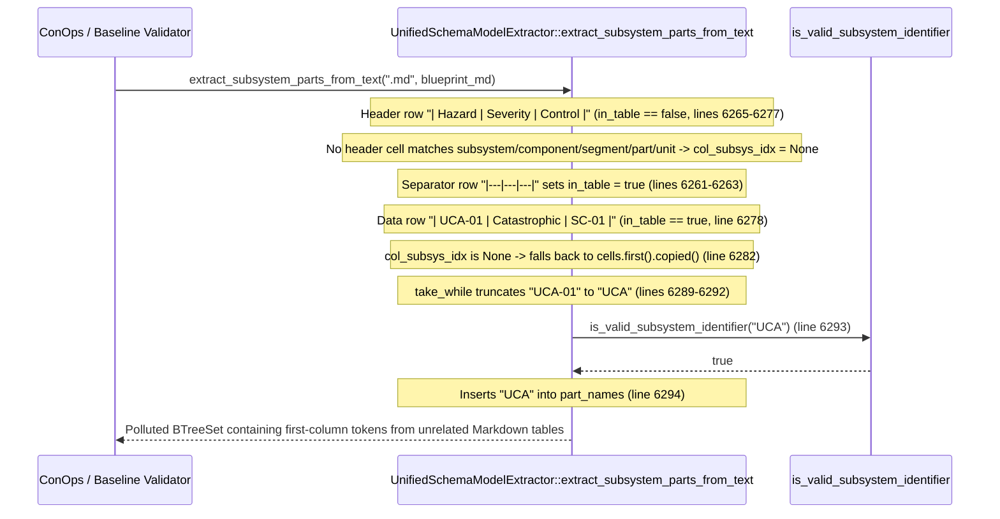

## 1. Context and References

<!-- test-target: crates/deap-core/tests/extract_subsystem_parts_md_table_tests.rs -->

- **File**: `crates/deap-core/src/sysml_ast.rs:6247-6305`
- **Pillar**: Semantic Traceability
- **Symptom**: When scanning `.md` or `.markdown` files (`crates/deap-core/src/sysml_ast.rs:6247-6302`), if a Markdown table header has no column matching `"subsystem"`, `"component"`, `"segment"`, `"part"`, or `"unit"` (`col_subsys_idx` remains `None` at lines `6266-6277`), line `6282` unconditionally falls back to `cells.first().copied()`, extracting the first cell (or its leading alphanumeric word via `take_while` at lines `6289-6292`) of every row of every unrelated Markdown table in `docs/designs/blueprint-01..06-*.md` and `schema/*.md` as a domain subsystem part.
- **Test-Target**: `crates/deap-core/tests/extract_subsystem_parts_md_table_tests.rs`

## 2. Root Cause Analysis (5 Whys)

1. **Why does `UnifiedSchemaModelExtractor::extract_subsystem_parts_from_text` extract arbitrary first-column cells from unrelated Markdown tables in `docs/designs/blueprint-01..06-*.md` as domain subsystem parts?** Because at `crates/deap-core/src/sysml_ast.rs:6279-6283`, when `col_subsys_idx` is `None`, the data-row branch executes `else { cells.first().copied() }` (`line 6282`) instead of skipping tables that lack a subsystem/component header column.
2. **Why is `col_subsys_idx` `None` when scanning non-architectural Markdown tables (`sysml_ast.rs:6265-6277`)?** Because the header-row loop (`if !in_table`, lines `6265-6277`) sets `col_subsys_idx = Some(idx)` only when a header cell's lowercase text contains `"subsystem"`, `"component"`, `"segment"`, `"part"`, or `"unit"`; for all other tables (such as STPA/FMECA matrices, parameter budgets, revision histories, glossaries, or requirement traceability tables in `docs/designs/blueprint-01..06-*.md`), no header cell matches and `col_subsys_idx` stays `None`.
3. **Why did the author include the `else { cells.first().copied() }` fallback at `sysml_ast.rs:6282` after already implementing header-column detection at lines `6266-6277`?** Because the implementation assumed every Markdown table inside a scanned `.md` file was a subsystem inventory table whose first column defaulted to a subsystem identifier even when the header used an unrecognized label.
4. **Why do prose phrases, requirement IDs, and hazard tags in the first column of unrelated Markdown tables pass `is_valid_subsystem_identifier` (`sysml_ast.rs:6289-6295`)?** Because lines `6289-6292` apply `.chars().take_while(|c| c.is_ascii_alphanumeric() || *c == '_').collect()` before calling `is_valid_subsystem_identifier(&clean_ident)` (`line 6293`), silently truncating hyphenated IDs (e.g. `UCA-01` to `UCA`, `REQ-04` to `REQ`) and multi-word prose cells (e.g. `Nominal operation` to `Nominal`) into valid-looking single-word ASCII identifiers.
5. **Why did existing unit tests in `crates/deap-core/src/sysml_ast.rs:8263-8276` fail to catch this defect?** Because `test_unified_schema_model_extractor_multi_format` (`lines 8263-8276`) tests only a single positive table (`| Subsystem | Function | Allocation |`) and contains zero negative assertions verifying that unrelated Markdown tables (such as `| Hazard | Severity | Mitigation |` or `| Metric | Budget | Margin |`) in the same `.md` document are ignored.

## 3. Correctness Analysis

- **Violated Invariant**: `REQ-SYSML-AST-SSOT-PARITY/EXTRACT-SUBSYSTEM-PARTS-TEXT` (`crates/deap-core/src/sysml_ast.rs:6195-6213`) and the Pure Schema-Driven Compiler Invariant (`.pipeline/constitution.md:50`). `UnifiedSchemaModelExtractor::extract_subsystem_parts_from_text(".md", content)` must extract only subsystem and component identifiers from Markdown tables whose header explicitly declares a structural subsystem/component column.
- **Trigger-to-Failure Data Flow (`crates/deap-core/src/sysml_ast.rs:6247-6302`)**:
  1. A caller invokes `UnifiedSchemaModelExtractor::extract_subsystem_parts` (`sysml_ast.rs:6170-6186`) or `extract_subsystem_parts_from_text(".md", content)` (`line 6214`) on a Markdown specification or design blueprint (such as `docs/designs/blueprint-01..06-*.md`).
  2. At `sysml_ast.rs:6248-6250`, `in_table` is initialized to `false` and `col_subsys_idx` is initialized to `None`, iterating over `content.lines()`.
  3. When the scanner encounters an unrelated Markdown table header row (for example, `| Hazard | Severity | Rationale |` or `| Parameter | Nominal | Tolerance |`), `in_table` is `false` (`line 6265`). Lines `6266-6277` inspect each header cell for `"subsystem"`, `"component"`, `"segment"`, `"part"`, or `"unit"`. None match, so `col_subsys_idx` remains `None`.
  4. On the next line (`|---|---|---|`), lines `6261-6264` detect the separator row and set `in_table = true`.
  5. On every subsequent data row of that unrelated table (`else` branch at `line 6278`), lines `6279-6283` evaluate:
     - `if let Some(idx) = col_subsys_idx { cells.get(idx).copied() } else { cells.first().copied() }`
     Because `col_subsys_idx` is `None`, line `6282` selects `cells.first().copied()` (the first column of the unrelated table).
  6. Lines `6285-6292` strip Markdown formatting characters (`['`', '*', '_', '[', ']']`) and truncate the cell at the first non-alphanumeric/underscore character via `.take_while(|c| c.is_ascii_alphanumeric() || *c == '_')`.
  7. Line `6293` checks `is_valid_subsystem_identifier(&clean_ident)` and line `6294` inserts `clean_ident` into `part_names`, polluting the returned `BTreeSet<String>` with first-column words from every table in the Markdown file.

## 4. UML Diagrams



## 5. Affected Callers / Downstream Impact

- `UnifiedSchemaModelExtractor::extract_subsystem_parts` (`crates/deap-core/src/sysml_ast.rs:6170-6186`) -- forwards `.md` and `.markdown` files to `extract_subsystem_parts_from_text` (`line 6181`), aggregating false-positive first-column tokens into the canonical subsystem set.
- `extract_subsystem_parts_from_markdown` (`crates/assemble-conops/src/params.rs:1248-1268`, called at `lines 1365, 2525`) -- calls `UnifiedSchemaModelExtractor::extract_subsystem_parts_from_text(".md", content)` (`line 1250`) and wraps every returned string into a `SubsystemPart` with `[TIER-1: OEM]` provenance, polluting ConOps parameter tables and subsystem inventories with unrelated Markdown table cells from `docs/designs/blueprint-01..06-*.md`.
- `load_sysml_symbol_index` (`crates/verify-baseline/src/spec_audit/mod.rs:666`), `discover_sysml_model_text` (`crates/verify-baseline/src/checks/parity_gates.rs:707`), and `discover_architectural_sysml_model_text` (`crates/verify-baseline/src/checks/parity_gates.rs:811`) -- synthesize `PartDef` AST nodes from `extract_subsystem_parts(&non_sysml_paths)`, causing downstream model coverage and safety parity checks to fail on phantom subsystem parts when `.md` files are present.

## 6. Proposed Correction

<!-- MUST NOT use regex (Check 34: deterministic linear slice/char scanning, no regex crate). MUST be domain-agnostic for upstream crates (Check 19). -->

Remove the `else { cells.first().copied() }` fallback at `crates/deap-core/src/sysml_ast.rs:6281-6283` so data rows are extracted only when `col_subsys_idx` is `Some(idx)` (i.e., the Markdown table header explicitly matched `"subsystem"`, `"component"`, `"segment"`, `"part"`, or `"unit"`), and reset `col_subsys_idx = None` before scanning each header row:

```rust
        } else if norm_ext == ".md" || norm_ext == ".markdown" {
            let mut in_table = false;
            let mut col_subsys_idx = None;
            for line in content.lines() {
                let trimmed = line.trim();
                if trimmed.starts_with('|') && trimmed.ends_with('|') {
                    let cells: Vec<&str> = trimmed
                        .split('|')
                        .map(|c| c.trim())
                        .filter(|c| !c.is_empty())
                        .collect();
                    if cells.is_empty() {
                        continue;
                    }
                    if cells.iter().all(|c| c.chars().all(|ch| ch == '-' || ch == ':' || ch.is_whitespace())) {
                        in_table = true;
                        continue;
                    }
                    if !in_table {
                        col_subsys_idx = None;
                        for (idx, cell) in cells.iter().enumerate() {
                            let clower = cell.to_ascii_lowercase();
                            if clower.contains("subsystem")
                                || clower.contains("component")
                                || clower.contains("segment")
                                || clower.contains("part")
                                || clower.contains("unit")
                            {
                                col_subsys_idx = Some(idx);
                                break;
                            }
                        }
                    } else if let Some(idx) = col_subsys_idx {
                        if let Some(raw_cand) = cells.get(idx).copied() {
                            let clean_cand = raw_cand
                                .replace(['`', '*', '_', '[', ']'], "")
                                .trim()
                                .to_string();
                            let clean_ident: String = clean_cand
                                .chars()
                                .take_while(|c| c.is_ascii_alphanumeric() || *c == '_')
                                .collect();
                            if is_valid_subsystem_identifier(&clean_ident) {
                                part_names.insert(clean_ident);
                            }
                        }
                    }
                } else {
                    in_table = false;
                    col_subsys_idx = None;
                }
            }
        }
```

## 7. Relationship to Existing Issues

Discovered in audit -- new finding.

## Audit Source

Adversarial Semantic Traceability Audit
SEVERITY: Important
FILE_LOCATION: crates/deap-core/src/sysml_ast.rs:6247-6305
