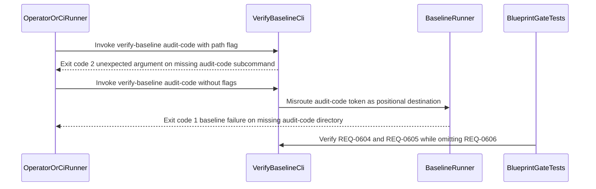

## 1. Context and References

<!-- test-target: crates/verify-baseline/tests/blueprint_gate_tests.rs -->

- **File**: `crates/verify-baseline/src/main.rs:197-606`
- **Pillar**: Semantic Traceability
- **Symptom**: `docs/designs/blueprint-06-deterministic-static-defect-dossier-auditor.md` carries `Status: Approved` for `REQ-0606` (`DeterministicStaticDefectAuditor` and `./target/release/verify-baseline audit-code`), yet `crates/verify-baseline/src/audit_code.rs` does not exist, `crates/verify-baseline/src/lib.rs:34-56` omits `pub mod audit_code`, `crates/verify-baseline/src/main.rs:197-606` omits `Command::new("audit-code")` and `Subcommands::AuditCode(AuditCodeArgs)`, and `crates/verify-baseline/tests/blueprint_gate_tests.rs:2015-2681` omits all `REQ-0606` (`AC-01`..`AC-06`) verification tests.
- **Test-Target**: `crates/verify-baseline/tests/blueprint_gate_tests.rs`

## 2. Root Cause Analysis (5 Whys)

1. **Why does invoking `verify-baseline audit-code --path <PATH> --dry-run` fail with `clap` exit code 2 (`unexpected argument '--path'`) while bare `verify-baseline audit-code` misroutes `"audit-code"` as a directory path?** Because `Cli::parse()` in `crates/verify-baseline/src/main.rs:197-468` registers only six subcommands (`check-commit-msg`, `check-output`, `check-defect`, `check-blueprint`, `setup-hooks`, `check-secrets`) and omits `Command::new("audit-code")`, `Subcommands::AuditCode(AuditCodeArgs)` (`main.rs:515-533`), and its `main()` dispatch arm (`main.rs:572-606`).
2. **Why were `Subcommands::AuditCode(AuditCodeArgs)` in `crates/verify-baseline/src/main.rs` and `pub mod audit_code;` in `crates/verify-baseline/src/lib.rs:34-56` never wired into the `verify-baseline` crate?** Because `crates/verify-baseline/src/audit_code.rs` -- specified in `docs/designs/blueprint-06-deterministic-static-defect-dossier-auditor.md:345-689` to implement `DeterministicStaticDefectAuditor`, `FivePillarStaticAstAnalyzer` (`E0601`..`E0605`), `DeterministicDossierSynthesizer`, `MermaidUmlDiagramGenerator`, and `ClosedLoopDefectPublisherGate` -- was designed and marked `Status: Approved` (`blueprint-06:6`) without executing the downstream TDD implementation work packages.
3. **Why did `crates/verify-baseline/tests/blueprint_gate_tests.rs` pass workspace test gates without failing on the unimplemented `REQ-0606` (`AC-01`..`AC-06`) contract?** Because `crates/verify-baseline/tests/blueprint_gate_tests.rs:2015-2681` implements requirement-mapped integration tests for `REQ-0604` (`AC-01`..`AC-05` at `lines 2015-2427`) and `REQ-0605` (`AC-01`..`AC-05` at `lines 2463-2679`) while `main.rs:138` realizes `REQ-0601`, but zero `#[test]` functions were added for `REQ-0606` (`AC-01`..`AC-06`).
4. **Why did `verify-baseline check-blueprint` (Check 11) and baseline blueprint realization checks (Check 37) pass on `docs/designs/blueprint-06-deterministic-static-defect-dossier-auditor.md` despite `audit_code.rs` being absent from disk?** Because `blueprint-06` anchored Section 5 `Test-Target` (`lines 309-311`) to the pre-existing `crates/verify-baseline/src/defect_dossier.rs` module and cited only pre-existing files in Section 7 `Source References` (`lines 705-716`), referencing `crates/verify-baseline/src/audit_code.rs` solely inside Section 6 prose (`line 364`) where `check_11_source_references` does not scan.
5. **Why could an `Approved` blueprint satisfy baseline verification by pointing `Test-Target` at an older module (`defect_dossier.rs`) that lacks the blueprint's declared `REQ-0606` components and CLI subcommand?** Because the blueprint-to-code semantic traceability gate checks `Test-Target` file existence and general test presence without verifying that an `Approved` blueprint's `Requirement ID` (`REQ-0606`), Section 2 `PartDef` classifiers, and Section 6.1 CLI subcommand (`audit-code`) are realized in `crates/verify-baseline/src/{lib,main}.rs` and exercised by `REQ-0606` assertions in the test target.

## 3. Correctness Analysis

`docs/designs/blueprint-06-deterministic-static-defect-dossier-auditor.md:3-10` declares `Blueprint ID: BP-06`, `Requirement ID: REQ-0606`, and `Status: Approved` targeting `crates/verify-baseline` and `crates/deap-core`. Section 2 (`blueprint-06:73-140`) defines five structural components (`DeterministicStaticDefectAuditor`, `FivePillarStaticAstAnalyzer`, `DeterministicDossierSynthesizer`, `MermaidUmlDiagramGenerator`, and `ClosedLoopDefectPublisherGate`), Section 5 (`blueprint-06:307-342`) specifies six normative acceptance criteria (`AC-01` through `AC-06` emitting diagnostics `E0601`..`E0605`), and Section 6 (`blueprint-06:343-689`) specifies the `verify-baseline audit-code` CLI contract (`AuditCodeArgs`, `AuditPillar`, `AuditFinding`, `evaluate_source_file_pillars`, `synthesize_defect_dossier_markdown`, and `run_audit_code`) inside `crates/verify-baseline/src/audit_code.rs`.

Tracing execution through `crates/verify-baseline` exposes a complete specification-to-implementation gap across three boundaries:

1. **CLI Argument Parsing & Dispatch Failure (`crates/verify-baseline/src/main.rs:140-624`)**:
   - In `Cli::parse()` (`main.rs:140-485`), `Command::new("verify-baseline")` defines a positional `Arg::new("destination").default_value(".")` (`lines 143-148`) with `.subcommand_precedence_over_arg(true)` (`line 142`), followed by six `.subcommand(...)` builders (`check-commit-msg` at `lines 198-231`, `check-output` at `lines 234-260`, `check-defect` at `lines 263-324`, `check-blueprint` at `lines 327-370`, `setup-hooks` at `lines 373-380`, and `check-secrets` at `lines 383-398`). `Command::new("audit-code")` is completely absent.
   - When a caller invokes `./target/release/verify-baseline audit-code --path crates/ --dry-run` (per `BP-06` `AC-01` at `blueprint-06:315`), `clap` consumes `"audit-code"` as the positional `destination` argument and aborts at `get_matches()` (`main.rs:399`) with exit code `2` because `--path` is not a valid top-level argument.
   - When a caller invokes `./target/release/verify-baseline audit-code` without subcommand flags, `matches.subcommand()` hits `_ => None` (`main.rs:467`), `cli.command` evaluates to `None`, and `main()` falls through to the `else` branch (`main.rs:607-623`), invoking `verify_baseline::runner::run` with `destination: PathBuf::from("audit-code")` instead of executing static 5-pillar AST analysis.
   - Neither `enum Subcommands` (`main.rs:515-533`) nor `match cmd` in `main()` (`main.rs:573-606`) defines `Subcommands::AuditCode(AuditCodeArgs)`.

2. **Missing Library Module & Public Facade (`crates/verify-baseline/src/lib.rs:34-56`)**:
   - `crates/verify-baseline/src/lib.rs:34-42` declares `blueprint_gate`, `check_secrets`, `checks`, `commit_msg`, `defect_dossier`, `output_integrity`, `runner`, `setup_hooks`, and `spec_audit`. `pub mod audit_code;` is missing, `crates/verify-baseline/src/audit_code.rs` is absent from the crate, and none of the `REQ-0606` types or entrypoints are exported in `lib.rs:44-56`.

3. **Unverified Requirement & Check 11 / Check 37 Escape Hatch (`crates/verify-baseline/tests/blueprint_gate_tests.rs:2015-2681` and `blueprint-06:309-311, 705-716`)**:
   - `blueprint-06:309-311` sets `<!-- test-target: crates/verify-baseline/src/defect_dossier.rs -->`, which exists on disk and contains unit tests for the 12-check `check-defect` schema validator (`REQ-0606` prerequisite), not for `audit-code` (`AC-01`..`AC-06`).
   - `blueprint-06:705-716` (`## 7. Source References`) lists only pre-existing files (`main.rs:1-120`, `defect_dossier.rs:1-2276`, `source_ast.rs:1-120`), omitting `crates/verify-baseline/src/audit_code.rs` (cited only in Section 6 at `line 364`), allowing `check_11_source_references` (`blueprint_gate_tests.rs:1363-1403`) to pass.
   - Meanwhile, `crates/verify-baseline/tests/blueprint_gate_tests.rs` verifies `REQ-0604` (`lines 2015-2427`) and `REQ-0605` (`lines 2463-2679`) to completion, but terminates at `line 2681` with zero tests realizing `[REQ-0606]`.

- **Violated Invariant**: `CLI Dispatch Determinism & Approved Blueprint-to-Test Semantic Traceability Invariant` (`crates/verify-baseline/src/main.rs:11-15`, `.pipeline/constitution.md:78-83`, `docs/designs/blueprint-06-deterministic-static-defect-dossier-auditor.md:6, 18-22, 278-285` -- **REQ-0606** / **SC-01**..**SC-04**).

## 4. UML Diagrams



## 5. Affected Callers / Downstream Impact

- `crates/verify-baseline/src/main.rs` (`Cli::parse` at lines `139-485`, `Subcommands` at lines `515-533`, `main` at lines `569-624`) -- Rejects documented `verify-baseline audit-code --path <PATH>` invocations with `clap` exit status `2` and misinterprets bare `verify-baseline audit-code` as positional `destination`.
- `crates/verify-baseline/src/lib.rs` (lines `34-56`) -- Lacks `pub mod audit_code;` and public exports for `AuditCodeArgs`, `AuditPillar`, `AuditFinding`, `evaluate_source_file_pillars`, `synthesize_defect_dossier_markdown`, and `run_audit_code`.
- `crates/verify-baseline/tests/blueprint_gate_tests.rs` (lines `2015-2681`) -- Covers `REQ-0604` and `REQ-0605` acceptance matrices but provides zero regression or mutation probes for `REQ-0606` (`AC-01`..`AC-06`).
- `docs/designs/blueprint-06-deterministic-static-defect-dossier-auditor.md` (lines `6`, `309-311`, `705-716`) -- Holds `Status: Approved` while bypassing Check 11 and Check 37 realization enforcement via a pre-existing `defect_dossier.rs` `Test-Target` binding.
- `.agents/skills/adversarial-code-auditor/SKILL.md` and upstream audit workflows (refs `#465`, `#466`, `#467`, `#468`, `#611`-`#623`, `#649`-`#654`, `#680`-`#684`, `#690`) -- Cannot transition from multi-subagent LLM code auditing to deterministic single-pass native Rust AST auditing (`auditor_subagent_count == 0`).

## 6. Proposed Correction

<!-- Deterministic linear slice/char scanning only (Check 34 compliant) and domain-agnostic compiler primitives only (Check 19 compliant). -->

1. Implement `crates/verify-baseline/src/audit_code.rs` per `BP-06` Section 6.2 (`AuditPillar`, `UmlDiagramKind`, `AuditFinding`, `AuditCodeArgs`, `evaluate_source_file_pillars` emitting `E0601`..`E0605` over `deap_core::source_ast::SourceAstItem` slices, `synthesize_defect_dossier_markdown`, and `run_audit_code`) and export `pub mod audit_code;` in `crates/verify-baseline/src/lib.rs`.
2. Wire `Command::new("audit-code")` and `Subcommands::AuditCode(AuditCodeArgs)` in `crates/verify-baseline/src/main.rs`, and add `REQ-0606` (`AC-01`..`AC-06`) positive and negative-mutation tests in `crates/verify-baseline/tests/blueprint_gate_tests.rs` (updating `BP-06` Section 5 `Test-Target` and Section 7 `Source References` to bind `audit_code.rs` and `blueprint_gate_tests.rs` directly):

```rust
// 1. In crates/verify-baseline/src/lib.rs:
pub mod audit_code;
pub use audit_code::{
    evaluate_source_file_pillars, run_audit_code, synthesize_defect_dossier_markdown,
    AuditCodeArgs, AuditFinding, AuditPillar, UmlDiagramKind,
};

// 2. In crates/verify-baseline/src/main.rs (Cli::parse subcommand registration & dispatch):
fn build_audit_code_subcommand() -> Command {
    Command::new("audit-code")
        .about("Execute deterministic 5-pillar static AST code audit and defect dossier synthesis")
        .arg(
            Arg::new("path")
                .long("path")
                .value_name("PATH")
                .required(true)
                .action(ArgAction::Set)
                .value_parser(clap::value_parser!(PathBuf))
                .help("Workspace-relative file or directory path to scan"),
        )
        .arg(
            Arg::new("pillar")
                .long("pillar")
                .value_name("PILLAR")
                .action(ArgAction::Set)
                .help("Optional pillar filter (memory-safety, resource-lifecycle, concurrency, test-integrity, semantic-traceability, all)"),
        )
        .arg(
            Arg::new("issue")
                .long("issue")
                .value_name("ID")
                .action(ArgAction::Set)
                .value_parser(clap::value_parser!(u64))
                .help("Existing GitHub issue number to update atomically and verify closed-loop"),
        )
        .arg(
            Arg::new("repo")
                .long("repo")
                .value_name("OWNER/REPO")
                .action(ArgAction::Set)
                .help("Target GitHub repository identifier (<owner>/<repo>)"),
        )
        .arg(
            Arg::new("publish")
                .long("publish")
                .action(ArgAction::SetTrue)
                .help("Publish each new deduplicated dossier and run closed-loop verification"),
        )
        .arg(
            Arg::new("dry_run")
                .long("dry-run")
                .action(ArgAction::SetTrue)
                .help("Validate all synthesized dossiers through the 12-check gate without remote mutation"),
        )
}

fn parse_audit_pillar_filter(raw: Option<&str>) -> Result<Option<AuditPillar>, String> {
    match raw.map(str::trim) {
        None | Some("") | Some("all") => Ok(None),
        Some("memory-safety") => Ok(Some(AuditPillar::MemorySafety)),
        Some("resource-lifecycle") => Ok(Some(AuditPillar::ResourceLifecycle)),
        Some("concurrency") => Ok(Some(AuditPillar::Concurrency)),
        Some("test-integrity") => Ok(Some(AuditPillar::TestIntegrity)),
        Some("semantic-traceability") => Ok(Some(AuditPillar::SemanticTraceability)),
        Some(other) => Err(format!("Unsupported --pillar filter: {other}")),
    }
}

// Inside match cmd in crates/verify-baseline/src/main.rs:
// Subcommands::AuditCode(args) => {
//     let workspace_root = PathBuf::from(&cli.destination);
//     if let Err(code) = verify_baseline::audit_code::run_audit_code(&workspace_root, &args) {
//         process::exit(code);
//     }
// }
```

## 7. Relationship to Existing Issues

Discovered in pre-emptive Semantic Traceability audit -- new finding documenting that `docs/designs/blueprint-06-deterministic-static-defect-dossier-auditor.md` (`BP-06` / `REQ-0606`) is marked `Status: Approved` while `crates/verify-baseline/src/audit_code.rs`, `Subcommands::AuditCode(AuditCodeArgs)` in `crates/verify-baseline/src/main.rs`, `pub mod audit_code` in `crates/verify-baseline/src/lib.rs`, and `REQ-0606` (`AC-01`..`AC-06`) verification tests in `crates/verify-baseline/tests/blueprint_gate_tests.rs` remain unimplemented (refs `#465`, `#466`, `#467`, `#468`, `#611`, `#623`, `#649`, `#654`, `#680`, `#684`, `#690`).

## Audit Source

Adversarial Semantic Traceability Audit
SEVERITY: Important
FILE_LOCATION: crates/verify-baseline/src/main.rs:197-606
