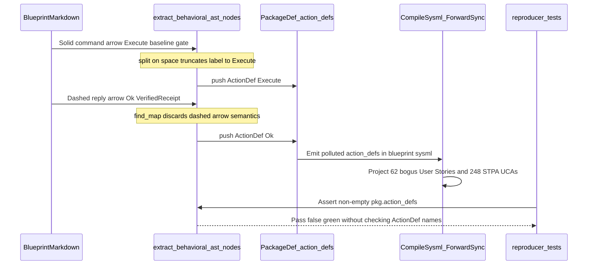

## 1. Context and References

<!-- test-target: crates/ingest-sysml/tests/reproducer_tests.rs -->

- **File**: `crates/ingest-sysml/src/translators/markdown.rs:1959-1998`
- **Pillar**: Semantic Traceability
- **Symptom**: `extract_behavioral_ast_nodes` lowers Mermaid `sequenceDiagram` dashed return/reply arrows (double-dash double-chevron, `-->`, `--x`, `--)`) identically to solid command arrows (single-dash double-chevron, `->`, `-x`, `-)`) and truncates multi-word prose command labels at the first ASCII space via `msg_clean.split(['(', ':', ' '])`, synthesizing bogus single-token package-level `ActionDef` AST nodes (such as `Ok`, `Vec`, `Masked`, `Sorted`, `Reparsed`, `Created`, `Live`, `CLOSED_LOOP`, `Exit_item`, `C_PURITY_03`, `C_PURITY_04`, `ICD_01`, `WBS_01_03`, `Execute`, `Read`, `Return`, `Run`, `Emit`, `Resolve`, and `gh`) while `crates/ingest-sysml/tests/reproducer_tests.rs` passes without exercising return-arrow exclusion or multi-word label fidelity.
- **Test-Target**: `crates/ingest-sysml/tests/reproducer_tests.rs`

## 2. Root Cause Analysis (5 Whys)

1. **Why did `ingest-sysml` pollute `blueprint-01..06.sysml` with degenerate single-token `ActionDef` declarations that cascaded into 62 polluted upstream `US-*.md` User Stories and 248 bogus Cartesian STPA UCA rows?** Because `extract_behavioral_ast_nodes` in `crates/ingest-sysml/src/translators/markdown.rs:1959-1998` promotes every matched Mermaid `sequenceDiagram` message line into a top-level `PackageDef.action_defs` entry using only the first whitespace-delimited token of the message label.
2. **Why are return-value annotations (`Ok`, `Vec`, `Masked`, `Sorted`, `Reparsed`, `Created`, `Live`, `CLOSED_LOOP`, `Exit_item`, `C_PURITY_03`, `C_PURITY_04`, `ICD_01`, `WBS_01_03`) promoted to standalone `ActionDef` AST nodes instead of reply telemetry messages?** Because lines `1959-1961` scan all eight Mermaid sequence arrow operators (both `--` dashed return forms and `-` solid command forms across double-chevron, `>`, `x`, and `)` arrowheads) via `.find_map(|arrow| trimmed.split_once(arrow))`, discarding the matched arrow operator and erasing the UML/SysML semantic distinction between solid invocation messages and dashed reply/return telemetry.
3. **Why are multi-word prose command labels and inline CLI invocations truncated into bare verbs or binary names (`Execute`, `Read`, `Return`, `Run`, `Emit`, `Resolve`, `gh`)?** Because lines `1975-1978` extract `action_head` with `msg_clean.split(['(', ':', ' ']).find(|s| !s.trim().is_empty())`, splitting unconditionally on `' '` (ASCII space) and discarding all object and qualifier tokens that distinguish distinct behavioral operations.
4. **Why does arrow matching also risk splitting inside message payloads rather than strictly between lifeline endpoints?** Because `trimmed.split_once(arrow)` searches the entire raw line (including the message text right of `:`) in fixed array order rather than locating the leftmost arrow operator within the lifeline header prefix left of `:`.
5. **Why did existing regression suites fail to catch this AST corruption before forward-sync specification projection?** Because `test_issue_550_bom_bullets_and_behavioral_blocks_extracted` in `crates/ingest-sysml/tests/reproducer_tests.rs:222-300` supplies only single-token `PascalCase` function-call labels (`DispatchGateCheck(cmd_in)`, `EmitGateStatus(status_out)`) and asserts only `!pkg.action_defs.is_empty()` (`reproducer_tests.rs:285-288`), while the unit test in `crates/ingest-sysml/src/translators/markdown.rs:5901,5934` actively asserts that a dashed reply message (`US_AC_03_ConfirmReady(ack)` from `D` back to `C`) synthesizes a state-machine transition trigger.

## 3. Correctness Analysis

In `.pipeline/constitution.md:74,80-82`, the Universal Model Consistency Rules mandate that actions and operational paths map to logical operations defined on target classifiers, and that dynamic behavior diagrams preserve distinct invocation and return message semantics without inventing undefined operations.

Tracing the data flow from Markdown ingestion to downstream specification corruption:
1. **Entry Point**: `MarkdownTranslator::translate` (`crates/ingest-sysml/src/translators/markdown.rs:2989`) invokes `extract_behavioral_ast_nodes(body_content, &mut pkg)` on every ingested Markdown requirement or design blueprint, and `MarkdownTranslator::translate_files` (`crates/ingest-sysml/src/translators/markdown.rs:3223-3226,3379-3383`) merges all resulting `sub_pkg.action_defs` into the consolidated `PackageDef`.
2. **Arrow Semantics Erasure (`markdown.rs:1959-1962`)**:
   - The eight-element arrow candidate array at `markdown.rs:1959-1961` invokes `.into_iter().find_map(|arrow| trimmed.split_once(arrow))` and returns only `Some((lhs, rhs))`.
   - When a blueprint sequence diagram documents a dashed reply message carrying return payloads such as `Ok(Vec<PackageDef>)`, `[CLOSED-LOOP VERIFIED]`, `C-PURITY-03`, `C-PURITY-04`, `ICD_01`, or `WBS_01_03`, `arrow_pair` matches the `--` return arrow and routes the return annotation straight into `ActionDef` synthesis (`markdown.rs:1982-1993`).
3. **First-Space Label Truncation (`markdown.rs:1974-1980`)**:
   - `msg_clean` only trims outer `"` and `` ` `` delimiters, then `msg_clean.split(['(', ':', ' ']).find(|s| !s.trim().is_empty())` slices off everything after the first space.
   - Multi-word imperative commands (`Execute baseline check`, `Read markdown schema`, `Return canonical AST`, `Run check-defect gate`, `Emit canonical SysML`, `Resolve cross references`) collapse into single-word `ActionDef` names (`Execute`, `Read`, `Return`, `Run`, `Emit`, `Resolve`), colliding across unrelated sequence diagrams due to name-only deduplication at `markdown.rs:1982` (`!pkg.action_defs.iter().any(|a| a.name == clean_action)`).
   - Inline backticked CLI commands (such as a solid invocation carrying `` `gh issue edit --body-file` ``) lose outer backticks at `markdown.rs:1974` and truncate at the first space to `ActionDef { name: "gh" }`.
   - Return tokens colliding with reserved KerML/SysML keywords (such as `Exit 0`) are rewritten by `sanitize_identifier` into `Exit_item`, while bracketed status tags (`[CLOSED-LOOP VERIFIED]`) split at the first space into `[CLOSED-LOOP` and sanitize into `CLOSED_LOOP`.
4. **Fallback State Trigger Contamination (`markdown.rs:2073-2083`)**:
   - Whenever a Markdown document contains a `sequenceDiagram` without a `stateDiagram-v2`, fallback `StateDef` synthesis binds `trig1` and `trig2` to `pkg.action_defs.first()` and `pkg.action_defs.get(1)`, injecting truncated verbs or return-type tokens directly into `TransitionDef.trigger` (`{s1}_to_{s2}_on_{trig1}`).
5. **Semantic Traceability Test Gap (`crates/ingest-sysml/tests/reproducer_tests.rs:222-347`)**:
   - `test_issue_550_bom_bullets_and_behavioral_blocks_extracted` (refs #550) asserts only `!pkg.action_defs.is_empty()` and `!child_pkg.action_defs.is_empty()`, never checking exact `ActionDef` names, never verifying that the dashed reply line from `Gate` to `Op` is excluded from `pkg.action_defs`, and never testing multi-word prose labels.

## 4. UML Diagrams



## 5. Affected Callers / Downstream Impact

- `extract_behavioral_ast_nodes` (`crates/ingest-sysml/src/translators/markdown.rs:1959-1998,2073-2083`) -- Synthesizes bogus `ActionDef` nodes from dashed reply arrows and space-truncated command phrases, and binds fallback `StateDef` transition triggers (`trig1`, `trig2`) to those corrupted action names.
- `MarkdownTranslator::translate` (`crates/ingest-sysml/src/translators/markdown.rs:2989`) -- Emits polluted `PackageDef.action_defs` and `PackageDef.state_defs` for every single-file Markdown translation containing a Mermaid `sequenceDiagram`.
- `MarkdownTranslator::translate_files` (`crates/ingest-sysml/src/translators/markdown.rs:3223-3226,3379-3383`) -- Aggregates polluted `action_defs` across multi-file requirement and blueprint suites (`blueprint-01..06.sysml`), causing cross-diagram collisions on generic verbs (`Execute`, `Read`, `Run`, `Emit`, `Resolve`).
- Downstream `compile-sysml` forward-sync & STPA synthesis -- Projects every bogus `ActionDef` in `PackageDef.action_defs` into standalone `US-*.md` User Stories (`#562` through `#623`) and $4 \times$ Cartesian STPA Unsafe Control Action rows (248 polluted UCA rows).
- `test_issue_550_bom_bullets_and_behavioral_blocks_extracted` (`crates/ingest-sysml/tests/reproducer_tests.rs:222-347`) and `test_extract_behavioral_ast_nodes_populates_sub_states_and_fallback_state_def` (`crates/ingest-sysml/src/translators/markdown.rs:5895-5936`) -- Fail to guard the behavioral action-extraction invariant and codify dashed-arrow `ActionDef` promotion.

## 6. Proposed Correction

Locate the leftmost Mermaid sequence arrow strictly within the lifeline header segment prior to `:`, classify `--` dashed arrows as reply telemetry messages that populate `InteractionDef.messages` without pushing `ActionDef` nodes into `pkg.action_defs`, and synthesize compound `PascalCase` identifiers across significant words for multi-word solid-arrow command labels using deterministic linear slice and character scanning:

```rust
/// Locates the leftmost Mermaid `sequenceDiagram` arrow within the lifeline header before `:`.
/// Returns `(sender_slice, rhs_slice, is_reply_arrow)`.
fn classify_sequence_arrow(trimmed: &str) -> Option<(&str, &str, bool)> {
    const ARROW_PARTS: &[(&str, &str, bool)] = &[
        ("--", ">>", true),
        ("-", ">>", false),
        ("--", ">", true),
        ("-", ">", false),
        ("--", "x", true),
        ("-", "x", false),
        ("--", ")", true),
        ("-", ")", false),
    ];
    let header_scope = trimmed.split_once(':').map_or(trimmed, |(hdr, _)| hdr);
    for (idx, _) in header_scope.char_indices() {
        let tail = header_scope.get(idx..)?;
        for &(stem, head, is_reply) in ARROW_PARTS {
            if let Some(after_stem) = tail.strip_prefix(stem) {
                if let Some(after_head) = after_stem.strip_prefix(head) {
                    if !after_head.starts_with('-') {
                        let arrow_len = stem.len() + head.len();
                        let lhs = trimmed.get(..idx)?;
                        let rhs = trimmed.get(idx + arrow_len..)?;
                        return Some((lhs, rhs, is_reply));
                    }
                }
            }
        }
    }
    None
}

/// Strips an optional leading numbered step prefix (e.g. `1.` or `Step 2:`) from a message label.
fn strip_leading_step_prefix(raw: &str) -> &str {
    let trimmed = raw.trim();
    let after_step_kw = trimmed
        .strip_prefix("Step ")
        .or_else(|| trimmed.strip_prefix("step "))
        .unwrap_or(trimmed)
        .trim_start();
    let digit_bytes = after_step_kw
        .bytes()
        .take_while(|b| b.is_ascii_digit())
        .count();
    if digit_bytes > 0 {
        if let Some(rest) = after_step_kw.get(digit_bytes..) {
            let stripped = rest.trim_start_matches(['.', ')', ':', '-', ' ']).trim_start();
            if !stripped.is_empty() {
                return stripped;
            }
        }
    }
    trimmed
}

/// Derives a deterministic SysML identifier from a sequence diagram message label without
/// truncating multi-word command phrases at the first space.
fn derive_sequence_message_identifier(msg_raw: &str, fallback: &str) -> String {
    const MAX_COMPOUND_WORDS: usize = 6;
    let unquoted = msg_raw
        .trim()
        .trim_matches(['"', '`', '\'', ' ']);
    let after_step = strip_leading_step_prefix(unquoted);
    let before_paren = after_step
        .split_once('(')
        .map_or(after_step, |(bp, _)| bp);
    let head_clause = before_paren
        .split_once(':')
        .map_or(before_paren, |(bc, _)| bc)
        .trim();

    if head_clause.is_empty() {
        return fallback.to_string();
    }

    // Preserve single-token CamelCase or snake_case operation identifiers verbatim.
    if !head_clause.contains(char::is_whitespace) {
        let single_id = sanitize_identifier(head_clause, fallback);
        return strip_ingested_action_prefix(&single_id).to_string();
    }

    // Synthesize a compound PascalCase identifier across up to MAX_COMPOUND_WORDS non-flag words.
    let mut compound = String::with_capacity(head_clause.len());
    let mut word_count = 0usize;
    for raw_tok in head_clause.split_whitespace() {
        let tok = raw_tok.trim_matches(['`', '"', '\'', '*', '[', ']', ',']);
        if tok.is_empty() || tok.starts_with('-') {
            continue;
        }
        let mut capitalize_next = true;
        let mut emitted_in_tok = false;
        for ch in tok.chars() {
            if ch.is_ascii_alphanumeric() {
                if capitalize_next {
                    compound.push(ch.to_ascii_uppercase());
                    capitalize_next = false;
                } else {
                    compound.push(ch);
                }
                emitted_in_tok = true;
            } else {
                capitalize_next = true;
            }
        }
        if emitted_in_tok {
            word_count += 1;
            if word_count >= MAX_COMPOUND_WORDS {
                break;
            }
        }
    }

    if compound.is_empty() {
        return fallback.to_string();
    }
    let sanitized = sanitize_identifier(&compound, fallback);
    strip_ingested_action_prefix(&sanitized).to_string()
}

// Inside extract_behavioral_ast_nodes (replacing lines 1959-1998):
if let Some((lhs, rhs, is_reply)) = classify_sequence_arrow(trimmed) {
    let sender_raw = lhs.trim().trim_end_matches(['+', '-']).trim();
    let (receiver_raw, msg_raw, has_explicit_msg) = if let Some((r, m)) = rhs.split_once(':') {
        (r.trim().trim_start_matches(['+', '-']).trim(), m.trim(), true)
    } else {
        (
            rhs.trim().trim_start_matches(['+', '-']).trim(),
            if is_reply { "ReplyPayload" } else { "SendMessage" },
            false,
        )
    };
    let sender_id = sanitize_identifier(sender_raw, "Sender");
    let receiver_id = sanitize_identifier(receiver_raw, "Receiver");

    if is_reply {
        let reply_id = derive_sequence_message_identifier(msg_raw, "ReplyPayload");
        let reply_stmt = format!("reply {reply_id} from {sender_id} to {receiver_id}");
        if !seq_messages.contains(&reply_stmt) {
            seq_messages.push(reply_stmt);
        }
    } else {
        let fallback_action = if has_explicit_msg {
            "ExecuteAction"
        } else {
            "SendMessage"
        };
        let clean_action = derive_sequence_message_identifier(msg_raw, fallback_action);
        let doc_clean = clean_bdd_text(msg_raw.trim_matches(['"', '`', ' ']));
        if !pkg.action_defs.iter().any(|a| a.name == clean_action) {
            pkg.action_defs.push(ActionDef {
                name: clean_action.clone(),
                doc: if doc_clean.is_empty() {
                    None
                } else {
                    Some(doc_clean)
                },
                is_def: true,
                ..Default::default()
            });
        }
        let msg_stmt = format!("{clean_action} from {sender_id} to {receiver_id}");
        if !seq_messages.contains(&msg_stmt) {
            seq_messages.push(msg_stmt);
        }
    }
}
```

## 7. Relationship to Existing Issues

Discovered in audit -- new finding related to behavioral `sequenceDiagram` extraction introduced under (refs #550), which polluted `blueprint-01..06.sysml` and downstream forward-sync User Stories (`#562` through `#623`).

## Audit Source

Adversarial Semantic Traceability Audit
SEVERITY: Critical
FILE_LOCATION: crates/ingest-sysml/src/translators/markdown.rs:1959-1998
