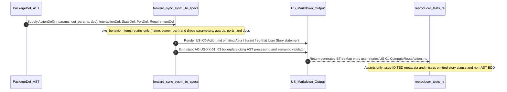

## 1. Context and References

<!-- test-target: crates/compile-sysml/tests/reproducer_tests.rs -->

- **File**: `crates/compile-sysml/src/sync/forward.rs:1595-2442`
- **Pillar**: Semantic Traceability
- **Symptom**: Forward-synced User Story specifications (`docs/user-stories/US-*.md`) completely omit the mandatory constitutional `As a [Actor/Subsystem], I want to [Action/Command], so that [Outcome/Safety Constraint]` clause (`.pipeline/constitution.md:126-129`) and emit identical, non-AST 3-line boilerplate BDD scenarios containing leaked compiler-domain phrases (`"processes the AST within defined latency envelope"`, `"When semantic validator executes"`) instead of deriving actor lifelines, typed `in`/`out` action parameters, doc-comment preconditions/outcomes, `StateDef` transition guards, `PortDef` signals, and constraint-specific negative boundary scenarios from the SysML v2 AST.
- **Test-Target**: `crates/compile-sysml/tests/reproducer_tests.rs`

## 2. Root Cause Analysis (5 Whys)

1. **Why do generated `docs/user-stories/US-*.md` files omit the `As a ..., I want to ..., so that ...` User Story statement and emit identical 3-line placeholder BDD across every story?** Because the User Story Markdown template in `crates/compile-sysml/src/sync/forward.rs:2396-2440` jumps directly from `# {title}` (line `2408`) to `## UML Sequence Diagram` (line `2410`) and hardcodes three static `AC-US-{s_num:02}-01..03` lines (`2417-2419`) that reference `"processes the AST"` and `"semantic validator executes"`.
2. **Why does the template hardcode static prose instead of projecting behavioral and structural fields from the SysML v2 AST?** Because `pkg_behavior_items` (`crates/compile-sysml/src/sync/forward.rs:1610-1633`) and `StoryMeta` (`crates/compile-sysml/src/sync/forward.rs:1430-1442`) strip every `PackageDef::action_defs`, `PartDef::actions`, and `PackageDef::interaction_defs` node down to bare identifier strings `(action_name, owner_part)`, discarding `ActionDef.in_params`, `ActionDef.out_params`, `ActionDef.doc`, `InteractionDef.messages`, `InteractionDef.doc`, `StateDef.transitions`, `PortDef`, `ConstraintDef`, and `RequirementDef` bindings before rendering begins.
3. **Why were `StoryMeta` and the `US-*.md` loop left as string-only scaffolds while `FEAT-*.md` received AST-backed `generate_feature_bdd` (`forward.rs:597-675`) and parameterized operation signatures (`forward.rs:3385-3451`)?** Because incremental forward-sync enhancements added AST constraint lowering for `PartDef` features and `UseCaseDef` doc parsing (`parse_use_case_doc` at `forward.rs:1313-1368`), but never introduced a corresponding `generate_user_story_statement` or `generate_user_story_bdd` projection pass -- nor a `user-stories/` preservation branch in `merge_existing_spec_content` (`forward.rs:3106-3134`).
4. **Why did compiler-domain phrases (`"processes the AST"`, `"semantic validator executes"`) survive inside an abstract schema-driven compiler template?** Because the initial User Story template was authored against self-hosted compiler specifications and only partially scrubbed during prior de-contamination passes, which removed specific identifier tokens (`DEAPCompilerSystem`, `HumanEngineer`) without auditing `US-*.md` prose templates against `.pipeline/constitution.md:50` and `.pipeline/constitution.md:119-129`.
5. **Why did existing regression suites in `crates/compile-sysml/tests/reproducer_tests.rs` and `forward.rs` fail to catch these constitutional and semantic traceability violations?** Because `test_issue_552_forward_sync_does_not_emit_hardcoded_colliding_issue_ids` (`crates/compile-sysml/tests/reproducer_tests.rs:83-232`) constructs a default empty `ActionDef` (`107-110`) and asserts only `| **Issue ID** | TBD |` metadata (`151-155`, `189-193`), while inline tests in `forward.rs:5168-5307` check only `Parent Epic` links, sequence arrows, and a 6-token identifier denylist -- leaving constitutional User Story grammar and AST-to-BDD semantic traceability unverified.

## 3. Correctness Analysis

### Data Flow from AST Input to Defective Specification Output
1. **Behavioral AST Truncation (`crates/compile-sysml/src/sync/forward.rs:1610-1726`)**:
   - During `forward_sync_sysml_to_specs`, `pkg_behavior_items: Vec<(String, Option<String>)>` (`1610`) collects `p.action_defs` (`1613-1618`), `part.actions` (`1619-1626`), and trailing `p.interaction_defs` (`1627-1633`). Only the stripped name string and optional owning `PartDef` name are retained.
   - All rich behavioral and interface AST attributes on `ActionDef` (`in_params: Vec<AttributeDef>`, `out_params: Vec<AttributeDef>`, `doc: Option<String>`), `InteractionDef` (`lifelines`, full `messages` sequence, `doc`), package `StateDef` (`transitions` with `source`, `target`, `trigger`, `guard`, `effect` parsed by `extract_transition_endpoints` at `863-916`), owning `PartDef` (`ports: Vec<PortDef>`, `constraints: Vec<ConstraintDef>`, `requirements: Vec<RequirementDef>`), and package `RequirementDef` (`req_id`, `name`, `constraints`, `satisfied_by`) are dropped rather than stored in `StoryMeta` (`1430-1442`).
   - Furthermore, when an `InteractionDef` declares an external actor or cross-package initiator lifeline `l0` (`1653-1656`), lines `1668-1674` check `!p.part_defs.iter().any(|pt| pt.name == caller_engine)` and overwrite `caller_engine` with `p.part_defs.first()`, erasing external actor lifelines. Subsequently, `default_actor` (`2285-2301`) scans `all_packages.iter().flat_map(|p| p.use_case_defs.iter()).next()`, binding every User Story in every subsystem package to the first global Use Case actor in the entire model (or `"Operator"`).
2. **Omission of Constitutional User Story Clause (`crates/compile-sysml/src/sync/forward.rs:2396-2427`)**:
   - `.pipeline/constitution.md:126-129` mandates:
     - `User Stories follow: As a [Actor/Subsystem], I want to [Action/Command], so that [Outcome/Safety Constraint].`
     - `Each User Story MUST have at least one canonical aerospace BDD scenario (Given-When-Then).`
   - In `forward.rs:2408-2416`, the generated Markdown emits `# {title}` followed immediately by `## UML Sequence Diagram` and `## Acceptance Criteria (BDD)`. Zero `## User Story` heading and zero `As a ..., I want to ..., so that ...` statement exist anywhere in the generated `US-*.md` payload.
   - In `merge_existing_spec_content` (`forward.rs:3106-3134`), non-forced synchronization (`!opts.force`) preserves authored prose sections for `epics/` (`3106-3117`) and `features/` (`3118-3132`), but contains no branch for `user-stories/`, causing re-syncs to clobber any authored User Story clause on disk.
3. **Non-AST Boilerplate BDD and Compiler-Domain Leakage (`crates/compile-sysml/src/sync/forward.rs:2416-2420`)**:
   - Lines `2417-2419` emit:
     - `AC-US-{s_num:02}-01`: `"Given operational environment initialized, When {action_name} executes, Then {engine_name} processes the AST within defined latency envelope."`
     - `AC-US-{s_num:02}-02`: `"Given formal constraints, When semantic validator executes, Then asserts invariant satisfaction."`
     - `AC-US-{s_num:02}-03`: `"Given exceptional conditions, When error recovery activates, Then graceful recovery occurs without data loss."`
   - `AC-US-XX-02` and `AC-US-XX-03` are 100% static across every generated User Story in every package, while `AC-US-XX-01` and `AC-US-XX-02` inject hardcoded DEAP compiler domain concepts (`"processes the AST"`, `"semantic validator executes"`) into arbitrary downstream customer schemas.
4. **Test Assertion Blind Spot (`crates/compile-sysml/tests/reproducer_tests.rs:83-232` & `forward.rs:5168-5307`)**:
   - `reproducer_tests.rs:107-110` exercises `forward_sync_sysml_to_specs` with an unparameterized `ActionDef` and checks `us_md` only for `| **Issue ID** | TBD |` (`151-155`, `189-193`).
   - `forward.rs:5168-5241` verifies sequence diagram arrows and `Parent Epic` links without inspecting story statements or BDD lines, and `forward.rs:5244-5307` checks a 6-string denylist that omits `"processes the AST"` and `"semantic validator executes"`.

### Violated Invariants
- **Constitutional User Story Format Invariant (`.pipeline/constitution.md:126-129`)**: Every User Story must state `As a [Actor/Subsystem], I want to [Action/Command], so that [Outcome/Safety Constraint]` paired with canonical 3-layer Given-When-Then BDD scenarios.
- **Pure Schema-Driven Compiler Invariant (`.pipeline/constitution.md:50`, `AGENTS.md`)**: Upstream compiler templates must remain 100% domain-agnostic and derive specifications deterministically from input SysML v2 AST nodes without injecting hardcoded compiler-domain concepts (`"processes the AST"`, `"semantic validator"`).
- **Schema Compliance & Mandatory Negative Boundary Invariant (`.pipeline/constitution.md:60-62`, `78-82`, `119-124`)**: Typed action parameters, port signals, state transition guards, formal constraints, and negative boundary failure modes declared in the AST must be captured with zero loss tolerance.

## 4. UML Diagrams



## 5. Affected Callers / Downstream Impact

- `compile_sysml::sync::forward::forward_sync_sysml_to_specs` (`crates/compile-sysml/src/sync/forward.rs:1471-2776`) -- Every downstream workspace running `compile-sysml` forward synchronization receives non-compliant `docs/user-stories/US-*.md` files lacking the constitutional `As a ... I want to ... so that ...` clause and containing hardcoded `"processes the AST"` / `"semantic validator"` boilerplate divorced from the workspace's `.pipeline/schema.sysml` AST.
- `compile_sysml::sync::forward::merge_existing_spec_content` (`crates/compile-sysml/src/sync/forward.rs:3070-3135`) -- Non-forced re-synchronization (`opts.force == false`) overwrites authored `## User Story` statements in existing `docs/user-stories/US-*.md` files because `user-stories/` has no prose-section preservation rule.
- Downstream `spec-user-story-engineering` and `feature-driven-implementation` workflows -- Downstream TDD micro-tasks consuming forward-synced `US-*.md` acceptance criteria cannot trace test assertions back to declared SysML `ActionDef` `in`/`out` parameters, `PortDef` signals, `StateDef` transition guards, or `ConstraintDef` negative boundaries.
- `crates/compile-sysml/tests/reproducer_tests.rs:83-232` and `crates/compile-sysml/src/sync/forward.rs:5168-5307` -- Regression tests pass green while `US-*.md` violates `.pipeline/constitution.md:50`, `119-124`, and `126-129`.

## 6. Proposed Correction

<!-- Deterministic linear slice/char scanning only (Check 34 compliant). Strictly domain-agnostic AST projection with zero hardcoded customer domain tokens (Check 19 compliant). -->

```rust
/// Structured doc-comment clauses extracted deterministically from an `ActionDef` or `InteractionDef`.
#[derive(Debug, Clone, Default, PartialEq, Eq)]
struct ParsedStoryDoc {
    actor: Option<String>,
    precondition: Option<String>,
    outcome: Option<String>,
}

/// Parses optional `Actor:`, `Preconditions:` / `Precondition:`, and `Outcome:` / `Postconditions:` / `Objective:` lines
/// using deterministic linear prefix scanning.
fn parse_story_doc(doc_opt: Option<&str>) -> ParsedStoryDoc {
    let mut parsed = ParsedStoryDoc::default();
    let Some(raw) = doc_opt.map(str::trim).filter(|s| !s.is_empty()) else {
        return parsed;
    };
    for line in raw.lines() {
        let trimmed = line.trim().trim_start_matches('-').trim();
        if let Some(rest) = trimmed.strip_prefix("Actor:") {
            let val = rest.trim();
            if !val.is_empty() {
                parsed.actor = Some(val.to_string());
            }
        } else if let Some(rest) = trimmed
            .strip_prefix("Preconditions:")
            .or_else(|| trimmed.strip_prefix("Precondition:"))
        {
            let val = rest.trim();
            if !val.is_empty() {
                parsed.precondition = Some(val.to_string());
            }
        } else if let Some(rest) = trimmed
            .strip_prefix("Outcome:")
            .or_else(|| trimmed.strip_prefix("Postconditions:"))
            .or_else(|| trimmed.strip_prefix("Postcondition:"))
            .or_else(|| trimmed.strip_prefix("Objective:"))
        {
            let val = rest.trim();
            if !val.is_empty() {
                parsed.outcome = Some(val.to_string());
            }
        } else if parsed.outcome.is_none() && !trimmed.is_empty() {
            parsed.outcome = Some(trimmed.trim_end_matches('.').to_string());
        }
    }
    parsed
}

/// Formats typed `in` and `out` parameters of an `ActionDef` for User Story and BDD traceability.
fn format_action_call_with_params(action_name: &str, act_opt: Option<&ActionDef>) -> String {
    let Some(act) = act_opt else {
        return format!("{action_name}()");
    };
    let mut args = Vec::new();
    for p in &act.in_params {
        if p.type_name.trim().is_empty() {
            args.push(format!("in {}", p.name.trim()));
        } else {
            args.push(format!("in {}: {}", p.name.trim(), p.type_name.trim()));
        }
    }
    for p in &act.out_params {
        if p.type_name.trim().is_empty() {
            args.push(format!("out {}", p.name.trim()));
        } else {
            args.push(format!("out {}: {}", p.name.trim(), p.type_name.trim()));
        }
    }
    format!("{action_name}({})", args.join(", "))
}

/// Synthesizes the constitutional `As a ..., I want to ..., so that ...` User Story statement from AST nodes.
fn generate_user_story_statement(
    actor_label: &str,
    engine_name: &str,
    action_name: &str,
    act_opt: Option<&ActionDef>,
    inter_doc: Option<&str>,
    target_part: Option<&PartDef>,
    reqs: &[&RequirementDef],
) -> String {
    let parsed_doc = act_opt
        .and_then(|a| a.doc.as_deref())
        .map(|d| parse_story_doc(Some(d)))
        .filter(|d| d.outcome.is_some() || d.actor.is_some())
        .unwrap_or_else(|| parse_story_doc(inter_doc));

    let effective_actor = parsed_doc
        .actor
        .as_deref()
        .filter(|a| !a.is_empty())
        .unwrap_or(actor_label);
    let call_sig = format_action_call_with_params(action_name, act_opt);

    let outcome_clause = if let Some(ref outcome) = parsed_doc.outcome {
        outcome.trim_end_matches('.').to_string()
    } else if let Some(req) = reqs.first() {
        let req_label = if !req.req_id.trim().is_empty() {
            format!("{} ({})", req.req_id.trim(), req.name.trim())
        } else {
            req.name.trim().to_string()
        };
        format!("{engine_name} satisfies formal requirement `{req_label}`")
    } else if let Some(c) = target_part.and_then(|pt| pt.constraints.first()) {
        format!("{engine_name} enforces declared invariant `{}`", c.name.trim())
    } else if let Some(out_p) = act_opt.and_then(|a| a.out_params.first()) {
        format!(
            "{engine_name} produces verified output `{}: {}`",
            out_p.name.trim(),
            out_p.type_name.trim()
        )
    } else {
        format!(
            "{engine_name} completes `{action_name}` and preserves declared subsystem state invariants"
        )
    };

    format!(
        "As a `{effective_actor}`, I want to invoke `{call_sig}` on `{engine_name}`, so that {outcome_clause}."
    )
}

/// Synthesizes AST-derived 3-layer Given-When-Then BDD scenarios (nominal, guard/constraint, and negative boundary)
/// for a User Story with zero hardcoded domain concepts.
fn generate_user_story_bdd(
    s_num: usize,
    actor_label: &str,
    engine_name: &str,
    action_name: &str,
    reply_msg: &str,
    act_opt: Option<&ActionDef>,
    inter_doc: Option<&str>,
    pkg_states: &[deap_core::sysml_ast::StateDef],
    target_part: Option<&PartDef>,
    reqs: &[&RequirementDef],
) -> String {
    let mut criteria = Vec::new();
    let parsed_doc = act_opt
        .and_then(|a| a.doc.as_deref())
        .map(|d| parse_story_doc(Some(d)))
        .unwrap_or_else(|| parse_story_doc(inter_doc));

    let matched_transition = pkg_states
        .iter()
        .flat_map(|st| st.transitions.iter())
        .find(|tr| {
            tr.trigger
                .as_deref()
                .is_some_and(|t| t.contains(action_name))
                || tr
                    .effect
                    .as_deref()
                    .is_some_and(|e| e.contains(action_name))
        })
        .or_else(|| pkg_states.first().and_then(|st| st.transitions.first()));

    let pre_state = parsed_doc
        .precondition
        .clone()
        .or_else(|| {
            matched_transition
                .and_then(|tr| tr.source.as_deref())
                .map(|src| format!("`{engine_name}` is in declared state `{src}`"))
        })
        .unwrap_or_else(|| format!("`{engine_name}` is initialized in nominal operational state"));

    let in_contract = act_opt
        .filter(|a| !a.in_params.is_empty())
        .map(|a| {
            let sig: Vec<String> = a
                .in_params
                .iter()
                .map(|p| format!("`{}: {}`", p.name.trim(), p.type_name.trim()))
                .collect();
            format!(" with valid input parameters ({})", sig.join(", "))
        })
        .or_else(|| {
            target_part.and_then(|pt| {
                let in_ports: Vec<String> = pt
                    .ports
                    .iter()
                    .filter(|port| port.direction == "in" || port.direction == "inout")
                    .map(|port| format!("`{}: {}`", port.name.trim(), port.type_name.trim()))
                    .collect();
                if in_ports.is_empty() {
                    None
                } else {
                    Some(format!(" on input ports ({})", in_ports.join(", ")))
                }
            })
        })
        .unwrap_or_default();

    let out_contract = act_opt
        .filter(|a| !a.out_params.is_empty())
        .map(|a| {
            let sig: Vec<String> = a
                .out_params
                .iter()
                .map(|p| format!("`{}: {}`", p.name.trim(), p.type_name.trim()))
                .collect();
            format!("emits verified outputs ({}) and `{reply_msg}`", sig.join(", "))
        })
        .or_else(|| {
            parsed_doc
                .outcome
                .as_ref()
                .map(|o| format!("{} and returns `{reply_msg}`", o.trim_end_matches('.')))
        })
        .unwrap_or_else(|| format!("updates `{engine_name}` state and emits `{reply_msg}`"));

    let post_state = matched_transition
        .and_then(|tr| tr.target.as_deref())
        .map(|tgt| format!(", transitioning to `{tgt}`"))
        .unwrap_or_default();

    // 1. Nominal AST-derived execution scenario
    criteria.push(format!(
        "- [ ] AC-US-{s_num:02}-01: Given {pre_state}{in_contract}, When `{actor_label}` dispatches `{action_name}` to `{engine_name}`, Then `{engine_name}` {out_contract}{post_state}."
    ));

    // 2. State transition guard and formal constraint scenarios
    if let Some(guard) = matched_transition
        .and_then(|tr| tr.guard.as_deref())
        .map(str::trim)
        .filter(|g| !g.is_empty())
    {
        let ac_idx = criteria.len() + 1;
        criteria.push(format!(
            "- [ ] AC-US-{s_num:02}-{ac_idx:02}: Given `{engine_name}` evaluates transition guard `[{guard}]` prior to `{action_name}`, When guard condition `[{guard}]` holds true, Then `{engine_name}` authorizes state transition execution without invariant violation."
        ));
    }

    let mut constraint_labels: Vec<String> = Vec::new();
    if let Some(pt) = target_part {
        for c in &pt.constraints {
            if !c.name.trim().is_empty() {
                let expr = c.expression.trim();
                let label = if expr.is_empty() {
                    c.name.trim().to_string()
                } else {
                    format!("{} ({})", c.name.trim(), expr)
                };
                if !constraint_labels.contains(&label) {
                    constraint_labels.push(label);
                }
            }
        }
    }
    for req in reqs {
        for c in &req.constraints {
            if !c.name.trim().is_empty() {
                let label = c.name.trim().to_string();
                if !constraint_labels.contains(&label) {
                    constraint_labels.push(label);
                }
            }
        }
        if req.constraints.is_empty() && !req.name.trim().is_empty() {
            let label = req.name.trim().to_string();
            if !constraint_labels.contains(&label) {
                constraint_labels.push(label);
            }
        }
    }

    for label in constraint_labels.iter().take(6) {
        let ac_idx = criteria.len() + 1;
        criteria.push(format!(
            "- [ ] AC-US-{s_num:02}-{ac_idx:02}: Given `{engine_name}` active state during `{action_name}`, When `{engine_name}` evaluates formal constraint `{label}`, Then `{engine_name}` confirms constraint satisfaction before committing output signals."
        ));
    }

    if criteria.len() == 1 {
        criteria.push(format!(
            "- [ ] AC-US-{s_num:02}-02: Given `{engine_name}` interface contract for `{action_name}`, When `{engine_name}` validates structural preconditions and port types, Then `{engine_name}` preserves state consistency across execution."
        ));
    }

    // 3. Mandatory negative boundary / guard-rejection scenario
    let neg_trigger = if let Some(guard) = matched_transition
        .and_then(|tr| tr.guard.as_deref())
        .map(str::trim)
        .filter(|g| !g.is_empty())
    {
        format!("unsatisfied transition guard `[{guard}]`")
    } else if let Some(first_c) = constraint_labels.first() {
        format!("boundary violation of constraint `{first_c}`")
    } else if let Some(in_p) = act_opt.and_then(|a| a.in_params.first()) {
        format!(
            "out-of-range or malformed input parameter `{}: {}`",
            in_p.name.trim(),
            in_p.type_name.trim()
        )
    } else {
        format!("malformed input payload or precondition violation on `{action_name}`")
    };

    let neg_idx = criteria.len() + 1;
    criteria.push(format!(
        "- [ ] AC-US-{s_num:02}-{neg_idx:02}: Given {neg_trigger}, When `{actor_label}` invokes `{action_name}` on `{engine_name}`, Then `{engine_name}` rejects the request without partial state mutation and reports a deterministic fault status."
    ));

    criteria.join("\n")
}
```

## 7. Relationship to Existing Issues

Discovered in audit -- new finding. Prior forward-sync audits addressed issue-ID fallback collisions (refs #552), 6 legacy identifier strings (refs #442), and `ConOps` / `PartDef::actions` file projection (refs #477), but left the missing constitutional `As a ... I want to ... so that ...` User Story statement and the hardcoded `"processes the AST"` / `"semantic validator"` BDD boilerplate in `crates/compile-sysml/src/sync/forward.rs:2396-2427` undetected.

## Audit Source

Adversarial Semantic Traceability Audit
SEVERITY: Important
FILE_LOCATION: crates/compile-sysml/src/sync/forward.rs:1595-2442
