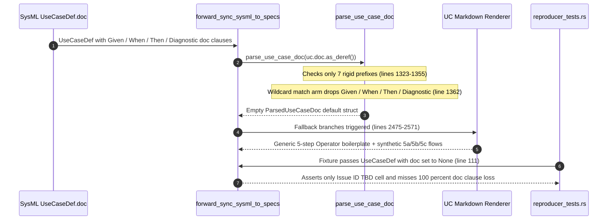

## 1. Context and References

<!-- test-target: crates/compile-sysml/tests/reproducer_tests.rs -->

- **File**: `crates/compile-sysml/src/sync/forward.rs:1313-2715`
- **Pillar**: Semantic Traceability
- **Symptom**: `parse_use_case_doc` (`forward.rs:1313-1368`) recognizes only seven rigid case-sensitive prefixes (`Actors:`, `Subject:`, `Preconditions:`, `Trigger:`, `Main Success Scenario:`, `Alternate and Exception Flows:`, `Postconditions:`) and silently discards `Given:`, `When:`, `Then:`, `Diagnostic:`, bullet-prefixed clauses, and narrative scenario text in `UseCaseDef.doc`, causing the `UC-*.md` forward-sync synthesis loop (`forward.rs:2445-2715`) to fall back to identical 5-step hardcoded boilerplate prose across all 31 generated upstream `UC-*.md` specifications (#624-#654) while `crates/compile-sysml/tests/reproducer_tests.rs` passes without exercising `UseCaseDef.doc`.
- **Test-Target**: `crates/compile-sysml/tests/reproducer_tests.rs`

## 2. Root Cause Analysis (5 Whys)

1. **Why do all 31 forward-synced upstream `UC-*.md` specifications (#624-#654) render identical 5-step hardcoded boilerplate (`1. Actor Operator submits input payload for <X> to <Y>...`) instead of the behavioral contracts authored in their SysML `use case def` `doc /* ... */` blocks?** Because `parse_use_case_doc(uc_m.uc.doc.as_deref())` at `crates/compile-sysml/src/sync/forward.rs:2454` returns an empty `ParsedUseCaseDoc::default()`, triggering the hardcoded fallback branches for `preconditions` (`2490-2491`), `trigger` (`2499`), `resolved_scenario_steps` (`2519-2527`), `alternate_flows` (`2539-2551`), and `postconditions` (`2569-2570`).
2. **Why does `parse_use_case_doc` return an empty `ParsedUseCaseDoc` when `UseCaseDef.doc` contains non-empty `Given:`, `When:`, `Then:`, `Diagnostic:`, or acceptance scenario clauses?** Because the line scanner at `crates/compile-sysml/src/sync/forward.rs:1320-1365` initializes `current_section = ""` and only transitions state on seven exact string prefixes (`Actors:`, `Subject:`, `Preconditions:`, `Trigger:`, `Main Success Scenario:`, `Alternate and Exception Flows:`, `Postconditions:`), routing every other non-empty line in `doc_str` into the wildcard no-op arm `_ => {}` at `forward.rs:1362`.
3. **Why do `Given:`, `When:`, `Then:`, and `Diagnostic:` clauses hit the `_ => {}` silent discard arm instead of populating `preconditions`, `trigger`, `main_scenario`, `alternate_flows`, and `postconditions`?** Because `parse_use_case_doc` was coupled exclusively to a single legacy Markdown section-label format and lacks clause dispatchers mapping `Given:` to preconditions, `When:` to trigger and scenario action steps, `Then:` to postconditions and verification steps, `Diagnostic:` to alternate/exception flows, or unprefixed narrative `doc` sentences to scenario steps.
4. **Why does this silent parser drop permanently overwrite Use Case behavioral fidelity across both forced and non-forced (`!opts.force`) synchronization runs?** Because `UseCaseDef` AST nodes ingested from specifications and `blueprint-XX-*.sysml` metamodels store behavioral contracts inside `UseCaseDef.doc` rather than duplicating them into `uc.preconditions`/`uc.steps`/`uc.postconditions`, and `merge_existing_spec_content` (`forward.rs:3070-3135`) only preserves authored Markdown sections for `epics/` (`3106-3117`) and `features/` (`3118-3132`), leaving `use-cases/` completely unprotected against boilerplate replacement.
5. **Why did `crates/compile-sysml/tests/reproducer_tests.rs` and the in-crate `forward::tests` suite fail to detect 100% loss of `Given:`/`When:`/`Then:`/`Diagnostic:` clauses?** Because `test_issue_552_forward_sync_does_not_emit_hardcoded_colliding_issue_ids` (`reproducer_tests.rs:111-114`) constructs `UseCaseDef { name: "UC_Compute_Route".to_string(), ..Default::default() }` with `doc: None` and asserts only `Issue ID` table cells (`reproducer_tests.rs:156-160, 194-198`), while round-trip unit tests (`forward.rs:6084-6093, 6261-6280`) pre-populate `UseCaseDef.preconditions`/`steps`/`postconditions` directly in Rust memory with `doc: None`, leaving `parse_use_case_doc` completely untested across the workspace.

## 3. Correctness Analysis

Let a SysML v2 `UseCaseDef` node in `.pipeline/schema.sysml` or `docs/designs/blueprint-XX-*.sysml` carry a structured behavioral contract in `uc.doc`:

`Some("Given: Verified subsystem AST loaded in memory\nWhen: Forward synchronization executes on UseCaseDef\nThen: Emits deterministic Use Case markdown preserving all behavioral clauses\nDiagnostic: E0405 emitted on malformed behavioral contract")`

Tracing execution through `forward_sync_sysml_to_specs` (`crates/compile-sysml/src/sync/forward.rs:1471-2776`):

1. **Pre-allocation Pass (`forward.rs:1814-1850`)**: At line `1819`, `parse_use_case_doc(uc.doc.as_deref())` scans all four lines. None start with the seven hardcoded headers (`1323-1355`), so `current_section` remains `""` and all four lines execute `_ => {}` at line `1362`. `parsed_doc.subject` is `None`.
2. **Use Case Lowering Loop (`forward.rs:2445-2715`)**: At line `2454`, `let parsed_doc = parse_use_case_doc(uc_m.uc.doc.as_deref());` again discards every `Given:`, `When:`, `Then:`, and `Diagnostic:` line:
   - Notice also three secondary parser drops inside `parse_use_case_doc` (`1323-1364`):
     - `Trigger:` (`1343-1345`) captures only inline text on the header line and sets `current_section = "trigger"`, which is absent from `match current_section` (`1357-1363`), silently dropping multi-line triggers.
     - `Main Success Scenario:` (`1346-1347`) and `Alternate and Exception Flows:` (`1348-1349`) ignore any inline text on the header line and reject standard variant headings such as `Actor:`, `Precondition:`, `Alternate Flows:`, `Postcondition:`, or Markdown bullet prefixes (`- Given:`, `* When:`).
     - If `Given:`/`When:`/`Then:`/`Diagnostic:` appear after `Actors:` or `Subject:`, `current_section` is `"actors"` or `"subject"`, both of which fall into `_ => {}` (`1362`) and drop all subsequent clauses.
3. **Fallback Boilerplate Injection (`forward.rs:2475-2571`)**:
   - `preconditions` (`2475-2492`): `parsed_doc.preconditions` and `uc.preconditions` are empty, emitting hardcoded compiler-domain prose `"- The compiler execution environment is initialized in nominal operational state.\n- Authoritative input schema files exist with read access."` (`2490-2491`).
   - `trigger` (`2494-2500`): `parsed_doc.trigger` is empty and `uc.objective` is `None`, emitting `"- Operational workflow command dispatched for <Title>."` (`2499`) and losing the `When:` trigger.
   - `resolved_scenario_steps` (`2502-2528`): `parsed_doc.main_scenario` and `uc.steps` are empty, emitting the generic 5-step sequence (`2520-2526`) and feeding those same 5 generic steps into `generate_use_case_diagram` (`2618`), corrupting both `## 4. Main Success Scenario` and the `## UML Diagrams` Mermaid graph (`UC_Step01`..`UC_Step05`, `forward.rs:804-825`).
   - `alternate_flows` (`2531-2552`): `parsed_doc.alternate_flows` is empty, emitting generic `5a`/`5b`/`5c` prose (`2539-2551`) and losing every `Diagnostic:` fault/rejection clause.
   - `postconditions` (`2554-2571`): `parsed_doc.postconditions` and `uc.postconditions` are empty, emitting generic reproducibility prose (`2569-2570`) and losing every `Then:` postcondition.
4. **Violated Invariants**:
   - **Use Case Formality & Behavioral Semantics Fidelity Invariant** (`.pipeline/constitution.md:58-60, 130-133`): Normative behavioral semantics (Actor, Preconditions, Main Success Scenario, Alternate Flows, Postconditions) must be preserved with zero loss tolerance rather than erased into synthetic boilerplate.
   - **Pure Schema-Driven Compiler Invariant** (`.pipeline/constitution.md:50`): `forward.rs:2490` injects hardcoded `"compiler execution environment"` prose whenever preconditions fall back.
   - **Semantic Traceability Invariant**: Neither `crates/compile-sysml/tests/reproducer_tests.rs:83-232` nor `crates/compile-sysml/src/sync/forward.rs:4633-6499` contains a single assertion verifying `UseCaseDef.doc` clause preservation through `forward_sync_sysml_to_specs`.

## 4. UML Diagrams



## 5. Affected Callers / Downstream Impact

- `forward_sync_sysml_to_specs` (`crates/compile-sysml/src/sync/forward.rs:1819, 2454`) -- Every invocation of `compile-sysml --sync-specs` (both `--force` and incremental non-force mode, since `merge_existing_spec_content` at `forward.rs:3070-3135` omits `use-cases/`) silently discards `Given:`/`When:`/`Then:`/`Diagnostic:` clauses from `UseCaseDef.doc` and overwrites `docs/use-cases/UC-*.md` with generic 5-step boilerplate (manifested across upstream tracker issues #624-#654).
- `forward_sync_sysml_to_specs` User Story default actor resolution (`crates/compile-sysml/src/sync/forward.rs:2285-2301`) -- Calls `parse_use_case_doc(uc.doc.as_deref())` at line `2289`; singular `Actor:` lines or bulleted `- Actors:` lines in `UseCaseDef.doc` are ignored, forcing User Story sequence diagrams back to `actor Operator`.
- `generate_use_case_diagram` (`crates/compile-sysml/src/sync/forward.rs:788-835`, called at `2618`) -- Receives the fallback `resolved_scenario_steps`, rendering five identical `<<include>>` stadium nodes (`UC_Step01`..`UC_Step05`) across every Use Case UML diagram instead of schema-derived behavioral steps.
- `reverse_sync_specs_to_sysml` round-trip callers (`crates/compile-sysml/src/sync/reverse.rs`, exercised in `forward.rs:6026-6190`) -- Subsequent reverse synchronization reads the overwritten boilerplate `UC-*.md` sections back into `UseCaseDef.preconditions`, `UseCaseDef.steps`, and `UseCaseDef.postconditions`, permanently laundering synthetic boilerplate into `.pipeline/schema.sysml`.

## 6. Proposed Correction

```rust
fn strip_doc_line_decorator(line: &str) -> &str {
    let mut cur = line.trim();
    while let Some(rest) = cur.strip_prefix('#') {
        cur = rest.trim_start();
    }
    if let Some(rest) = cur
        .strip_prefix("- ")
        .or_else(|| cur.strip_prefix("* "))
        .or_else(|| cur.strip_prefix("> "))
    {
        cur = rest.trim_start();
    }
    let digit_len = cur.chars().take_while(|c| c.is_ascii_digit()).count();
    if digit_len > 0 {
        if let Some(after_digits) = cur.get(digit_len..) {
            if let Some(rest) = after_digits
                .strip_prefix(". ")
                .or_else(|| after_digits.strip_prefix(") "))
            {
                cur = rest.trim_start();
            }
        }
    }
    cur
}

fn match_case_insensitive_label<'a>(s: &'a str, label: &str) -> Option<&'a str> {
    let head = s.get(..label.len())?;
    if head.eq_ignore_ascii_case(label) {
        s.get(label.len()..).map(str::trim)
    } else {
        None
    }
}

fn push_unique_clause(target: &mut Vec<String>, value: &str) {
    let clean = value.trim();
    if !clean.is_empty() && !target.iter().any(|existing| existing == clean) {
        target.push(clean.to_string());
    }
}

fn parse_use_case_doc(doc_opt: Option<&str>) -> ParsedUseCaseDoc {
    let mut parsed = ParsedUseCaseDoc::default();
    let doc_str = match doc_opt {
        Some(s) if !s.trim().is_empty() => s.trim(),
        _ => return parsed,
    };

    let mut current_section = "";
    let mut explicit_main_header = false;
    let mut bdd_when_steps: Vec<String> = Vec::new();
    let mut bdd_then_steps: Vec<String> = Vec::new();
    let mut freeform_lines: Vec<String> = Vec::new();

    for raw_line in doc_str.lines() {
        let trimmed = raw_line.trim();
        if trimmed.is_empty() {
            continue;
        }
        let clean = strip_doc_line_decorator(trimmed);
        if clean.is_empty() {
            continue;
        }

        if let Some(act_str) = match_case_insensitive_label(clean, "Actors:")
            .or_else(|| match_case_insensitive_label(clean, "Actor:"))
        {
            for actor in act_str.split(',').map(str::trim).filter(|a| !a.is_empty()) {
                push_unique_clause(&mut parsed.actors, actor);
            }
            current_section = "actors";
        } else if let Some(subj) = match_case_insensitive_label(clean, "Subject:") {
            if !subj.is_empty() {
                parsed.subject = Some(subj.to_string());
            }
            current_section = "subject";
        } else if let Some(pre) = match_case_insensitive_label(clean, "Preconditions:")
            .or_else(|| match_case_insensitive_label(clean, "Precondition:"))
        {
            push_unique_clause(&mut parsed.preconditions, pre);
            current_section = "preconditions";
        } else if let Some(trig) = match_case_insensitive_label(clean, "Trigger:") {
            if !trig.is_empty() {
                parsed.trigger = trig.to_string();
            }
            current_section = "trigger";
        } else if let Some(inline_main) =
            match_case_insensitive_label(clean, "Main Success Scenario:")
        {
            explicit_main_header = true;
            push_unique_clause(&mut parsed.main_scenario, inline_main);
            current_section = "main";
        } else if let Some(inline_alt) =
            match_case_insensitive_label(clean, "Alternate and Exception Flows:")
                .or_else(|| match_case_insensitive_label(clean, "Alternate Flows:"))
                .or_else(|| match_case_insensitive_label(clean, "Exception Flows:"))
        {
            push_unique_clause(&mut parsed.alternate_flows, inline_alt);
            current_section = "alt";
        } else if let Some(post) = match_case_insensitive_label(clean, "Postconditions:")
            .or_else(|| match_case_insensitive_label(clean, "Postcondition:"))
        {
            push_unique_clause(&mut parsed.postconditions, post);
            current_section = "postconditions";
        } else if let Some(given_clause) = match_case_insensitive_label(clean, "Given:") {
            push_unique_clause(&mut parsed.preconditions, given_clause);
            current_section = "given";
        } else if let Some(when_clause) = match_case_insensitive_label(clean, "When:") {
            if !when_clause.is_empty() {
                if parsed.trigger.is_empty() {
                    parsed.trigger = when_clause.to_string();
                } else {
                    parsed.trigger = format!("{}; {}", parsed.trigger, when_clause);
                }
                push_unique_clause(&mut bdd_when_steps, when_clause);
            }
            current_section = "when";
        } else if let Some(then_clause) = match_case_insensitive_label(clean, "Then:") {
            push_unique_clause(&mut parsed.postconditions, then_clause);
            push_unique_clause(&mut bdd_then_steps, then_clause);
            current_section = "then";
        } else if let Some(diag_clause) = match_case_insensitive_label(clean, "Diagnostic:") {
            if !diag_clause.is_empty() {
                let formatted = format!("Diagnostic: {}", diag_clause);
                push_unique_clause(&mut parsed.alternate_flows, &formatted);
            }
            current_section = "diagnostic";
        } else {
            match current_section {
                "actors" => {
                    for actor in clean.split(',').map(str::trim).filter(|a| !a.is_empty()) {
                        push_unique_clause(&mut parsed.actors, actor);
                    }
                }
                "subject" => {
                    if parsed.subject.is_none() {
                        parsed.subject = Some(clean.to_string());
                    }
                }
                "trigger" | "when" => {
                    if parsed.trigger.is_empty() {
                        parsed.trigger = clean.to_string();
                    } else {
                        parsed.trigger = format!("{} {}", parsed.trigger, clean);
                    }
                    if current_section == "when" {
                        push_unique_clause(&mut bdd_when_steps, clean);
                    }
                }
                "main" => push_unique_clause(&mut parsed.main_scenario, trimmed),
                "alt" | "diagnostic" => push_unique_clause(&mut parsed.alternate_flows, clean),
                "preconditions" | "given" => push_unique_clause(&mut parsed.preconditions, clean),
                "postconditions" | "then" => {
                    push_unique_clause(&mut parsed.postconditions, clean);
                    if current_section == "then" {
                        push_unique_clause(&mut bdd_then_steps, clean);
                    }
                }
                _ => push_unique_clause(&mut freeform_lines, clean),
            }
        }
    }

    if !explicit_main_header && parsed.main_scenario.is_empty() {
        for step in bdd_when_steps.iter().chain(bdd_then_steps.iter()) {
            push_unique_clause(&mut parsed.main_scenario, step);
        }
        if parsed.main_scenario.is_empty() {
            for line in &freeform_lines {
                push_unique_clause(&mut parsed.main_scenario, line);
            }
        }
    }

    parsed.main_scenario = parsed
        .main_scenario
        .into_iter()
        .enumerate()
        .map(|(idx, step)| {
            let s = step.trim();
            let has_number = {
                let d_len = s.chars().take_while(|c| c.is_ascii_digit()).count();
                d_len > 0 && s.get(d_len..).is_some_and(|r| r.starts_with(". "))
            };
            if has_number {
                s.to_string()
            } else {
                format!("{}. {}", idx + 1, s)
            }
        })
        .collect();

    parsed
}
```

## 7. Relationship to Existing Issues

Discovered in audit -- new finding. Explains why upstream generated Use Case specifications (#624-#654) collapsed `UseCaseDef.doc` behavioral contracts into identical 5-step fallback boilerplate.

## Audit Source

Adversarial Semantic Traceability Audit
SEVERITY: Important
FILE_LOCATION: crates/compile-sysml/src/sync/forward.rs:1313-2715
