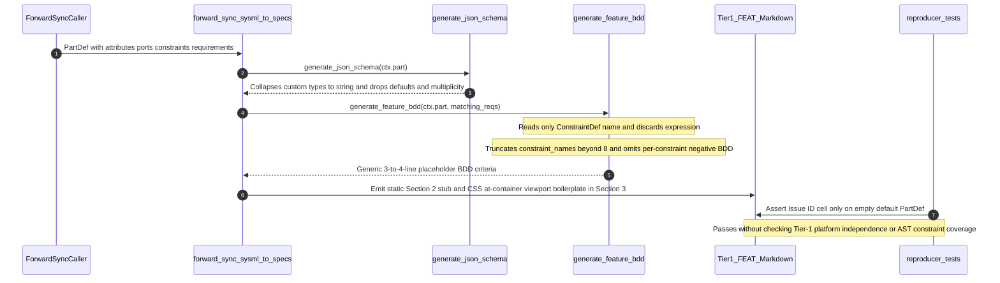

## 1. Context and References

<!-- test-target: crates/compile-sysml/tests/reproducer_tests.rs -->

- **File**: `crates/compile-sysml/src/sync/forward.rs:514-2261`
- **Pillar**: Semantic Traceability
- **Symptom**: `forward_sync_sysml_to_specs` unconditionally injects hardcoded CSS/web layout strings (`viewport containment`, `@container isolation rules`) and static 1-line section placeholders into every generated Tier-1 `docs/features/FEAT-*.md` file (`forward.rs:2219-2236`) -- even for pure backend Rust compiler `PartDef`s -- while `generate_json_schema` (`forward.rs:514-568`) and `generate_feature_bdd` (`forward.rs:597-675`) drop `ConstraintDef` invariant expressions, truncate constraints beyond 8 (`constraint_names.truncate(8)`), omit `AttributeDef` default/multiplicity and `PortDef` payload constraints, and omit mandatory per-constraint negative BDD scenarios, undetected by `crates/compile-sysml/tests/reproducer_tests.rs`.
- **Test-Target**: `crates/compile-sysml/tests/reproducer_tests.rs`

## 2. Root Cause Analysis (5 Whys)

1. **Why do forward-synced Tier-1 `FEAT-*.md` specifications for pure backend compiler and embedded `PartDef` components contain CSS `@container isolation rules`, `viewport containment` boilerplate, and generic 3-to-4-line placeholder BDD while missing declared SysML AST constraints?** Because the Feature synthesis loop in `forward_sync_sysml_to_specs` (`crates/compile-sysml/src/sync/forward.rs:2193-2258`) formats a hardcoded web-UI markdown template for `### 2. Validation & Constraints` (`forward.rs:2219-2220`) and `### 3. Visual Layout & Arrangement` (`forward.rs:2222-2223`), and delegates acceptance criteria to `generate_feature_bdd` (`forward.rs:597-675`), which reads only constraint names (`c.name`) and truncates them at 8 (`forward.rs:655-657`).
2. **Why does the Feature template emit CSS `@container` boilerplate and a static 1-line `Validation & Constraints` stub regardless of the underlying `PartDef` AST?** Because `forward_sync_sysml_to_specs` never inspects `ctx.part.attributes`, `ctx.part.ports`, `ctx.part.parts`, `ctx.part.constraints`, or `matching_reqs` when rendering Sections 2 and 3 or Layers 1-3 (`forward.rs:2183,2219-2236`), treating every `PartDef` simultaneously as a `"Physical / Structural / Internal Bus"` (`forward.rs:2183`), a CSS `@container` web widget (`forward.rs:2223`), and an `"AST references"` holder (`forward.rs:2229`).
3. **Why do `generate_feature_bdd` and `generate_json_schema` fail to project `AttributeDef` types/defaults/multiplicities, `PortDef` directions/payloads, `ConstraintDef` expressions, and `RequirementDef` positive/negative criteria?** Because `generate_json_schema` (`forward.rs:529-549`) collapses all non-primitive attribute types to `"string"` and forces all members into `"required"` without reading defaults, multiplicities, or constraint expressions, while `generate_feature_bdd` (`forward.rs:610-672`) extracts only `ConstraintDef::name` strings (discarding `ConstraintDef::expression`), invents a synthetic `"operational_invariants"` placeholder when empty (`forward.rs:654`), calls `constraint_names.truncate(8)` to force Check 18 bounds (`forward.rs:655-657`), and emits only one generic catch-all failsafe line (`forward.rs:668-672`) instead of per-constraint negative scenarios.
4. **Why does non-forced re-synchronization (`opts.force == false`) perpetuate the leaked `@container` boilerplate and omitted constraints even after a schema is enriched?** Because `merge_existing_spec_content` (`forward.rs:3118-3132`) overwrites newly generated `### 2. Validation & Constraints` and `### 3. Visual Layout & Arrangement` bodies with whatever text was written to disk during initial Feature generation.
5. **Why did `crates/compile-sysml/tests/reproducer_tests.rs` and inline `forward.rs` unit tests fail to catch both the Tier-1 CSS `@container` violation and the dropped AST constraints?** Because the sole forward-sync test in `reproducer_tests.rs` (`test_issue_552_forward_sync_does_not_emit_hardcoded_colliding_issue_ids`, `reproducer_tests.rs:83-232`) passes an empty `PartDef::default()` (`NavigationController`, `reproducer_tests.rs:103-106`) and asserts only `Issue ID` table cells (`reproducer_tests.rs:147-150,185-188,220-224`), while inline unit test `test_feature_bdd_derived_from_constraints_and_requirements` (`forward.rs:4894-4954`) passes `expression: "frame_rate <= 60"` and `expression: "latency_ms < 5"` in its fixture (`forward.rs:4903,4912`) without asserting that either expression appears in the generated BDD output.

## 3. Correctness Analysis

Tracing data flow from a SysML v2 `PackageDef` containing a pure backend `PartDef` (e.g., `RangeSliceAstDetector` or `BijectiveSysmlSerializer`) with typed `AttributeDef`s, directional `PortDef`s, `ConstraintDef` invariant expressions, and `RequirementDef`s through `forward_sync_sysml_to_specs(&pkg, &opts)` (`crates/compile-sysml/src/sync/forward.rs:1471-2776`):

1. **Tier-1 Platform-Independence Violation (`.pipeline/constitution.md:44,115-116`)**:
   - At `forward.rs:2105-2261`, `forward_sync_sysml_to_specs` iterates over `part_contexts`.
   - At `forward.rs:2183`, it hardcodes `let interface_type = "Physical / Structural / Internal Bus";` for every `PartDef` instead of deriving the LUMI category (`gui`, `api`/`mcp`, `hardware`, or internal structural module) from AST ports and operations.
   - At `forward.rs:2222-2223`, it unconditionally emits into every `docs/features/FEAT-*.md`:
     `Logical layout, viewport containment, and container structure for {part_name} conforming to platform design tokens. Container boundaries enforce @container isolation rules.`
   - `@container` is a CSS Container Queries stylesheet keyword and `viewport containment` is browser layout terminology. Injecting CSS framework/stylesheet rules into Tier-1 `FEAT-*.md` specifications -- including pure Rust compiler components with zero GUI surface -- directly violates `.pipeline/constitution.md:44` ("Tier 1: Functional Layer (Abstract Specification)... Must be platform-independent and standard-agnostic. No framework keywords, specific standards designations, or hardcoded visual values allowed") and `.pipeline/constitution.md:115-116` ("Features MUST be platform-independent and standard-agnostic").
   - Simultaneously, `forward.rs:2229` hardcodes `"AST references"` (`Domain state vector representing {part_name} status, AST references, and typed signal models.`) into Layer 1 of non-compiler domain `PartDef`s, contaminating non-compiler specifications with compiler-internal terminology.

2. **Schema Compliance & Zero-Loss Constraint Violation (`.pipeline/constitution.md:60-66,108,120-124`)**:
   - **Section 2 Complete AST Drop (`forward.rs:2219-2220`)**: `### 2. Validation & Constraints` emits only `"Formal constraints and invariant guarantees enforced by {part_name}."`. Zero `AttributeDef` types/defaults/multiplicities, zero `PortDef` directions/payloads, zero `ConstraintDef` expressions, and zero `RequirementDef` clauses are projected, and unconstrained nodes omit the mandatory `"no additional constraints specified in schema"` note required by `.pipeline/constitution.md:63`.
   - **JSON Schema Lossy Collapse (`forward.rs:514-568`)**: `generate_json_schema` maps every custom SysML type outside `Integer`/`Real`/`Float`/`Boolean` to `"string"` (`forward.rs:530-535`) without preserving the declared SysML `type_name`, forces every attribute and port into `"required"` (`forward.rs:540,548`) regardless of multiplicity or default value, and ignores all `ConstraintDef` bounds.
   - **BDD Expression & Negative-Scenario Drop (`forward.rs:597-675`)**:
     - `generate_feature_bdd` collects only `c.name.trim()` (`forward.rs:610-649`), discarding `c.expression` on both `PartDef::constraints` and `RequirementDef::constraints`, as well as `RequirementDef` specification text and `req_id` traceability when `req.name` is non-empty (`forward.rs:626-631`).
     - When `constraint_names.len() > 8`, `constraint_names.truncate(8)` (`forward.rs:655-657`) silently discards every 9th and subsequent schema constraint, directly violating `.pipeline/constitution.md:61` ("Every data model constraint in the schema MUST be captured in at least one Feature's acceptance criteria. Zero loss tolerance") and `.pipeline/constitution.md:108` ("Features exceeding 10 acceptance criteria MUST be split into targeted sub-features").
     - When `constraint_names.is_empty()`, `forward.rs:653-654` fabricates `"operational_invariants"`, yielding a generic 3-line placeholder BDD (`AC-01` nominal stub, `AC-02` `'operational_invariants'` stub, `AC-03` generic failsafe stub) that ignores all declared `AttributeDef` and `PortDef` contracts.
     - Only a single generic Pattern C failsafe bullet is emitted (`forward.rs:668-672`), violating `.pipeline/constitution.md:124` ("Negative scenarios (error cases, boundary violations, emergency failsafe modes) are MANDATORY for every constraint").
   - **Requirement Substring Cross-Contamination (`forward.rs:2118-2124`)**: `matching_reqs` filters `all_requirements` across all packages using `r.name.to_lowercase().contains(&ctx.subsys_dir)` (`forward.rs:2122`), matching unrelated requirements whose names happen to contain a short package slug substring (e.g., `"io"` or `"core"`).

3. **Semantic Traceability Gap in `reproducer_tests.rs` (`crates/compile-sysml/tests/reproducer_tests.rs:83-232`)**:
   - `test_issue_552_forward_sync_does_not_emit_hardcoded_colliding_issue_ids` (`reproducer_tests.rs:83-232`) is the only test in `reproducer_tests.rs` exercising `forward_sync_sysml_to_specs`. Because it constructs `PartDef { name: "NavigationController".to_string(), ..Default::default() }` (`reproducer_tests.rs:103-106`) and asserts only `| **Issue ID** |` metadata cells, it passes while `FEAT-01-NavigationController.md` contains `@container isolation rules` and zero AST constraint projections.
   - Inline tests in `forward.rs` omit `@container`/`viewport` from `test_zero_hardcoded_domain_strings_exist_in_output_specifications` (`forward.rs:4732-4741`), fail to assert `c.expression` presence in `test_feature_bdd_derived_from_constraints_and_requirements` (`forward.rs:4901-4944`), and embed `@container rules` directly inside the `FEAT-01` fixture of `test_issue_477_conops_part_behavior_projection_and_non_destructive_sync` (`forward.rs:5788,5960`).

## 4. UML Diagrams



## 5. Affected Callers / Downstream Impact

- `forward_sync_sysml_to_specs` (`crates/compile-sysml/src/sync/forward.rs:1471-2776`, Feature loop `2104-2261`) -- Every `compile-sysml` forward-sync invocation emits Tier-1 `docs/features/FEAT-*.md` files polluted with CSS `@container` / `viewport containment` keywords and stripped of `PartDef` AST constraints.
- `generate_feature_bdd` (`crates/compile-sysml/src/sync/forward.rs:597-675`) -- Silently drops `ConstraintDef::expression`, truncates constraints beyond 8, and omits per-constraint negative BDD acceptance criteria across all generated Features.
- `generate_json_schema` (`crates/compile-sysml/src/sync/forward.rs:514-568`) -- Emits lossy JSON Schema payloads that erase custom SysML type identities, multiplicities, and default value contracts.
- `merge_existing_spec_content` (`crates/compile-sysml/src/sync/forward.rs:3070-3135`, Feature merge `3118-3132`) -- Locks the initially generated CSS `@container` boilerplate and empty `Validation & Constraints` placeholder into disk files across all subsequent non-forced sync runs (`opts.force == false`).
- Downstream `feature-driven-implementation` & `verify-baseline` (`Check 16`, `Check 18`, `Check 19`, `Check 25` in `.pipeline/constitution.md:175-192`) -- Implementation subagents consuming `docs/features/FEAT-*.md` receive ungrounded placeholder prose and web CSS directives instead of authoritative SysML v2 invariant expressions, attribute bounds, and port contracts.
- `crates/compile-sysml/tests/reproducer_tests.rs:83-232` -- Lacks regression assertions rejecting Tier-1 framework/CSS leakage and verifying lossless `PartDef` AST projection into `FEAT-*.md`.

## 6. Proposed Correction

<!-- MUST NOT use regex (Check 34: deterministic linear slice/char scanning, no regex crate). MUST be domain-agnostic for upstream crates (Check 19). -->

```rust
fn format_optional_clause(label: &str, value: Option<&str>) -> String {
    match value.map(str::trim).filter(|v| !v.is_empty()) {
        Some(v) => format!("{label}={v}"),
        None => String::new(),
    }
}

/// Projects all `PartDef` attributes, ports, constraints, and satisfied requirements into
/// Section 2 (`Validation & Constraints`) with zero loss and explicit unconstrained-node notes
/// per `.pipeline/constitution.md:60-66`.
fn render_feature_validation_and_constraints(
    part: &PartDef,
    reqs: &[&RequirementDef],
) -> String {
    let mut lines = Vec::new();

    for attr in &part.attributes {
        let declared_type = if attr.type_name.trim().is_empty() {
            "Unspecified"
        } else {
            attr.type_name.trim()
        };
        let mut details = Vec::new();
        let mult = format_optional_clause("multiplicity", attr.multiplicity.as_deref());
        if !mult.is_empty() {
            details.push(mult);
        }
        let def_val = format_optional_clause("default", attr.default_value.as_deref());
        if !def_val.is_empty() {
            details.push(def_val);
        }
        if details.is_empty() {
            lines.push(format!(
                "- Attribute `{}` (`{}`): no additional constraints specified in schema.",
                attr.name, declared_type
            ));
        } else {
            lines.push(format!(
                "- Attribute `{}` (`{}`): {}.",
                attr.name,
                declared_type,
                details.join(", ")
            ));
        }
    }

    for port in &part.ports {
        let dir = if port.direction.trim().is_empty() {
            "inout"
        } else {
            port.direction.trim()
        };
        let payload = if port.type_name.trim().is_empty() {
            "UntypedSignal"
        } else {
            port.type_name.trim()
        };
        lines.push(format!(
            "- Port `{}` (`{}`, payload `{}`): directional interface contract enforced.",
            port.name, dir, payload
        ));
    }

    for c in &part.constraints {
        let expr = if c.expression.trim().is_empty() {
            "declared structural invariant"
        } else {
            c.expression.trim()
        };
        lines.push(format!("- Constraint `{}`: `{}`.", c.name.trim(), expr));
    }

    for req in part.requirements.iter().chain(reqs.iter().copied()) {
        let id_label = if !req.req_id.trim().is_empty() {
            req.req_id.trim()
        } else {
            req.name.trim()
        };
        if req.constraints.is_empty() {
            lines.push(format!("- Requirement `{}` (`{}`): satisfied by `{}`.", id_label, req.name.trim(), part.name));
        } else {
            for rc in &req.constraints {
                lines.push(format!(
                    "- Requirement `{}` constraint `{}`: `{}`.",
                    id_label,
                    rc.name.trim(),
                    rc.expression.trim()
                ));
            }
        }
    }

    if lines.is_empty() {
        format!(
            "- Classifier `{}`: no additional constraints specified in schema.",
            part.name
        )
    } else {
        lines.join("\n")
    }
}

/// Renders Tier-1 platform-independent logical containment and boundary topology without CSS,
/// browser viewport terms, or framework keywords (`.pipeline/constitution.md:44,115-116`).
fn render_logical_containment_and_arrangement(part: &PartDef) -> String {
    let mut lines = Vec::new();
    if part.parts.is_empty() && part.ports.is_empty() {
        lines.push(format!(
            "Logical structural boundary for `{}` with self-contained internal state encapsulation and zero external platform layout coupling.",
            part.name
        ));
    } else {
        for sub in &part.parts {
            let target = sub.type_name.as_deref().unwrap_or(&sub.name);
            lines.push(format!(
                "- Logical composition: `{}` encapsulates sub-component `{}` (`{}`).",
                part.name, sub.name, target
            ));
        }
        for port in &part.ports {
            let dir = if port.direction.trim().is_empty() {
                "inout"
            } else {
                port.direction.trim()
            };
            let payload = if port.type_name.trim().is_empty() {
                "LogicalSignal"
            } else {
                port.type_name.trim()
            };
            lines.push(format!(
                "- Boundary terminal `{}`: `{}` channel carrying `{}`.",
                port.name, dir, payload
            ));
        }
    }
    lines.join("\n")
}

/// Projects deterministic positive and mandatory negative Given-When-Then acceptance criteria
/// from `PartDef` constraints, requirements, attributes, and ports without `.truncate(8)` data loss.
fn generate_feature_bdd_lossless(part: &PartDef, reqs: &[&RequirementDef]) -> String {
    let mut criteria = Vec::new();
    let mut seen = BTreeSet::new();

    for c in &part.constraints {
        let key = format!("{}::{}", c.name.trim(), c.expression.trim());
        if !c.name.trim().is_empty() && seen.insert(key) {
            let expr = if c.expression.trim().is_empty() {
                c.name.trim()
            } else {
                c.expression.trim()
            };
            let pos_idx = criteria.len() + 1;
            criteria.push(format!(
                "- [ ] AC-{pos_idx:02}: Given initialized `{}` state satisfying preconditions, When `{}` evaluates constraint `{}` (`{}`), Then invariant holds and nominal output state is committed.",
                part.name, part.name, c.name.trim(), expr
            ));
            let neg_idx = criteria.len() + 1;
            criteria.push(format!(
                "- [ ] AC-{neg_idx:02}: Given input or state violating constraint `{}` (`not ({})`), When `{}` validation executes, Then rejects the transition fail-closed without partial state mutation.",
                c.name.trim(), expr, part.name
            ));
        }
    }

    for req in part.requirements.iter().chain(reqs.iter().copied()) {
        let req_label = if !req.req_id.trim().is_empty() {
            req.req_id.trim()
        } else {
            req.name.trim()
        };
        if req.constraints.is_empty() && !req_label.is_empty() && seen.insert(req_label.to_string()) {
            let pos_idx = criteria.len() + 1;
            criteria.push(format!(
                "- [ ] AC-{pos_idx:02}: Given nominal `{}` state, When requirement `{}` (`{}`) is verified, Then `{}` satisfies declared requirement postconditions.",
                part.name, req_label, req.name.trim(), part.name
            ));
            let neg_idx = criteria.len() + 1;
            criteria.push(format!(
                "- [ ] AC-{neg_idx:02}: Given boundary input violating requirement `{}` (`{}`), When `{}` executes guard checks, Then emits structured fault diagnostic and preserves safe state.",
                req_label, req.name.trim(), part.name
            ));
        }
        for rc in &req.constraints {
            let key = format!("{}::{}::{}", req_label, rc.name.trim(), rc.expression.trim());
            if !rc.name.trim().is_empty() && seen.insert(key) {
                let expr = if rc.expression.trim().is_empty() {
                    rc.name.trim()
                } else {
                    rc.expression.trim()
                };
                let pos_idx = criteria.len() + 1;
                criteria.push(format!(
                    "- [ ] AC-{pos_idx:02}: Given operational `{}` state under `{}`, When constraint `{}` (`{}`) is evaluated, Then invariant holds within declared bounds.",
                    part.name, req_label, rc.name.trim(), expr
                ));
                let neg_idx = criteria.len() + 1;
                criteria.push(format!(
                    "- [ ] AC-{neg_idx:02}: Given input violating `{}` constraint `{}` (`not ({})`), When `{}` evaluates guard conditions, Then transitions to deterministic failsafe state without corruption.",
                    req_label, rc.name.trim(), expr, part.name
                ));
            }
        }
    }

    for attr in &part.attributes {
        let key = format!("attr::{}::{}", attr.name.trim(), attr.type_name.trim());
        if !attr.name.trim().is_empty() && seen.insert(key) {
            let pos_idx = criteria.len() + 1;
            criteria.push(format!(
                "- [ ] AC-{pos_idx:02}: Given valid `{}` value for attribute `{}` on `{}`, When state update is applied, Then `{}` persists typed attribute state deterministically.",
                attr.type_name.trim(), attr.name.trim(), part.name, part.name
            ));
            let neg_idx = criteria.len() + 1;
            criteria.push(format!(
                "- [ ] AC-{neg_idx:02}: Given malformed or out-of-range `{}` input for attribute `{}`, When `{}` validates state mutation, Then rejects mutation and preserves prior verified value.",
                attr.type_name.trim(), attr.name.trim(), part.name
            ));
        }
    }

    for port in &part.ports {
        let key = format!("port::{}::{}::{}", port.name.trim(), port.direction.trim(), port.type_name.trim());
        if !port.name.trim().is_empty() && seen.insert(key) {
            let pos_idx = criteria.len() + 1;
            criteria.push(format!(
                "- [ ] AC-{pos_idx:02}: Given well-formed `{}` payload on `{}` port `{}`, When `{}` processes interface transfer, Then routes signal deterministically per port contract.",
                port.type_name.trim(), port.direction.trim(), port.name.trim(), part.name
            ));
        }
    }

    while criteria.len() < 3 {
        let idx = criteria.len() + 1;
        if idx == 1 {
            criteria.push(format!(
                "- [ ] AC-01: Given initialized `{}` state, When nominal invocation occurs, Then preserves structural invariants (no additional constraints specified in schema).",
                part.name
            ));
        } else if idx == 2 {
            criteria.push(format!(
                "- [ ] AC-02: Given deterministic `{}` state transition request, When operations execute, Then completes with referential transparency.",
                part.name
            ));
        } else {
            criteria.push(format!(
                "- [ ] AC-03: Given invalid boundary input to `{}`, When fault guard executes, Then rejects request fail-closed without state corruption.",
                part.name
            ));
        }
    }

    criteria.join("\n")
}
```

## 7. Relationship to Existing Issues

Discovered in audit -- new finding.

## Audit Source

Adversarial Semantic Traceability Audit
SEVERITY: Important
FILE_LOCATION: crates/compile-sysml/src/sync/forward.rs:514-2261
