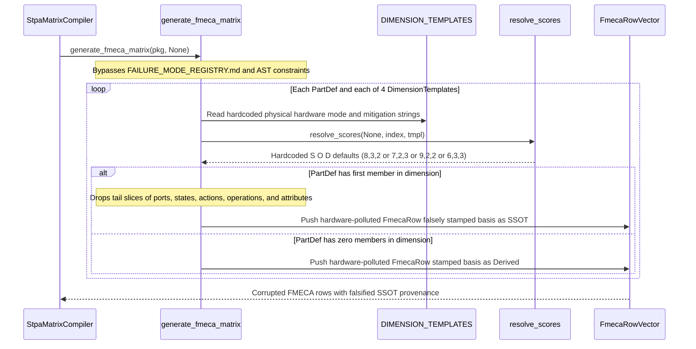

## 1. Context and References

<!-- test-target: crates/compile-sysml/tests/reproducer_tests.rs -->

- **File**: `crates/compile-sysml/src/stpa/fmeca.rs:226-613`
- **Pillar**: Semantic Traceability
- **Symptom**: `DIMENSION_TEMPLATES` hardcodes physical electro-mechanical and avionics hardware failure modes and mitigations (`"Interface Bus Dropout / Frame Corruption"`, `"Dual-redundant serial bus with CRC-32 integrity validation"`, `"Actuation Loop Saturation / Command Inversion"`, `"Uncommanded deflection or delayed actuation response"`, `"Thermal Headroom Depletion / Brownout"`, `"Passive thermal sink margin and low-voltage cutoff interlock"`) and `generate_fmeca_matrix` interpolates arbitrary software AST `PartDef` names and `.first()` member names directly into them while unconditionally stamping `basis = "SSOT"`, dropping `ports[1..]`, `states[1..]`, `actions[1..]`, `operations`, and `attributes[1..]`, bypassing `docs/research/FAILURE_MODE_REGISTRY.md`, and attributing hardcoded default `S * O * D` RPN scores (`8*3*2=48`, `7*2*3=42`, `9*2*2=36`, `6*3*3=54`) as SSOT facts.
- **Test-Target**: `crates/compile-sysml/tests/reproducer_tests.rs`

## 2. Root Cause Analysis (5 Whys)

1. **Why does `generate_fmeca_matrix` emit physical serial-bus, servo-deflection, and thermal-brownout FMECA rows marked `SSOT` for pure software SysML v2 components?** Because `crates/compile-sysml/src/stpa/fmeca.rs:382-458` formats every AST `PartDef` against the static `DIMENSION_TEMPLATES` table (`lines 226-263`) and unconditionally assigns `basis_str = "SSOT".to_string()` whenever `part.ports.first()`, `part.states.first()`, `part.actions.first()`, `part.operations.first()`, or `part.attributes.first()` returns `Some(_)`.
2. **Why does the presence of any single structural AST member cause fabricated hardware failure modes and hardcoded RPN scores (`48`, `42`, `36`, `54`) to be graded as `SSOT`?** Because `generate_fmeca_matrix` conflates structural existence of a port, state, action, operation, or attribute in `.pipeline/schema.sysml` with direct SSOT evidence of that member's failure mode, failure effect, hardware mitigation, and MIL-STD-1629A / SAE ARP4761 `S/O/D` scores, violating the Derivation-Annotation Contract (`.pipeline/constitution.md:210`).
3. **Why did `generate_fmeca_matrix` rely on static physical hardware string templates (`lines 226-263`) and `.first()` member sampling instead of schema- or registry-derived failure definitions?** Because `generate_fmeca_matrix(pkg: &PackageDef, scoring_config: Option<&FmecaScoringConfig>)` (`lines 292-295`) has no parameter or ingestion path for `docs/research/FAILURE_MODE_REGISTRY.md` (`.pipeline/constitution.md:204-209`) or AST constraint/hazard failure annotations, and instead hardcoded a single electro-mechanical template per `FailureDimension` while inspecting only index `0` of each member vector.
4. **Why does `resolve_scores` (`lines 586-613`) also produce ungrounded `S/O/D` values regardless of whether `scoring_config` is supplied?** Because when `scoring_config` is `None`, `resolve_scores` emits the hardcoded `DIMENSION_TEMPLATES` constants (`default_s`, `default_o`, `default_d`), and when `scoring_config` is `Some(cfg)`, `pick` (`lines 592-597`) modulo-cycles across scale entries by synthetic loop index `(index + offset).checked_rem(scale.len())` while falling back to `tmpl.default_s` for occurrence and detection alike if a scale slice is empty (`line 595`).
5. **Why did existing unit tests in `crates/compile-sysml/src/stpa/fmeca.rs:620-718` pass without detecting the domain pollution, dropped AST members, or falsified `SSOT` basis tags?** Because `test_fmeca_matrix_generation_and_rpn` (`lines 621-656`) constructs `PartDef` fixtures with `..Default::default()` (zero ports, states, actions, operations, or attributes), leaving every `Some(...)` `"SSOT"` branch (`lines 384-390`, `401-407`, `418-431`, `442-448`) completely unexecuted and asserting only superficial shape predicates (`rows.len() >= 15`, `1 <= s,o,d <= 10`, and non-empty strings) with zero assertions on `row.basis`, multi-member coverage, or domain neutrality.

## 3. Correctness Analysis

Tracing data flow from `generate_fmeca_matrix(pkg, scoring_config)` (`crates/compile-sysml/src/stpa/fmeca.rs:292`):

1. **Hardcoded Physical Avionics/Hardware Domain Pollution (`lines 226-263`)**:
   `DIMENSION_TEMPLATES` embeds concrete physical hardware assumptions inside an upstream Tier-0 abstract compiler crate:
   - `FailureDimension::Interface` (`lines 227-235`): `mode_suffix = "Interface Bus Dropout / Frame Corruption"`, `mitigation_template = "Dual-redundant serial bus with CRC-32 integrity validation"`, `default_s = 8, default_o = 3, default_d = 2` (`RPN = 48`).
   - `FailureDimension::State` (`lines 236-244`): `mode_suffix = "Degraded State Latch / Transition Lockout"`, `mitigation_template = "Independent watchdog supervisor with deterministic state-reset vector"`, `default_s = 7, default_o = 2, default_d = 3` (`RPN = 42`).
   - `FailureDimension::Action` (`lines 245-253`): `mode_suffix = "Actuation Loop Saturation / Command Inversion"`, `effect_template = "Uncommanded deflection or delayed actuation response"`, `mitigation_template = "Dynamic rate limiting and simplex safety-monitor disengagement"`, `default_s = 9, default_o = 2, default_d = 2` (`RPN = 36`).
   - `FailureDimension::Resource` (`lines 254-262`): `mode_suffix = "Thermal Headroom Depletion / Brownout"`, `mitigation_template = "Passive thermal sink margin and low-voltage cutoff interlock"`, `default_s = 6, default_o = 3, default_d = 3` (`RPN = 54`).
   When `pkg` models a pure software or protocol architecture (for example, `part def QueryPlanner` with `attribute maxRetries : Integer` and `action parseAst`), `lines 418-424` and `lines 442-448` emit `"QueryPlanner Action 'parseAst' Actuation Loop Saturation / Command Inversion"` with effect `"Uncommanded deflection or delayed actuation response during 'parseAst'"` and `"QueryPlanner Attribute 'maxRetries' Thermal Headroom Depletion / Brownout"` mitigated by `"Passive thermal sink margin and low-voltage cutoff interlock for attribute 'maxRetries'"`. This directly violates `.pipeline/constitution.md:50` (**Pure Schema-Driven Compiler**) and **Check 19** (**Domain Cleanliness Invariant**).

2. **Falsified `SSOT` Provenance Basis & Bypassed `FAILURE_MODE_REGISTRY.md` (`lines 292-295`, `382-458`, `586-613`)**:
   In the primary loop (`lines 374-478`), `generate_fmeca_matrix` tests `part.ports.first()` (`line 384`), `part.states.first()` (`line 401`), `part.actions.first()` (`line 418`), `part.operations.first()` (`line 425`), and `part.attributes.first()` (`line 442`). Whenever `.first()` yields `Some(_)`, the row is stamped `"SSOT".to_string()` (`lines 389, 406, 423, 430, 447`) even though:
   - Neither the failure mode text, nor the failure effect, nor the hardware mitigation, nor the `S/O/D` scores (`resolve_scores` at `lines 378-380`, `586-613`) appear anywhere in `pkg` or `docs/research/FAILURE_MODE_REGISTRY.md`.
   - When `scoring_config` is `Some(cfg)` with an empty scale vector, `resolve_scores` (`line 595`) substitutes `tmpl.default_s` into `occurrence` and `detection` (`tmpl.default_s` cubed instead of `default_o` / `default_d`).
   This violates `.pipeline/constitution.md:202, 209-210` (**Component Failure Mode Registry** and **Derivation-Annotation Contract**), which forbids presenting analytical/template extrapolations as `SSOT` facts.

3. **Silent Omission of Tail AST Members & Arbitrary Hazard Index Coupling (`lines 384-456`, `517-553`)**:
   Because each match arm inspects only `.first()`, all remaining ports `part.ports[1..]`, states `part.states[1..]`, actions `part.actions[1..]`, all `part.operations` whenever `part.actions` is non-empty (`lines 418-431`), and attributes `part.attributes[1..]` receive zero FMECA coverage. Furthermore, when `rows.len() < 15`, the padding loop (`lines 517-553`) pairs `filtered_parts[add_idx % filtered_parts.len()]` with `all_hazards.get(add_idx)` (`line 529`) purely by loop counter alignment rather than semantic AST hazard-to-component references.

## 4. UML Diagrams



## 5. Affected Callers / Downstream Impact

- `crates/compile-sysml/src/stpa/mod.rs` (STPA/FMECA Pillar 7 specification synthesizer) -- emits fabricated physical serial-bus, servo-deflection, and thermal-brownout mitigations along with falsified `SSOT` basis annotations into `docs/safety/STPA_MATRIX.md` for all software, protocol, and non-avionics SysML v2 schemas.
- `crates/verify-baseline` (Check 17 Safety Integrity Quality Gate) -- validates synthetic `>= 15` FMECA tables as passing because `basis` contains `"SSOT"` and `1 <= S, O, D <= 10`, masking missing `docs/research/FAILURE_MODE_REGISTRY.md` traceability and uncovered `ports[1..]` / `attributes[1..]` / `operations` AST nodes.
- `crates/compile-sysml/src/stpa/fmeca.rs:620-656` (`tests::test_fmeca_matrix_generation_and_rpn`) -- produces a false-green test pass on memberless `PartDef` fixtures without exercising lines `384-448` or verifying `SSOT` vs `Derived` provenance integrity.

## 6. Proposed Correction

<!-- MUST NOT use regex (Check 34: deterministic linear slice/char scanning, no regex crate). MUST be domain-agnostic for upstream crates (Check 19). -->

```rust
#[derive(Debug, Clone, PartialEq, Eq)]
pub struct RegistryFailureEntry {
    pub component: String,
    pub dimension: FailureDimension,
    pub failure_mode: String,
    pub effect: String,
    pub severity: u32,
    pub occurrence: u32,
    pub detection: u32,
    pub mitigation: String,
    pub is_ssot_evidenced: bool,
}

struct AbstractDimensionFallback {
    dimension: FailureDimension,
    mode_label: &'static str,
    effect_label: &'static str,
    mitigation_label: &'static str,
    default_s: u32,
    default_o: u32,
    default_d: u32,
}

const ABSTRACT_DIMENSION_FALLBACKS: [AbstractDimensionFallback; 4] = [
    AbstractDimensionFallback {
        dimension: FailureDimension::Interface,
        mode_label: "Boundary Contract Violation",
        effect_label: "Invalid or missing data exchange across declared interface boundary",
        mitigation_label: "Enforce declared interface schema validation and boundary error handling",
        default_s: 8,
        default_o: 3,
        default_d: 2,
    },
    AbstractDimensionFallback {
        dimension: FailureDimension::State,
        mode_label: "Illegal State Transition or Invariant Violation",
        effect_label: "Classifier enters inconsistent or deadlocked lifecycle state",
        mitigation_label: "Enforce deterministic transition guards and explicit recovery state",
        default_s: 7,
        default_o: 2,
        default_d: 3,
    },
    AbstractDimensionFallback {
        dimension: FailureDimension::Action,
        mode_label: "Behavioral Precondition or Postcondition Violation",
        effect_label: "Operation produces out-of-contract output or misses completion bound",
        mitigation_label: "Enforce input precondition checks and bounded execution invariants",
        default_s: 9,
        default_o: 2,
        default_d: 2,
    },
    AbstractDimensionFallback {
        dimension: FailureDimension::Resource,
        mode_label: "Declared Capacity or Allocation Exhaustion",
        effect_label: "Property value exceeds declared domain bound or exhausts capacity",
        mitigation_label: "Enforce static capacity bounds and deterministic saturation handling",
        default_s: 6,
        default_o: 3,
        default_d: 3,
    },
];

fn resolve_fallback_scores(
    scoring_config: Option<&FmecaScoringConfig>,
    index: usize,
    tmpl: &AbstractDimensionFallback,
) -> (u32, u32, u32, String, String, String) {
    if let Some(cfg) = scoring_config {
        let pick = |scale: &[ScoringScaleEntry], offset: usize, fallback: u32| -> (u32, String) {
            match (index + offset).checked_rem(scale.len()).and_then(|i| scale.get(i)) {
                Some(entry) => (entry.score, format!("{} ({})", entry.label, entry.score)),
                None => (fallback, format!("{}", fallback)),
            }
        };
        let (s, s_cell) = pick(&cfg.severity_scale, 0, tmpl.default_s);
        let (o, o_cell) = pick(&cfg.occurrence_scale, 1, tmpl.default_o);
        let (d, d_cell) = pick(&cfg.detection_scale, 2, tmpl.default_d);
        (s, o, d, s_cell, o_cell, d_cell)
    } else {
        (
            tmpl.default_s,
            tmpl.default_o,
            tmpl.default_d,
            format!("{}", tmpl.default_s),
            format!("{}", tmpl.default_o),
            format!("{}", tmpl.default_d),
        )
    }
}

pub fn generate_fmeca_matrix_with_registry(
    pkg: &PackageDef,
    scoring_config: Option<&FmecaScoringConfig>,
    registry_entries: &[RegistryFailureEntry],
) -> Vec<FmecaRow> {
    let mut rows = Vec::new();
    let mut row_counter: usize = 0;

    for part in pkg.get_all_parts().into_iter().filter(|p| !p.name.starts_with('_')) {
        let part_name = part.name.as_str();
        for tmpl in &ABSTRACT_DIMENSION_FALLBACKS {
            let explicit_matches: Vec<&RegistryFailureEntry> = registry_entries
                .iter()
                .filter(|e| e.component == part_name && e.dimension == tmpl.dimension)
                .collect();

            if !explicit_matches.is_empty() {
                for entry in explicit_matches {
                    row_counter += 1;
                    let s = entry.severity.clamp(1, 10);
                    let o = entry.occurrence.clamp(1, 10);
                    let d = entry.detection.clamp(1, 10);
                    let rpn = s * o * d;
                    rows.push(FmecaRow {
                        id: format!("FMECA-{:03}", row_counter),
                        component: part_name.to_string(),
                        dimension: tmpl.dimension.as_str().to_string(),
                        failure_mode: entry.failure_mode.clone(),
                        effect: entry.effect.clone(),
                        severity: s,
                        occurrence: o,
                        detection: d,
                        rpn,
                        severity_cell: format!("{}", s),
                        occurrence_cell: format!("{}", o),
                        detection_cell: format!("{}", d),
                        rpn_cell: format!("{}", rpn),
                        mitigation: entry.mitigation.clone(),
                        basis: if entry.is_ssot_evidenced {
                            "SSOT".to_string()
                        } else {
                            "Derived".to_string()
                        },
                    });
                }
                continue;
            }

            let member_labels: Vec<(String, &str)> = match tmpl.dimension {
                FailureDimension::Interface => part
                    .ports
                    .iter()
                    .map(|m| (m.name.clone(), "Port"))
                    .collect(),
                FailureDimension::State => part
                    .states
                    .iter()
                    .map(|m| (m.name.clone(), "State"))
                    .collect(),
                FailureDimension::Action => part
                    .actions
                    .iter()
                    .map(|m| (m.name.clone(), "Action"))
                    .chain(part.operations.iter().map(|m| (m.name.clone(), "Operation")))
                    .collect(),
                FailureDimension::Resource => part
                    .attributes
                    .iter()
                    .map(|m| (m.name.clone(), "Attribute"))
                    .collect(),
            };

            if member_labels.is_empty() {
                row_counter += 1;
                let (s, o, d, s_cell, o_cell, d_cell) =
                    resolve_fallback_scores(scoring_config, row_counter, tmpl);
                let rpn = s * o * d;
                rows.push(FmecaRow {
                    id: format!("FMECA-{:03}", row_counter),
                    component: part_name.to_string(),
                    dimension: tmpl.dimension.as_str().to_string(),
                    failure_mode: format!("{} {}", part_name, tmpl.mode_label),
                    effect: format!("{}: {}", part_name, tmpl.effect_label),
                    severity: s,
                    occurrence: o,
                    detection: d,
                    rpn,
                    severity_cell: s_cell,
                    occurrence_cell: o_cell,
                    detection_cell: d_cell,
                    rpn_cell: format!("{}", rpn),
                    mitigation: format!("{}: {}", part_name, tmpl.mitigation_label),
                    basis: "Derived".to_string(),
                });
            } else {
                for (member_name, kind_label) in member_labels {
                    row_counter += 1;
                    let (s, o, d, s_cell, o_cell, d_cell) =
                        resolve_fallback_scores(scoring_config, row_counter, tmpl);
                    let rpn = s * o * d;
                    rows.push(FmecaRow {
                        id: format!("FMECA-{:03}", row_counter),
                        component: part_name.to_string(),
                        dimension: tmpl.dimension.as_str().to_string(),
                        failure_mode: format!(
                            "{} {} '{}' {}",
                            part_name, kind_label, member_name, tmpl.mode_label
                        ),
                        effect: format!(
                            "{}: {} on {} '{}'",
                            part_name, tmpl.effect_label, kind_label, member_name
                        ),
                        severity: s,
                        occurrence: o,
                        detection: d,
                        rpn,
                        severity_cell: s_cell,
                        occurrence_cell: o_cell,
                        detection_cell: d_cell,
                        rpn_cell: format!("{}", rpn),
                        mitigation: format!(
                            "{}: {} for {} '{}'",
                            part_name, tmpl.mitigation_label, kind_label, member_name
                        ),
                        basis: "Derived".to_string(),
                    });
                }
            }
        }
    }

    rows
}
```

## 7. Relationship to Existing Issues

Discovered in audit -- new finding.

## Audit Source

Adversarial Semantic Traceability Audit
SEVERITY: Important
FILE_LOCATION: crates/compile-sysml/src/stpa/fmeca.rs:226-613
