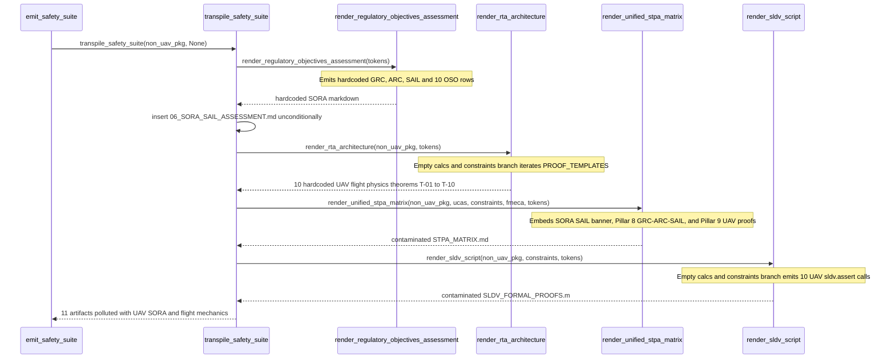

## 1. Context and References

<!-- test-target: crates/compile-sysml/tests/reproducer_tests.rs -->

- **File**: `crates/compile-sysml/src/stpa/safety_suite.rs:60-1720`
- **Pillar**: Semantic Traceability
- **Symptom**: The upstream abstract safety compiler (`compile-sysml`) hardcodes 10 UAV flight-mechanics, pneumatic catapult launch, RF datalink, battery return-to-launch, airspace well-clear CPA, and terminal-dive aeroelastic proof templates (`PROOF_TEMPLATES: [ProofTemplate; 10]`) alongside JARUS SORA drone regulatory assessment artifacts (`06_SORA_SAIL_ASSESSMENT.md`, `Ground Risk Class (GRC)`, `Air Risk Class (ARC)`, `Specific Assurance and Integrity Level (SAIL)`, and 10 hardcoded `OSO ID` rows `OBJ-01`..`OBJ-10`), injecting UAV-specific physics theorems, MATLAB SLDV assertions, and drone regulatory tables into every downstream project regardless of domain while unit tests pass by asserting on those hardcoded UAV artifacts.
- **Test-Target**: `crates/compile-sysml/tests/reproducer_tests.rs`

## 2. Root Cause Analysis (5 Whys)

1. **Why do non-UAV downstream workspaces receive UAV flight-mechanics theorems (`Kinetic Energy Dissipation Bound`, `LiftToDragRatio`, `SinkRate`, `StallSpeed`, `PropulsionPower`, `AvionicsPower`) and JARUS SORA drone regulatory tables (`GRC`, `ARC`, `SAIL`, `OSO ID`) in their generated safety suite?** Because `crates/compile-sysml/src/stpa/safety_suite.rs` embeds a static 10-element `PROOF_TEMPLATES` constant (`lines 60-319`) invoked by fallback branches in `render_rta_architecture` (`lines 1377-1412`) and `render_sldv_script` (`lines 1714-1720`), and unconditionally emits `06_SORA_SAIL_ASSESSMENT.md` (`line 600`), `SAIL` UCA columns (`line 909`), SORA `GRC`/`ARC`/`SAIL`/`OSO` rows (`lines 1118-1173`), and `SORA SAIL` headers in `STPA_MATRIX.md` (`lines 1457, 1520-1529`).
2. **Why were `PROOF_TEMPLATES` and SORA `GRC`/`ARC`/`SAIL`/`OSO` tables hardcoded directly into `crates/compile-sysml/src/stpa/safety_suite.rs`?** Because the safety suite transpiler was originally extracted from a concrete unmanned aerial system reference model by turning its 10 flight-envelope proofs and JARUS SORA regulatory table into static Rust string templates with `%%ParamName%%` placeholders defaulting to `PENDING_PARAMETER` (`lines 471-495, 1120-1173, 1392-1410`).
3. **Why do `render_rta_architecture` and `render_sldv_script` still emit those 10 UAV physics proofs when compiling an arbitrary SysML v2 schema?** Because when a `PackageDef` declares zero `calc def` and zero `constraint def` nodes (`all_calcs.is_empty() && all_constraints.is_empty()` at `lines 1263, 1377` and `line 1714`), both functions fall back to iterating `&PROOF_TEMPLATES` instead of reporting that the input AST declares zero formal calculation or constraint expressions.
4. **Why did `render_regulatory_objectives_assessment` and `transpile_safety_suite` continue emitting `06_SORA_SAIL_ASSESSMENT.md` and `GRC`/`ARC`/`SAIL`/`OSO` tables after Pillar 8 was generalized in `.pipeline/constitution.md:203`?** Because `transpile_safety_suite` kept cloning `reg_doc` into `"06_SORA_SAIL_ASSESSMENT.md"` (`lines 595-600`) for backward filename compatibility and `render_regulatory_objectives_assessment` (`lines 1105-1176`) retained hardcoded `Ground Risk Class (GRC)`, `Air Risk Class (ARC)`, `Specific Assurance and Integrity Level (SAIL)`, `| OSO ID |`, and a fixed `for i in 1..=10` loop probing `OSO{:02}_*` keys rather than deriving regulatory classifications and safety objectives from AST nodes.
5. **Why did automated unit tests in `safety_suite.rs` fail to catch this violation of the Pure Schema-Driven Compiler Invariant?** Because the test suite exhibits a Semantic Traceability gap: `test_transpile_safety_suite_produces_all_10_artifacts` (`lines 1936-1980`) explicitly asserts `suite.contains_key("06_SORA_SAIL_ASSESSMENT.md")` (`line 1960`) and `rta.contains("\\begin{aligned}")` (`lines 1968-1969`) on a `TestSystem` fixture containing zero `calc def` and zero `constraint def` nodes (passing solely via the UAV `PROOF_TEMPLATES` fallback), while `test_defect_333_stpa_matrix_embodies_unified_8_pillars` (`lines 2037-2068`) tests a UAV-named package (`AvengerSystemSafety` / `FlightController`) and accepts `"SORA SAIL"` (`line 2065`) as valid Pillar 8 output.

## 3. Correctness Analysis

`.pipeline/constitution.md:50` establishes the **Pure Schema-Driven Compiler Invariant**: the pipeline is an abstract compiler and verification framework, and hardcoding domain-specific concepts into compiler logic or templates is strictly forbidden. `.pipeline/constitution.md:203,210` further mandates that Pillar 8 (**Domain Regulatory Objectives & Integrity Level Mapping**) derive domain safety classifications, integrity levels, and regulatory objectives deterministically from the authoritative domain schema and applicable domain safety framework rather than assuming a single regulatory regime.

Tracing execution from `emit_safety_suite` (`crates/compile-sysml/src/stpa/safety_suite.rs:654-670`) and `transpile_safety_suite` (`crates/compile-sysml/src/stpa/safety_suite.rs:554-624`) on any non-UAV `PackageDef` (for example, an automotive ISO 26262 braking controller, a medical IEC 62304 infusion pump, an industrial railway interlock, or a network protocol module) exposes two coupled domain-contamination paths:

1. **Hardcoded UAV Flight-Mechanics & Catapult Proof Templates (`PROOF_TEMPLATES`)**:
   - `crates/compile-sysml/src/stpa/safety_suite.rs:60-319` defines `pub const PROOF_TEMPLATES: [ProofTemplate; 10]`, embedding 10 unmanned aircraft physics theorems directly in the Tier-0 compiler binary:
     - `T-01` (`lines 61-86`): `Kinetic Energy Dissipation Bound` (`DragCoefficient`, `Aerodynamic drag coefficient`, `DecelerationArea`, `FrontalArea`, `ImpactEnergyDensity`).
     - `T-02` (`lines 87-112`): `Containment Reach Bound` (`InitialAltitude`, `LiftToDragRatio`, `SinkRate`, `WindDriftSpeed`, `GlideDistance`).
     - `T-03` (`lines 113-136`): `Barrier Forward Invariance Bound` (`BarrierRadius`, `PositionOffset`, `GroundSpeed`).
     - `T-04` (`lines 137-158`): `Exponential Discharge Bound` (`BleedResistance`, `StorageCapacitance`, `TauBleed`).
     - `T-05` (`lines 159-185`): `Energy Balance Separation Bound` (`RailPressure`, `PistonArea`, `StrokeLength`, `StallSpeed`, `Minimum stall velocity`, `ReleaseSpeed`).
     - `T-06` (`lines 186-213`): `Link Margin Lower Bound` (`TransmitPower`, `TransmitGain`, `ReceiveGain`, `CarrierFrequency`, `StandoffDistance`).
     - `T-07` (`lines 214-245`): `Energy Reserve and Thermal Budget Bound` (`PropulsionPower`, `AvionicsPower`, `CruiseSpeed`, `ReserveDistance`, `AbortReserve`, `CellTemperature`, return-to-launch energy `E_rtl`).
     - `T-08` (`lines 246-269`): `Separation and Miss Distance Bound` (`WellClearRadius`, `VerticalClearance`, `WarnTime`, `EvadeAcceleration`, `HorizontalSeparationAtCPA`, `VerticalSeparationAtCPA`).
     - `T-09` (`lines 270-297`): `Loading Ceiling and Field of View Bound` (`TerminalMass`, `Terminal dive mass`, `DescentAngle`, `Maximum dive path angle`, `DescentDragCoefficient`, `SeaLevelDensity`, `DynamicPressureLimit`, `Aeroelastic dynamic pressure limit`, `FieldOfViewHalf`).
     - `T-10` (`lines 298-318`): `Markov Reliability Bound` (`ChannelFailureRate1`, `ChannelFailureRate2`, `SwitchRate`, `MissionDuration`, `FailureCeiling`).
   - Whenever the input `PackageDef` contains zero `calc def` and zero `constraint def` nodes (`!all_calcs.is_empty() || !all_constraints.is_empty()` evaluates to `false` at `line 1263`), `render_rta_architecture` enters the `else` branch at `lines 1377-1412` and emits all 10 UAV theorems with every unmapped parameter resolved via `resolve_template` (`lines 471-495`) to `PENDING_PARAMETER` into both `07_RTA_ARCHITECTURE.md` (`lines 603-606`) and Section 9 of `STPA_MATRIX.md` (`lines 1532-1539`).
   - Under the same empty-calc/empty-constraint condition (`line 1714`), `render_sldv_script` (`lines 1714-1720`) emits all 10 UAV `sldv.assert(...)` bindings into `SLDV_FORMAL_PROOFS.m` (`lines 618-621`), producing syntactically and semantically invalid MATLAB Simulink Design Verifier scripts referencing nonexistent aircraft signals (`ImpactEnergyDensity <= PENDING_PARAMETER`, `ReleaseSpeed >= PENDING_PARAMETER`, `HorizontalSeparationAtCPA >= PENDING_PARAMETER`).

2. **Hardcoded Drone JARUS SORA Regulatory Tables & Duplicate File Emission**:
   - `transpile_safety_suite` (`lines 594-600`) calls `render_regulatory_objectives_assessment(&tokens)` and unconditionally inserts both `"06_REGULATORY_OBJECTIVES_ASSESSMENT.md"` and `"06_SORA_SAIL_ASSESSMENT.md"`, causing `emit_safety_suite` (`lines 662-667`) to write a drone SORA file into `docs/safety/` for every project in every industry.
   - `render_uca_matrix` (`line 909`) hardcodes `| SAIL |` as the ninth column of `02_UCA_COMBINATORIAL_MATRIX.md` and Pillar 4 of `STPA_MATRIX.md`.
   - `render_regulatory_objectives_assessment` (`lines 1105-1176`) unconditionally renders `| Ground Risk Class (GRC) |`, `| Air Risk Class (ARC) |`, and `| Specific Assurance and Integrity Level (SAIL) |` (`lines 1120-1135`), followed by `## Operational Safety Objectives` (`line 1137`), `| OSO ID | Objective | Robustness | Integrity | Assurance Level | Evidence |` (`line 1138`), and a fixed 10-iteration loop (`for i in 1..=10` at `lines 1141-1173`) probing `OBJ{:02}_*` and `OSO{:02}_*` keys that defaults all 60 cells to `PENDING_PARAMETER` when absent.
   - `render_unified_stpa_matrix` (`line 1457` and `lines 1520-1529`) hardcodes `| SORA SAIL` in the top-level standards banner and `## 8. Domain Regulatory Objectives & SORA SAIL Risk Mitigations` as the Pillar 8 heading.

3. **Semantic Traceability Test Defect**:
   - Existing unit tests in `crates/compile-sysml/src/stpa/safety_suite.rs:1936-1980` and `2037-2068` do not test negative domain-cleanliness invariants; instead, they require `"06_SORA_SAIL_ASSESSMENT.md"` to exist (`line 1960`) and rely on `PROOF_TEMPLATES` fallback math generation (`line 1968`) when `TestSystem` has zero `calc def` or `constraint def` nodes.

## 4. UML Diagrams



## 5. Affected Callers / Downstream Impact

- `compile_sysml::stpa::safety_suite::transpile_safety_suite` (`crates/compile-sysml/src/stpa/safety_suite.rs:554-624`) -- unconditionally inserts `"06_SORA_SAIL_ASSESSMENT.md"` into the returned artifact map and passes domain-contaminated outputs into `06_REGULATORY_OBJECTIVES_ASSESSMENT.md`, `07_RTA_ARCHITECTURE.md`, `STPA_MATRIX.md`, `02_UCA_COMBINATORIAL_MATRIX.md`, and `SLDV_FORMAL_PROOFS.m`.
- `compile_sysml::stpa::safety_suite::emit_safety_suite` (`crates/compile-sysml/src/stpa/safety_suite.rs:654-670`) -- persists `06_SORA_SAIL_ASSESSMENT.md` and UAV-contaminated safety specifications onto disk in `docs/safety/` for every downstream project invoking `compile-sysml`.
- `compile_sysml::stpa::safety_suite::render_unified_stpa_matrix` (`crates/compile-sysml/src/stpa/safety_suite.rs:1447-1542`) -- pollutes the primary 8-pillar `docs/safety/STPA_MATRIX.md` deliverable inspected by `./target/release/verify-baseline` (Check 17) and downstream blueprint synthesis (`spec-blueprint-engineering`) with `SORA SAIL` headers, `GRC`/`ARC`/`SAIL`/`OSO` tables, and fallback UAV physics theorems.
- `compile_sysml::stpa::safety_suite::render_rta_architecture` (`crates/compile-sysml/src/stpa/safety_suite.rs:1205-1415`) and `render_sldv_script` (`crates/compile-sysml/src/stpa/safety_suite.rs:1691-1739`) -- emit fabricated aerodynamic/catapult theorems and invalid `PENDING_PARAMETER` MATLAB `sldv.assert` statements whenever a package has not yet declared `calc def` or `constraint def` nodes.
- `crates/compile-sysml/src/stpa/safety_suite.rs` unit tests (`lines 1936-1980, 2037-2068`) -- codify the domain leak by asserting on `"06_SORA_SAIL_ASSESSMENT.md"` and fallback `PROOF_TEMPLATES` output.

## 6. Proposed Correction

<!-- MUST NOT use regex (Check 34: deterministic linear slice/char scanning, no regex crate). MUST be domain-agnostic for upstream crates (Check 19). -->

```rust
// 1. Delete `struct ProofTemplate`, `const PROOF_TEMPLATES`, and `fn resolve_template`
//    from `crates/compile-sysml/src/stpa/safety_suite.rs` so zero domain physics templates
//    exist in the abstract compiler crate.

// 2. In `transpile_safety_suite`, emit only the domain-agnostic regulatory assessment file:
let reg_doc = render_regulatory_objectives_assessment(pkg, &tokens);
artifacts.insert(
    "06_REGULATORY_OBJECTIVES_ASSESSMENT.md".to_string(),
    reg_doc,
);

// 3. In `render_uca_matrix`, replace the domain-specific column label with `Integrity Level`:
out.push_str("| UCA ID | Controller | Control Action | Guide Word | Context | Hazard | Safety Constraint | Severity | Integrity Level |\n");

// 4. Derive regulatory classifications and objective rows strictly from AST attributes and tokens
//    using deterministic linear prefix/slice scanning (zero regex, zero hardcoded domain rows):
fn extract_declared_objective_indices(
    tokens: &BTreeMap<String, String>,
    stem: &str,
) -> BTreeSet<String> {
    let mut indices = BTreeSet::new();
    for key in tokens.keys() {
        if let Some(rest) = key.strip_prefix(stem) {
            if let Some((digits, suffix)) = rest.split_once('_') {
                if !digits.is_empty()
                    && digits.chars().all(|c| c.is_ascii_digit())
                    && !suffix.is_empty()
                {
                    indices.insert(digits.to_string());
                }
            }
        }
    }
    indices
}

fn render_regulatory_objectives_assessment(
    pkg: &PackageDef,
    tokens: &BTreeMap<String, String>,
) -> String {
    let raw_prefix = tokens
        .get("REGULATORY_OBJECTIVE_PREFIX")
        .cloned()
        .unwrap_or_else(|| "OBJ-".to_string());
    let prefix_stem = raw_prefix.trim_end_matches('-');
    let prefix_label = format!("{}-", prefix_stem);

    let mut out = String::new();
    out.push_str("# Domain Regulatory Objectives Assessment & Safety Objective Roster\n\n");
    out.push_str("| Assessment Field | Value |\n");
    out.push_str("| :--- | :--- |\n");

    let mut wrote_classification = false;
    for (key, val) in tokens {
        if let Some(field) = key
            .strip_prefix("RegulatoryClass_")
            .or_else(|| key.strip_prefix("IntegrityLevel_"))
        {
            out.push_str(&format!("| {} | {} |\n", field.replace('_', " "), val));
            wrote_classification = true;
        }
    }
    if !wrote_classification {
        out.push_str(&format!(
            "| Domain Integrity Classification ({}) | {} |\n",
            pkg.name, PENDING_PARAMETER
        ));
    }
    out.push('\n');

    out.push_str("## Declared Regulatory Safety Objectives\n\n");
    out.push_str("| Objective ID | Objective | Robustness | Integrity | Assurance Level | Evidence |\n");
    out.push_str("| :--- | :--- | :--- | :--- | :--- | :--- |\n");

    let mut indices = extract_declared_objective_indices(tokens, prefix_stem);
    if prefix_stem != "OBJ" {
        indices.extend(extract_declared_objective_indices(tokens, "OBJ"));
    }

    if indices.is_empty() {
        out.push_str(&format!(
            "| {0}01 | {1} | {1} | {1} | {1} | {1} |\n",
            prefix_label, PENDING_PARAMETER
        ));
    } else {
        for idx in indices {
            let obj_id = format!("{}{}", prefix_label, idx);
            let lookup = |field: &str| -> &str {
                tokens
                    .get(&format!("{}{}_{}", prefix_stem, idx, field))
                    .or_else(|| tokens.get(&format!("OBJ{}_{}", idx, field)))
                    .map(|s| s.as_str())
                    .unwrap_or(PENDING_PARAMETER)
            };
            out.push_str(&format!(
                "| {} | {} | {} | {} | {} | {} |\n",
                obj_id,
                lookup("Objective"),
                lookup("Robustness"),
                lookup("Integrity"),
                lookup("Assurance_Level"),
                lookup("Evidence")
            ));
        }
    }
    out.push('\n');
    out
}

// 5. In `render_rta_architecture` and `render_sldv_script`, replace the `PROOF_TEMPLATES`
//    fallback branch with an explicit schema-derived diagnostic when zero `calc def` and
//    zero `constraint def` nodes exist in `pkg`:
//
// In `render_rta_architecture`:
//     } else {
//         out.push_str(&format!(
//             "No `calc def` or `constraint def` expressions declared in package `{}`.\n\n",
//             base_pkg
//         ));
//     }
//
// In `render_sldv_script`:
//     if all_calcs.is_empty() && constraints.is_empty() {
//         out.push_str(&format!(
//             "% No calc def or constraint def assertions declared in package {}\n",
//             pkg.name
//         ));
//     }
//
// 6. In `render_unified_stpa_matrix`, remove domain-specific regulatory acronyms from headers:
//     out.push_str("> **Safety Standards:** ISO/IEC/IEEE 15026-3 | ASTM F3269-17 RTA | MIL-STD-882E | Domain Integrity Framework\n\n");
//     ...
//     out.push_str("## 8. Domain Regulatory Objectives & Integrity Level Mapping\n\n");
```

## 7. Relationship to Existing Issues

Discovered in audit -- new finding.

## Audit Source

Adversarial Semantic Traceability Audit
SEVERITY: Important
FILE_LOCATION: crates/compile-sysml/src/stpa/safety_suite.rs:60-1720
