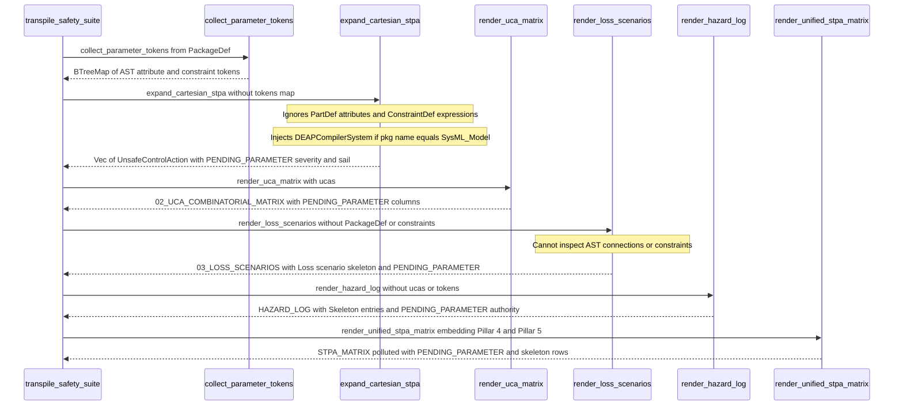

## 1. Context and References

<!-- test-target: crates/compile-sysml/tests/reproducer_tests.rs -->

- **File**: `crates/compile-sysml/src/stpa/uca.rs:84-154`
- **Pillar**: Semantic Traceability
- **Symptom**: `expand_cartesian_stpa` unconditionally assigns `PENDING_PARAMETER` to `severity` and `sail` on every generated `UnsafeControlAction` (and hardcodes `"DEAPCompilerSystem"` when `pkg.name == "SysML_Model"`), while downstream renderers in `crates/compile-sysml/src/stpa/safety_suite.rs` (`render_uca_matrix`, `render_loss_scenarios`, `render_unified_stpa_matrix`, `render_stpa_matrix`, and `render_hazard_log`) unconditionally emit `PENDING_PARAMETER` and `"Loss scenario skeleton"` rows instead of deriving STPA risk attributes and control-loop causal factors from the SysML v2 AST.
- **Test-Target**: `crates/compile-sysml/tests/reproducer_tests.rs`

## 2. Root Cause Analysis (5 Whys)

1. **Why do `02_UCA_COMBINATORIAL_MATRIX.md`, `03_LOSS_SCENARIOS.md`, `STPA_MATRIX.md`, and `HAZARD_LOG.md` unconditionally emit `PENDING_PARAMETER` placeholders, `"Loss scenario skeleton"` descriptions, and hardcoded `"DEAPCompilerSystem"` controller names even when the SysML v2 AST declares explicit attributes, connections, and constraints?** Because `expand_cartesian_stpa` (`crates/compile-sysml/src/stpa/uca.rs:101-111` and `138-148`) unconditionally assigns `severity: PENDING_PARAMETER.to_string()` and `sail: PENDING_PARAMETER.to_string()` and falls back to `"DEAPCompilerSystem"` at `crates/compile-sysml/src/stpa/uca.rs:125-126`, while `render_loss_scenarios` (`crates/compile-sysml/src/stpa/safety_suite.rs:955-973`) formats every row with `"Loss scenario skeleton for {} under nondeterministic conditions"` and `PENDING_PARAMETER`.
2. **Why do `expand_cartesian_stpa` and `render_loss_scenarios` emit static placeholders rather than resolving AST metadata and STPA control-loop causal factors?** Because `expand_cartesian_stpa(pkg: &PackageDef)` never inspects `PartDef.attributes`, `PackageDef.attribute_defs`, `PartDef.constraints`, or `PackageDef.constraint_defs`, and `render_loss_scenarios(ucas: &[UnsafeControlAction])` accepts only the flattened `UnsafeControlAction` slice without `&PackageDef`, `&[ConstraintDef]`, or `&BTreeMap<String, String>`.
3. **Why was `transpile_safety_suite` (`crates/compile-sysml/src/stpa/safety_suite.rs:554-624`) structured without passing `tokens`, `pkg`, or `constraints` into UCA expansion, loss scenario synthesis, and hazard log rendering?** Because `collect_parameter_tokens(pkg)` (`crates/compile-sysml/src/stpa/safety_suite.rs:559`) was threaded exclusively into regulatory and proof renderers (`render_regulatory_objectives_assessment`, `render_rta_architecture`, `render_sldv_script`), leaving `expand_cartesian_stpa(pkg)` (`safety_suite.rs:560`), `render_loss_scenarios(&ucas)` (`safety_suite.rs:579, 1488`), `render_stpa_matrix` (`safety_suite.rs:1571-1590`), and `render_hazard_log(pkg)` (`safety_suite.rs:615, 1618-1661`) wired as unparameterized skeleton emitters.
4. **Why does package-level action expansion in `expand_cartesian_stpa` (`crates/compile-sysml/src/stpa/uca.rs:120-130`) inject the upstream compiler self-reference `"DEAPCompilerSystem"`?** Because when no `PartDef` contains inline `actions`, the fallback lookup filters `all_parts` solely by substring predicates `p.name.contains("System") || p.name.ends_with("Engine")` (`uca.rs:122`), ignoring other declared `PartDef` controllers in `all_parts` and branching on `if pkg.name == "SysML_Model"` (`uca.rs:125-126`) to emit `"DEAPCompilerSystem"` in violation of the Pure Schema-Driven Compiler invariant (`.pipeline/constitution.md:50`).
5. **Why did existing unit tests pass without detecting the missing AST-to-artifact semantic traceability?** Because `test_uca_cartesian_expansion_all_guide_words` (`crates/compile-sysml/src/stpa/uca.rs:162-202`), `test_transpile_safety_suite_produces_all_10_artifacts` (`crates/compile-sysml/src/stpa/safety_suite.rs:1936-1980`), and `test_defect_333_stpa_matrix_embodies_unified_8_pillars` (`crates/compile-sysml/src/stpa/safety_suite.rs:2037-2068`) assert only vector cardinality and Markdown section titles without verifying that AST-supplied parameters, connections, and constraints populate UCA `severity`/`sail` fields, loss scenario causal factors, or hazard log authority cells.

## 3. Correctness Analysis

Tracing the data flow from `transpile_safety_suite` (`crates/compile-sysml/src/stpa/safety_suite.rs:554-624`) through `expand_cartesian_stpa` (`crates/compile-sysml/src/stpa/uca.rs:84-154`) exposes four coupled violations of **Pure Schema-Driven Compilation** (`.pipeline/constitution.md:50`), **8-Pillar Safety Specification Completeness** (`.pipeline/constitution.md:195-201`), and the **Derivation-Annotation Contract** (`.pipeline/constitution.md:210`):

1. **Unconditional `PENDING_PARAMETER` Assignment in `expand_cartesian_stpa`**:
   - At `crates/compile-sysml/src/stpa/uca.rs:17`, `pub const PENDING_PARAMETER: &str = "PENDING_PARAMETER";` is defined.
   - In the primary part-controller Cartesian loop (`crates/compile-sysml/src/stpa/uca.rs:95-114`), every `UnsafeControlAction` pushed at `uca.rs:101-111` unconditionally sets `context: format!("Context for {} under {}", action_name, guide_word)` (`uca.rs:106`), `severity: PENDING_PARAMETER.to_string()` (`uca.rs:109`), and `sail: PENDING_PARAMETER.to_string()` (`uca.rs:110`).
   - In the package-level action fallback loop (`crates/compile-sysml/src/stpa/uca.rs:117-151`), every `UnsafeControlAction` pushed at `uca.rs:138-148` identically sets `severity: PENDING_PARAMETER.to_string()` (`uca.rs:145`) and `sail: PENDING_PARAMETER.to_string()` (`uca.rs:146`).
   - Neither branch inspects `controller.attributes`, `controller.constraints`, `pkg.attribute_defs`, `pkg.constraint_defs`, or `collect_parameter_tokens(pkg)`. Consequently, no SysML v2 input model can ever cause `expand_cartesian_stpa` to produce a resolved `severity` or `sail` value.

2. **Hardcoded `"DEAPCompilerSystem"` Controller Injection & `PartDef` Skip**:
   - When actions are declared at package scope (`pkg.get_all_actions()`) rather than nested inside a `PartDef`, `crates/compile-sysml/src/stpa/uca.rs:120-130` searches `all_parts` exclusively with `.find(|p| p.name.contains("System") || p.name.ends_with("Engine"))`.
   - If a downstream model named `package SysML_Model` declares concrete controller parts such as `part def PrimarySupervisor` or `part def ActuationController` (neither containing `"System"` nor ending with `"Engine"`), `.find(...)` returns `None` and `unwrap_or_else` (`uca.rs:124-130`) discards all declared `PartDef` nodes in `all_parts`, injecting `"DEAPCompilerSystem"` into `u.controller` across `01_LOSSES_HAZARDS_TOPOLOGY.md` (`safety_suite.rs:754, 824`), `02_UCA_COMBINATORIAL_MATRIX.md` (`safety_suite.rs:915`), `03_LOSS_SCENARIOS.md` (`safety_suite.rs:965`), and `STPA_MATRIX.md` (`safety_suite.rs:1461-1494`).

3. **Unconditional Skeleton & `PENDING_PARAMETER` Emission in `render_loss_scenarios`**:
   - `render_uca_matrix` (`crates/compile-sysml/src/stpa/safety_suite.rs:904-927`) serializes `u.severity` and `u.sail` directly into columns 8 and 9 (`safety_suite.rs:921-922`), filling both `02_UCA_COMBINATORIAL_MATRIX.md` and Pillar 4 of `STPA_MATRIX.md` (`safety_suite.rs:1477-1483`) with `PENDING_PARAMETER`.
   - `render_loss_scenarios` (`crates/compile-sysml/src/stpa/safety_suite.rs:955-973`) iterates `ucas.iter().enumerate()` (`safety_suite.rs:960`) and emits:
     `| LS-{:03} | {} | {} | {} | Loss scenario skeleton for {} under nondeterministic conditions | PENDING_PARAMETER |` (`safety_suite.rs:961-969`).
   - Because `render_loss_scenarios` does not receive `pkg: &PackageDef` or `constraints: &[ConstraintDef]`, it fails to differentiate the 4 Leveson STPA guide words (`Not providing`, `Providing`, `Too early / Too late / Out of order`, `Stopped too soon / Applied too long`) into distinct control-loop causal factors (process-model belief divergence, feedback connection dropout/latency, actuation sequence skew, or completion-predicate latching) anchored to AST `ConnectionDef` and `ConstraintDef` declarations, directly violating `.pipeline/constitution.md:199-201` and the 4-part Derivation-Annotation Contract at `.pipeline/constitution.md:210`.

4. **Downstream `render_stpa_matrix` and `render_hazard_log` Placeholder Propagation**:
   - `render_stpa_matrix` (`crates/compile-sysml/src/stpa/safety_suite.rs:1571-1590`) unconditionally emits `PENDING_PARAMETER` as `Traceability Status` (`safety_suite.rs:1585`) even when `u.hazard` and `u.constraint` are populated.
   - `render_hazard_log` (`crates/compile-sysml/src/stpa/safety_suite.rs:1618-1661`) emits `"Skeleton loss entry"` (`safety_suite.rs:1633, 1641`), `"Compound hazard skeleton"` (`safety_suite.rs:1653`), drops all `H-*` rows whenever actions are declared at package scope (`controllers.is_empty()` at `safety_suite.rs:1649`), and unconditionally emits `| Resolution Authority | PENDING_PARAMETER |` (`safety_suite.rs:1659`) without querying `tokens`.

## 4. UML Diagrams



## 5. Affected Callers / Downstream Impact

- `crates/compile-sysml/src/stpa/uca.rs:84-154` (`expand_cartesian_stpa`) -- Returns `UnsafeControlAction` records whose `severity` and `sail` fields are permanently locked to `"PENDING_PARAMETER"` and whose fallback `controller` injects `"DEAPCompilerSystem"` on `SysML_Model` root packages.
- `crates/compile-sysml/src/stpa/safety_suite.rs:554-624` (`transpile_safety_suite` and `emit_safety_suite`) -- Propagates unresolved `PENDING_PARAMETER` cells and `"skeleton"` placeholders across `02_UCA_COMBINATORIAL_MATRIX.md`, `03_LOSS_SCENARIOS.md`, `STPA_MATRIX.md`, and `HAZARD_LOG.md`.
- `crates/compile-sysml/src/stpa/safety_suite.rs:904-927` (`render_uca_matrix`) -- Renders `PENDING_PARAMETER` in `Severity` and `SAIL` columns for every UCA row in Pillar 4.
- `crates/compile-sysml/src/stpa/safety_suite.rs:955-973` (`render_loss_scenarios`) -- Renders identical `"Loss scenario skeleton for <action> under nondeterministic conditions"` and `PENDING_PARAMETER` causal factor cells across all 4 STPA guide words in Pillar 5.
- `crates/compile-sysml/src/stpa/safety_suite.rs:1447-1542` (`render_unified_stpa_matrix`) -- Embeds `render_uca_matrix` and `render_loss_scenarios` directly into `STPA_MATRIX.md`, causing downstream Phase 0 safety deliverables to violate `.pipeline/constitution.md:199-201, 210` and Check 17 safety completeness expectations.
- `crates/compile-sysml/src/stpa/safety_suite.rs:1571-1590, 1618-1661` (`render_stpa_matrix` and `render_hazard_log`) -- Emits hardcoded `PENDING_PARAMETER` traceability/authority cells and omits `H-*` hazard entries for package-scoped actions.

## 6. Proposed Correction

<!-- MUST NOT use regex (Check 34: deterministic linear slice/char scanning, no regex crate). MUST be domain-agnostic for upstream crates (Check 19). -->

Resolve controller fallback, UCA `context`/`severity`/`sail`, guide-word-differentiated STPA control-loop loss scenarios, and hazard log fields deterministically from the SysML v2 AST (`PartDef`, `AttributeDef`, `ConnectionDef`, `ConstraintDef`, and `collect_parameter_tokens`) using linear slice/token lookup with zero `regex` dependencies and zero hardcoded domain or compiler tokens:

```rust
// In crates/compile-sysml/src/stpa/uca.rs:
use std::collections::BTreeMap;
use deap_core::sysml_ast::{AttributeDef, ConstraintDef, PackageDef, PartDef};

fn lookup_scoped_token(
    part: Option<&PartDef>,
    action_name: &str,
    tokens: &BTreeMap<String, String>,
    suffixes: &[&str],
) -> Option<String> {
    if let Some(p) = part {
        for suffix in suffixes {
            let action_key = format!("{}_{}", action_name, suffix);
            let part_key = format!("{}_{}", p.name, suffix);
            if let Some(found) = find_attr_ci(&p.attributes, &action_key)
                .or_else(|| find_attr_ci(&p.attributes, &part_key))
                .or_else(|| find_attr_ci(&p.attributes, suffix))
            {
                return Some(found);
            }
        }
    }
    for suffix in suffixes {
        let action_key = format!("{}_{}", action_name, suffix);
        if let Some(v) = find_map_ci(tokens, &action_key).or_else(|| find_map_ci(tokens, suffix)) {
            return Some(v);
        }
    }
    None
}

fn find_attr_ci(attrs: &[AttributeDef], target: &str) -> Option<String> {
    for attr in attrs {
        if attr.name.eq_ignore_ascii_case(target) {
            if let Some(ref val) = attr.default_value {
                let trimmed = val.trim().trim_matches('"');
                if !trimmed.is_empty() {
                    return Some(trimmed.to_string());
                }
            }
        }
    }
    None
}

fn find_map_ci(tokens: &BTreeMap<String, String>, target: &str) -> Option<String> {
    for (k, v) in tokens {
        if k.eq_ignore_ascii_case(target) {
            let trimmed = v.trim().trim_matches('"');
            if !trimmed.is_empty() {
                return Some(trimmed.to_string());
            }
        }
    }
    None
}

fn derive_guide_word_severity(guide_word: &str, has_assert_constraint: bool) -> String {
    if has_assert_constraint || guide_word == "Providing" || guide_word == "Not providing" {
        "Catastrophic (Derived: Leveson STPA)".to_string()
    } else {
        "Hazardous (Derived: Leveson STPA)".to_string()
    }
}

fn resolve_default_controller_name(pkg: &PackageDef, all_parts: &[PartDef]) -> String {
    all_parts
        .iter()
        .find(|p| {
            !p.name.starts_with('_')
                && (p.name.contains("Controller")
                    || p.name.contains("Supervisor")
                    || p.name.contains("System")
                    || p.name.ends_with("Engine"))
        })
        .or_else(|| all_parts.iter().find(|p| !p.name.starts_with('_')))
        .or_else(|| all_parts.first())
        .map(|p| p.name.clone())
        .unwrap_or_else(|| {
            if pkg.name.trim().is_empty() {
                "SystemController".to_string()
            } else {
                format!("{}_Controller", pkg.name.trim())
            }
        })
}

pub fn expand_cartesian_stpa_with_tokens(
    pkg: &PackageDef,
    tokens: &BTreeMap<String, String>,
) -> Vec<UnsafeControlAction> {
    let mut ucas = Vec::new();
    let all_parts = pkg.get_all_parts();
    let all_constraints = pkg.get_all_constraints();
    let has_assert = all_constraints.iter().any(|c| c.is_assertion || !c.expression.is_empty());
    let controllers: Vec<_> = all_parts
        .iter()
        .filter(|part| !part.actions.is_empty())
        .collect();

    let mut uca_counter = 0usize;
    let mut action_counter = 0usize;

    for controller in &controllers {
        let guard_anchor = controller
            .constraints
            .first()
            .or_else(|| all_constraints.first())
            .map(|c| format!("guard {} ({})", c.name, c.expression))
            .unwrap_or_else(|| format!("operational envelope of {}", controller.name));

        for action in &controller.actions {
            action_counter += 1;
            let action_name = &action.name;
            let ssot_sev = lookup_scoped_token(
                Some(controller),
                action_name,
                tokens,
                &["Severity", "HazardSeverity", "DefaultSeverity"],
            );
            let ssot_sail = lookup_scoped_token(
                Some(controller),
                action_name,
                tokens,
                &["SAIL", "IntegrityLevel", "AssuranceLevel"],
            );

            for guide_word in &STPA_GUIDE_WORDS {
                uca_counter += 1;
                let severity = ssot_sev
                    .clone()
                    .unwrap_or_else(|| derive_guide_word_severity(guide_word, has_assert));
                let sail = ssot_sail
                    .clone()
                    .unwrap_or_else(|| "Derived-High (Leveson STPA; SSOT silent)".to_string());
                ucas.push(UnsafeControlAction {
                    id: format!("UCA-{:03}", uca_counter),
                    controller: controller.name.clone(),
                    control_action: action_name.clone(),
                    guide_word: (*guide_word).to_string(),
                    context: format!(
                        "{} dispatching {} while {} is active [AST PartDef({})]",
                        controller.name, action_name, guard_anchor, controller.name
                    ),
                    hazard: format!("H-{}", action_counter),
                    constraint: format!("SC-{:03}", uca_counter),
                    severity,
                    sail,
                });
            }
        }
    }

    if ucas.is_empty() {
        let all_actions = pkg.get_all_actions();
        if !all_actions.is_empty() {
            let default_controller = resolve_default_controller_name(pkg, &all_parts);
            let matched_part = all_parts.iter().find(|p| p.name == default_controller);
            let guard_anchor = all_constraints
                .first()
                .map(|c| format!("guard {} ({})", c.name, c.expression))
                .unwrap_or_else(|| format!("package envelope of {}", pkg.name));

            for action in &all_actions {
                action_counter += 1;
                let action_name = &action.name;
                let ssot_sev = lookup_scoped_token(
                    matched_part,
                    action_name,
                    tokens,
                    &["Severity", "HazardSeverity", "DefaultSeverity"],
                );
                let ssot_sail = lookup_scoped_token(
                    matched_part,
                    action_name,
                    tokens,
                    &["SAIL", "IntegrityLevel", "AssuranceLevel"],
                );

                for guide_word in &STPA_GUIDE_WORDS {
                    uca_counter += 1;
                    let severity = ssot_sev
                        .clone()
                        .unwrap_or_else(|| derive_guide_word_severity(guide_word, has_assert));
                    let sail = ssot_sail
                        .clone()
                        .unwrap_or_else(|| "Derived-High (Leveson STPA; SSOT silent)".to_string());
                    ucas.push(UnsafeControlAction {
                        id: format!("UCA-{:03}", uca_counter),
                        controller: default_controller.clone(),
                        control_action: action_name.clone(),
                        guide_word: (*guide_word).to_string(),
                        context: format!(
                            "{} dispatching {} while {} is active [AST PackageDef({})]",
                            default_controller, action_name, guard_anchor, pkg.name
                        ),
                        hazard: format!("H-{}", action_counter),
                        constraint: format!("SC-{:03}", uca_counter),
                        severity,
                        sail,
                    });
                }
            }
        }
    }

    ucas
}

// In crates/compile-sysml/src/stpa/safety_suite.rs:
fn render_loss_scenarios(
    pkg: &PackageDef,
    ucas: &[UnsafeControlAction],
    constraints: &[ConstraintDef],
) -> String {
    let connections = pkg.get_all_connections();
    let mut out = String::new();
    out.push_str("# Loss Scenarios & Causal Factors\n\n");
    out.push_str("| Loss Scenario ID | UCA ID | Controller | Control Action | Scenario | Causal Factor |\n");
    out.push_str("| :--- | :--- | :--- | :--- | :--- | :--- |\n");

    for (i, u) in ucas.iter().enumerate() {
        let link_anchor = connections
            .iter()
            .find(|c| {
                c.source_part.as_deref() == Some(u.controller.as_str())
                    || c.target_part.as_deref() == Some(u.controller.as_str())
            })
            .or_else(|| connections.first())
            .map(|c| {
                let proto = c.protocol.as_deref().unwrap_or(c.name.as_str());
                format!("AST ConnectionDef({}: {})", c.name, proto)
            })
            .unwrap_or_else(|| {
                format!(
                    "AST PartDef({} control loop; silent ConnectionDef set)",
                    u.controller
                )
            });

        let guard_anchor = constraints
            .get(i % constraints.len().max(1))
            .map(|c| format!("AST ConstraintDef({}: {})", c.name, c.expression))
            .unwrap_or_else(|| "silent ConstraintDef set (caveat: no explicit guard expression)".to_string());

        let (scenario, causal_factor) = match u.guide_word.as_str() {
            "Not providing" => (
                format!(
                    "{} omits {} when safety boundary {} requires actuation",
                    u.controller, u.control_action, guard_anchor
                ),
                format!(
                    "Controller process-model stale state or feedback dropout on {} [Leveson STPA; Analytically Derived]",
                    link_anchor
                ),
            ),
            "Providing" => (
                format!(
                    "{} issues {} while {} prohibits actuation",
                    u.controller, u.control_action, guard_anchor
                ),
                format!(
                    "Corrupted sensor feedback or invalid mode belief in {} across {} [Leveson STPA; Analytically Derived]",
                    u.controller, link_anchor
                ),
            ),
            "Too early / Too late / Out of order" => (
                format!(
                    "{} dispatches {} outside required temporal ordering relative to {}",
                    u.controller, u.control_action, guard_anchor
                ),
                format!(
                    "Transport latency or sequence skew on {} violating {}",
                    link_anchor, u.constraint
                ),
            ),
            _ => (
                format!(
                    "{} terminates or latches {} across actuation duration bound of {}",
                    u.controller, u.control_action, guard_anchor
                ),
                format!(
                    "Premature completion predicate or latched actuator channel on {} [Leveson STPA; Analytically Derived]",
                    link_anchor
                ),
            ),
        };

        out.push_str(&format!(
            "| LS-{:03} | {} | {} | {} | {} | {} |\n",
            i + 1,
            u.id,
            u.controller,
            u.control_action,
            scenario,
            causal_factor
        ));
    }
    out.push('\n');
    out
}
```

## 7. Relationship to Existing Issues

Discovered in audit -- new finding. Complements historical structural 8-pillar layout coverage in `test_defect_333_stpa_matrix_embodies_unified_8_pillars` (refs #333), which verified Pillar 4 and Pillar 5 section headings in `STPA_MATRIX.md` without asserting AST-derived semantic resolution of UCA `Severity`/`SAIL` fields or Leveson STPA loss scenario causal factors.

## Audit Source

Adversarial Semantic Traceability Audit
SEVERITY: Important
FILE_LOCATION: crates/compile-sysml/src/stpa/uca.rs:84-154
