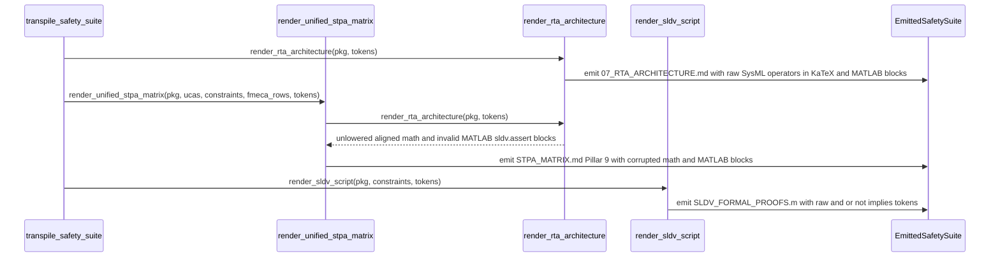

## 1. Context and References

<!-- test-target: crates/compile-sysml/tests/reproducer_tests.rs -->

- **File**: `crates/compile-sysml/src/stpa/safety_suite.rs:1260-1739`
- **Pillar**: Semantic Traceability
- **Symptom**: `render_rta_architecture` (`lines 1269-1279, 1302-1306, 1308-1314, 1327-1337, 1363-1367, 1369-1375`) and `render_sldv_script` (`lines 1699-1710, 1721-1735`) interpolate raw SysML v2 `CalcDef.expression` and `ConstraintDef.expression` strings directly into KaTeX `$$ \begin{aligned} ... \end{aligned} $$` math blocks (applying only `.replace('_', "\\_")`) and verbatim into MATLAB `sldv.assert( (<expr>), ... );` assertions, emitting unlowered SysML word operators (`and`, `or`, `not`, `implies`, `xor`), raw ASCII relational operators (`>=`, `<=`, `!=`, `==`), unwrapped multi-letter math identifiers that render as concatenated italic variable products (such as `0and`), and syntactically invalid MATLAB / Simulink Design Verifier scripts.
- **Test-Target**: `crates/compile-sysml/tests/reproducer_tests.rs`

## 2. Root Cause Analysis (5 Whys)

1. **Why do `07_RTA_ARCHITECTURE.md`, `STPA_MATRIX.md`, and `SLDV_FORMAL_PROOFS.m` contain corrupted KaTeX math formulas and syntactically invalid MATLAB `sldv.assert` statements whenever a SysML v2 schema defines `calc def` or `constraint def` nodes?** Because `render_rta_architecture` and `render_sldv_script` interpolate raw SysML v2 AST expression strings (`calc.expression` and `c.expression`) into target-language templates without lexical or syntactic lowering to LaTeX/KaTeX or MATLAB grammar.
2. **Why does `render_rta_architecture` fail to produce valid KaTeX math despite wrapping theorem names in `\mathrm{...}`?** Because `lines 1272, 1278, 1305, 1330, 1336, 1366` only call `expr.replace('_', "\\_")` on the right-hand expression, leaving SysML boolean keywords (`and`, `or`, `not`, `implies`, `xor`), ASCII multi-character comparators (`>=`, `<=`, `!=`, `==`), unescaped `%` modulo tokens, and multi-letter identifiers unwrapped inside TeX display-math mode where whitespace is ignored.
3. **Why do `render_rta_architecture` (`lines 1310-1312, 1371-1373`) and `render_sldv_script` (`lines 1706-1709, 1729-1734`) emit unparseable MATLAB assertions?** Because both functions pass raw `expr` directly into `format!("sldv.assert( ({}), ... );", expr)` without lowering SysML v2 boolean and relational operators (`and`, `or`, `not`, `!=`, single `=`, infix `implies`, infix `xor`, and trailing `;`) into valid MATLAB / Simulink Design Verifier operators (`&&`, `||`, `~(...)`, `~=`, `==`, `implies(lhs, rhs)`, `xor(lhs, rhs)`).
4. **Why did existing unit tests in `crates/compile-sysml/src/stpa/safety_suite.rs` (`test_transpile_safety_suite_produces_all_10_artifacts` at `lines 1936-1980` and `test_defect_333_stpa_matrix_embodies_unified_8_pillars` at `lines 2037-2068`) pass without detecting either defect?** Because both tests construct minimal `PackageDef` fixtures containing only a `PartDef` and `ActionDef` with zero `CalcDef` and zero `ConstraintDef` nodes, causing `all_calcs.is_empty() && all_constraints.is_empty()` to evaluate to `true` and executing only the hardcoded `PROOF_TEMPLATES` fallback branch (`lines 1378-1412` and `1714-1719`).
5. **Why was no expression-lowering layer introduced when the AST-driven theorem branch (`lines 1263-1377` and `1699-1710, 1721-1736`) was added alongside `PROOF_TEMPLATES`?** Because `PROOF_TEMPLATES` (`lines 60-319`) pre-authored hand-tuned LaTeX (`\mathrm{...}`, `\le`, `\ge`, `\wedge`, `\vee`) and MATLAB (`&&`, `||`, `implies(...)`) strings, and the AST-driven branch substituted raw SysML source text into the same output slots without a SysML-to-KaTeX or SysML-to-MATLAB token/AST lowering pass or semantic traceability assertions over non-empty `CalcDef`/`ConstraintDef` expressions.

## 3. Correctness Analysis

### Data Flow Trace from SysML AST to Corrupted Safety Artifacts

1. **AST Ingestion**: The SysML v2 parser populates `CalcDef.expression: Option<String>` and `ConstraintDef.expression: String` with verbatim KerML/SysML v2 expression text (for example, `direct_range_slice_count >= 0 and direct_range_slice_count <= 0` or `guard_active and not fault_latched implies output_value != 0`).
2. **Suite Dispatch (`safety_suite.rs:554-624`)**:
   - `transpile_safety_suite` collects `constraints = collect_all_constraints(pkg)` (`line 561`).
   - At `line 605`, it calls `render_rta_architecture(pkg, &tokens)` to emit `07_RTA_ARCHITECTURE.md`.
   - At `line 611`, it calls `render_unified_stpa_matrix(pkg, &ucas, &constraints, &fmeca_rows, &tokens)` to emit `STPA_MATRIX.md`, which invokes `render_rta_architecture(pkg, tokens)` again at `line 1533` and embeds the entire output under Pillar 9 (`## 9. ASTM F3269-17 Run-Time Assurance (RTA) Architecture & Toolchain Proof Hooks`).
   - At `line 620`, it calls `render_sldv_script(pkg, &constraints, &tokens)` to emit `SLDV_FORMAL_PROOFS.m`.
3. **KaTeX Math Corruption in `render_rta_architecture` (`safety_suite.rs:1263-1377`)**:
   - Whenever `!all_calcs.is_empty() || !all_constraints.is_empty()` (`line 1263`), each `CalcDef` emits three `$$ \begin{aligned} ... \end{aligned} $$` blocks (`lines 1269-1273`, `1275-1279`, `1302-1306`) and each `ConstraintDef` emits three `$$ \begin{aligned} ... \end{aligned} $$` blocks (`lines 1327-1331`, `1333-1337`, `1363-1367`).
   - Every one of those six sites performs only `expr.replace('_', "\\_")`. For `direct_range_slice_count >= 0 and direct_range_slice_count <= 0`, the emitted block is:
     ```text
     $$
     \begin{aligned}
         \mathrm{SliceBound} &: direct\_range\_slice\_count >= 0 and direct\_range\_slice\_count <= 0
     \end{aligned}
     $$
     ```
   - Because TeX math mode strips spaces between adjacent letters and digits, KaTeX renders `0 and direct\_range\_slice\_count` as a single concatenated italic product `0anddirect_range_slice_count`, renders `>=` and `<=` as separate adjacent ASCII glyphs rather than `\ge` and `\le`, renders `!=` as factorial `!` followed by `=`, and treats unescaped `%` (modulo) as a TeX comment that truncates the remainder of the line inside `\begin{aligned}`.
4. **Invalid MATLAB / SLDV Code Generation (`safety_suite.rs:1308-1314, 1369-1375, 1699-1710, 1721-1735`)**:
   - Four emission sites interpolate raw `expr` into `sldv.assert( ({}), '...' );`:
     - `render_rta_architecture` calc assertions (`lines 1309-1313`)
     - `render_rta_architecture` constraint assertions (`lines 1370-1374`)
     - `render_sldv_script` schema constraint assertions (`lines 1706-1709`)
     - `render_sldv_script` theorem calc assertions (`lines 1729-1734`)
   - Emitting `sldv.assert( (direct_range_slice_count >= 0 and direct_range_slice_count <= 0), 'Bind_SLICEBOUND_ASSERTION' );` produces a hard MATLAB parser failure because MATLAB has no infix `and`, `or`, `xor`, or `implies` keywords, no prefix `not` keyword, and rejects `!=` (requiring `&&`, `||`, `~`, `~=`, `xor(a, b)`, and `implies(a, b)`). In addition, `calc.expression` with `Some("")` or whitespace-only `c.expression` (`lines 1266, 1320, 1700`) bypasses `.is_empty()` or `.unwrap_or("true")` and emits `sldv.assert( (), ... );`.

### Violated Invariants

- **KaTeX / LaTeX Mathematical Integrity (`rules/latex-katex-integrity.md`, `.pipeline/constitution.md` Check 13)**: Multi-letter identifiers inside math blocks MUST be wrapped in `\mathrm{...}`, logical connectives MUST use canonical LaTeX commands (`\land`, `\lor`, `\lnot`, `\implies`, `\oplus`), and relational comparators MUST use canonical LaTeX commands (`\ge`, `\le`, `\neq`).
- **ASTM F3269-17 RTA & Simulink Design Verifier Hook Mandate (`.pipeline/constitution.md:211`)**: Synthesized SLDV proof scripts (`SLDV_FORMAL_PROOFS.m`) and RTA temporal assertion bindings (`07_RTA_ARCHITECTURE.md`, `STPA_MATRIX.md`) MUST be syntactically valid MATLAB / Simulink Design Verifier expressions.
- **Semantic Traceability Pillar (`safety_suite.rs:1936-1980, 2037-2068`)**: Existing unit tests assert only the presence of `$$\n\begin{aligned}` on empty-constraint fixtures that execute the static `PROOF_TEMPLATES` branch, passing while leaving the AST-driven expression lowering path completely unverified.

## 4. UML Diagrams



## 5. Affected Callers / Downstream Impact

- `transpile_safety_suite` (`crates/compile-sysml/src/stpa/safety_suite.rs:554-624`) -- produces corrupted `07_RTA_ARCHITECTURE.md`, `STPA_MATRIX.md`, and `SLDV_FORMAL_PROOFS.m` map entries for every SysML package declaring at least one `calc def` or `constraint def`.
- `emit_safety_suite` (`crates/compile-sysml/src/stpa/safety_suite.rs:654-670`) -- persists the broken Markdown math blocks and unparseable `.m` proof script to `docs/safety/` during `compile-sysml` safety compilation.
- `render_unified_stpa_matrix` (`crates/compile-sysml/src/stpa/safety_suite.rs:1447-1542`, specifically `line 1533`) -- embeds `render_rta_architecture` verbatim into Pillar 9 of `docs/safety/STPA_MATRIX.md`, causing downstream `verify-baseline` Check 13 / Check 17 gates and Markdown/KaTeX renderers to encounter malformed math expressions.
- Downstream MATLAB / Simulink Design Verifier verification workflows -- executing `SLDV_FORMAL_PROOFS.m` fails immediately with MATLAB syntax errors on the first `ConstraintDef` or `CalcDef` containing `and`, `or`, `not`, `implies`, `xor`, `!=`, or single `=`.

## 6. Proposed Correction

<!-- MUST NOT use regex (Check 34: deterministic linear slice/char scanning, no regex crate). MUST be domain-agnostic for upstream crates (Check 19). -->

Introduce a deterministic, zero-allocator-panic linear expression tokenizer (`tokenize_sysml_expr`) paired with dedicated target-grammar lowering passes `lower_sysml_expr_to_katex` and `lower_sysml_expr_to_matlab`, and invoke them across all six KaTeX math sites and all four MATLAB `sldv.assert` sites in `render_rta_architecture` and `render_sldv_script`:

```rust
#[derive(Debug, Clone, Copy, PartialEq, Eq)]
enum SysmlExprToken<'a> {
    LParen,
    RParen,
    Comma,
    Dot,
    Op(&'a str),
    Ident(&'a str),
    Number(&'a str),
    StringLit(&'a str),
}

fn tokenize_sysml_expr(expr: &str) -> Vec<SysmlExprToken<'_>> {
    let bytes = expr.as_bytes();
    let len = bytes.len();
    let mut tokens = Vec::new();
    let mut i = 0;

    while i < len {
        let b = bytes[i];
        if b.is_ascii_whitespace() || b == b';' {
            i += 1;
            continue;
        }
        if b == b'(' {
            tokens.push(SysmlExprToken::LParen);
            i += 1;
            continue;
        }
        if b == b')' {
            tokens.push(SysmlExprToken::RParen);
            i += 1;
            continue;
        }
        if b == b',' {
            tokens.push(SysmlExprToken::Comma);
            i += 1;
            continue;
        }
        if b == b'.' {
            tokens.push(SysmlExprToken::Dot);
            i += 1;
            continue;
        }
        if b == b'"' || b == b'\'' {
            let quote = b;
            let start = i + 1;
            i += 1;
            while i < len && bytes[i] != quote {
                if bytes[i] == b'\\' && i + 1 < len {
                    i += 2;
                } else {
                    i += 1;
                }
            }
            tokens.push(SysmlExprToken::StringLit(&expr[start..i]));
            if i < len && bytes[i] == quote {
                i += 1;
            }
            continue;
        }
        if i + 1 < len {
            let two = &expr[i..i + 2];
            if matches!(
                two,
                ">=" | "<=" | "!=" | "~=" | "==" | "&&" | "||" | "->" | "=>"
            ) {
                tokens.push(SysmlExprToken::Op(two));
                i += 2;
                continue;
            }
        }
        if matches!(
            b,
            b'<' | b'>' | b'=' | b'+' | b'-' | b'*' | b'/' | b'%' | b'^' | b'!' | b'~'
        ) {
            tokens.push(SysmlExprToken::Op(&expr[i..i + 1]));
            i += 1;
            continue;
        }
        if b.is_ascii_digit() {
            let start = i;
            while i < len && (bytes[i].is_ascii_digit() || bytes[i] == b'.') {
                i += 1;
            }
            if i < len && (bytes[i] == b'e' || bytes[i] == b'E') {
                i += 1;
                if i < len && (bytes[i] == b'+' || bytes[i] == b'-') {
                    i += 1;
                }
                while i < len && bytes[i].is_ascii_digit() {
                    i += 1;
                }
            }
            tokens.push(SysmlExprToken::Number(&expr[start..i]));
            continue;
        }
        if b.is_ascii_alphabetic() || b == b'_' {
            let start = i;
            while i < len && (bytes[i].is_ascii_alphanumeric() || bytes[i] == b'_') {
                i += 1;
            }
            tokens.push(SysmlExprToken::Ident(&expr[start..i]));
            continue;
        }
        let step = expr[i..].chars().next().map_or(1, char::len_utf8);
        i += step;
    }

    tokens
}

fn escape_katex_ident(raw: &str) -> String {
    let mut out = String::with_capacity(raw.len() + 4);
    for ch in raw.chars() {
        match ch {
            '_' => out.push_str("\\_"),
            '%' => out.push_str("\\%"),
            '&' => out.push_str("\\&"),
            '#' => out.push_str("\\#"),
            '{' => out.push_str("\\{"),
            '}' => out.push_str("\\}"),
            _ => out.push(ch),
        }
    }
    out
}

pub fn lower_sysml_expr_to_katex(expr: &str) -> String {
    let tokens = tokenize_sysml_expr(expr);
    if tokens.is_empty() {
        return "\\mathrm{true}".to_string();
    }
    let mut out = String::with_capacity(expr.len() * 2);
    for (idx, tok) in tokens.iter().enumerate() {
        let prev = idx.checked_sub(1).and_then(|p| tokens.get(p));
        let is_unary_sign = matches!(tok, SysmlExprToken::Op("+" | "-"))
            && matches!(
                prev,
                None
                    | Some(
                        SysmlExprToken::LParen
                            | SysmlExprToken::Comma
                            | SysmlExprToken::Op(_)
                            | SysmlExprToken::Ident("and" | "or" | "not" | "implies" | "xor")
                    )
            );
        match *tok {
            SysmlExprToken::LParen => out.push('('),
            SysmlExprToken::RParen => out.push(')'),
            SysmlExprToken::Comma => out.push_str(", "),
            SysmlExprToken::Dot => out.push('.'),
            SysmlExprToken::Number(n) => out.push_str(n),
            SysmlExprToken::StringLit(s) => {
                out.push_str("\\text{\"");
                out.push_str(&escape_katex_ident(s));
                out.push_str("\"}");
            }
            SysmlExprToken::Ident(id) => {
                if id.eq_ignore_ascii_case("and") {
                    out.push_str(" \\land ");
                } else if id.eq_ignore_ascii_case("or") {
                    out.push_str(" \\lor ");
                } else if id.eq_ignore_ascii_case("not") {
                    out.push_str("\\lnot ");
                } else if id.eq_ignore_ascii_case("implies") {
                    out.push_str(" \\implies ");
                } else if id.eq_ignore_ascii_case("xor") {
                    out.push_str(" \\oplus ");
                } else {
                    out.push_str("\\mathrm{");
                    out.push_str(&escape_katex_ident(id));
                    out.push('}');
                }
            }
            SysmlExprToken::Op(op) => match op {
                ">=" => out.push_str(" \\ge "),
                "<=" => out.push_str(" \\le "),
                "!=" | "~=" => out.push_str(" \\neq "),
                "==" | "=" => out.push_str(" = "),
                "&&" => out.push_str(" \\land "),
                "||" => out.push_str(" \\lor "),
                "->" | "=>" => out.push_str(" \\implies "),
                "!" | "~" => out.push_str("\\lnot "),
                "*" => out.push_str(" \\cdot "),
                "%" => out.push_str(" \\bmod "),
                "+" | "-" if is_unary_sign => out.push_str(op),
                "^" => out.push('^'),
                _ => {
                    out.push(' ');
                    out.push_str(op);
                    out.push(' ');
                }
            },
        }
    }
    out.trim().to_string()
}

pub fn lower_sysml_expr_to_matlab(expr: &str, default_empty: &str) -> String {
    let tokens = tokenize_sysml_expr(expr);
    if tokens.is_empty() {
        return default_empty.to_string();
    }
    let mut pos = 0;
    let lowered = parse_matlab_implies(&tokens, &mut pos);
    if lowered.trim().is_empty() {
        default_empty.to_string()
    } else {
        lowered
    }
}

fn is_bool_connective(tok: SysmlExprToken<'_>) -> bool {
    match tok {
        SysmlExprToken::Op("&&" | "||" | "->" | "=>") => true,
        SysmlExprToken::Ident(id) => {
            id.eq_ignore_ascii_case("and")
                || id.eq_ignore_ascii_case("or")
                || id.eq_ignore_ascii_case("xor")
                || id.eq_ignore_ascii_case("implies")
        }
        _ => false,
    }
}

fn parse_matlab_implies(tokens: &[SysmlExprToken<'_>], pos: &mut usize) -> String {
    let mut lhs = parse_matlab_or(tokens, pos);
    while let Some(&tok) = tokens.get(*pos) {
        let is_imp = matches!(tok, SysmlExprToken::Op("->" | "=>"))
            || matches!(tok, SysmlExprToken::Ident(id) if id.eq_ignore_ascii_case("implies"));
        if !is_imp {
            break;
        }
        *pos += 1;
        let rhs = parse_matlab_or(tokens, pos);
        lhs = format!("implies({}, {})", lhs.trim(), rhs.trim());
    }
    lhs
}

fn parse_matlab_or(tokens: &[SysmlExprToken<'_>], pos: &mut usize) -> String {
    let mut lhs = parse_matlab_xor(tokens, pos);
    while let Some(&tok) = tokens.get(*pos) {
        let is_or = matches!(tok, SysmlExprToken::Op("||"))
            || matches!(tok, SysmlExprToken::Ident(id) if id.eq_ignore_ascii_case("or"));
        if !is_or {
            break;
        }
        *pos += 1;
        let rhs = parse_matlab_xor(tokens, pos);
        lhs = format!("{} || {}", lhs.trim(), rhs.trim());
    }
    lhs
}

fn parse_matlab_xor(tokens: &[SysmlExprToken<'_>], pos: &mut usize) -> String {
    let mut lhs = parse_matlab_and(tokens, pos);
    while let Some(&SysmlExprToken::Ident(id)) = tokens.get(*pos) {
        if !id.eq_ignore_ascii_case("xor") {
            break;
        }
        *pos += 1;
        let rhs = parse_matlab_and(tokens, pos);
        lhs = format!("xor({}, {})", lhs.trim(), rhs.trim());
    }
    lhs
}

fn parse_matlab_and(tokens: &[SysmlExprToken<'_>], pos: &mut usize) -> String {
    let mut lhs = parse_matlab_not(tokens, pos);
    while let Some(&tok) = tokens.get(*pos) {
        let is_and = matches!(tok, SysmlExprToken::Op("&&"))
            || matches!(tok, SysmlExprToken::Ident(id) if id.eq_ignore_ascii_case("and"));
        if !is_and {
            break;
        }
        *pos += 1;
        let rhs = parse_matlab_not(tokens, pos);
        lhs = format!("{} && {}", lhs.trim(), rhs.trim());
    }
    lhs
}

fn parse_matlab_not(tokens: &[SysmlExprToken<'_>], pos: &mut usize) -> String {
    if let Some(&tok) = tokens.get(*pos) {
        let is_not = matches!(tok, SysmlExprToken::Op("!" | "~"))
            || matches!(tok, SysmlExprToken::Ident(id) if id.eq_ignore_ascii_case("not"));
        if is_not {
            *pos += 1;
            let inner = parse_matlab_not(tokens, pos);
            let trimmed = inner.trim();
            if trimmed.starts_with('(') && trimmed.ends_with(')') {
                return format!("~{}", trimmed);
            }
            return format!("~({})", trimmed);
        }
    }
    parse_matlab_clause(tokens, pos)
}

fn parse_matlab_clause(tokens: &[SysmlExprToken<'_>], pos: &mut usize) -> String {
    let mut out = String::new();
    while let Some(&tok) = tokens.get(*pos) {
        if matches!(tok, SysmlExprToken::RParen | SysmlExprToken::Comma) || is_bool_connective(tok)
        {
            break;
        }
        let is_mid_not = matches!(tok, SysmlExprToken::Op("!" | "~"))
            || matches!(tok, SysmlExprToken::Ident(id) if id.eq_ignore_ascii_case("not"));
        if is_mid_not {
            out.push_str(&parse_matlab_not(tokens, pos));
            continue;
        }
        *pos += 1;
        match tok {
            SysmlExprToken::LParen => {
                out.push('(');
                while let Some(&next_tok) = tokens.get(*pos) {
                    if matches!(next_tok, SysmlExprToken::RParen) {
                        break;
                    }
                    let arg = parse_matlab_implies(tokens, pos);
                    out.push_str(arg.trim());
                    if matches!(tokens.get(*pos), Some(SysmlExprToken::Comma)) {
                        *pos += 1;
                        out.push_str(", ");
                    } else {
                        break;
                    }
                }
                if matches!(tokens.get(*pos), Some(SysmlExprToken::RParen)) {
                    *pos += 1;
                }
                out.push(')');
            }
            SysmlExprToken::Dot => out.push('.'),
            SysmlExprToken::Number(n) => out.push_str(n),
            SysmlExprToken::Ident(id) => out.push_str(id),
            SysmlExprToken::StringLit(s) => {
                out.push('\'');
                out.push_str(&s.replace('\'', "''"));
                out.push('\'');
            }
            SysmlExprToken::Op(op) => match op {
                "!=" | "~=" => out.push_str(" ~= "),
                "==" | "=" => out.push_str(" == "),
                ">=" | "<=" | ">" | "<" | "+" | "-" | "*" | "/" => {
                    out.push(' ');
                    out.push_str(op);
                    out.push(' ');
                }
                "^" => out.push('^'),
                "%" => out.push_str(" / "),
                _ => out.push_str(op),
            },
            SysmlExprToken::RParen | SysmlExprToken::Comma => break,
        }
    }
    out.trim().to_string()
}
```

Then in `render_rta_architecture` (`lines 1266-1376`) and `render_sldv_script` (`lines 1699-1736`), replace raw `expr.replace('_', "\\_")` with `lower_sysml_expr_to_katex(expr)` (and `escape_katex_ident(&calc.name)` / `escape_katex_ident(&c.name)`), and replace raw `expr` in `sldv.assert` with `lower_sysml_expr_to_matlab(expr, "true")` (or `"false"` for empty schema constraints in `render_sldv_script`).

## 7. Relationship to Existing Issues

Discovered in audit -- new finding. Related to unified 8-pillar STPA synthesis `(refs #333)`, whose existing test fixture (`test_defect_333_stpa_matrix_embodies_unified_8_pillars` in `crates/compile-sysml/src/stpa/safety_suite.rs:2037-2068`) omitted `CalcDef` and `ConstraintDef` nodes and therefore exercised only the static `PROOF_TEMPLATES` fallback branch.

## Audit Source

Adversarial Semantic Traceability Audit
SEVERITY: Important
FILE_LOCATION: crates/compile-sysml/src/stpa/safety_suite.rs:1260-1739
