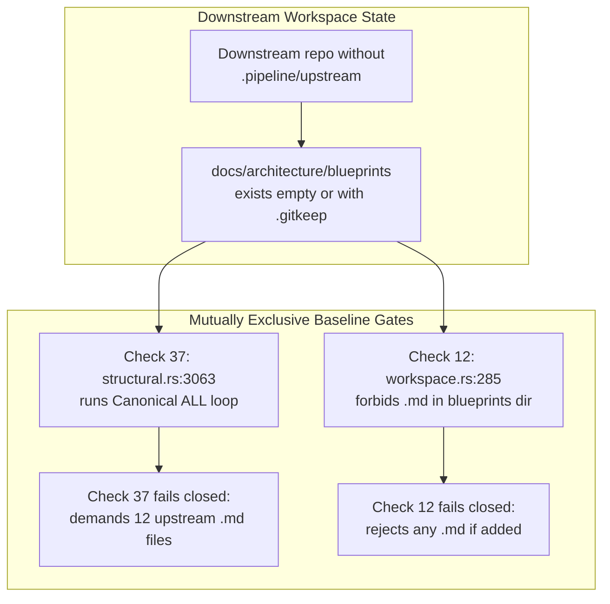

## 1. Context and References

<!-- test-target: crates/verify-baseline/src/checks/structural.rs -->

- **File**: `crates/verify-baseline/src/checks/structural.rs:3063-3080`
- **Pillar**: Semantic Traceability
- **Symptom**: In downstream workspaces (`!is_upstream_compiler(repo_root)`), whenever `docs/architecture/blueprints/` exists on disk (such as an empty directory or one containing `.gitkeep` after deleting or relocating `.md` files), Check 37 (`check_blueprint_grounding`) fails closed demanding 12 upstream `CanonicalArchitectureBlueprint` `.md` files inside `docs/architecture/blueprints/` that Check 12 (`check_no_duplicate_master_blueprints` in `crates/deap-core/src/workspace.rs:285-302`) simultaneously forbids.
- **Test-Target**: `crates/verify-baseline/src/checks/structural.rs`

## 2. Root Cause Analysis (5 Whys)

1. **Why does Check 37 fail closed demanding 12 upstream canonical `.md` files in a downstream workspace when `docs/architecture/blueprints/` exists?** Because `check_blueprint_grounding` (`crates/verify-baseline/src/checks/structural.rs:3063-3080`) runs the `CanonicalArchitectureBlueprint::ALL` completeness loop whenever `blueprints_dir.is_dir()` is `true`, exempting only `SysmlSsotBidirectionalSynchronizationArchitecture` when `!is_upstream_compiler(repo_root)`.
2. **Why does an empty or `.gitkeep`-populated `docs/architecture/blueprints/` directory create an unsatisfiable contradiction in downstream repositories?** Because Check 12 (`check_no_duplicate_master_blueprints` at `crates/deap-core/src/workspace.rs:285-302`) forbids every `.md` file inside `docs/architecture/blueprints/` when `!is_upstream_compiler(repo_root)`, whereas Check 37 demands 12 `.md` files in that same directory whenever `blueprints_dir.is_dir()` evaluates to `true`.
3. **Why did `check_blueprint_grounding` exempt only one enum variant instead of gating the entire `CanonicalArchitectureBlueprint::ALL` loop on `is_upstream_compiler(repo_root)`?** Because `structural.rs:3048-3080` treated directory existence (`blueprints_dir.is_dir()`) as a proxy for requiring upstream canonical architecture blueprints rather than tying canonical completeness strictly to the `UPSTREAM_SPEC_CORE_COMPILER` role sentinel (`is_upstream_compiler(repo_root)`).
4. **Why did unit tests in `structural.rs` fail to detect this Check 12 versus Check 37 contradiction?** Because `test_check_37_rejects_fictional_crates_and_nonexistent_paths` (`crates/verify-baseline/src/checks/structural.rs:4670-4687`) wrote all `CanonicalArchitectureBlueprint::ALL` files into a `TempDir` lacking `.pipeline/upstream` without executing Check 12, and `test_check_37_scans_docs_designs_blueprints` (`structural.rs:4837-4875`) never created `docs/architecture/blueprints/`.
5. **Why was the test suite able to pass while exercising an invalid downstream directory state?** Because `check_blueprint_grounding` lacked an explicit `is_upstream_compiler(repo_root)` guard around the `CanonicalArchitectureBlueprint::ALL` completeness loop, and no test asserted joint satisfiability with Check 12 when `docs/architecture/blueprints/` is empty or contains `.gitkeep` in a downstream workspace.

## 3. Correctness Analysis

Let $U(\text{root}) = \text{is\_upstream\_compiler}(\text{root})$ denote the repository role predicate (`.pipeline/upstream` directory presence) and $D_{\text{bp}}(\text{root}) = \text{is\_dir}(\text{root}/\text{docs/architecture/blueprints})$.

1. **Check 12 Downstream Prohibition (`crates/deap-core/src/workspace.rs:233-302`)**:
   - At line 234, `if is_upstream_compiler(repo_root) { return Ok(()); }` bypasses Check 12 for the upstream compiler repository.
   - For downstream workspaces ($\neg U(\text{root})$), lines 285-302 inspect `docs/architecture/blueprints`: if $D_{\text{bp}}(\text{root})$ is `true`, every file entry with extension `"md"` is pushed into `duplicates`, causing `check_no_duplicate_master_blueprints` to return `Err(duplicates)`. Therefore, Check 12 enforces:

$$
\neg U(\text{root}) \land D_{\text{bp}}(\text{root}) \implies N_{\text{md}} = 0
$$

2. **Check 37 Unconditional Directory Completeness Loop (`crates/verify-baseline/src/checks/structural.rs:3042-3080`)**:
   - At line 3048, `if !blueprints_dir.is_dir() && !designs_dir.is_dir() && !is_upstream_compiler(repo_root)` does not return early when $D_{\text{bp}}(\text{root})$ is `true` (for example, when a downstream project removes `.md` files from `docs/architecture/blueprints/` or retains `docs/architecture/blueprints/.gitkeep`).
   - At lines 3063-3080, `if blueprints_dir.is_dir()` iterates over all 13 variants of `CanonicalArchitectureBlueprint::ALL`. Lines 3065-3072 skip only `CanonicalArchitectureBlueprint::SysmlSsotBidirectionalSynchronizationArchitecture` when `!is_upstream_compiler(repo_root)`, requiring the remaining 12 `.md` files ($N_{\text{md}}$) to exist inside `docs/architecture/blueprints/`:

$$
\neg U(\text{root}) \land D_{\text{bp}}(\text{root}) \implies N_{\text{md}} \ge 12
$$

3. **Violated Invariant (`REQ-CHECK-37-BLUEPRINT-GROUNDING` / Repository Role Separation Invariant)**:
   - Combining Check 12 and Check 37 under $\neg U(\text{root}) \land D_{\text{bp}}(\text{root})$ yields $0 \ge 12$, a mutually unsatisfiable baseline deadlock. Any downstream workspace with an empty or `.gitkeep`-only `docs/architecture/blueprints/` directory cannot pass `verify-baseline` without deleting the directory completely.
   - Furthermore, `test_check_37_rejects_fictional_crates_and_nonexistent_paths` (`crates/verify-baseline/src/checks/structural.rs:4670-4693`) masked this defect by creating `docs/architecture/blueprints/` and all `CanonicalArchitectureBlueprint::ALL` files inside a `TempDir` without `.pipeline/upstream`, relying on the missing `is_upstream_compiler(repo_root)` guard to exercise upstream blueprint scanning in a downstream-classified fixture.

## 4. UML Diagrams



## 5. Affected Callers / Downstream Impact

- `verify-baseline` full baseline runner invoking `check_blueprint_grounding` (`crates/verify-baseline/src/checks/structural.rs:3042`) alongside `check_no_duplicate_master_blueprints` (`crates/deap-core/src/workspace.rs:233`) -- enters an unresolvable fail-closed deadlock in any downstream workspace where `docs/architecture/blueprints/` exists on disk (empty or containing `.gitkeep`).
- Downstream engineering workspaces generating `docs/designs/blueprint-*.md` (`crates/verify-baseline/src/checks/structural.rs:3112-3143`) -- blocked by 12 spurious `"Missing canonical architecture blueprint: docs/architecture/blueprints/..."` violations if `docs/architecture/blueprints/` was left behind after evacuating `.md` files to satisfy Check 12.
- `test_check_37_rejects_fictional_crates_and_nonexistent_paths` (`crates/verify-baseline/src/checks/structural.rs:4670-4693`) -- tests upstream `CanonicalArchitectureBlueprint::ALL` fixtures inside a non-upstream `TempDir` lacking `.pipeline/upstream`, masking the role-gating defect.

## 6. Proposed Correction

```rust
// In crates/verify-baseline/src/checks/structural.rs (lines 3063-3081):
// Gate the upstream CanonicalArchitectureBlueprint::ALL completeness loop
// strictly on `is_upstream_compiler(repo_root)`.
if blueprints_dir.is_dir() {
    if is_upstream_compiler(repo_root) {
        for bp in CanonicalArchitectureBlueprint::ALL {
            let bp_path = blueprints_dir.join(bp.as_str());
            if !bp_path.is_file() {
                violations.push(format!(
                    "Missing canonical architecture blueprint: docs/architecture/blueprints/{}",
                    bp.as_str()
                ));
            }
        }
    }

    match fs::read_dir(&blueprints_dir) {
        // Retain directory .md discovery so any stray .md file is still audited.
        Ok(entries) => {
            for entry_res in entries {
                match entry_res {
                    Ok(entry) => {
                        let path = entry.path();
                        if path.is_file()
                            && path.extension().map(|ext| ext == "md").unwrap_or(false)
                        {
                            md_files.push(path);
                        }
                    }
                    Err(err) => {
                        violations.push(format!(
                            "docs/architecture/blueprints: directory entry read error: {}",
                            err
                        ));
                    }
                }
            }
        }
        Err(err) => {
            violations.push(format!(
                "docs/architecture/blueprints: unable to read directory: {}",
                err
            ));
        }
    }
}

// In test_check_37_rejects_fictional_crates_and_nonexistent_paths (structural.rs:4671):
// Mark the fixture as an upstream compiler workspace (.pipeline/upstream) and add a
// downstream regression test confirming an empty or .gitkeep blueprints_dir passes Check 37.
```

## 7. Relationship to Existing Issues

Discovered in audit -- new finding (related to downstream `docs/designs/blueprint-*.md` scanning introduced in refs #533).

## Audit Source

Adversarial Semantic Traceability Audit
SEVERITY: Important
FILE_LOCATION: crates/verify-baseline/src/checks/structural.rs:3063-3080
