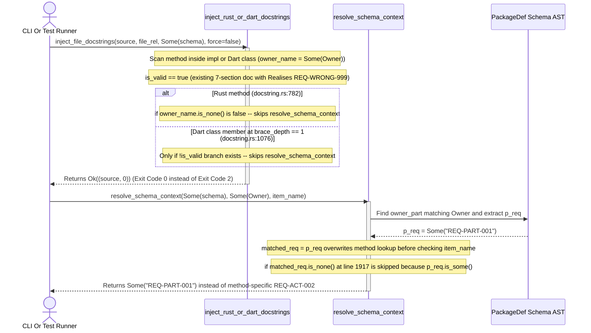

## 1. Context and References

<!-- test-target: crates/compile-sysml/tests/docstring_injector_tests.rs -->

- **File**: `crates/compile-sysml/src/docstring.rs:781-1939`
- **Pillar**: Semantic Traceability
- **Symptom**: Unforced `Realises: [...]` conflict detection (exit code `2`) is bypassed for all Rust `impl`/`trait` methods (`owner_name.is_some()`) and all Dart class/mixin/extension members (`brace_depth == 1`), and `resolve_schema_context` overwrites method-level SysML requirements with the parent `PartDef` requirement `p_req`.
- **Test-Target**: `crates/compile-sysml/tests/docstring_injector_tests.rs`

## 2. Root Cause Analysis (5 Whys)

1. **Why do `inject_rust_file_docstrings` and `inject_dart_file_docstrings` return `Ok` (exit code `0`) instead of `Err` (exit code `2`) when an existing 7-section method docstring contains a conflicting `Realises: [REQ-WRONG-999]` without `--force`?** Because `inject_rust_file_docstrings` (`crates/compile-sysml/src/docstring.rs:781-799`) wraps its conflict check inside `if owner_name.is_none()`, and `inject_dart_file_docstrings` at `brace_depth == 1` (`crates/compile-sysml/src/docstring.rs:1073-1106`) omits the `if is_valid` conflict check branch entirely.
2. **Why were `owner_name.is_some()` methods excluded from unforced `Realises:` conflict verification in Rust and Dart?** Because the conflict verification logic was only wired for top-level declarations (`owner_name == None` at `brace_depth == 0`) where `resolve_schema_context(schema_model, None, &item_name)` resolves `PartDef` requirements directly.
3. **Why does `resolve_schema_context` fail to resolve method-specific `RequirementDef` bindings when `owner_name` is `Some(owner)`?** Because in `crates/compile-sysml/src/docstring.rs:1873-1904`, `resolve_schema_context` immediately assigns `matched_req = p_req;` from `extract_part_req_and_constraint(owner_part)` and never searches `owner_part.requirements`, `owner_part.satisfied_requirements`, or `pkg.requirement_defs` for a requirement matching `item_name` (or `act.name`).
4. **Why does the fallback requirement loop in `crates/compile-sysml/src/docstring.rs:1917-1939` also fail to prioritize or match method-level requirements?** Because `if matched_req.is_none()` is skipped whenever `owner_part` has any parent requirement `p_req`, and even when `p_req` is `None`, `let target_ident = owner_name.unwrap_or(item_name);` checks `target_ident` (`owner`) before `item_name` in a single `.find()` pass and never checks `r.satisfied_by` against `item_name`.
5. **Why did `test_cli_exit_code_1_on_broken_schema_and_exit_code_2_on_conflicting_unforced_docstring` in `crates/compile-sysml/tests/docstring_injector_tests.rs:748-886` pass despite these three flaws?** Because the test fixture only placed a conflicting `Realises: [REQ-WRONG-999]` docstring on a top-level Rust `pub struct AutopilotController` (`owner_name == None`), never testing a conflicting docstring on a Rust `impl` method, a Dart class method, or a method with its own action-level SysML `RequirementDef`.

## 3. Correctness Analysis

FEAT-42 (`docs/designs/FEAT-42_source_code_ast_ingestion_and_docstring_synthesizer.md`, Section 2.2 and Section 3.2) specifies that `compile-sysml --inject-safety-docstrings <DIR>` must validate or update all eligible structs, classes, functions, and methods, exiting with status code `2` (`DocstringExitCode::IdempotencyOrConflict`) whenever an existing compliant docstring carries a `Realises: [<REQ-ID>]` tag that conflicts with the authoritative `--schema` model and `--force` is not enabled.

Three interacting defects in `crates/compile-sysml/src/docstring.rs` violate this invariant for methods and class members:

1. **Rust Method Conflict Bypass (`crates/compile-sysml/src/docstring.rs:781-799`)**:
   Inside `inject_rust_file_docstrings`, when `is_valid` is `true` (`!force` and the existing `///` block satisfies the 7-section structure), line 782 guards the schema conflict check with `if owner_name.is_none()`. For any method inside an `impl` block or `trait` block, `impl_owner_stack.last()` yields `owner_name == Some(owner)`. Consequently, `resolve_schema_context` is never called, and an unforced method docstring with a conflicting `Realises: [REQ-WRONG-999]` silently passes with `Ok((source, 0))` (exit code `0`).
2. **Dart Class Member Conflict Bypass (`crates/compile-sysml/src/docstring.rs:1071-1106`)**:
   Inside `inject_dart_file_docstrings`, top-level declarations at `brace_depth == 0` (`crates/compile-sysml/src/docstring.rs:996-1011`) check `if is_valid` against `resolve_schema_context(schema_model, None, &item_name)`. However, at `brace_depth == 1` (`crates/compile-sysml/src/docstring.rs:1073-1106`), when `classify_dart_member_ast(code, cls_name)` matches a constructor, method, getter, or setter and `is_valid` is `true`, there is only an `if !is_valid` block. The loop clears `current_doc` and continues without calling `resolve_schema_context(schema_model, Some(cls_name.as_str()), &member_name)`, allowing conflicting `Realises:` tags on Dart methods to pass silently with exit code `0`.
3. **Parent `PartDef` Requirement Shadowing in `resolve_schema_context` (`crates/compile-sysml/src/docstring.rs:1873-1939`)**:
   When `resolve_schema_context(schema_model, Some(owner), item_name)` locates `owner_part` in `all_parts` (`crates/compile-sysml/src/docstring.rs:1874-1881`), it unconditionally sets `matched_req = p_req;` (the parent `PartDef`'s first requirement). Inside `if let Some(act) = owner_part.actions.iter().find(...)` (`crates/compile-sysml/src/docstring.rs:1883-1903`), it resolves action-specific constraints into `matched_constraint` but never checks for an action/method-specific requirement matching `item_name` (or `owner::item_name`). Because `matched_req` is already `Some(...)` whenever the owning `PartDef` has a requirement, line 1917 (`if matched_req.is_none()`) is skipped. Even when `p_req` is `None`, lines 1918-1938 check `target_ident` (`owner`) in the same `.find()` predicate as `item_name` and omit `r.satisfied_by.iter().any(|s| schema_identifiers_match(s, item_name))`. As a result, method-specific requirements in `--schema` are shadowed by `p_req` during both docstring synthesis (`synthesize_7_section_docstring`) and conflict detection.

## 4. UML Diagrams



## 5. Affected Callers / Downstream Impact

- `run_docstring_injection` (`crates/compile-sysml/src/docstring.rs:348-450`) -- Fails to return `Err((DocstringExitCode::IdempotencyOrConflict, ...))` (CLI exit code `2`) when Rust `impl`/`trait` methods or Dart class members have unforced conflicting `Realises:` tags against `--schema`.
- `inject_rust_file_docstrings` (`crates/compile-sysml/src/docstring.rs:570-894`) -- Skips unforced schema conflict detection whenever `owner_name.is_some()`.
- `inject_dart_file_docstrings` (`crates/compile-sysml/src/docstring.rs:927-1184`) -- Skips unforced schema conflict detection for all class, mixin, and extension members at `brace_depth == 1`.
- `synthesize_7_section_docstring` (`crates/compile-sysml/src/docstring.rs:1331-1545`) -- Calls `resolve_schema_context(ctx.schema_model, ctx.owner_name, ctx.item_name)` and stamps methods with the parent `PartDef` requirement ID even when the schema defines an action/method-specific `RequirementDef` for `ctx.item_name`.

## 6. Proposed Correction

<!-- MUST NOT use regex (Check 34: deterministic linear slice/char scanning, no regex crate). MUST be domain-agnostic for upstream crates (Check 19). -->

In `crates/compile-sysml/src/docstring.rs`:
1. In `resolve_schema_context`, when `owner_name` is `Some(owner)`, check for a method/action-specific requirement matching `item_name` (or `owner::item_name`) in `owner_part.requirements`, `owner_part.satisfied_requirements`, `owner_part.safety_realises`, and `all_pkgs` (`pkg.requirement_defs`, including `r.satisfied_by` matching `item_name` or `owner::item_name`, while excluding requirements whose name matches a different `PartDef` in `all_parts`) before falling back to the parent `PartDef`'s `p_req`.
2. In `inject_rust_file_docstrings` (`lines 781-799`), remove the `if owner_name.is_none()` guard and pass `owner_name` into `resolve_schema_context(schema_model, owner_name, &item_name)` so conflicting unforced `Realises:` tags on Rust `impl`/`trait` methods return `Err(...)` (exit code `2`).
3. In `inject_dart_file_docstrings` at `brace_depth == 1` (`lines 1076-1106`), add the `if is_valid` branch invoking `resolve_schema_context(schema_model, Some(cls_name.as_str()), &member_name)` so conflicting unforced `Realises:` tags on Dart class members return `Err(...)` (exit code `2`).

```rust
// 1. In inject_rust_file_docstrings (crates/compile-sysml/src/docstring.rs:781-799):
if is_valid {
    let (schema_req_opt, _) =
        resolve_schema_context(schema_model, owner_name, &item_name);
    if let Some(schema_req) = schema_req_opt {
        let existing_reqs =
            extract_realises_ids_from_doc_lines(&current_doc);
        if !existing_reqs.is_empty()
            && !existing_reqs
                .iter()
                .any(|r| schema_identifiers_match(r, &schema_req))
        {
            let qualified_item = match owner_name {
                Some(owner) => format!("{}::{}", owner, item_name),
                None => item_name.clone(),
            };
            return Err(format!(
                "Conflicting unforced docstring in '{}' for '{}': existing Realises {:?} conflicts with schema requirement '{}' (use --force to overwrite)",
                file_rel, qualified_item, existing_reqs, schema_req
            ));
        }
    }
}

// 2. In inject_dart_file_docstrings at brace_depth == 1 (crates/compile-sysml/src/docstring.rs:1076):
if is_valid {
    let (schema_req_opt, _) =
        resolve_schema_context(schema_model, Some(cls_name.as_str()), &member_name);
    if let Some(schema_req) = schema_req_opt {
        let existing_reqs = extract_realises_ids_from_doc_lines(&current_doc);
        if !existing_reqs.is_empty()
            && !existing_reqs
                .iter()
                .any(|r| schema_identifiers_match(r, &schema_req))
        {
            return Err(format!(
                "Conflicting unforced docstring in '{}' for '{}::{}': existing Realises {:?} conflicts with schema requirement '{}' (use --force to overwrite)",
                file_rel, cls_name, member_name, existing_reqs, schema_req
            ));
        }
    }
} else {
    // existing synthesis branch for !is_valid
}

// 3. In resolve_schema_context (crates/compile-sysml/src/docstring.rs:1873-1939):
let find_item_specific_req = |owner_opt: Option<&str>,
                              owner_part_opt: Option<&deap_core::sysml_ast::PartDef>,
                              item: &str|
 -> Option<String> {
    let qualified_colon = owner_opt.map(|o| format!("{}::{}", o, item));
    let qualified_dot = owner_opt.map(|o| format!("{}.{}", o, item));
    let matches_item_target = |candidate: &str| -> bool {
        schema_identifiers_match(candidate, item)
            || qualified_colon
                .as_deref()
                .map(|q| schema_identifiers_match(candidate, q))
                .unwrap_or(false)
            || qualified_dot
                .as_deref()
                .map(|q| schema_identifiers_match(candidate, q))
                .unwrap_or(false)
    };

    if let Some(part) = owner_part_opt {
        if let Some(inline_req) = part.requirements.iter().find(|r| {
            matches_item_target(&r.name)
                || (!r.req_id.is_empty() && matches_item_target(&r.req_id))
                || r.satisfied_by.iter().any(|s| matches_item_target(s))
        }) {
            if !inline_req.req_id.is_empty() {
                return Some(inline_req.req_id.clone());
            } else if !inline_req.name.is_empty() {
                return Some(inline_req.name.clone());
            }
        }
    }

    // Do not match a RequirementDef whose identifier merely names an unrelated PartDef
    let names_other_part = all_parts
        .iter()
        .any(|p| schema_identifiers_match(&p.name, item));

    for pkg in &all_pkgs {
        if let Some(req_def) = pkg.requirement_defs.iter().find(|r| {
            r.satisfied_by.iter().any(|s| matches_item_target(s))
                || (!names_other_part
                    && ( matches_item_target(&r.name)
                        || (!r.req_id.is_empty() && matches_item_target(&r.req_id))))
        }) {
            let id = if !req_def.req_id.is_empty() {
                req_def.req_id.clone()
            } else {
                req_def.name.clone()
            };
            if !id.is_empty() {
                return Some(id);
            }
        }
    }
    None
};
```

## 7. Relationship to Existing Issues

Discovered in audit -- new finding (refs #458).

## Audit Source

Adversarial Semantic Traceability Audit
SEVERITY: Important
FILE_LOCATION: crates/compile-sysml/src/docstring.rs:781-1939
