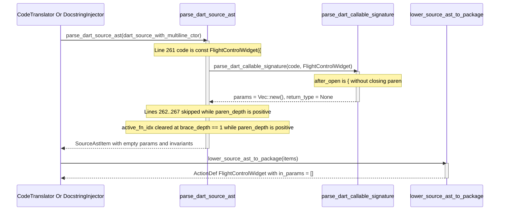

## 1. Context and References

<!-- test-target: crates/ingest-sysml/tests/code_ingestion_tests.rs -->

- **File**: `crates/deap-core/src/source_ast.rs:1525-1636`
- **Pillar**: Semantic Traceability
- **Symptom**: `parse_dart_source_ast` (`crates/deap-core/src/source_ast.rs:1529-1533`, `1582-1583`) and `inject_dart_file_docstrings` (`crates/compile-sysml/src/docstring.rs:1019-1023`, `1083-1084`) invoke `parse_dart_callable_signature(code, &name)` on only the single opening declaration line `code` rather than accumulating multi-line parameter lists up to the closing `)` delimiter, causing multi-line Dart constructors, methods, and functions to lower into SysML v2 `ActionDef` nodes and 7-section docstrings with empty (`Vec::new()`) or truncated formal parameter lists while `test_ac01_dart_stateful_widget_extraction_into_canonical_packagedef_ast` passes without asserting lowered Dart `ActionDef::in_params`.
- **Test-Target**: `crates/ingest-sysml/tests/code_ingestion_tests.rs`

## 2. Root Cause Analysis (5 Whys)

1. **Why do multi-line Dart constructors, methods, and functions lose their formal parameters during SysML v2 AST ingestion and 7-section safety docstring synthesis?** Because `parse_dart_callable_signature` (`crates/deap-core/src/source_ast.rs:2879-2986`) is passed only the single opening declaration line `code` at `crates/deap-core/src/source_ast.rs:1530` and `1583` and at `crates/compile-sysml/src/docstring.rs:1020` and `1084`.
2. **Why does passing only the opening line `code` produce an empty or truncated `Vec<SourceParam>`?** Because when a Dart callable wraps its parameter list across multiple lines (such as `const FlightControlWidget({\n  super.key,\n  required this.vehicleCallsign,\n});`), `code` ends immediately after `(` or `({`, so `after_open.rsplit_once(')')` (`crates/deap-core/src/source_ast.rs:2906-2915`) strips `{` and yields an empty `cleaned_section` (`""`), returning zero `SourceParam` entries.
3. **Why did `parse_dart_source_ast` and `inject_dart_file_docstrings` not accumulate continuation lines for Dart callables the way Rust callables do?** Because `parse_rust_source_ast` (`crates/deap-core/src/source_ast.rs:1262-1275`, `1318-1324`, `1377-1383`) and `inspect_rust_item_details` (`crates/compile-sysml/src/docstring.rs:1587-1605`) explicitly accumulate multi-line Rust `fn` signatures into a buffer until `{` or `;`, whereas the Dart parser and docstring injector were implemented as single-line classifiers without a multi-line parameter accumulation state.
4. **Why are body-level `assert(...)` invariants inside multi-line-signature Dart methods also dropped during AST extraction?** Because at the end of a class-member opening line where `paren_depth > 0` and `brace_depth == 1`, `parse_dart_source_ast` executes `else if brace_depth == 1 { active_fn_idx = None; }` (`crates/deap-core/src/source_ast.rs:1634-1636`), clearing `active_fn_idx` before the parameter list closes and the method body opens.
5. **Why did the existing FEAT-42 integration test suite (`crates/ingest-sysml/tests/code_ingestion_tests.rs:246-351`) pass despite using a 6-line `const FlightControlWidget({...})` constructor fixture?** Because `test_ac01_dart_stateful_widget_extraction_into_canonical_packagedef_ast` only asserted `widget_part.attributes`, `widget_part.ports`, and `widget_part.satisfied_requirements` (`crates/ingest-sysml/tests/code_ingestion_tests.rs:294-331`), omitting assertions on `widget_part.actions` and `ActionDef::in_params` (unlike the Rust test `test_ac02_rust_struct_and_impl_block_ast_ingestion` at lines `451-491`).

## 3. Correctness Analysis

`docs/designs/FEAT-42_source_code_ast_ingestion_and_docstring_synthesizer.md` Section 3.1 (line 92) mandates that source methods and functions lower to `ActionDef` with formal `in` and `out` parameters (`action def <name>(in ..., out ...);`), and Section 3.2 (lines 109-111) mandates that Section 3 (`## 3. Preconditions`) and Section 5 (`## 5. Algorithmic Complexity Bounds`) of synthesized 7-section safety docstrings enumerate each formal input parameter `<param_name>: <ParamType>` derived from the callable's AST signature.

In `crates/deap-core/src/source_ast.rs`:
1. When `parse_dart_source_ast` (`crates/deap-core/src/source_ast.rs:1487-1640`) encounters a top-level Dart function at `brace_depth == 0, paren_depth == 0` (`lines 1527-1533`) or a class constructor/method at `brace_depth == 1, paren_depth == 0` (`lines 1578-1583`), it immediately invokes `parse_dart_callable_signature(code, &name)` on the single line `code`.
2. If the Dart callable's formal parameter list spans multiple lines -- which is standard formatting in Flutter/Dart for constructors and methods with named parameters `{super.key, required this.field, ...}` -- `code` on the opening line contains only the prefix up to `(` or `({`.
3. Inside `parse_dart_callable_signature` (`crates/deap-core/src/source_ast.rs:2879-2986`), `code.split_once('(')` (`line 2884`) sets `after_open` to `"{"` (or any first-line parameter fragment). `after_open.rsplit_once(')')` (`lines 2906-2909`) finds no closing `')'` on that line and falls back to `after_open`. `cleaned_section` (`lines 2910-2915`) strips `'{'`, leaving `""`. The loop over `split_top_level_comma(cleaned_section)` (`lines 2917-2983`) produces `params = Vec::new()`.
4. On subsequent lines of the parameter list (`paren_depth > 0`), `parse_dart_source_ast` skips the `if paren_depth == 0` block (`line 1525`) without appending the parameter lines to the pending callable's signature. Furthermore, for any class method whose opening line leaves `brace_depth == 1` and `paren_depth > 0`, `crates/deap-core/src/source_ast.rs:1634-1636` executes `else if brace_depth == 1 { active_fn_idx = None; }`, prematurely clearing `active_fn_idx` before the parameter list closes with `) {`, so any `assert(...)` invariant inside that method's body (`lines 1615-1620`) is also silently discarded.
5. Identically, in `crates/compile-sysml/src/docstring.rs:1019-1023` (top-level Dart functions) and `1083-1084` (class constructors and methods), `inject_dart_file_docstrings` passes only the single opening line `code` to `parse_dart_callable_signature`, causing `synthesize_7_section_docstring` (`lines 1039`, `1100`) to receive `params: Vec::new()` (and `return_type` without any trailing signature tokens after `)`), generating generic zero-parameter preconditions and complexity bounds instead of interpolating the declared Dart parameters.

## 4. UML Diagrams



## 5. Affected Callers / Downstream Impact

- `deap_core::source_ast::parse_dart_source_ast` (`crates/deap-core/src/source_ast.rs:1487-1640`) -- drops formal parameters on multi-line Dart constructors, methods, and top-level functions, and clears `active_fn_idx` while `paren_depth > 0` at `brace_depth == 1`, dropping body `assert(...)` invariants on multi-line-signature Dart methods.
- `deap_core::source_ast::lower_source_ast_to_package` (`crates/deap-core/src/source_ast.rs:1675-1894`) -- emits SysML v2 `ActionDef` nodes with missing `in` parameters (`in_params`) and missing `ConstraintDef` assertions for multi-line Dart callables.
- `ingest_sysml::translators::code::CodeTranslator::translate_directory` (`crates/ingest-sysml/src/translators/code.rs:195-217`) -- produces incomplete `.pipeline/schema.sysml` models when ingesting formatted Flutter/Dart source trees (`ingest-sysml --source <DIR> --language dart`).
- `compile_sysml::docstring::inject_dart_file_docstrings` (`crates/compile-sysml/src/docstring.rs:927-1160`) -- synthesizes 7-section Dart docstrings with empty `params` in `ItemSynthesisContext` (`lines 1033`, `1094`), omitting formal parameter preconditions in Section 3 and parameter dimensions in Section 5.
- `crates/ingest-sysml/tests/code_ingestion_tests.rs:246-351` (`test_ac01_dart_stateful_widget_extraction_into_canonical_packagedef_ast`) -- false-positive green test that exercises a multi-line `FlightControlWidget` constructor without asserting its lowered `ActionDef::in_params`.

## 6. Proposed Correction

<!-- MUST NOT use regex (Check 34: deterministic linear slice/char scanning, no regex crate). MUST be domain-agnostic for upstream crates (Check 19). -->

Accumulate multi-line Dart callable signatures across continuation lines until balanced parentheses close (`paren_depth == 0`) in both `parse_dart_source_ast` (`crates/deap-core/src/source_ast.rs`) and `inject_dart_file_docstrings` (`crates/compile-sysml/src/docstring.rs`), and preserve `active_fn_idx` while `paren_depth > 0`:

```rust
/// Collects a complete Dart callable signature starting at `start_idx` across continuation lines
/// until the parameter list parentheses balance (`paren_depth == 0`).
pub fn collect_dart_callable_signature(raw_lines: &[&str], start_idx: usize) -> String {
    let mut sig_buf = String::new();
    let mut paren_depth: usize = 0;
    let mut brace_depth: usize = 0;
    let mut seen_open_paren = false;
    let end_scan = start_idx.saturating_add(32).min(raw_lines.len());

    if let Some(window) = raw_lines.get(start_idx..end_scan) {
        for (offset, &line) in window.iter().enumerate() {
            let trimmed = strip_line_comment_preserving_strings(line.trim()).trim();
            let code = if offset == 0 {
                strip_leading_dart_annotations(trimmed).trim()
            } else {
                trimmed
            };
            if code.is_empty() {
                continue;
            }
            if !sig_buf.is_empty() {
                sig_buf.push(' ');
            }
            sig_buf.push_str(code);
            if code.contains('(') {
                seen_open_paren = true;
            }
            update_ast_delimiter_depths(code, &mut brace_depth, &mut paren_depth);
            if !seen_open_paren || paren_depth == 0 {
                break;
            }
        }
    }
    sig_buf
}
```

And in `parse_dart_source_ast` (`crates/deap-core/src/source_ast.rs:1626-1636`), guard the `active_fn_idx` reset so it does not clear an in-flight callable while `paren_depth > 0`:

```rust
        let prev_brace_depth = brace_depth;
        update_ast_delimiter_depths(code, &mut brace_depth, &mut paren_depth);
        if (prev_brace_depth > 0 && brace_depth == 0)
            || (brace_depth == 0 && paren_depth == 0 && (code.ends_with(';') || code.ends_with('}')))
        {
            active_class_idx = None;
            active_class_name = None;
            active_fn_idx = None;
        } else if brace_depth == 1 && paren_depth == 0 {
            active_fn_idx = None;
        }
```

## 7. Relationship to Existing Issues

Discovered in audit -- new finding (refs #458).

## Audit Source

Adversarial Semantic Traceability Audit
SEVERITY: Important
FILE_LOCATION: crates/deap-core/src/source_ast.rs:1525-1636
