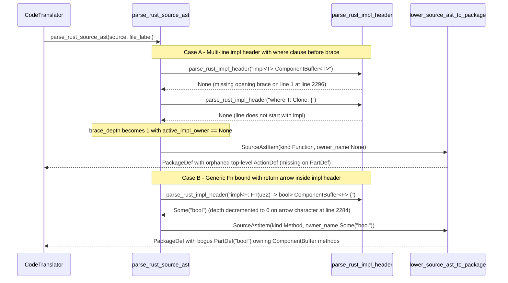

## 1. Context and References

<!-- test-target: crates/ingest-sysml/tests/code_ingestion_tests.rs -->

- **File**: `crates/deap-core/src/source_ast.rs:2275-2308`
- **Pillar**: Semantic Traceability
- **Symptom**: `parse_rust_source_ast` (`crates/deap-core/src/source_ast.rs:1279-1281`) and `parse_rust_impl_header` (`crates/deap-core/src/source_ast.rs:2275-2308`) drop `active_impl_owner` on multi-line Rust `impl` headers (where `{` appears on a subsequent line after a `where` clause, trait `for` clause, or multi-line generic parameter list) and prematurely terminate `impl<...>` generic scanning on `->` return-type arrows inside closure/fn bounds (such as `impl<F: Fn(u32) -> bool> ComponentBuffer<F>`), causing methods to be extracted with `owner_name: None` and `SourceItemKind::Function` or bound to a fabricated `PartDef("bool")`, while `test_ac02_rust_struct_and_impl_block_ast_ingestion` in `crates/ingest-sysml/tests/code_ingestion_tests.rs:399-522` passes by only exercising a single-line non-generic `impl ComponentBuffer {` header.
- **Test-Target**: `crates/ingest-sysml/tests/code_ingestion_tests.rs`

## 2. Root Cause Analysis (5 Whys)

1. **Why are methods inside multi-line or closure-bounded Rust `impl` blocks detached from their owning `PartDef` during `ingest-sysml --source` AST lowering?** Because `lower_source_ast_to_package` (`crates/deap-core/src/source_ast.rs:1839-1880`) attaches an `ActionDef` (and its `satisfied_requirements` and `assert!` `ConstraintDef` invariants) to a `PartDef` only when `item.owner_name` is `Some(target_type)`, and falls back to package-level `pkg.action_defs` (or a bogus `PartDef`) when `active_impl_owner` was `None` or misparsed.
2. **Why is `active_impl_owner` set to `None` when a Rust `impl` header spans multiple lines before `{`?** Because `parse_rust_source_ast` (`crates/deap-core/src/source_ast.rs:1279`) invokes `parse_rust_impl_header(code)` only on individual lines at `brace_depth == 0` without accumulating multi-line `impl` headers, and `parse_rust_impl_header` (`crates/deap-core/src/source_ast.rs:2296-2298`) returns `None` whenever `!code.contains('{')`.
3. **Why does `parse_rust_impl_header` extract `"bool"` instead of `"ComponentBuffer"` on `impl<F: Fn(u32) -> bool> ComponentBuffer<F> {`?** Because the generic angle-bracket scanner in `parse_rust_impl_header` (`crates/deap-core/src/source_ast.rs:2280-2290`) decrements `depth` on every `'>'` character without checking whether the preceding character was `'-'` (`->`), causing `depth` to reach `0` at the return arrow inside `Fn(u32) -> bool` and slicing the target type starting at `bool>`.
4. **Why did `compile-sysml` docstring injection (`crates/compile-sysml/src/docstring.rs:720-767, 2065-2105`) handle `prev_ch != Some('-')` and `where` clauses while `deap-core::source_ast` remained broken?** Because `extract_rust_impl_header_prefix` and `pending_impl_target` were implemented locally inside `crates/compile-sysml/src/docstring.rs` instead of fixing the shared Layer 1/Layer 2 AST parser in `crates/deap-core/src/source_ast.rs`.
5. **Why did the FEAT-42 AC-02 integration test suite (`crates/ingest-sysml/tests/code_ingestion_tests.rs:399-522`) fail to catch both defects?** Because `test_ac02_rust_struct_and_impl_block_ast_ingestion` only tested a single-line, non-generic `impl ComponentBuffer {` block without multi-line `where`/`for` clauses or `Fn(...) -> Ret` generic bounds.

## 3. Correctness Analysis

In `docs/designs/FEAT-42_source_code_ast_ingestion_and_docstring_synthesizer.md` (Section 3.1 and Scenario 2 `AC-02`) and the function contract of `parse_rust_source_ast` (`crates/deap-core/src/source_ast.rs:1162`) and `parse_rust_impl_header` (`crates/deap-core/src/source_ast.rs:2250-2261`), every method declared inside an `impl <Target>` or `impl <Trait> for <Target>` block must be extracted with `kind: SourceItemKind::Method` and `owner_name: Some(Target)`, and lowered into an `ActionDef` owned by `PartDef(Target)`.

Three distinct defects in `crates/deap-core/src/source_ast.rs` violate this invariant:

1. **Multi-Line `impl` Header Drop (`crates/deap-core/src/source_ast.rs:1279-1281, 2296-2298`)**:
   - While `parse_rust_source_ast` accumulates multi-line `fn` signatures via `pending_sig_fn_idx` and `pending_sig_text` (`lines 1200-1201, 1263-1275, 1320-1323`), it has no accumulator for multi-line `impl` headers at `brace_depth == 0`.
   - When an `impl` block is formatted across multiple lines (for example, `impl<T> ComponentBuffer<T>\nwhere\n    T: Clone,\n{` or `impl<T> FrameSink<T>\n    for ComponentBuffer<T>\n{` or a multi-line generic parameter list `impl<\n    T: Clone,\n> ComponentBuffer<T> {`), line 1 lacks `'{'` so `parse_rust_impl_header(code)` returns `None` at line 2296 (`if !code.contains('{') { return None; }`).
   - Subsequent continuation lines (`where`, `T: Clone,`, `for ComponentBuffer<T>`, `{`) do not begin with `"impl "` or `"impl<"`, so `parse_rust_impl_header(code)` returns `None` on those lines as well.
   - Once `{` is processed by `update_ast_delimiter_depths` (`line 1438`), `brace_depth` becomes `1` while `active_impl_owner` remains `None`.
   - At `brace_depth == 1` (`lines 1346-1385`), every method in the `impl` block is classified with `actual_kind = SourceItemKind::Function` (`line 1351`, because `active_impl_owner.is_some()` is `false`) and `owner_name: None` (`line 1366`).
   - Furthermore, at `line 1444` (`} else if brace_depth == 1 && active_impl_owner.is_some() { active_fn_idx = None; }`), because `active_impl_owner` is `None`, `active_fn_idx` is not cleared when a method body closes at `brace_depth == 1`.
   - In `lower_source_ast_to_package` (`lines 1839-1880`), `item.owner_name` is `None`, so all methods, `/// Realises:` requirements, and `assert!` constraints inside the multi-line `impl` block are omitted from `PartDef("ComponentBuffer")` and emitted as detached package-level items.

2. **Premature `impl<...>` Termination on Return-Type Arrows (`crates/deap-core/src/source_ast.rs:2277-2291`)**:
   - Inside `parse_rust_impl_header`, when `after_unsafe` starts with `"impl<"`, lines 2280-2290 iterate over `r.char_indices()` and execute `if ch == '<' { depth = depth.saturating_add(1); } else if ch == '>' { depth = depth.saturating_sub(1); ... }`.
   - Because `ch == '>'` does not check whether the preceding character was `'-'`, a return-type arrow `->` in a trait bound such as `impl<F: Fn(u32) -> bool> ComponentBuffer<F> {` decrements `depth` from `1` to `0` at `->`.
   - `end_idx` is set immediately after `->`, making `rest` equal to `"bool> ComponentBuffer<F> {"`, and `extract_leading_ast_ident` returns `Some("bool")`.
   - `lower_source_ast_to_package` (`lines 1841-1849`) then creates an extraneous `PartDef` named `"bool"` and attaches `ComponentBuffer`'s methods to `part def bool`.

3. **Unstripped `where` Clause Before `" for "` Splitting (`crates/deap-core/src/source_ast.rs:2300-2305`)**:
   - Line 2301 splits `before_brace` on `" for "` before stripping any `" where "` clause.
   - In an inherent `impl` whose `where` clause contains a higher-rank trait bound (e.g., `impl<T> ComponentBuffer<T> where for<'a> &'a T: Copy {` or `where T: for<'a> Fn(&'a u32)`), `before_brace.split_once(" for ")` matches inside the `where` clause instead of extracting `ComponentBuffer`.

## 4. UML Diagrams



## 5. Affected Callers / Downstream Impact

- `parse_rust_source_ast` (`crates/deap-core/src/source_ast.rs:1184-1450`) -- Misclassifies methods inside multi-line `impl` blocks as `SourceItemKind::Function` with `owner_name: None`, fails to reset `active_fn_idx` at `brace_depth == 1`, and misattributes `impl<F: Fn(...) -> Ret>` blocks to the return type identifier.
- `lower_source_ast_to_package` (`crates/deap-core/src/source_ast.rs:1726-1894`) -- Emits `impl` methods, `satisfied_requirements`, and `assert!` `ConstraintDef` invariants at package scope or under a fabricated primitive return-type `PartDef` instead of the target struct's `PartDef`.
- `ingest_source_directory` (`crates/deap-core/src/source_ast.rs:1990-2043`) and `CodeTranslator::translate_directory` (`crates/ingest-sysml/src/translators/code.rs:157-164`) -- Produces incomplete `PartDef` models when ingesting standard `rustfmt`-formatted Rust crates containing multi-line `impl` headers.
- `run_extract_source` (`crates/compile-sysml/src/docstring.rs:417-460`) -- Reverse source extraction (`compile-sysml --extract-source`) inherits the same AST lowering corruption because it delegates directly to `ingest_source_directory`.

## 6. Proposed Correction

<!-- MUST NOT use regex (Check 34: deterministic linear slice/char scanning, no regex crate). MUST be domain-agnostic for upstream crates (Check 19). -->

Accumulate multi-line `impl` headers at `brace_depth == 0` in `parse_rust_source_ast` until `{` (or `;` / `}`) is encountered, and update `parse_rust_impl_header` to:
1. Ignore `'>'` when immediately preceded by `'-'` (`->`) while balancing `impl<...>` generic parameter lists.
2. Strip any `where` clause (`" where "` or trailing `" where"`) before splitting on `" for "` at angle-bracket depth `0`.

```rust
fn starts_rust_impl_header(code: &str) -> bool {
    let after_unsafe = code.strip_prefix("unsafe ").unwrap_or(code).trim_start();
    after_unsafe.starts_with("impl ")
        || after_unsafe.starts_with("impl<")
        || after_unsafe == "impl"
}

fn split_trait_for_target_top_level(header_before_where: &str) -> &str {
    let mut angle_depth: usize = 0;
    let mut paren_depth: usize = 0;
    let mut prev_ch: Option<char> = None;
    for (i, ch) in header_before_where.char_indices() {
        if ch == '<' {
            angle_depth = angle_depth.saturating_add(1);
        } else if ch == '>' && prev_ch != Some('-') {
            angle_depth = angle_depth.saturating_sub(1);
        } else if ch == '(' {
            paren_depth = paren_depth.saturating_add(1);
        } else if ch == ')' {
            paren_depth = paren_depth.saturating_sub(1);
        } else if angle_depth == 0 && paren_depth == 0 {
            if let Some(after_for) = header_before_where.get(i..).and_then(|s| s.strip_prefix(" for ")) {
                return after_for.trim();
            }
        }
        prev_ch = Some(ch);
    }
    header_before_where
}

fn parse_rust_impl_header(code: &str) -> Option<String> {
    if !code.contains('{') {
        return None;
    }
    let after_unsafe = code.strip_prefix("unsafe ").unwrap_or(code).trim_start();
    let after_impl = after_unsafe.strip_prefix("impl")?.trim_start();
    let rest = if let Some(r) = after_impl.strip_prefix('<') {
        let mut depth: usize = 1;
        let mut end_idx: Option<usize> = None;
        let mut prev_ch: Option<char> = None;
        for (i, ch) in r.char_indices() {
            if ch == '<' {
                depth = depth.saturating_add(1);
            } else if ch == '>' && prev_ch != Some('-') {
                depth = depth.saturating_sub(1);
                if depth == 0 {
                    end_idx = Some(i.saturating_add(1));
                    break;
                }
            }
            prev_ch = Some(ch);
        }
        r.get(end_idx?..).unwrap_or("").trim_start()
    } else if after_unsafe.starts_with("impl ") {
        after_impl
    } else {
        return None;
    };

    let before_brace = rest.split_once('{').map(|(b, _)| b.trim()).unwrap_or(rest);
    let before_where = before_brace
        .split_once(" where ")
        .map(|(b, _)| b.trim())
        .unwrap_or(before_brace)
        .trim_end_matches(" where")
        .trim();
    let target_part = split_trait_for_target_top_level(before_where);
    let target_clean = target_part
        .trim_start_matches('&')
        .trim_start_matches("mut ")
        .trim();
    extract_leading_ast_ident(target_clean)
}
```

And in `parse_rust_source_ast` (`crates/deap-core/src/source_ast.rs:1200-1330`), maintain `pending_impl_header: Option<String>` at `brace_depth == 0`:
- When `pending_impl_header` is `Some(ref mut hdr)`, append `' '` and `code`; if `code.contains('{')`, set `active_impl_owner = parse_rust_impl_header(hdr)` and clear `pending_impl_header` and `current_doc` (or clear `pending_impl_header` if `code.contains(';')` or `code.contains('}')`).
- When `pending_impl_header` is `None` at `brace_depth == 0` and `starts_rust_impl_header(code)` is `true`, either resolve `parse_rust_impl_header(code)` immediately if `code.contains('{')` or initialize `pending_impl_header = Some(code.to_string())`.

## 7. Relationship to Existing Issues

Discovered in audit of FEAT-42 (`#458`) -- new finding in `crates/deap-core/src/source_ast.rs` where `test_ac02_rust_struct_and_impl_block_ast_ingestion` in `crates/ingest-sysml/tests/code_ingestion_tests.rs` only covered single-line non-generic `impl` headers.

## Audit Source

Adversarial Semantic Traceability Audit
SEVERITY: Important
FILE_LOCATION: crates/deap-core/src/source_ast.rs:2275-2308
