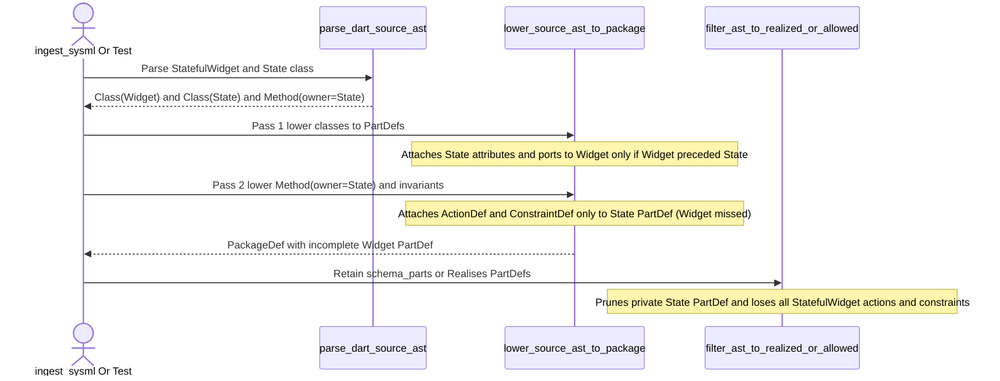

## 1. Context and References

<!-- test-target: crates/ingest-sysml/tests/code_ingestion_tests.rs -->

- **File**: `crates/deap-core/src/source_ast.rs:1728-1880`
- **Pillar**: Semantic Traceability
- **Symptom**: `lower_source_ast_to_package` Pass 2 (`crates/deap-core/src/source_ast.rs:1804-1880`) attaches Dart `State<WidgetName>` methods (`ActionDef`) and `assert(...)` invariants (`ConstraintDef`) only to the companion state class `PartDef` rather than forwarding them to the owning `WidgetName` `PartDef`, and Pass 1 (`crates/deap-core/src/source_ast.rs:1728-1750`) only links `State<WidgetName>` attributes, ports, requirements, and `StateDef` if `WidgetName` appeared earlier in `items`, while `test_ac01_dart_stateful_widget_extraction_into_canonical_packagedef_ast` passes without asserting `widget_part.actions` or `widget_part.constraints`.
- **Test-Target**: `crates/ingest-sysml/tests/code_ingestion_tests.rs`

## 2. Root Cause Analysis (5 Whys)

1. **Why are Dart `StatefulWidget` state transition methods (`ActionDef`) and `assert(...)` invariants (`ConstraintDef`) missing from the owning widget `PartDef` and lost after realization scoping?** Because `lower_source_ast_to_package` attaches callable members and assertions of a `class _MyWidgetState extends State<MyWidget>` exclusively to the sanitized state class `PartDef` (`MyWidgetState`), which is subsequently pruned by `filter_ast_to_realized_or_allowed` (`crates/ingest-sysml/src/lib.rs:743-795`) when only `MyWidget` carries the architectural `Realises:` tag or matches `schema_parts`.
2. **Why does `lower_source_ast_to_package` attach `State<WidgetName>` methods and assertions only to `MyWidgetState` instead of `MyWidget`?** Because in Pass 2 (`crates/deap-core/src/source_ast.rs:1839-1863`), `item.owner_name` for methods parsed inside `class _MyWidgetState` is `Some("_MyWidgetState")`, and Pass 2 looks up only `owner_clean` (`MyWidgetState`) in `pkg.part_defs` without resolving whether `owner_clean` is a `State<WidgetName>` companion class bound to `WidgetName`.
3. **Why did Pass 1 link `State<WidgetName>` fields to `WidgetName` while Pass 2 omitted methods and constraints (and why can Pass 1 also drop fields when `_MyWidgetState` precedes `MyWidget`)?** Because `extract_state_generic_target` (`crates/deap-core/src/source_ast.rs:1729-1750`) is only inspected inline on the `SourceItemKind::Class` item during Pass 1 via a linear `pkg.part_defs.iter_mut().find(|p| p.name == widget_name)` lookup, and no `state_class -> widget_name` ownership map is recorded for Pass 2 or for order-independent Pass 1 resolution.
4. **Why did `test_ac01_dart_stateful_widget_extraction_into_canonical_packagedef_ast` (`crates/ingest-sysml/tests/code_ingestion_tests.rs:246-351`) and `test_parse_dart_stateful_widget_and_lower_to_sysml` (`crates/deap-core/src/source_ast.rs:4768-4828`) pass despite this broken invariant?** Because although both test fixtures explicitly declare a `State<...>` method with an `assert(...)` statement (`void setArmedState(bool armed) { assert(armed == true || armed == false); ... }` and `void togglePanel(bool nextState) { assert(nextState == true || nextState == false); ... }`), neither test asserts that `widget_part.actions` contains the lowered `ActionDef` or that `widget_part.constraints` contains the lowered `ConstraintDef`.
5. **Why was this semantic traceability gap introduced during FEAT-42 implementation?** Because the AC-01 verification tests checked only structural `StatefulWidget` fields (`AttributeDef`), callbacks (`PortDef`), and `satisfied_requirements` on the widget `PartDef`, leaving the behavioral `State<WidgetName>` action and assertion lowering contract in `lower_source_ast_to_package` (`crates/deap-core/src/source_ast.rs:1653-1654`) unverified by any assertion.

## 3. Correctness Analysis

In `crates/deap-core/src/source_ast.rs:1653-1654`, the specification contract of `lower_source_ast_to_package` states:
> Links Dart `State<WidgetName>` classes to their owning `WidgetName` `PartDef` so widget parts contain both widget properties/callbacks and state actions/transitions.

Similarly, `docs/designs/FEAT-42_source_code_ast_ingestion_and_docstring_synthesizer.md:88-96` (Section 3.1) mandates that `Methods / Functions` lower to `ActionDef` ("Maps member functions, synchronous actions, and state transitions to actions") and `Invariants / assert(...)` lower to `assert constraint` (`ConstraintDef`).

Tracing the execution flow reveals three compounding defects:
1. **Pass 2 Missing `State<WidgetName>` Ownership Forwarding (`crates/deap-core/src/source_ast.rs:1804-1880`)**:
   - During `parse_dart_source_ast` (`crates/deap-core/src/source_ast.rs:1578-1623`), when parsing `class _FlightControlWidgetState extends State<FlightControlWidget>`, the class item (`SourceItemKind::Class`) has `name = "_FlightControlWidgetState"` and `parent_type = Some("State<FlightControlWidget>")`. Each method inside that state class (e.g., `setArmedState`) is emitted as a separate `SourceAstItem` with `kind = SourceItemKind::Method`, `owner_name = Some("_FlightControlWidgetState")`, `parent_type = None`, and `invariants = vec!["armed == true || armed == false"]`.
   - In `lower_source_ast_to_package` Pass 2 (`crates/deap-core/src/source_ast.rs:1839-1863`), `owner_raw` is `"_FlightControlWidgetState"`, which sanitizes to `owner_clean = "FlightControlWidgetState"`. Pass 2 pushes `action_def` (`setArmedState`), `item.satisfied_requirements`, and `item.invariants` (`invariant_setArmedState_1`) exclusively onto the `PartDef` named `"FlightControlWidgetState"`.
   - Because Pass 2 never checks whether `"FlightControlWidgetState"` is a `State<WidgetName>` companion class for `"FlightControlWidget"`, the owning widget `PartDef` (`FlightControlWidget`) never receives `setArmedState` in `actions` or `invariant_setArmedState_1` in `constraints`.
2. **Pass 1 Declaration-Order Sensitivity & Unsanitized Target Lookup (`crates/deap-core/src/source_ast.rs:1728-1750`)**:
   - In Pass 1, when `extract_state_generic_target(parent)` returns `Some(widget_name)`, lines `1731-1734` search `pkg.part_defs.iter_mut().find(|p| p.name == widget_name)`.
   - If `_MyWidgetState extends State<MyWidget>` is declared before `class MyWidget extends StatefulWidget` in the same file (or in an earlier file lexicographically when `MyWidget` and `_MyWidgetState` are split across files), `MyWidget` does not yet exist in `pkg.part_defs` during Pass 1. Consequently, `find` returns `None`, and even the state class's `attributes`, `ports`, `satisfied_requirements`, and `StateDef` are silently dropped from `MyWidget`. Furthermore, `widget_name` is not passed through `sanitize_sysml_identifier(&widget_name, "ComponentPart")` before comparing against `p.name`.
3. **Silent Pruning by `filter_ast_to_realized_or_allowed` (`crates/ingest-sysml/src/lib.rs:743-795`) & Test Traceability Gap (`crates/ingest-sysml/tests/code_ingestion_tests.rs:246-351`)**:
   - When `ingest-sysml --source <DIR> --schema <SCHEMA>` executes (`crates/ingest-sysml/src/main.rs:432`), `filter_ast_to_realized_or_allowed` retains `PartDef` nodes that either match `schema_parts` or carry `Realises:` bindings (`satisfied_requirements`). In Flutter codebases, the public `StatefulWidget` (`FlightControlWidget`) is the architectural component in `schema_parts` and carries `/// Realises: [REQ-UI-01]`, while private `_FlightControlWidgetState` does not. `filter_ast_to_realized_or_allowed` therefore prunes `FlightControlWidgetState`, permanently discarding all `StatefulWidget` state transition `ActionDef`s and `ConstraintDef`s from the model.
   - In `crates/ingest-sysml/tests/code_ingestion_tests.rs:273-280` (`test_ac01_dart_stateful_widget_extraction_into_canonical_packagedef_ast`) and `crates/deap-core/src/source_ast.rs:4790-4797` (`test_parse_dart_stateful_widget_and_lower_to_sysml`), the test fixtures define `setArmedState` / `togglePanel` with `assert(...)` inside `_...State`, but lines `294-332` and `4806-4826` never assert that those actions or constraints exist on `FlightControlWidget` or `WidgetAlpha`.

## 4. UML Diagrams



## 5. Affected Callers / Downstream Impact

- `deap_core::source_ast::lower_source_ast_to_package` (`crates/deap-core/src/source_ast.rs:1675-1894`) -- fails to attach `State<WidgetName>` methods (`ActionDef`), method-level `satisfied_requirements`, and `assert(...)` invariants (`ConstraintDef`) to the owning `WidgetName` `PartDef`, and fails to attach `State<WidgetName>` fields/ports/states when `State<WidgetName>` precedes `WidgetName`.
- `ingest_sysml::filter_ast_to_realized_or_allowed` (`crates/ingest-sysml/src/lib.rs:743-795`) and `run_ingestion_with_code` (`crates/ingest-sysml/src/main.rs:385-434`) -- prunes unannotated `State<WidgetName>` `PartDef` nodes during schema-scoped Dart/Flutter ingestion, causing complete loss of `StatefulWidget` behavioral `ActionDef`s and `ConstraintDef`s in `.pipeline/schema.sysml`.
- `compile_sysml::docstring::resolve_schema_context` (`crates/compile-sysml/src/docstring.rs`) -- when injecting 7-section safety docstrings into Dart `State<WidgetName>` methods against an ingested SysML schema, cannot resolve `ActionDef` or `ConstraintDef` contracts on the owning widget `PartDef`.
- `test_ac01_dart_stateful_widget_extraction_into_canonical_packagedef_ast` (`crates/ingest-sysml/tests/code_ingestion_tests.rs:246-351`) and `test_parse_dart_stateful_widget_and_lower_to_sysml` (`crates/deap-core/src/source_ast.rs:4768-4828`) -- pass as false positives without verifying that `State<WidgetName>` methods and `assert(...)` invariants are lowered onto the widget `PartDef`.

## 6. Proposed Correction

<!-- MUST NOT use regex (Check 34: deterministic linear slice/char scanning, no regex crate). MUST be domain-agnostic for upstream crates (Check 19). -->

Pre-compute a deterministic `BTreeMap<String, String>` mapping each sanitized `State<WidgetName>` class identifier to its sanitized `WidgetName` target before Pass 1 in `lower_source_ast_to_package`. In Pass 1, ensure the target `WidgetName` `PartDef` exists in `pkg.part_defs` (creating a placeholder `PartDef` if `State<WidgetName>` was encountered before `WidgetName`) before attaching attributes, ports, requirements, and `StateDef`. In Pass 2, when `owner_clean` resolves via `state_to_widget_map` to `widget_name` (and `widget_name != owner_clean`), also attach the lowered `ActionDef`, `satisfied_requirements`, and `ConstraintDef` assertions onto `widget_name`'s `PartDef`. Update the AC-01 tests to assert `actions` and `constraints` on the widget `PartDef`.

```rust
    // Pre-pass: Map sanitized `State<WidgetName>` class names to their sanitized `WidgetName` owner
    let mut state_to_widget: std::collections::BTreeMap<String, String> =
        std::collections::BTreeMap::new();
    for item in items {
        if matches!(item.kind, SourceItemKind::Class | SourceItemKind::Struct) {
            if let Some(ref parent) = item.parent_type {
                if let Some(raw_widget) = extract_state_generic_target(parent) {
                    let state_clean = sanitize_sysml_identifier(&item.name, "ComponentPart");
                    let widget_clean = sanitize_sysml_identifier(&raw_widget, "ComponentPart");
                    if state_clean != widget_clean {
                        state_to_widget.insert(state_clean, widget_clean);
                    }
                }
            }
        }
    }
```

And in Pass 1 (`crates/deap-core/src/source_ast.rs:1728-1770`), ensure `widget_clean` exists in `pkg.part_defs` even if the `State<WidgetName>` class appears before `WidgetName`, and avoid clobbering `doc` when `WidgetName` is subsequently visited:

```rust
                if let Some(widget_clean) = state_to_widget.get(&part_name) {
                    if !pkg.part_defs.iter().any(|p| p.name == *widget_clean) {
                        pkg.part_defs.push(PartDef {
                            name: widget_clean.clone(),
                            is_def: true,
                            ..Default::default()
                        });
                    }
                    if let Some(owner_part) = pkg
                        .part_defs
                        .iter_mut()
                        .find(|p| p.name == *widget_clean)
                    {
                        owner_part.attributes.extend(attributes.clone());
                        owner_part.ports.extend(ports.clone());
                        for req in &item.satisfied_requirements {
                            if !owner_part.satisfied_requirements.contains(req) {
                                owner_part.satisfied_requirements.push(req.clone());
                            }
                        }
                        owner_part.states.push(StateDef {
                            name: part_name.clone(),
                            doc: summary_from_doc_lines(&item.doc_lines),
                            ..Default::default()
                        });
                    }
                }

                if let Some(existing) = pkg.part_defs.iter_mut().find(|p| p.name == part_name) {
                    if existing.doc.is_none() {
                        existing.doc = summary_from_doc_lines(&item.doc_lines);
                    }
                    existing.attributes.extend(attributes);
                    existing.ports.extend(ports);
                    for req in &item.satisfied_requirements {
                        if !existing.satisfied_requirements.contains(req) {
                            existing.satisfied_requirements.push(req.clone());
                        }
                    }
                }
```

And in Pass 2 (`crates/deap-core/src/source_ast.rs:1839-1864`), forward `action_def`, `satisfied_requirements`, and `invariants` to the owning `widget_clean` `PartDef` whenever `state_to_widget.get(&owner_clean)` matches:

```rust
        if let Some(ref owner_raw) = item.owner_name {
            let owner_clean = sanitize_sysml_identifier(owner_raw, "ComponentPart");
            let mut target_owners = vec![owner_clean.clone()];
            if let Some(widget_clean) = state_to_widget.get(&owner_clean) {
                if !target_owners.contains(widget_clean) {
                    target_owners.push(widget_clean.clone());
                }
            }
            for target_owner in target_owners {
                if !pkg.part_defs.iter().any(|p| p.name == target_owner) {
                    pkg.part_defs.push(PartDef {
                        name: target_owner.clone(),
                        is_def: true,
                        ..Default::default()
                    });
                }
                if let Some(owner_part) = pkg.part_defs.iter_mut().find(|p| p.name == target_owner) {
                    owner_part.actions.push(action_def.clone());
                    for req in &item.satisfied_requirements {
                        if !owner_part.satisfied_requirements.contains(req) {
                            owner_part.satisfied_requirements.push(req.clone());
                        }
                    }
                    for (inv_idx, inv_expr) in item.invariants.iter().enumerate() {
                        owner_part.constraints.push(ConstraintDef {
                            name: format!("invariant_{}_{}", act_name, inv_idx.saturating_add(1)),
                            expression: inv_expr.clone(),
                            is_assertion: true,
                            ..Default::default()
                        });
                    }
                }
            }
        }
```

## 7. Relationship to Existing Issues

Discovered during adversarial Semantic Traceability audit of `gintatkinson/DEAP01-spec-core#458` (`FEAT-42: Source-Code AST Ingestion & 7-Section Safety Docstring Synthesizer`, interacting with `#472` realization scoping) -- new finding (`WP-4`).

## Audit Source

Adversarial Semantic Traceability Audit
SEVERITY: Important
FILE_LOCATION: crates/deap-core/src/source_ast.rs:1728-1880
