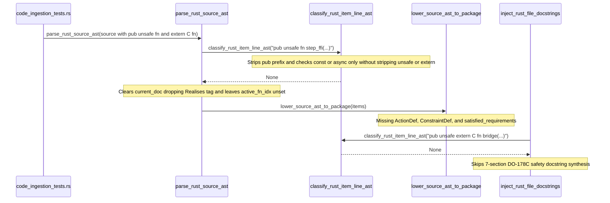

## 1. Context and References

<!-- test-target: crates/ingest-sysml/tests/code_ingestion_tests.rs -->

- **File**: `crates/deap-core/src/source_ast.rs:2339-2385`
- **Pillar**: Semantic Traceability
- **Symptom**: `classify_rust_item_line_ast` omits `unsafe` and `extern` qualifier stripping before matching `trait ` and `fn `, causing `parse_rust_source_ast` and `inject_rust_file_docstrings` to silently drop `unsafe fn`, `const unsafe fn`, `async unsafe fn`, `extern "C" fn`, and `unsafe trait` declarations along with their `Realises:` requirement bindings, `assert!` invariants, and 7-section safety docstrings while `code_ingestion_tests.rs` only exercises safe `pub fn` methods.
- **Test-Target**: `crates/ingest-sysml/tests/code_ingestion_tests.rs`

## 2. Root Cause Analysis (5 Whys)

1. **Why do `ingest-sysml --source` and `compile-sysml --inject-safety-docstrings` silently ignore `unsafe fn`, `extern "C" fn`, and `unsafe trait` declarations in Rust source files?** Because `classify_rust_item_line_ast` (`crates/deap-core/src/source_ast.rs:2339-2385`) returns `None` whenever `unsafe` or `extern` qualifiers appear between the visibility prefix and the `trait ` or `fn ` keyword.
2. **Why does `classify_rust_item_line_ast` return `None` when `unsafe` or `extern` qualifiers precede `trait ` or `fn `?** Because lines 2364-2367 check `after_vis.strip_prefix("trait ")` directly without stripping `"unsafe "`, and lines 2369-2377 only strip `"const async "`, `"async "`, or `"const "` before checking `after_qual.strip_prefix("fn ")` at line 2379.
3. **Why did `classify_rust_item_line_ast` omit `"unsafe "` and `"extern "` stripping despite documenting `unsafe` in its own Section 2 invariant at line 2318?** Because the implementation hardcoded a three-branch `if/else` check for `const` and `async` instead of iteratively stripping the full Rust function and trait qualifier grammar (`const`, `async`, `unsafe`, `extern "<ABI>"`).
4. **Why was this discrepancy between the documented Section 2 invariant (`crates/deap-core/src/source_ast.rs:2318`) and the implementation not caught during FEAT-42 verification?** Because `test_ac02_rust_struct_and_impl_block_ast_ingestion` in `crates/ingest-sysml/tests/code_ingestion_tests.rs:399-522` only tested safe `pub fn` methods (`enqueue_frame` and `remaining_capacity`) and included zero assertions for `unsafe fn`, `extern "C" fn`, or `unsafe trait` items.
5. **Why did the test suite lack coverage for `unsafe` and `extern` Rust items?** Because test scenarios were derived from nominal safe struct/impl examples without tracing the full qualifier invariant stated in `classify_rust_item_line_ast` Section 2 (`crates/deap-core/src/source_ast.rs:2318`) to concrete test assertions.

## 3. Correctness Analysis

In `crates/deap-core/src/source_ast.rs:2318`, the formal Section 2 invariant of `classify_rust_item_line_ast` states:
- `Strips visibility (pub, pub(crate), pub(super), pub(in ...)) and qualifiers (const, async, unsafe).`
- `Matches struct , enum , trait , and fn declarations followed by a valid identifier.`

However, the implementation in `crates/deap-core/src/source_ast.rs:2339-2385` violates this invariant at two points:
1. **Trait classification (`crates/deap-core/src/source_ast.rs:2364-2367`)**: Immediately after stripping visibility (`after_vis`), line 2364 checks `after_vis.strip_prefix("trait ")`. Whereas `parse_rust_impl_header` (`crates/deap-core/src/source_ast.rs:2276`) strips `"unsafe "` for `unsafe impl`, `classify_rust_item_line_ast` does not strip `"unsafe "` before `"trait "`. Consequently, `unsafe trait` and `pub unsafe trait` return `None`.
2. **Function/Method classification (`crates/deap-core/src/source_ast.rs:2369-2382`)**: Lines 2369-2377 only strip `"const async "`, `"async "`, or `"const "` into `after_qual` and then check `after_qual.strip_prefix("fn ")` at line 2379. Valid Rust callable declarations with `unsafe` or `extern` ABI qualifiers -- including `unsafe fn`, `pub unsafe fn`, `const unsafe fn`, `async unsafe fn`, `const async unsafe fn`, `extern "C" fn`, `pub extern "C" fn`, and `pub unsafe extern "C" fn` -- leave `"unsafe ..."` or `"extern ..."` at the front of `after_qual`, failing `strip_prefix("fn ")` and returning `None`.

Tracing the data flow from trigger to failure across callers:
- In `parse_rust_source_ast` (`crates/deap-core/src/source_ast.rs:1282, 1346, 1399`), when `classify_rust_item_line_ast(code)` returns `None` for an `unsafe` or `extern` declaration:
  - The accumulated `current_doc` buffer containing `/// Realises: [REQ-...]` tags is wiped via `current_doc.clear()` (`crates/deap-core/src/source_ast.rs:1329, 1395, 1433`).
  - No `SourceAstItem` is pushed to `items`, so `lower_source_ast_to_package` (`crates/deap-core/src/source_ast.rs:1675-1894`) fails to emit the corresponding `PartDef` (for `unsafe trait`), `ActionDef` (for `unsafe fn` / `extern "C" fn`), `RequirementDef` satisfaction bindings (`satisfied_requirements`), and body `assert!` `ConstraintDef` nodes (because `active_fn_idx` is not updated at lines 1319 or 1378).
- In `inject_rust_file_docstrings` (`crates/compile-sysml/src/docstring.rs:768`), when `classify_rust_item_line_ast(code)` returns `None`, execution falls through to the `else` branch at line 844, clearing `current_doc` and skipping 7-section DO-178C docstring synthesis for `unsafe` and `extern` items.

## 4. UML Diagrams



## 5. Affected Callers / Downstream Impact

- `parse_rust_source_ast` (`crates/deap-core/src/source_ast.rs:1282, 1346, 1399`) -- Silently drops top-level `unsafe trait`, `unsafe fn`, and `extern "C" fn` declarations, `impl` / `trait` methods with `unsafe` or `extern` qualifiers, their `/// Realises: [REQ-ID]` traceability tags, and their body `assert!` invariants.
- `lower_source_ast_to_package` (`crates/deap-core/src/source_ast.rs:1675-1894`) -- Produces incomplete SysML v2 `PackageDef` models missing `PartDef`, `ActionDef`, `ConstraintDef`, and `satisfied_requirements` for any `unsafe` or FFI `extern` Rust constructs during `ingest-sysml --source` or `compile-sysml --extract-source`.
- `inject_rust_file_docstrings` (`crates/compile-sysml/src/docstring.rs:768`) -- Fails to synthesize or validate 7-section safety docstrings on `unsafe trait`, `unsafe fn`, and `extern "C" fn` items during `compile-sysml --inject-safety-docstrings`.
- `classify_rust_item_line` (`crates/verify-baseline/src/checks/docstring_gate.rs:1544-1590`) -- Exhibits the identical omission in Check 36, allowing undocumented `unsafe` and `extern` items to bypass docstring verification unless synchronized with `classify_rust_item_line_ast`.

## 6. Proposed Correction

<!-- MUST NOT use regex (Check 34: deterministic linear slice/char scanning, no regex crate). MUST be domain-agnostic for upstream crates (Check 19). -->

```rust
pub fn classify_rust_item_line_ast(code: &str) -> Option<(SourceItemKind, String)> {
    let after_vis = if let Some(rest) = code.strip_prefix("pub(crate) ") {
        rest.trim_start()
    } else if let Some(rest) = code.strip_prefix("pub(super) ") {
        rest.trim_start()
    } else if let Some(rest) = code.strip_prefix("pub(in ") {
        if let Some((_, after_paren)) = rest.split_once(") ") {
            after_paren.trim_start()
        } else {
            code
        }
    } else if let Some(rest) = code.strip_prefix("pub ") {
        rest.trim_start()
    } else {
        code
    };

    if let Some(rest) = after_vis.strip_prefix("struct ") {
        let name = extract_leading_ast_ident(rest.trim_start())?;
        return Some((SourceItemKind::Struct, name));
    }
    if let Some(rest) = after_vis.strip_prefix("enum ") {
        let name = extract_leading_ast_ident(rest.trim_start())?;
        return Some((SourceItemKind::Enum, name));
    }

    let after_trait_qual = after_vis
        .strip_prefix("unsafe ")
        .map(str::trim_start)
        .unwrap_or(after_vis);
    if let Some(rest) = after_trait_qual.strip_prefix("trait ") {
        let name = extract_leading_ast_ident(rest.trim_start())?;
        return Some((SourceItemKind::Trait, name));
    }

    let mut after_qual = after_vis;
    for _ in 0..4 {
        let next = if let Some(rest) = after_qual.strip_prefix("const ") {
            rest.trim_start()
        } else if let Some(rest) = after_qual.strip_prefix("async ") {
            rest.trim_start()
        } else if let Some(rest) = after_qual.strip_prefix("unsafe ") {
            rest.trim_start()
        } else if let Some(rest) = after_qual.strip_prefix("extern ") {
            let trimmed_ext = rest.trim_start();
            if let Some(after_open_quote) = trimmed_ext.strip_prefix('"') {
                if let Some((_, after_close_quote)) = after_open_quote.split_once('"') {
                    after_close_quote.trim_start()
                } else {
                    break;
                }
            } else {
                trimmed_ext
            }
        } else {
            break;
        };
        after_qual = next;
    }

    if let Some(rest) = after_qual.strip_prefix("fn ") {
        let name = extract_leading_ast_ident(rest.trim_start())?;
        return Some((SourceItemKind::Function, name));
    }

    None
}
```

## 7. Relationship to Existing Issues

Discovered in audit -- new finding (refs #458).

## Audit Source

Adversarial Semantic Traceability Audit
SEVERITY: Important
FILE_LOCATION: crates/deap-core/src/source_ast.rs:2339-2385
