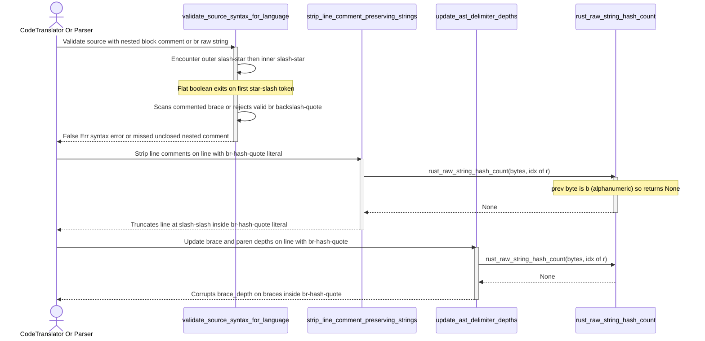

## 1. Context and References

<!-- test-target: crates/ingest-sysml/tests/code_ingestion_tests.rs -->

- **File**: `crates/deap-core/src/source_ast.rs:948-4021`
- **Pillar**: Semantic Traceability
- **Symptom**: `validate_source_syntax_for_language` (`crates/deap-core/src/source_ast.rs:948-976`) tracks block comments via a flat boolean (`let mut closed = false`) instead of a nesting depth counter (`depth: usize`), prematurely exiting block-comment mode at the first `*/` inside nested `/* ... /* ... */ ... */` comments (which are valid in both Rust and Dart), while `is_raw_quote` (`crates/deap-core/src/source_ast.rs:1025-1031`), `rust_raw_string_hash_count` (`crates/deap-core/src/source_ast.rs:3999-4021`), `strip_line_comment_preserving_strings` (`crates/deap-core/src/source_ast.rs:4288-4310`), and `update_ast_delimiter_depths` (`crates/deap-core/src/source_ast.rs:4612-4634`) reject `'r'` when preceded by `'b'` (`prev.is_ascii_alphanumeric()`), causing Rust byte raw string literals (`br"..."` and `br#"..."#`) to be misclassified as ordinary strings despite `scan_rust_line_preserving_lex_state` (`crates/deap-core/src/source_ast.rs:3835-3854, 3905`) and `docs/designs/feat-458-solution.md:35` explicitly specifying nested block comments and `br##"..."##` support.
- **Test-Target**: `crates/ingest-sysml/tests/code_ingestion_tests.rs`

## 2. Root Cause Analysis (5 Whys)

1. **Why do `validate_source_syntax_for_language`, `strip_line_comment_preserving_strings`, and `update_ast_delimiter_depths` misparse valid Rust and Dart nested block comments (`/* outer /* inner */ { */`) and Rust byte raw strings (`br"..."` and `br#"..."#`)?** Because `validate_source_syntax_for_language` terminates its block-comment loop at the very first `*/` token without tracking nested `/*` depth, and `is_raw_quote` / `rust_raw_string_hash_count` reject any `'r'` preceded by an ASCII alphanumeric byte including the Rust byte-string prefix `'b'`.
2. **Why does `validate_source_syntax_for_language` exit on the first `*/` while `scan_rust_line_preserving_lex_state` tracks `BlockComment(depth)`?** Because `validate_source_syntax_for_language` (`crates/deap-core/src/source_ast.rs:948-976`) was written with an ad-hoc `let mut closed = false` loop that only checks `cb == b'*' && bytes.get(idx.saturating_add(1)) == Some(&b'/')` and never increments depth on nested `/*` tokens.
3. **Why do `is_raw_quote` (`crates/deap-core/src/source_ast.rs:1025-1031`) and `rust_raw_string_hash_count` (`crates/deap-core/src/source_ast.rs:3999-4021`) reject `'b'` before `'r'`?** Because their token-boundary guard checks `prev.is_ascii_alphanumeric() || prev == b'_'` at `idx - 1` without allowing a standalone `'b'` or `'B'` prefix whose own predecessor at `idx - 2` is a non-identifier boundary.
4. **Why did this lexical divergence across scanners within the same module remain undetected?** Because `scan_rust_line_preserving_lex_state` (`crates/deap-core/src/source_ast.rs:3835-3920`) and the syntax/delimiter scanners (`validate_source_syntax_for_language`, `rust_raw_string_hash_count`, `strip_line_comment_preserving_strings`, `update_ast_delimiter_depths`) did not share a unified raw-prefix predicate or nested block-comment depth machine.
5. **Why did the integration and unit test suites pass without catching this semantic traceability gap?** Because `crates/ingest-sysml/tests/code_ingestion_tests.rs` tested only flat comments and standard `r#"..."#` strings, never asserting `validate_source_syntax_for_language` or AST ingestion over nested `/* ... /* ... */ ... */` comments or Rust `br"..."` / `br#"..."#` byte raw string literals.

## 3. Correctness Analysis

- **Invariant Violated**: FEAT-42 AC-02 / AC-05 Zero-Regex Lexical Parity Invariant (`docs/designs/FEAT-42_source_code_ast_ingestion_and_docstring_synthesizer.md:163-172` and `docs/designs/feat-458-solution.md:35`), which mandates that the zero-regex lexer accurately tracks multi-line nested `/* ... */` block comments and Rust raw/byte-raw strings (`r#"..."#`, `br#"..."#`, `br"..."`) across syntax validation and AST extraction.
- **Trigger & Data Flow 1 (Nested Block Comments in `validate_source_syntax_for_language`)**:
  1. Caller invokes `parse_rust_source_ast` or `parse_dart_source_ast`, which immediately calls `validate_source_syntax_for_language` (`crates/deap-core/src/source_ast.rs:1191, 1451`).
  2. When the input contains a valid nested block comment such as `/* outer /* inner */ { still commented */`, `validate_source_syntax_for_language` enters the `/*` handler at `crates/deap-core/src/source_ast.rs:948`.
  3. The inner loop (`lines 954-968`) ignores the nested `/*` before `inner` and breaks at the first `*/` (`lines 955-959`), setting `closed = true`.
  4. Scanning resumes in normal code mode after the inner `*/`: the commented-out `{` is pushed onto `stack` (`line 1072`), and validation fails with a false-positive `syntax error: unclosed delimiter '{'` (`lines 1137-1147`). Conversely, an unclosed nested block comment `/* outer /* inner */` falsely returns `Ok(())` instead of failing closed with exit code `1`.
- **Trigger & Data Flow 2 (Rust Byte Raw Strings `br"..."` and `br#"..."#`)**:
  1. In `validate_source_syntax_for_language` (`crates/deap-core/src/source_ast.rs:1025-1031`), `is_raw_quote` inspects `bytes.get(idx.saturating_sub(2))` and requires `!p.is_ascii_alphanumeric() && p != b'_'`. For a valid Rust raw byte string `let pat = br"\";`, `p` is `b'b'`, so `is_raw_quote` evaluates to `false`. Inside the active string loop (`line 883`), `\"` is treated as an escape sequence rather than a literal backslash followed by a closing quote, causing `validate_source_syntax_for_language` to fail with `syntax error: unclosed string literal`.
  2. In `rust_raw_string_hash_count` (`crates/deap-core/src/source_ast.rs:4004-4009`), `if prev.is_ascii_alphanumeric() || prev == b'_' { return None; }` rejects `prev == b'b'`. When `strip_line_comment_preserving_strings` (`line 4288`) or `update_ast_delimiter_depths` (`line 4612`) scans `let s = br#"quote " // not a comment {"#;`, `rust_raw_string_hash_count` returns `None`.
  3. The opening `"` after `br#` is then scanned as an ordinary double-quoted string, the embedded `"` prematurely closes the string, `// not a comment {"#;` is stripped as a comment by `strip_line_comment_preserving_strings`, and unbalanced delimiters inside `br#"..."#` corrupt `brace_depth` and `paren_depth` in `update_ast_delimiter_depths`.

## 4. UML Diagrams



## 5. Affected Callers / Downstream Impact

- `parse_rust_source_ast` (`crates/deap-core/src/source_ast.rs:1191`) and `parse_dart_source_ast` (`crates/deap-core/src/source_ast.rs:1451`) -- invoke `validate_source_syntax_for_language`, `strip_line_comment_preserving_strings`, and `update_ast_delimiter_depths`, causing valid Rust/Dart files with nested block comments or Rust `br"..."` / `br#"..."#` literals to fail syntax validation or corrupt AST brace depth.
- `CodeTranslator::translate` and `CodeTranslator::translate_directory` (`crates/ingest-sysml/src/translators/code.rs:95-218`) -- `ingest-sysml --source <DIR>` aborts with exit code `1` on valid source trees containing nested block comments or byte raw strings, or exits `0` on unclosed nested block comments.
- `inject_rust_file_docstrings` and `inject_dart_file_docstrings` (`crates/compile-sysml/src/docstring.rs:584-870`) -- rely on `strip_line_comment_preserving_strings` and `update_ast_delimiter_depths` to track declaration boundaries during 7-section safety docstring synthesis.

## 6. Proposed Correction

<!-- MUST NOT use regex (Check 34: deterministic linear slice/char scanning, no regex crate). MUST be domain-agnostic for upstream crates (Check 19). -->

```rust
fn is_valid_raw_string_prefix(bytes: &[u8], r_idx: usize, allow_byte_prefix: bool) -> bool {
    if r_idx == 0 {
        return true;
    }
    let Some(&prev) = bytes.get(r_idx.saturating_sub(1)) else {
        return true;
    };
    if !prev.is_ascii_alphanumeric() && prev != b'_' {
        return true;
    }
    if allow_byte_prefix && (prev == b'b' || prev == b'B') {
        if r_idx < 2 {
            return true;
        }
        return bytes
            .get(r_idx.saturating_sub(2))
            .map(|&before_b| !before_b.is_ascii_alphanumeric() && before_b != b'_')
            .unwrap_or(true);
    }
    false
}

fn rust_raw_string_hash_count(bytes: &[u8], idx: usize) -> Option<(usize, usize)> {
    let b = *bytes.get(idx)?;
    if b != b'r' && b != b'R' {
        return None;
    }
    if !is_valid_raw_string_prefix(bytes, idx, true) {
        return None;
    }
    let mut scan = idx.saturating_add(1);
    let mut hashes: usize = 0;
    while bytes.get(scan) == Some(&b'#') {
        hashes = hashes.saturating_add(1);
        scan = scan.saturating_add(1);
    }
    if hashes > 0 && bytes.get(scan) == Some(&b'"') {
        Some((hashes, scan))
    } else {
        None
    }
}

// Inside validate_source_syntax_for_language:
// 1. Nested block comment `/* ... */` depth tracking:
if b == b'/' && bytes.get(idx.saturating_add(1)) == Some(&b'*') {
    let open_line = line;
    let open_col = col;
    idx = idx.saturating_add(2);
    col = col.saturating_add(2);
    let mut depth: usize = 1;
    while let Some(&cb) = bytes.get(idx) {
        if cb == b'/' && bytes.get(idx.saturating_add(1)) == Some(&b'*') {
            depth = depth.saturating_add(1);
            idx = idx.saturating_add(2);
            col = col.saturating_add(2);
            continue;
        }
        if cb == b'*' && bytes.get(idx.saturating_add(1)) == Some(&b'/') {
            depth = depth.saturating_sub(1);
            idx = idx.saturating_add(2);
            col = col.saturating_add(2);
            if depth == 0 {
                break;
            }
            continue;
        }
        if cb == b'\n' {
            line = line.saturating_add(1);
            col = 1;
        } else {
            col = col.saturating_add(1);
        }
        idx = idx.saturating_add(1);
    }
    if depth != 0 {
        return Err(format!(
            "{}:{}:{}: syntax error: unclosed block comment starting at line {}, column {}",
            file_label, open_line, open_col, open_line, open_col
        ));
    }
    continue;
}

// 2. Use is_valid_raw_string_prefix(bytes, idx, !is_dart) for hashed raw strings
//    and is_valid_raw_string_prefix(bytes, idx.saturating_sub(1), !is_dart) for is_raw_quote.
```

## 7. Relationship to Existing Issues

Discovered in audit -- new finding (refs #458).

## Audit Source

Adversarial Semantic Traceability Audit
SEVERITY: Important
FILE_LOCATION: crates/deap-core/src/source_ast.rs:948-4021
