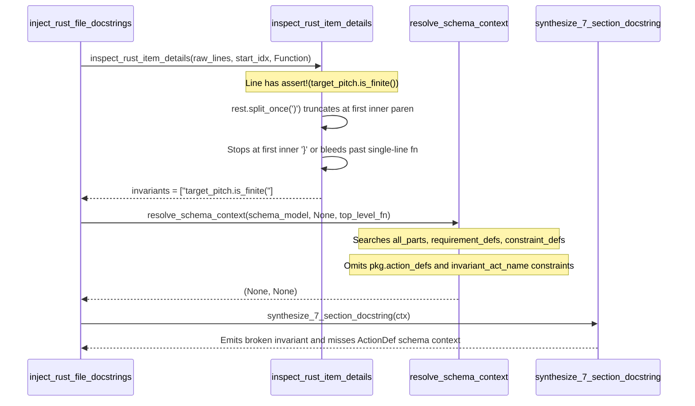

## 1. Context and References

<!-- test-target: crates/compile-sysml/tests/docstring_injector_tests.rs -->

- **File**: `crates/compile-sysml/src/docstring.rs:1606-1955`
- **Pillar**: Semantic Traceability
- **Symptom**: `inspect_rust_item_details` truncates `assert!` and `debug_assert!` expressions at the first inner `)` or `,` and halts body scanning at the first inner `}` or after a single-line declaration, while `resolve_schema_context` omits `pkg.action_defs` when resolving schema bindings for top-level functions.
- **Test-Target**: `crates/compile-sysml/tests/docstring_injector_tests.rs`

## 2. Root Cause Analysis (5 Whys)

1. **Why do synthesized Rust safety docstrings emit truncated or mismatched `assert!` invariants in Section 2 and drop SysML action bindings for top-level functions in Section 1 and Section 7?** Because `inspect_rust_item_details` (`crates/compile-sysml/src/docstring.rs:1606-1622`) parses assertions with naive `split_once(')')` and `split_once(',')` calls over a brace-unaware window, and `resolve_schema_context` (`crates/compile-sysml/src/docstring.rs:1915-1955`) never inspects `pkg.action_defs` when `owner_name` is `None`.
2. **Why does `inspect_rust_item_details` truncate conditions like `assert!(target_pitch.is_finite());` into `"target_pitch.is_finite("` and stop early on inner blocks?** Because line 1611 calls `rest.split_once(')')` instead of balancing parentheses across the macro invocation, line 1612 calls `cond.split_once(',')` instead of splitting at top-level commas (`depth == 0`), and line 1618 breaks on the first line where `t == "}"` without tracking brace depth from the function's opening `{`.
3. **Why does `inspect_rust_item_details` diverge from the assertion extraction logic in `deap-core`?** Because `crates/deap-core/src/source_ast.rs:3112-3128` (`extract_assertion_invariant`) and `parse_rust_source_ast` (`crates/deap-core/src/source_ast.rs:1387-1435`) were implemented with outer delimiter matching and brace-depth tracking, whereas `inspect_rust_item_details` in `crates/compile-sysml/src/docstring.rs` reimplemented a separate ad-hoc line loop without sharing `deap-core`'s balanced delimiter logic.
4. **Why does `resolve_schema_context` fail to resolve schema context for top-level Rust and Dart functions lowered into `pkg.action_defs`?** Because when `lower_source_ast_to_package` (`crates/deap-core/src/source_ast.rs:1828-1879`) lowers a top-level function (`owner_name == None`), it pushes the `ActionDef` into `pkg.action_defs` (line 1865) and pushes its assertion constraints into `pkg.constraint_defs` named `invariant_<act_name>_<idx>` (line 1873), whereas `resolve_schema_context` (`crates/compile-sysml/src/docstring.rs:1905-1955`) only searches `all_parts`, `pkg.requirement_defs`, and exact-name `pkg.constraint_defs`, completely ignoring `pkg.action_defs`.
5. **Why did existing integration tests in `crates/compile-sysml/tests/docstring_injector_tests.rs` pass despite these two defects?** Because `test_extract_source_and_cli_flags` (`crates/compile-sysml/tests/docstring_injector_tests.rs:529-556`) ran `compile-sysml --inject-safety-docstrings` on `AttitudeController::stabilize` containing `assert!(target_pitch.is_finite());` and only checked `assert!(status.success())` without inspecting the corrupted `target_pitch.is_finite(` invariant written into `controller.rs`, and no integration test exercised `resolve_schema_context` against a `PackageDef` containing top-level `pkg.action_defs` with steps, requirements, or lowered action invariants.

## 3. Correctness Analysis

Two semantic traceability and AST synthesis invariants in `FEAT-42` (`docs/designs/FEAT-42_source_code_ast_ingestion_and_docstring_synthesizer.md`, Section 1, Section 3.1, and Section 3.2) are violated in `crates/compile-sysml/src/docstring.rs`:

1. **Defect A -- Unbalanced `assert!` / `debug_assert!` Extraction and Brace-Unaware Body Window (`crates/compile-sysml/src/docstring.rs:1606-1622`)**:
   - In `inspect_rust_item_details` (`crates/compile-sysml/src/docstring.rs:1577-1669`), lines 1606-1622 scan callable bodies using:
     - `let end_body_scan = start_idx.saturating_add(35).min(raw_lines.len());`
     - `if let Some(rest) = t.strip_prefix("assert!(").or_else(|| t.strip_prefix("debug_assert!("))`
     - `if let Some((cond, _)) = rest.split_once(')')`
     - `let clean_cond = cond.split_once(',').map(|(c, _)| c.trim()).unwrap_or(cond.trim());`
     - `if t == "}" { break; }`
   - **Failure Mode A1 (Nested Parentheses Truncation)**: When an assertion condition contains any method call, function call, or parenthesized sub-expression -- such as `assert!(target_pitch.is_finite());` in `crates/compile-sysml/tests/docstring_injector_tests.rs:530` or `assert!(in_bounds(val, min_v), "out of range");` -- `rest.split_once(')')` splits at the first inner `')'` rather than the matching closing `')'` of `assert!(...)`. For `assert!(target_pitch.is_finite());`, `cond` becomes `"target_pitch.is_finite("`, and `synthesize_7_section_docstring` (`crates/compile-sysml/src/docstring.rs:1368-1373`) emits the broken invariant `` `target_pitch.is_finite(` `` into Section 2 (`## 2. Invariants & Mathematical Properties`).
   - **Failure Mode A2 (Nested Comma Truncation)**: When an assertion condition contains a multi-argument call such as `assert!(check_range(x, y) > 0, "failed");`, `cond.split_once(',')` splits at the comma inside `check_range(x, y)` rather than the top-level macro argument separator (`depth == 0`), truncating the condition to `"check_range(x"`.
   - **Failure Mode A3 (Premature Inner-Brace Termination & Single-Line Bleed-Through)**: Because `inspect_rust_item_details` does not track brace depth from the callable declaration:
     - If a single-line function (`pub fn noop() {}`) or trait method signature (`fn validate(&self) -> bool;`) already closed on its declaration line, `raw_lines.get(start_idx.saturating_add(1)..end_body_scan)` scans into the *next* function in the file and steals the next function's `assert!` invariants.
     - Conversely, if a function contains an `if` / `match` / block statement whose closing `}` sits on its own line (`t == "}"`), `if t == "}" { break; }` terminates the scan before reaching assertions that follow the block, or misses assertions beyond the arbitrary 35-line window.

2. **Defect B -- Missing `pkg.action_defs` Resolution for Top-Level Functions in `resolve_schema_context` (`crates/compile-sysml/src/docstring.rs:1915-1955`)**:
   - `FEAT-42` Section 1 (line 21) and the contract of `resolve_schema_context` (`crates/compile-sysml/src/docstring.rs:1735-1737`) mandate binding SysML v2 `requirement def`, `constraint def`, and `action def` declarations from `--schema` into synthesized 7-section safety docstrings.
   - When `lower_source_ast_to_package` (`crates/deap-core/src/source_ast.rs:1828-1879`) lowers a top-level Rust or Dart function (`item.owner_name == None`), it places the resulting `ActionDef` into `pkg.action_defs` (line 1865) and lowers any function invariants into `pkg.constraint_defs` with `name: format!("invariant_{}_{}", act_name, inv_idx.saturating_add(1))` (line 1873).
   - However, in `resolve_schema_context` (`crates/compile-sysml/src/docstring.rs:1873-1955`), while methods (`owner_name == Some(owner)`) look up `owner_part.actions` (lines 1883-1903), the `owner_name == None` path (lines 1905-1955) only searches `all_parts`, `pkg.requirement_defs`, and `pkg.constraint_defs` (by exact identifier match), never inspecting `pkg.action_defs` or `invariant_<act_name>_*` constraints.
   - Consequently, top-level functions matched by an `ActionDef` in `pkg.action_defs` fail to resolve action step constraints (`act.steps.first()`), action performer/doc requirement bindings, or lowered `invariant_<act_name>_*` constraints in `pkg.constraint_defs` (and similarly `owner_part.constraints` misses `invariant_<act_name>_*` constraints on methods).

## 4. UML Diagrams



## 5. Affected Callers / Downstream Impact

- `inspect_rust_item_details` (`crates/compile-sysml/src/docstring.rs:1577-1669`) -- Directly corrupts `assert!` and `debug_assert!` conditions containing nested parentheses or commas, halts prematurely at the first inner block `}`, and bleeds across single-line functions into subsequent items.
- `resolve_schema_context` (`crates/compile-sysml/src/docstring.rs:1763-1956`) -- Fails to resolve `pkg.action_defs` (steps, doc/performer requirement bindings, and `invariant_<act_name>_*` constraints) when `owner_name` is `None`, and misses `invariant_<act_name>_*` constraints on `owner_part.actions`.
- `synthesize_7_section_docstring` (`crates/compile-sysml/src/docstring.rs:1331-1545`) -- Interpolates the truncated invariant strings into Section 2 (`## 2. Invariants & Mathematical Properties`) and omits schema constraint/requirement bindings in Section 1 and Section 7 for top-level functions.
- `inject_rust_file_docstrings` / `inject_dart_file_docstrings` / `run_docstring_injection` (`crates/compile-sysml/src/docstring.rs:349-1184`) -- Persists corrupted Section 2 invariants and incomplete schema bindings into target Rust and Dart source files during `compile-sysml --inject-safety-docstrings`.

## 6. Proposed Correction

<!-- MUST NOT use regex (Check 34: deterministic linear slice/char scanning, no regex crate). MUST be domain-agnostic for upstream crates (Check 19). -->

```rust
fn extract_balanced_rust_assert_cond(trimmed_line: &str) -> Option<String> {
    let rest = trimmed_line
        .strip_prefix("assert!(")
        .or_else(|| trimmed_line.strip_prefix("debug_assert!("))?;

    let mut paren_depth: usize = 1;
    let mut bracket_depth: usize = 0;
    let mut brace_depth: usize = 0;
    let mut in_double_quote = false;
    let mut in_single_quote = false;
    let mut escaped = false;
    let mut close_paren_idx: Option<usize> = None;
    let mut top_level_comma_idx: Option<usize> = None;

    for (idx, ch) in rest.char_indices() {
        if escaped {
            escaped = false;
            continue;
        }
        if (in_double_quote || in_single_quote) && ch == '\\' {
            escaped = true;
            continue;
        }
        if !in_single_quote && ch == '"' {
            in_double_quote = !in_double_quote;
            continue;
        }
        if !in_double_quote && ch == '\'' {
            in_single_quote = !in_single_quote;
            continue;
        }
        if in_double_quote || in_single_quote {
            continue;
        }

        match ch {
            '(' => paren_depth = paren_depth.saturating_add(1),
            ')' => {
                paren_depth = paren_depth.saturating_sub(1);
                if paren_depth == 0 {
                    close_paren_idx = Some(idx);
                    break;
                }
            }
            '[' => bracket_depth = bracket_depth.saturating_add(1),
            ']' => bracket_depth = bracket_depth.saturating_sub(1),
            '{' => brace_depth = brace_depth.saturating_add(1),
            '}' => brace_depth = brace_depth.saturating_sub(1),
            ',' if paren_depth == 1 && bracket_depth == 0 && brace_depth == 0 => {
                if top_level_comma_idx.is_none() {
                    top_level_comma_idx = Some(idx);
                }
            }
            _ => {}
        }
    }

    let end_idx = top_level_comma_idx.or(close_paren_idx)?;
    let cond = rest.get(..end_idx)?.trim();
    if cond.is_empty() {
        None
    } else {
        Some(cond.replace('"', "'"))
    }
}
```

And in `inspect_rust_item_details` (`crates/compile-sysml/src/docstring.rs:1587-1622`), track `brace_depth` across the callable signature and full body using `scan_rust_line_preserving_lex_state` and `update_ast_delimiter_depths` so single-line functions (`{ ... }`) and semicolon-terminated trait declarations (`;`) stop immediately on `sig_end_idx`, while multi-line function bodies scan until `brace_depth == 0` without halting on inner `}` blocks.

In `resolve_schema_context` (`crates/compile-sysml/src/docstring.rs:1883-1955`), match `invariant_<act_name>_*` constraints alongside exact `act.name` constraints, and when `owner_name` is `None`, search `pkg.action_defs` across `all_pkgs` for an `ActionDef` matching `item_name` to extract action-linked requirements (from `act.doc` `Realises:` tags, `act.performer`, or `pkg.requirement_defs`) and action constraints (from matching `pkg.constraint_defs` or `act.steps.first()`), while keeping unmatched package-level `ActionDef` items with no requirements or steps at `(None, None)`.

## 7. Relationship to Existing Issues

Discovered in audit -- new finding (refs #458).

## Audit Source

Adversarial Semantic Traceability Audit
SEVERITY: Important
FILE_LOCATION: crates/compile-sysml/src/docstring.rs:1606-1955
