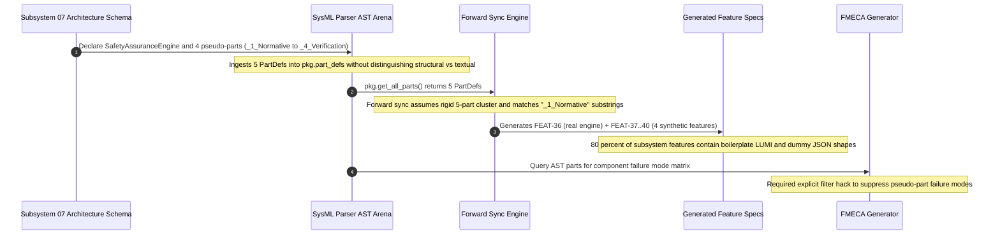

## 1. Context and References

<!-- test-target: scripts/e2e_acceptance_harness.py -->

- **File**: `schema/subsystems/subsystem_07_formal_safety_traceability_verification/architecture.sysml:8-24`
- **Pillar**: Semantic Traceability
- **Symptom**: Non-structural document section placeholders declared as part defs in SysML architecture schemas corrupt AST structural semantics, forcing compiler forward synchronization into artificial 5-part feature clustering with identical title stem collisions and severing requirement-to-component traceability.
- **Test-Target**: `scripts/e2e_acceptance_harness.py`

## 2. Root Cause Analysis (5 Whys)

1. **Why are 48 out of 60 subsystem features synthetic empty boilerplate with duplicate titles across all subsystems?** Because compiler forward synchronization derives features directly from AST part definitions, and every subsystem architecture schema declares four identical pseudo-parts alongside its primary engine.
2. **Why do the architecture schemas declare four identical pseudo-parts (_1_Normative_Statement, _2_Formal_Invariant, _3_Computational_Complexity_Algorithmic_Bounds, _4_Verification_Conformance_Criteria)?** Because document sections and mathematical invariant annotations were encapsulated inside part def blocks rather than native SysML v2 doc, constraint def, and verification constructs.
3. **Why did schema authors use part def blocks as documentation envelopes instead of modeling genuine architectural components?** Because the schema authoring template repurposed part def as a generic text container to pass markdown strings through early AST parser iterations.
4. **Why does declaring non-structural content as part defs violate semantic traceability?** Because part def defines physical or logical system components with ports and state behaviors, whereas these pseudo-parts lack ports, internal structure, and behaviors, masking real subsystem components and preventing meaningful requirement allocation.
5. **Why was this anti-pattern able to persist across all 12 subsystem schemas?** Because the compiler and baseline verification toolchain lacked semantic AST validators to reject non-structural part definitions or disallow identical part def identifiers across distinct subsystem packages.

## 3. Correctness Analysis

In `schema/subsystems/subsystem_07_formal_safety_traceability_verification/architecture.sysml:8-24` (and identically across all 12 subsystem architecture schemas), non-structural documentation and formal analysis sections are declared as SysML v2 structural components (`part def _1_Normative_Statement`, `part def _2_Formal_Invariant`, `part def _3_Computational_Complexity_Algorithmic_Bounds`, `part def _4_Verification_Conformance_Criteria`).

Under KerML and OMG SysML v2 (KerML 7.2.2 & SysML 8.2), `part def` defines a structural classifier for physical, logical, or software system components capable of owning ports, internal part usages, and state-machine allocations. In contrast, normative textual narratives belong in `doc` annotations or `requirement def` nodes, mathematical assertions belong in `constraint def` or `assert constraint` expressions, and verification criteria belong in `verification def` elements.

This metamodel misuse triggers a cascading semantic traceability breakdown across the compiler toolchain:

1. **AST Metamodel Pollution**:
`crates/compile-sysml/src/parser/` parses these blocks into `pkg.part_defs`. The compiler AST cannot distinguish between genuine execution components (e.g. `SafetyAssuranceEngine`) and arbitrary document section envelopes.

2. **Artificial Feature Clustering and Title Stem Collisions**:
In `crates/compile-sysml/src/sync/forward.rs:786-818`, the forward synchronization compiler iterates over `pkg.get_all_parts()`. To handle these pseudo-parts, the compiler introduces a hardcoded modulo calculation `let s_idx = (i - 6) / 5` assuming an invariant 5-part cluster per subsystem. The compiler projects each pseudo-part into standalone Feature specifications (`FEAT-37-_1_Normative_Statement.md` through `FEAT-40-_4_Verification_Conformance_Criteria.md`). Out of 65 total features in the repository, 48 features (73.8%) are completely synthetic boilerplate with identical filenames and title stems replicated 12 times across the specification tree.

3. **Breakdown of Architectural Requirement Allocation**:
In `schema/subsystems/subsystem_07_formal_safety_traceability_verification/requirements.sysml`, critical verification requirements (such as 7-tier bipartite DAG construction, disjoint tier partitioning E0402, adjacent edge enforcement E0400, and bidirectional reachability sweeps) cannot allocate or trace to real architectural components because genuine sub-components (such as `BipartiteGraphBuilder`, `DisjointTierValidator`, `BidirectionalSweepEngine`, and `DiagnosticSentinelSink`) were never declared in `architecture.sysml`.

4. **Safety Analysis Corruption**:
In `crates/compile-sysml/src/stpa/fmeca.rs:125`, the developer was forced to introduce an ad-hoc filter hack `.filter(|name| !name.starts_with('_'))` to prevent the STPA/FMECA generator from generating component failure modes (such as interface corruption, thermal throttling, or bus babbling) for text documentation sections.

This defect violates:
- **Pure Schema-Driven Compiler Invariant** (`.pipeline/constitution.md:48-52`, `AGENTS.md`): Mandates that specification generation derives deterministically from genuine structural AST nodes without hardcoded cluster assumptions or heuristic substring filters.
- **Model Metamodel & Profile Mapping Standard** (`.pipeline/constitution.md:70-76`): Mandates structural parts represent logical classes/components, range checks/invariants map to `ConstraintDef`, and documentation maps to `doc`.
- **Universal Model Consistency & Traceability Rules** (`.pipeline/constitution.md:78-89`): Mandates dynamic-to-static alignment and structural allocation of all behavioral requirements.

## 4. UML Diagrams



## 5. Affected Callers / Downstream Impact

- `schema/subsystems/subsystem_07_formal_safety_traceability_verification/architecture.sysml:8-24` (and all 12 `schema/subsystems/*/architecture.sysml`) -- Lacks genuine architectural component decomposition; conceals functional components behind documentation wrappers.
- `crates/compile-sysml/src/sync/forward.rs:786-865` -- Forward synchronization is constrained to a hardcoded 5-part heuristic `(i - 6) / 5` and brittle substring checks, preventing dynamic schema-driven feature generation.
- `crates/compile-sysml/src/stpa/fmeca.rs:121-135` -- Requires ad-hoc identifier filtering `!name.starts_with('_')` to avoid synthesizing FMECA failure modes for documentation sections.
- `docs/features/FEAT-*.md` -- 48 out of 65 feature specifications in the project are synthetic boilerplate with duplicated titles across 12 subsystems, diluting the backlog and creating title collision issues.
- `schema/subsystems/subsystem_07_formal_safety_traceability_verification/requirements.sysml` -- Formal verification requirements cannot trace to concrete architectural parts responsible for bipartite graph construction, tier partitioning, and reachability traversal.

## 6. Proposed Correction

```sysml
doc /* Structural Architecture for Subsystem 7 Formal Safety Traceability Verification */
package Subsystem_7_Formal_Safety_Traceability_Verification {

    doc /* Primary execution engine for Formal Safety, Traceability & Regulatory Verification */
    part def SafetyAssuranceEngine {
        port in state_in : StateSolverPort;
        port out safety_out : SafetyPort;

        part graph_builder : BipartiteGraphBuilder;
        part tier_validator : DisjointTierValidator;
        part reachability_engine : BidirectionalSweepEngine;
        part diagnostic_sink : DiagnosticSentinelSink;
    }

    doc /* Deterministic 7-tier bipartite DAG construction and reachability indexing */
    part def BipartiteGraphBuilder {
        port in ast_stream : ASTStreamPort;
        port out dag_out : GraphPort;
    }

    doc /* Enforces strict disjoint tier partitioning and adjacent-only edges */
    part def DisjointTierValidator {
        port in dag_in : GraphPort;
        port out diag_out : DiagnosticPort;
    }

    doc /* Bidirectional forward and backward reachability sweeps */
    part def BidirectionalSweepEngine {
        port in query_in : QueryPort;
        port out trace_out : TracePort;
    }

    doc /* Error sink and diagnostic sentinel emission for E0400, E0402, E0199 */
    part def DiagnosticSentinelSink {
        port in diag_in : DiagnosticPort;
        port out error_sink : ErrorPort;
    }

    doc /* Formal invariant for 7-tier bipartite DAG consistency */
    constraint def TraceabilityGraphInvariant {
        doc /* G_trace = (V_trace, E_trace), V_trace partitioned into 7 disjoint tiers T_1..T_7 */
    }
}
```

## 7. Relationship to Existing Issues

Discovered in audit -- new finding.

## Audit Source

Adversarial Semantic Traceability Audit
SEVERITY: Important
FILE_LOCATION: schema/subsystems/subsystem_07_formal_safety_traceability_verification/architecture.sysml:8-24
