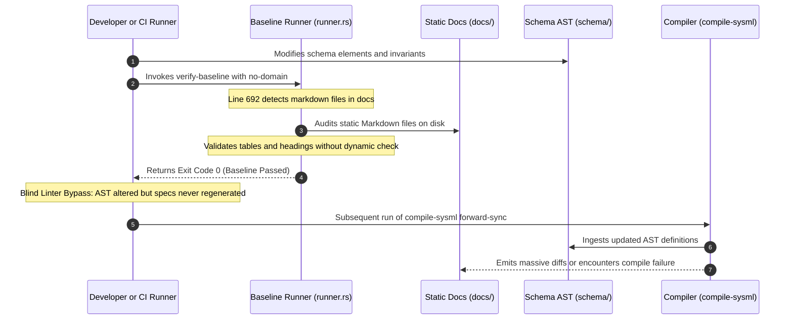

## 1. Context and References

<!-- test-target: crates/verify-baseline/src/runner.rs -->

- **File**: `crates/verify-baseline/src/runner.rs:692-747`
- **Pillar**: Test Integrity
- **Symptom**: verify-baseline audits static markdown files on disk without asserting dynamic compiler output freshness or checking if compile-sysml --forward-sync produces zero diff against the declared AST. This allows stale specifications on disk to pass baseline verification even when compiler regeneration would produce massive diffs or fail.
- **Test-Target**: `crates/verify-baseline/src/runner.rs`

## 2. Root Cause Analysis (5 Whys)

1. **Why does verify-baseline pass baseline verification when downstream specifications on disk are stale or desynchronized from the schema AST?** Because crates/verify-baseline/src/runner.rs only audits pre-existing static markdown files located in docs/ rather than checking whether compiler regeneration matches on-disk files.
2. **Why does runner.rs only audit static markdown files on disk?** Because run_spec_audit reads markdown files directly from the filesystem without invoking compile-sysml --forward-sync or evaluating regeneration diffs against the declared AST.
3. **Why is dynamic forward synchronization parity omitted from the baseline verification runner?** Because the verification runner treats markdown specification linting as a decoupled static analysis step rather than an end-to-end compiler output freshness assertion.
4. **Why was spec verification decoupled from compiler forward synchronization?** Because verify-baseline was designed to execute independently of the compiler pipeline, assuming external operators or CI always invoke compile-sysml --forward-sync prior to verification.
5. **Why is this architectural decoupling a Test Integrity violation?** Because in the absence of a dynamic freshness gate or clean diff check, developers and automated pipelines can modify schema definitions or compiler lowering logic while bypassing compilation, allowing stale or invalid specifications to pass all baseline gates undetected.

## 3. Correctness Analysis

The Test Integrity pillar mandates that verification gates must assert genuine dynamic invariants of the system under test rather than validating decoupled, stale, or synthetic artifacts. A test suite or verification tool that passes cleanly without confirming that generated artifacts match source declarations constitutes a blind linter bypass.

In `crates/verify-baseline/src/runner.rs:692-747`, when concrete specifications are detected via `has_concrete_specifications(&repo_root)` (lines 29-65), the runner constructs `SpecAuditOptions` and executes `run_spec_audit(&spec_options)` (line 702). Similarly, in `--spec-only` execution mode (`crates/verify-baseline/src/runner.rs:172-225`), `runner.rs` dispatches directly to `run_spec_audit`.

Within `run_spec_audit`, the verification suite executes an array of static checks over markdown files on disk:
1. CommonMark 2-column metadata table validation (lines 1-10).
2. Given-When-Then BDD scenario structure.
3. Mermaid diagram syntax (closed fences, zero unescaped semicolons).
4. Required section headers and traceability matrices.

Crucially, neither `runner.rs` nor `run_spec_audit` ever invokes the compiler engine (`compile-sysml --forward-sync`) or compares the on-disk markdown files against the current SysML schema AST in `schema/`. Check 31 (`check_dual_schema_ssot_parity` at lines 581-600) only validates that `schema/*.sysml` matches `.pipeline/schema.sysml`; it does not check that specifications in `docs/` match the AST.

Consequently, if an engineer or automated agent updates `schema/*.sysml` (adding classes, modifying properties, or altering constraints) without executing `compile-sysml --forward-sync --force`, or if a compiler lowering bug causes forward synchronization to emit broken markdown or crash, `./target/release/verify-baseline . --no-domain` and `./target/release/verify-baseline . --spec-only` still exit with code 0. Stale specifications on disk satisfy every static markdown linter rule. Furthermore, line 698 hardcodes `allow_missing_specs: true`, masking newly declared but ungenerated specifications unless `--strict` mode is explicitly toggled.

This design permits stale and invalid specifications to pass baseline verification, directly violating the Test Integrity pillar.

## 4. UML Diagrams



## 5. Affected Callers / Downstream Impact

- `crates/verify-baseline/src/runner.rs:692-747` -- Executes specification audit without checking compiler AST output freshness.
- `crates/verify-baseline/src/runner.rs:172-225` -- Runs `--spec-only` linter against stale on-disk files without asserting forward-sync parity.
- CI/CD Pipelines (`.gitlab-ci.yml`, GitHub Actions) -- Reports false positive green checkmarks when schema AST and markdown specifications drift.
- Downstream Code Generators and Modelers -- Consume desynchronized or invalid specifications certified as compliant by `verify-baseline`.
- `crates/reconcile-backlog` -- Projects stale specification bodies to remote issue trackers because `verify-baseline` certified them as valid.

## 6. Proposed Correction

```rust
// In crates/verify-baseline/src/runner.rs or a dedicated check module:
// Add dynamic compiler output freshness verification gate prior to static spec audit.

pub fn check_compiler_output_freshness(repo_root: &Path, strict: bool) -> Result<(), Vec<String>> {
    let compiler_bin = repo_root.join("target").join("release").join("compile-sysml");
    if !compiler_bin.exists() {
        if strict {
            return Err(vec![
                "Compiler binary target/release/compile-sysml not found for freshness verification."
                    .to_string(),
            ]);
        }
        return Ok(());
    }

    // Execute dry-run forward synchronization to detect schema-to-spec drift
    let output = std::process::Command::new(&compiler_bin)
        .arg("--forward-sync")
        .arg("--dry-run")
        .current_dir(repo_root)
        .output()
        .map_err(|e| vec![format!("Failed to execute compile-sysml dry-run: {}", e)])?;

    if !output.status.success() {
        let stderr = String::from_utf8_lossy(&output.stderr);
        return Err(vec![format!(
            "compile-sysml --forward-sync --dry-run failed with exit code {:?}: {}",
            output.status.code(),
            stderr.trim()
        )]);
    }

    // Check git status across docs/ zones for unstaged or uncommitted regeneration diffs
    let git_diff = std::process::Command::new("git")
        .args([
            "diff",
            "--name-only",
            "--",
            "docs/epics",
            "docs/features",
            "docs/user-stories",
            "docs/use-cases",
        ])
        .current_dir(repo_root)
        .output()
        .map_err(|e| vec![format!("Failed to execute git diff on specification zones: {}", e)])?;

    let diff_stdout = String::from_utf8_lossy(&git_diff.stdout);
    if !diff_stdout.trim().is_empty() {
        let stale_files: Vec<String> = diff_stdout
            .lines()
            .map(|f| format!("Stale specification detected (diff against AST): {}", f))
            .collect();
        return Err(stale_files);
    }

    Ok(())
}
```

## 7. Relationship to Existing Issues

- Issue #123 -- Synthetic Class Diagram Stub Gaming and Linter Bypass Vulnerability.
- Issue #126 -- Hollow Check 7 verification gate allows unescaped semicolon mermaid syntax regressions.
- Discovered in audit -- new finding.

## Audit Source

Adversarial Test Integrity Audit
SEVERITY: Critical
FILE_LOCATION: crates/verify-baseline/src/runner.rs:692-747
