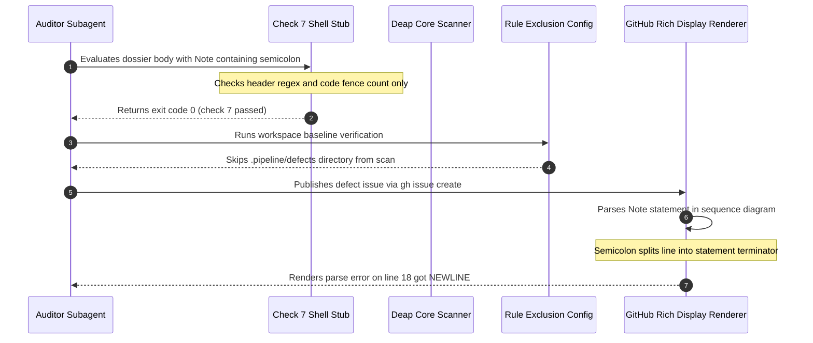

## 1. Context and References

<!-- test-target: crates/deap-core/src/markdown.rs -->

- **File**: `skills/adversarial-code-auditor/SKILL.md:186-207`
- **Pillar**: Test Integrity
- **Symptom**: GitHub Issues #121 and #123 crashed on GitHub with 'Unable to render rich display. Parse error on line 18: ... got NEWLINE' due to unescaped semicolons in sequence diagram Note lines.
- **Test-Target**: `crates/deap-core/src/markdown.rs`

## 2. Root Cause Analysis (5 Whys)

1. **Why did GitHub Issues #121 and #123 crash on GitHub with "Unable to render rich display. Parse error on line 18: ... got NEWLINE"?** Because unescaped semicolons in sequence diagram Note statements were parsed by Mermaid as statement terminators, splitting lines into invalid syntax fragments.
2. **Why were unescaped semicolons present in filed defect dossiers despite SKILL.md:61 stating that semicolons in Note statements are strictly prohibited?** Because auditor subagents relied on Step D Check 7, which SKILL.md:61 falsely claimed enforces these constraints mechanically, but Check 7 in SKILL.md:186-207 was a hollow bash stub checking only diagram headers and fence parity.
3. **Why was Check 7 gutted into a hollow bash stub instead of performing mechanical syntax validation?** Because commit f3fbfdd ('feat(pipeline): complete native rust port, zero-python purge') deleted the Python validator parity_auditor.validators.mermaid_syntax_validator and substituted a 16-line bash placeholder rather than wiring native Rust checks.
4. **Why did native Rust baseline verification in verify-baseline fail to catch the invalid diagrams in .pipeline/defects?** Because crates/deap-core/src/rules.rs:23 explicitly placed .pipeline/defects into EXCLUDED_DIRS, while crates/deap-core/src/markdown.rs:326-415 never implemented the scalar semicolon check required by rules/platform-independence.md:21.
5. **Why does crates/deap-core/src/markdown.rs lack scalar semicolon checking and rely on Regex?** Because the native Rust port in markdown.rs was incomplete and violated REQ-0015 (Zero-Regex Monotonic Scanning), creating a hollow verification gate under the Test Integrity pillar that silently certified invalid diagrams.

## 3. Correctness Analysis

In skills/adversarial-code-auditor/SKILL.md:61, the specification asserts:
"All Mermaid syntax constraints are defined in rules/platform-independence.md and MUST be observed in full. Most importantly here: no semicolons in Note statements or message text, and no curly braces in class member lines. Step D check 7 enforces these mechanically."

However, in skills/adversarial-code-auditor/SKILL.md:186-207, Check 7 was replaced in commit f3fbfdd with a 16-line bash script that inspects only diagram headers and fence count parity. The script executes zero checks for syntax errors, semicolons in Note or message statements, colons in class members, or curly braces.

This hollow verification logic permits unescaped semicolons, unquoted colons, and class member curly braces to pass with exit code 0. When subagents drafted .pipeline/defects/dossier_epic_subsystem_1to1_partitioning_defect.md (line 66) and .pipeline/defects/dossier_class_diagram_stub_gaming_vulnerability.md (lines 73 and 77), they included semicolons in Note lines. Check 7 returned exit code 0, giving the subagents false confidence.

Furthermore, crates/deap-core/src/markdown.rs:326-415 implements check_mermaid_syntax using regular expressions (Regex::new), violating REQ-0015 (Zero-Regex Monotonic Scanning). In crates/deap-core/src/rules.rs:23, .pipeline/defects is added to EXCLUDED_DIRS, preventing verify-baseline from auditing defect dossiers during workspace scans.

When these dossiers were filed on GitHub as Issues #121 and #123, GitHub rich display failed with 'Unable to render rich display. Parse error on line 18: ... got NEWLINE' because Mermaid parses semicolons as statement separators.

This defect violates:
1. Test Integrity Pillar: A verification gate that claims mechanical enforcement passes invalid artifacts without detecting violations.
2. REQ-0015: Zero-Regex Monotonic Scanning violated by regex invocations in crates/deap-core/src/markdown.rs:332-333.
3. rules/platform-independence.md:21: Prohibits semicolons in Mermaid Note statements and message text.

## 4. UML Diagrams



## 5. Affected Callers / Downstream Impact

- skills/adversarial-code-auditor/SKILL.md:186-207 -- Provides a hollow verification gate for all auditor subagents, generating invalid GitHub and GitLab issue bodies.
- skills/adversarial-code-auditor/SKILL.md:61 -- Misleads subagents into assuming mechanical enforcement of Mermaid rules.
- crates/deap-core/src/markdown.rs:326-415 -- Lacks scalar semicolon checks and violates REQ-0015 via Regex compilation.
- crates/deap-core/src/rules.rs:23 -- Prevents offline discovery of defect dossier syntax errors by excluding .pipeline/defects from workspace scans.
- GitHub Issues #121 and #123 -- Suffered rendering failures on GitHub rich display.

## 6. Proposed Correction

```rust
// Scan for forbidden semicolons in Note statements and message text without regex
for &(lineno, body_line) in &body {
    let trimmed = body_line.trim();
    let is_msg_or_note = trimmed.starts_with("Note ")
        || (trimmed.contains(':') && !trimmed.starts_with("participant ") && !trimmed.starts_with("actor "));
    if is_msg_or_note {
        if trimmed.contains(';') {
            errors.push(format!(
                "{}:{}: semicolon in Mermaid Note or message text: '{}'. Replace with commas, dashes, or spaces.",
                file_rel_path, lineno, trimmed
            ));
        }
    }
}
```

## 7. Relationship to Existing Issues

- GitHub Issue #121 -- Display crashed on GitHub due to semicolon in Note statement.
- GitHub Issue #123 -- Display crashed on GitHub due to semicolons in Note statements.
- Commit f3fbfdd -- Gutted Check 7 by deleting Python validator without porting rules to Rust.
- Discovered in audit -- new finding.

## Audit Source

Adversarial Test Integrity Audit
SEVERITY: Critical
FILE_LOCATION: skills/adversarial-code-auditor/SKILL.md:186-207
