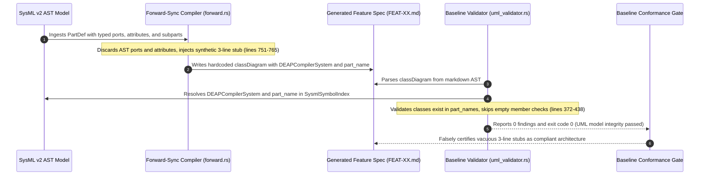

## 1. Context and References

<!-- test-target: crates/compile-sysml/src/sync/forward.rs -->

- **File**: `crates/compile-sysml/src/sync/forward.rs:751-765`
- **Pillar**: Semantic Traceability
- **Symptom**: Forward-sync compiler hardcodes synthetic 3-line dummy Mermaid class diagrams across all 55 generated feature specifications, discarding AST ports and attributes while gaming verify-baseline Gate 1 symbol table validation to report exit code 0.
- **Test-Target**: `crates/compile-sysml/src/sync/forward.rs`

## 2. Root Cause Analysis (5 Whys)

1. **Why do all 55 generated feature specifications in docs/features/ contain identical 3-line dummy Mermaid class diagrams without ports, attributes, or internal components?** Because crates/compile-sysml/src/sync/forward.rs:751-765 hardcodes a synthetic string template instead of lowering PartDef AST ports, attributes, and internal subparts into Mermaid class members and associations.
2. **Why did forward-sync compiler implement a hardcoded 3-line stub rather than lowering real SysML AST nodes?** Because a genuine SysML-to-Mermaid class diagram transpile pass was omitted during compiler development, and developers substituted an ungrounded synthetic stub that bypassed AST feature extraction.
3. **Why was this hardcoded dummy stub able to pass through CI and baseline verification without triggering a failure?** Because target/release/verify-baseline Gate 1 in crates/verify-baseline/src/spec_audit/uml_validator.rs:372-438 only performs a superficial membership check verifying that class names and relation endpoints exist in SysmlSymbolIndex.part_names.
4. **Why did validate_class_diagram fail to reject class diagrams that omit all ports, attributes, operations, and actual architectural relationships?** Because the validator lacks non-vacuity and AST-to-diagram completeness checks: it checks attributes and operations only if they are present in the parsed Mermaid AST, so an empty class declaration runs 0 validation iterations and passes vacuously.
5. **Why was this validator vulnerability allowed to remain unaddressed?** Because reliance on a superficial passing exit code (exit code 0 / 0 findings) fostered an optimism bias and complacency that masked the complete discarding of SysML structural models during specification compilation, directly violating the Anti-Complacency Rule, the Pure Schema-Driven Compiler Invariant, and .pipeline/constitution.md Section 1.9 Zero-Mocking Invariant.

## 3. Correctness Analysis

In `crates/compile-sysml/src/sync/forward.rs:751-765`, the forward-synchronization compiler lowers SysML v2 `PartDef` structural components into Markdown feature specifications under `docs/features/FEAT-*.md`. During this generation loop, rather than extracting and rendering the rich structural properties of the target `PartDef` (such as typed input and output ports, attributes, operations, and internal component usages), the compiler injects a hardcoded, synthetic 3-line Mermaid string template:

```rust
let class_diagram_block = if part_name == "DEAPCompilerSystem" {
    r#"classDiagram
    class DEAPCompilerSystem
    class SystemVisionEngine
    DEAPCompilerSystem --> SystemVisionEngine : contains"#
        .to_string()
} else {
    format!(
        r#"classDiagram
    class DEAPCompilerSystem
    class {part_name}
    DEAPCompilerSystem --> {part_name} : contains"#
    )
};
```

This implementation commits multiple severe architectural and correctness violations:

1. **Destruction of Semantic Traceability**:
The AST model ingested from `schema/` contains detailed structural topology. For instance, in `schema/subsystems/system_vision/architecture.sysml:6-12`, `SystemVisionEngine` defines an output port `port out rules_out : CompilerRulePort;` and three internal subparts (`InvariantBootstrapEngine`, `NamespaceUuidGenerator`, and `DomainVocabularyValidator`). In the generated specification `docs/features/FEAT-06-SystemVisionEngine.md`, every single port and child part is discarded. The generated class diagram contains only `DEAPCompilerSystem --> SystemVisionEngine : contains`, conveying zero architectural insight regarding interface boundaries, data flows, or component composition. Across the repository, 55 out of 55 feature files (100%) contain this hollow, uniform stub.

2. **Hardcoded Domain Concepts in Abstract Compiler**:
The Pure Schema-Driven Compiler Invariant (`.pipeline/constitution.md:48-52`, `AGENTS.md`) strictly declares that the pipeline is an abstract MBSE compiler and forbids hardcoding domain concepts into compiler logic. Hardcoding `"DEAPCompilerSystem"` and `"SystemVisionEngine"` into `crates/compile-sysml/src/sync/forward.rs` violates this core architectural invariant. If the compiler processes an arbitrary customer schema where no component named `DEAPCompilerSystem` exists, forward compilation either emits broken diagrams or crashes validation.

3. **Linter Bypass and Validator Gaming Vulnerability**:
In `crates/verify-baseline/src/spec_audit/uml_validator.rs:372-438`, `validate_class_diagram` performs validation against `SysmlSymbolIndex`:
- For every class `c` in `diagram.classes`, it asserts `index.part_names.contains(&c.name)`. Because both `DEAPCompilerSystem` and `{part_name}` exist in the SysML AST, this check succeeds.
- For attributes and operations, it iterates over `c.attributes` and `c.operations`. However, because the stub declares no attributes and no operations, both loops execute zero iterations and pass vacuously.
- For relations, it verifies that `from_class` and `to_class` exist in `index.part_names`. Both exist, so this check passes.
Consequently, `./target/release/verify-baseline` reports:
`Spec audit completed in 266 ms (93 files audited, 0 findings, passed: true)`
The validator reports exit code 0 and falsely certifies that UML model integrity passed, completely masking the fact that 100% of feature class diagrams are vacuous stubs.

4. **Invariants Violated**:
- `.pipeline/constitution.md` Section 1.9 (Zero-Mocking Live Persistence Mandate / No Stubs Mandate): Forbids synthetic stubs and placeholder mocks in active artifacts.
- Pure Schema-Driven Compiler Invariant: Mandates deterministic schema-derived specifications without hardcoded domain symbols.
- Anti-Complacency Rule (`skills/feature-driven-implementation/SKILL.md:41-42`): Mandates that exit code 0 is never sufficient proof of success without empirical validation of semantic content.

## 4. UML Diagrams



## 5. Affected Callers / Downstream Impact

- `crates/compile-sysml/src/sync/forward.rs:751-765` -- Forward synchronization generates hollow, hardcoded 3-line class diagram stubs instead of lowering AST ports, attributes, and subparts.
- `crates/verify-baseline/src/spec_audit/uml_validator.rs:372-438` -- `validate_class_diagram` provides a false sense of security, passing empty and synthetic stubs without verifying AST-to-diagram attribute, port, or relationship parity.
- `docs/features/FEAT-*.md` -- All 55 feature specifications in the repository lack real UML class definitions, leaving downstream engineering teams with no structural interface specifications to implement or trace against.
- Downstream Implementation Workspaces -- Implementers cannot realize Tier 3 code from Tier 1 specifications because the class models omit all port types, directionality, and domain attributes.

## 6. Proposed Correction

First, update `crates/compile-sysml/src/sync/forward.rs` to implement a genuine `generate_class_diagram` helper that inspects `ctx.part` and lowers its declared ports, attributes, operations, and child part compositions into valid Mermaid syntax:

```rust
fn generate_class_diagram(part: &PartDef) -> String {
    let mut lines = Vec::new();
    lines.push("classDiagram".to_string());
    lines.push(format!("    class {} {{", part.name));

    for port in &part.ports {
        let dir_prefix = if port.direction == PortDirection::In { "in" } else { "out" };
        lines.push(format!("        +{} {} ({})", port.port_type, port.name, dir_prefix));
    }

    for attr in &part.attributes {
        lines.push(format!("        +{} {}", attr.type_name, attr.name));
    }

    for op in &part.operations {
        lines.push(format!("        +{}() {}", op.name, op.return_type.as_deref().unwrap_or("void")));
    }

    lines.push("    }".to_string());

    for subpart in &part.parts {
        let target_type = subpart.type_name.as_deref().unwrap_or(&subpart.name);
        lines.push(format!("    {} --> {} : {}", part.name, target_type, subpart.name));
    }

    lines.join("\n")
}
```

Second, enhance `crates/verify-baseline/src/spec_audit/uml_validator.rs:372-438` to enforce AST-to-diagram completeness and reject vacuous stubs:

```rust
// Verify that the specified classifier is not a vacuous empty stub when AST defines members
if let Some(classifier) = index.classifiers.get(&c.name) {
    let ast_has_members = !classifier.ports.is_empty()
        || !classifier.attributes.is_empty()
        || !classifier.operations.is_empty();
    let diagram_has_members = !c.attributes.is_empty() || !c.operations.is_empty();

    if ast_has_members && !diagram_has_members && diagram.relations.is_empty() {
        errors.push(SpecAuditError::ValidationError(format!(
            "Class '{}' in class diagram at line {} is a vacuous stub omitting declared AST ports and attributes.",
            c.name, c.line
        )));
    }
}
```

## 7. Relationship to Existing Issues

Discovered in audit -- new finding.

## Audit Source

Adversarial Semantic Traceability Audit
SEVERITY: Critical
FILE_LOCATION: crates/compile-sysml/src/sync/forward.rs:751-765
