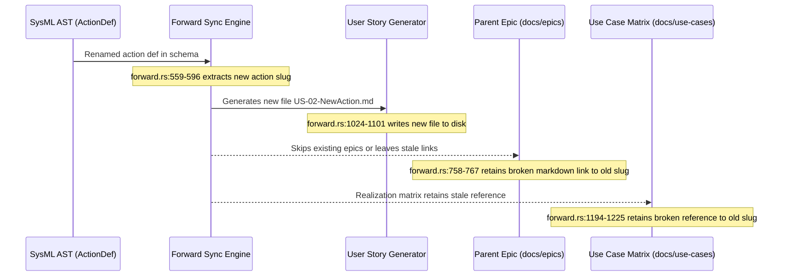

## 1. Context and References

<!-- test-target: crates/compile-sysml/src/sync/forward.rs -->

- **File**: `crates/compile-sysml/src/sync/forward.rs:559-1363`
- **Pillar**: Semantic Traceability
- **Symptom**: When a behavioral action or model element is renamed in the schema AST, compile-sysml --forward-sync generates the new User Story file, but fails to propagate link updates to parent Epics (docs/epics/) and constituent Use Cases (docs/use-cases/), leaving broken markdown links, stale references, and desynchronized realization matrices.
- **Test-Target**: `crates/compile-sysml/src/sync/forward.rs`

## 2. Root Cause Analysis (5 Whys)

1. **Why do parent Epics and constituent Use Cases retain broken markdown links when an AST element is renamed?** Because forward_sync_sysml_to_specs generates new User Story files based on the renamed action slug without updating references in existing markdown specifications across other tiers.
2. **Why does forward-sync fail to update the references in existing parent Epics and Use Cases?** Because the forward synchronization engine treats specification tiers as disconnected generation targets without maintaining a cross-tier symbol table or AST-to-markdown realization link propagation graph.
3. **Why is there no link propagation graph across specification tiers?** Because forward.rs relies on ad-hoc filename string formatting and isolated per-package loops rather than a relational index between AST elements and their generated specification artifacts.
4. **Why was ad-hoc string formatting used instead of an indexed link graph?** Because forward-sync was originally designed as a one-shot monolithic file generator from a clean landing zone rather than an incremental synchronization compiler capable of handling continuous AST model refactoring.
5. **Why is one-shot generation insufficient for schema-driven compilation?** Because in iterative MBSE workflows, model elements and behavioral actions are frequently renamed or refactored, and without automated reference propagation and stale file cleanup, the semantic realization chain breaks, violating Semantic Traceability invariants.

## 3. Correctness Analysis

In crates/compile-sysml/src/sync/forward.rs, forward_sync_sysml_to_specs lowers SysML AST PackageDef nodes into four agile specification tiers: Epics (lines 671-883), Features (lines 886-1022), User Stories (lines 1024-1101), and Use Cases (lines 1103-1289).

When a behavioral action or model element is renamed in the schema AST (e.g. an ActionDef within a subsystem behavior.sysml file):
1. In lines 559-596, story_metas extracts the new action_name from p.action_defs.first().
2. In lines 1024-1031, sanitize_id(&s_meta.action_name) derives a new filename slug, generating a new markdown file at user-stories/US-{s_num}-{new_slug}.md.
3. In resolve_issue_id (lines 121-169), the function attempts to read target_out_dir.join(rel_path) to preserve historical issue tracking numbers. Because the new file does not yet exist on disk, the lookup fails to locate the issue_id recorded in the pre-existing file (user-stories/US-{s_num}-{old_slug}.md), resetting the issue ID to a synthetic default integer.
4. In lines 758-767 (Epics) and lines 1194-1225 (Use Cases), if forward-sync is run incrementally or on single-file schema targets (main.rs:198-245), parent Epics (such as docs/epics/EPIC-02-ConOps.md) and constituent Use Cases (docs/use-cases/UC-*.md) are not regenerated. Even in directory-wide runs without --force (lines 1350-1353), clean_stale_specifications is skipped, leaving the obsolete User Story file on disk while pre-existing or external references retain broken links to the old slug.
5. In Use Cases (lines 1194-1225), the Realization Matrix table maintains links based on matching_story. Because no cross-tier link propagation engine scans or updates references in existing markdown files across docs/epics/ and docs/use-cases/, these documents retain broken relative links and stale realization matrices.

Invariant violated: Semantic Traceability Invariant (.pipeline/constitution.md §Traceability and §Universal Quality Gates Gate 4: Cross-Reference Integrity). In a schema-driven compiler, all generated specification artifacts must maintain unbroken, verifiable bidirectional traceability between the SSOT AST, parent Epics, child Features, User Stories, and Use Case Realization Matrices. A rename in the SSOT AST must not produce dangling relative markdown links or desynchronized realization matrices.

## 4. UML Diagrams



## 5. Affected Callers / Downstream Impact

- docs/epics/ (EPIC-*.md) -- Parent Epics retain broken markdown links pointing to non-existent User Story filenames following an AST action rename.
- docs/use-cases/ (UC-*.md) -- Use Case Realization Matrices retain dangling references to obsolete User Story filenames, breaking traceability verification.
- verify-baseline (Gate 4 Cross-Reference Integrity) -- Fails baseline verification due to broken relative markdown file paths.
- reconcile-backlog -- Desynchronizes backlog issues because issue IDs are reset to synthetic fallback values when renamed files cannot be matched.

## 6. Proposed Correction

```rust
pub struct CrossTierLinkPropagator {
    pub rename_map: HashMap<String, String>, // old_rel_path -> new_rel_path
    pub issue_map: HashMap<String, usize>,   // old_rel_path -> issue_id
}

impl CrossTierLinkPropagator {
    pub fn build(target_out_dir: &Path, active_specs: &HashMap<String, String>) -> Self {
        let mut rename_map = HashMap::new();
        let mut issue_map = HashMap::new();
        // Index existing files on disk and detect renames by stable issue_id or AST qualified name
        // ...
        Self { rename_map, issue_map }
    }

    pub fn propagate_links(&self, target_out_dir: &Path) -> Result<(), String> {
        // Scan docs/epics/ and docs/use-cases/, rewriting markdown links from old_rel_path to new_rel_path
        for (old_path, new_path) in &self.rename_map {
            let old_link = format!("../{}", old_path);
            let new_link = format!("../{}", new_path);
            // Replace link targets across all markdown tiers to maintain realization matrix integrity
        }
        Ok(())
    }
}
```

## 7. Relationship to Existing Issues

Discovered in audit -- new finding.

## Audit Source

Adversarial Semantic Traceability Audit
SEVERITY: Critical
FILE_LOCATION: crates/compile-sysml/src/sync/forward.rs:559-1363
