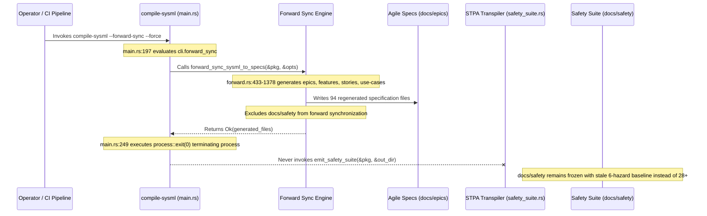

## 1. Context and References

<!-- test-target: crates/compile-sysml/src/main.rs -->

- **File**: `crates/compile-sysml/src/main.rs:91-250`
- **Pillar**: Resource Lifecycle
- **Symptom**: compile-sysml --forward-sync is decoupled from --stpa-transpile. As a result, when ConOps operational activities or system hazards are updated or decomposed, forward-sync leaves docs/safety/ frozen with stale hazard mappings (e.g. only 6 hazards instead of 28+) unless an operator manually invokes the separate --stpa-transpile flag.
- **Test-Target**: `crates/compile-sysml/src/main.rs`

## 2. Root Cause Analysis (5 Whys)

1. **Why does compile-sysml --forward-sync leave docs/safety/ frozen with stale hazard mappings when ConOps operational activities or system hazards are updated?** Because crates/compile-sysml/src/main.rs executes forward synchronization and STPA safety transpilation as decoupled, mutually exclusive CLI execution branches, terminating the process immediately after agile specification generation.
2. **Why are forward synchronization and STPA transpilation mutually exclusive branches in main.rs?** Because the CLI entrypoint handles --forward-sync and --stpa-transpile as isolated operational flags rather than binding safety artifacts to the forward synchronization lifecycle.
3. **Why does forward_sync_sysml_to_specs omit docs/safety/ even though forward.rs:8 documents safety matrix generation?** Because the forward synchronization engine manages only Epics, Features, User Stories, and Use Cases, treating the safety suite as an external unmanaged artifact.
4. **Why was safety suite transpilation architected as an unmanaged external artifact?** Because the compiler entrypoint adopted fragmented execution subcommands requiring manual operator sequencing rather than an integrated compilation lifecycle.
5. **Why is manual operator sequencing problematic in safety-critical Model-Based Systems Engineering?** Because manual flag sequencing violates the Resource Lifecycle invariant of compilation pipelines, causing split-brain desynchronization where updated schema hazards fail to reach docs/safety/, invalidating safety verification baselines.

## 3. Correctness Analysis

In crates/compile-sysml/src/main.rs, the CLI entrypoint defines independent boolean flags for safety transpilation (--stpa-transpile, lines 44-45) and specification synchronization (--forward-sync, lines 56-57).

When compile-sysml is invoked with --forward-sync (or --forward-sync --force):
1. In line 89, Cli::parse() binds cli.forward_sync to true, while cli.stpa_transpile defaults to false.
2. The initial STPA transpilation branch (lines 92-159) is evaluated and skipped because cli.stpa_transpile is false.
3. Execution proceeds directly to the forward synchronization branch (lines 197-250). In lines 198-234, resolve_schema_targets resolves and parses the SysML AST from schema/ (including newly decomposed ConOps operational activities and updated subsystem hazards).
4. In lines 237-243, ForwardSyncOptions is initialized with schema_path, docs_dir, out_dir, dry_run, and force. ForwardSyncOptions contains no configuration for STPA transpilation or FMECA scoring.
5. In line 245, forward_sync_sysml_to_specs(&pkg, &opts) is executed. Across crates/compile-sysml/src/sync/forward.rs:433-1378, the synchronization engine generates Epics (docs/epics/), Features (docs/features/), User Stories (docs/user-stories/), and Use Cases (docs/use-cases/). Although the module documentation in forward.rs:8 advertises Safety Matrix (docs/safety/STPA_MATRIX.md) generation, forward_sync_sysml_to_specs never invokes compile_sysml::stpa::emit_safety_suite, and clean_stale_specifications (forward.rs:1381-1385) scopes cleanup strictly to ["epics", "features", "user-stories", "use-cases"].
6. At line 249, main.rs terminates the process via process::exit(0).

As a direct consequence, the safety documentation suite in docs/safety/ (including STPA_MATRIX.md, 01_LOSSES_HAZARDS_TOPOLOGY.md, and 05_FMECA_MATRIX.md) is left completely untouched. When an engineer decomposes ConOps operational activities (e.g., expanding from 6 coarse operational activities to 28+ fine-grained activities with corresponding hazard definitions), running the canonical forward-sync command leaves docs/safety/ frozen with stale hazard mappings.

Invariant violated: Resource Lifecycle Invariant (.pipeline/constitution.md §Phase 0 System Safety Assurance Gate and rules/codebase-compliance.md §Resource Lifecycle). In a schema-driven compiler, generated downstream artifacts are derived compilation resources whose lifecycle (creation, caching, invalidation, eviction, re-generation) is strictly bound to the upstream schema AST. Treating safety transpilation as an unmanaged secondary pass allows stale safety baselines to persist silently across compilation cycles.

## 4. UML Diagrams



## 5. Affected Callers / Downstream Impact

- docs/safety/ (STPA_MATRIX.md, 01_LOSSES_HAZARDS_TOPOLOGY.md, 05_FMECA_MATRIX.md, HAZARD_LOG.md) -- Remains frozen with obsolete hazard mappings when ConOps activities or system hazards are decomposed.
- verify-baseline (Check 17: Safety Integrity Quality Gate) -- Validates desynchronized safety artifacts against updated operational activities because docs/safety/ was never regenerated during forward-sync.
- reconcile-backlog -- Projects outdated safety baselines to issue trackers during automated backlog synchronization passes.
- Automated CI / Deployment Pipelines -- Standard compilation commands (compile-sysml --forward-sync --force) fail to achieve end-to-end artifact freshness, creating silent safety-to-specification drift.

## 6. Proposed Correction

```rust
// In crates/compile-sysml/src/main.rs:237-250:
let opts = ForwardSyncOptions {
    schema_path: schema_path.clone(),
    docs_dir: cli.docs.clone(),
    out_dir: cli.out_dir.clone(),
    dry_run: cli.dry_run,
    force: cli.force,
};

if let Err(e) = forward_sync_sysml_to_specs(&pkg, &opts) {
    eprintln!("Error during forward sync: {}", e);
    process::exit(1);
}

// Ensure the safety artifact suite resource lifecycle is synchronized in lockstep with forward-sync
let safety_dir = cli.out_dir.as_ref()
    .map(|d| d.join("safety"))
    .unwrap_or_else(|| cli.docs.join("safety"));

if !cli.dry_run {
    if let Err(e) = compile_sysml::stpa::emit_safety_suite(&pkg, &safety_dir, None) {
        eprintln!("Error during safety suite forward synchronization: {}", e);
        process::exit(1);
    }
    println!(
        "[SysML v2 Forward-Sync] Successfully synchronized 10-pillar safety suite to '{}'",
        safety_dir.display()
    );
}
process::exit(0);
```

## 7. Relationship to Existing Issues

Discovered in audit -- new finding.

## Audit Source

Adversarial Resource Lifecycle Audit
SEVERITY: Critical
FILE_LOCATION: crates/compile-sysml/src/main.rs:91-250
