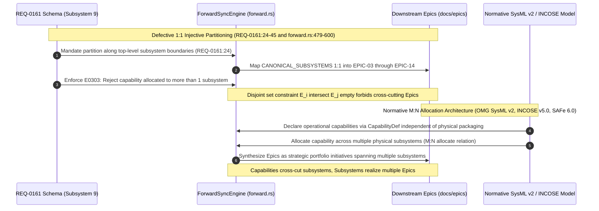

## 1. Context and References

<!-- test-target: scripts/e2e_acceptance_harness.py -->

- **File**: `schema/REQ-0161.md:24-45`
- **Pillar**: Semantic Traceability
- **Symptom**: REQ-0161 mandates an artificial 1:1 partitioning of Epics to subsystems with disjoint capability allocations, causing `crates/compile-sysml/src/sync/forward.rs` to hardcode a 1:1 lowering from `CANONICAL_SUBSYSTEMS` to Epics (`EPIC-03` through `EPIC-14`) and rejecting multi-subsystem capabilities via diagnostic `E0303` in direct violation of OMG SysML v2, INCOSE SE Handbook v5.0, ISO/IEC/IEEE 15288, and SAFe 6.0 M:N allocation semantics.
- **Test-Target**: `scripts/e2e_acceptance_harness.py`

## 2. Root Cause Analysis (5 Whys)

1. **Why does `crates/compile-sysml/src/sync/forward.rs:479-600` enforce an artificial 1:1 lowering from the 12 canonical subsystems to Epics (EPIC-03 through EPIC-14)?** Because the forward synchronization generator was written to implement the specification in REQ-0161, which mandated synthesizing Epics along top-level subsystem boundaries.
2. **Why did REQ-0161 mandate that the projection engine synthesize Epics by partitioning models along top-level subsystem boundaries with disjoint partitions?** Because the formal requirement author designed the projection engine around an idealized mathematical equivalence where physical architectural decomposition is treated as isomorphic to operational capability decomposition.
3. **Why was physical architectural decomposition conflated with operational capability decomposition?** Because the model author treated Subsystems (`PartDef` hierarchy) and Epics (`CapabilityDef` groupings) as interchangeable containment hierarchies, failing to recognize that structural packaging and functional capabilities represent orthogonal architectural dimensions.
4. **Why was this orthogonal architectural dimension collapsed into a single disjoint partition?** Because REQ-0161 enforced a single-parent functional allocation mapping and codified diagnostic `E0303` (CapabilityAllocationViolation) to reject any capability allocated across more than one subsystem.
5. **Why did REQ-0161 mandate an injective functional allocation that rejects multi-subsystem capabilities?** Because the Agile projection requirements were framed around naive mathematical set partitioning rather than foundational systems engineering standards (OMG SysML v2 / KerML, INCOSE SE Handbook v5.0, ISO/IEC/IEEE 15288:2023, and SAFe 6.0), which mandate that allocation between operational capabilities and physical subsystems is inherently Many-to-Many (M:N).

## 3. Correctness Analysis

In `schema/REQ-0161.md:24-45` and `schema/subsystems/downstream_agile_projections/requirements.sysml:48-67`, REQ-0161 specifies the contract for Agile Epics projection:
"The projection engine of Subsystem 9 SHALL synthesize Epic specifications by partitioning models along top-level subsystem boundaries and projecting capability allocations."

The formal mathematical invariant in REQ-0161 codifies this disjoint partition:

$$
\begin{aligned}
E_k&=\{c\in\mathcal{M}_{\text{capabilities}}\mid\text{Alloc}(c)=S_k\},\quad k\in\{1,\dots,m\} \\
\bigcup_{k=1}^m E_k&=\mathcal{M}_{\text{capabilities}}\land(\forall i\ne j,\,E_i\cap E_j=\emptyset) \\
(\exists c:\text{Alloc}(c)=\bot\lor\text{Alloc}(c)\notin\mathcal{S}&\lor\exists i\ne j:c\in E_i\cap E_j)\implies\text{Diagnostic}(c,\text{E0303})\in\mathcal{D}_{\text{sink}}\land c\gets\bot_{\text{epic}}
\end{aligned}
$$

Furthermore, Acceptance Criterion AC-03 explicitly rejects cross-subsystem capability allocation:
"Given: Capability `Capability_Alpha` unallocated or mapped to `Subsystem_0` and `Subsystem_1`. When: Validating allocation partitions. Then: Rejects model, emits `E0303`, and binds sentinel `\bot_{\text{epic}}`."

This flawed specification has directly leaked into the compiler implementation in `crates/compile-sysml/src/sync/forward.rs`:
1. **Hardcoded Subsystem-to-Epic Loop (lines 479-600)**: The forward sync engine iterates over `CANONICAL_SUBSYSTEMS` (12 subsystems) and emits `EPIC-03` through `EPIC-14` in exact 1:1 lockstep with each subsystem. Each Epic is labeled with `package: "{pkg_name}"` and `subsystem: "{subsystem}"`.
2. **Subsystem-Confined Features (lines 482-599)**: The requirements checklist for each Epic contains only the 5 features belonging to that specific subsystem.
3. **Single-Subsystem Capability Binding (lines 182-187)**: In the generic capability branch, each `CapabilityDef` is forced to bind to a single `subsys` string (`cap.subsystem`), preventing multi-subsystem allocation.

This 1:1 partitioning violates four normative systems engineering and agile architecture standards:

1. **OMG SysML v2 / KerML Metamodel Violation**:
Under KerML (ptc/2023-08-06 §8.4) and OMG SysML v2 (ptc/2023-08-04 §7.18), functional capabilities (`CapabilityDef`), actions (`ActionDef`), and use cases (`UseCaseDef`) represent operational behaviors, while subsystems are physical or logical components (`PartDef`). The `allocate` relationship connecting functional behaviors to structural elements is inherently Many-to-Many (M:N). A single capability (e.g. "Continuous Telemetry Ingestion" or "Safe Degraded Recovery") allocates functional roles across multiple physical subsystems. Restricting allocation to a single subsystem and emitting `E0303` if a capability allocates across multiple subsystems directly violates SysML v2 allocation semantics.

2. **INCOSE Systems Engineering Handbook v5.0 Violation (§3.4.4 & §4.2)**:
INCOSE SE Handbook v5.0 emphasizes that systems engineering architecture must decouple the Functional/Logical Architecture from the Physical Architecture. Subsystems represent modular physical packaging boundaries, whereas capabilities represent operational stakeholder outcomes. Forcing a 1:1 mapping between Epics and Subsystems is a classical systems engineering anti-pattern ("functional-physical isomorphism"), which fragments cross-cutting concerns and prevents modeling emergent system-level capabilities.

3. **ISO/IEC/IEEE 15288:2023 Violation (§6.4.2 vs §6.4.3)**:
ISO/IEC/IEEE 15288 decouples the Stakeholder Needs and Requirements Definition Process (§6.4.2) from the Architecture Definition Process (§6.4.3). Operational capabilities exist to fulfill stakeholder missions independently of implementation partitioning. §6.4.3 mandates establishing non-injective, non-surjective allocation matrices between logical architectural elements and physical system elements. REQ-0161 subordinates capability modeling to subsystem boundaries.

4. **Scaled Agile Framework (SAFe 6.0) Anti-Pattern**:
In SAFe 6.0, an Epic is a portfolio-level or solution-level initiative that delivers significant business value spanning multiple Agile Release Trains (ARTs), value streams, and subsystems. Epics decompose into Features, which are implemented across different components. Forcing each Epic to map 1:1 to a physical subsystem reduces Epics to trivial subsystem component buckets, destroying portfolio-level capability governance and preventing cross-subsystem value delivery tracking.

## 4. UML Diagrams



## 5. Affected Callers / Downstream Impact

- `schema/REQ-0161.md:24-45` -- Formal requirement statement, mathematical invariant, and acceptance criteria AC-02 and AC-03 enforce disjoint partitioning and reject cross-subsystem capabilities.
- `schema/subsystems/downstream_agile_projections/requirements.sysml:48-67` -- SysML v2 requirement definition `REQ_0161_Epics_Projection` formalizes the defective disjoint allocation invariant and diagnostic `E0303`.
- `crates/compile-sysml/src/sync/forward.rs:72-157` -- `CANONICAL_SUBSYSTEMS` table defines rigid 12-subsystem metadata for hardcoded 1:1 Epic lowering.
- `crates/compile-sysml/src/sync/forward.rs:479-600` -- Subsystem loop lowers `EPIC-03` through `EPIC-14` directly from subsystem names rather than from SysML v2 `CapabilityDef` nodes.
- `crates/compile-sysml/src/sync/forward.rs:182-187` -- Capability lowering forces single-subsystem binding (`cap.subsystem`), dropping M:N allocation relationships.
- `docs/epics/EPIC-*.md` -- Generated Epic specifications represent isolated subsystem silos rather than portfolio-level capabilities.
- `crates/verify-baseline/` -- Conformance checks validating against REQ-0161 reject valid models that allocate capabilities across multiple subsystems.

## 6. Proposed Correction

```sysml
    doc /* Epics Projection: Operational Capabilities and M:N Subsystem Allocation */
    requirement def REQ_0161_Epics_Projection {
        id = "REQ-0161";
        text = "The projection engine of Subsystem 9 SHALL synthesize Epic specifications from top-level operational capabilities (CapabilityDef) and project cross-cutting capability allocations across architectural subsystems through M:N feature allocation matrices.";
        attribute uuidv5 : String = "62138c24-7491-5944-9c0b-c5775216cd2d";
        attribute complexity_class : String = "Class P (O(|C| + |S|))";
        attribute governing_standard : String = "OMG SysML v2 / INCOSE SE Handbook v5.0 / SAFe 6.0";
        attribute diagnostic_codes : String = "E0199, E0300, E0303";

        doc /* Formal Invariant: M:N Allocation Matrix
            Let S = {S_1, ..., S_m} and C = {c_1, ..., c_n}.
            A \subseteq C \times S denotes capability allocation.
            Epic(c) = <name(c), FQN(c), AllocatedSubsystems(c)>, forall c in C
            AllocatedSubsystems(c) = { S in S | (c, S) in A }
            SubsystemCapabilities(S_k) = { c in C | (c, S_k) in A }
            forall c in C, |AllocatedSubsystems(c)| >= 1
            (AllocatedSubsystems(c) == \emptyset or exists S in AllocatedSubsystems(c) : S not in S) => Diagnostic(c, E0303) in D_sink
        */
        constraint def Invariant_REQ_0161_FormalInvariant;
        require Invariant_REQ_0161_FormalInvariant;

        verify by AC_01_Structural_Decomposition_and_Capability_Projection;
        verify by AC_02_Multi_Subsystem_Capability_Allocation;
        verify by AC_03_Dangling_Capability_Allocation_Rejection;
        verify by AC_04_Decomposition_Cycle_and_Delimiter_Recovery;
        satisfy by AgileProjectionEngine;
    }
```

```rust
// In crates/compile-sysml/src/sync/forward.rs:
// Remove hardcoded CANONICAL_SUBSYSTEMS -> EPIC-03..EPIC-14 loop (lines 479-600)
// Lower Epics directly from pkg.get_all_capabilities() with M:N subsystem feature allocation:

pub fn forward_sync_sysml_to_specs(
    pkg: &PackageDef,
    opts: &ForwardSyncOptions,
) -> Result<HashMap<String, String>, String> {
    let target_out_dir = opts
        .out_dir
        .as_ref()
        .cloned()
        .unwrap_or_else(|| opts.docs_dir.clone());

    let mut generated_files = HashMap::new();
    let today_iso = Utc::now().format("%Y-%m-%d").to_string();

    let all_packages = pkg.get_all_packages();
    let capabilities = pkg.get_all_capabilities();

    // Lower Epics directly from CapabilityDefs (M:N allocation across subsystems)
    for (idx, cap) in capabilities.iter().enumerate() {
        let i = idx + 1;
        let cap_name = sanitize_id(&cap.name);

        // Collect all subsystems allocated to this capability
        let allocated_subsystems: Vec<String> = cap
            .allocated_subsystems
            .iter()
            .map(|s| sanitize_id(s))
            .collect();

        let doc = cap
            .doc
            .clone()
            .or_else(|| cap.description.clone())
            .unwrap_or_else(|| format!("System capability specification for {}", cap_name));

        let rel_path = format!("epics/EPIC-{:02}-{}.md", i, cap_name);
        let epic_date = resolve_date(&target_out_dir, &rel_path, &today_iso);

        let content = format!(
            "---\ntitle: \"Epic {:02}: {}\"\nversion: \"1.0.0\"\ndate: \"{}\"\ntype: epic\ncapabilities: [\"{}\"]\nallocated_subsystems: {:?}\nissue_id: 0\ngeneration_mode: subagent\n---\n\n# Epic {:02}: {}\n\n### Metadata\n| Attribute | Specification Detail |\n| :--- | :--- |\n| **Title** | Epic {:02}: {} |\n| **Version** | 1.0.0 |\n| **Date** | {} |\n| **Type** | epic |\n| **Capabilities** | {} |\n| **Allocated Subsystems** | {} |\n\n### Context\n{}\n\n### Requirements & Checklist\n{}",
            i, cap_name, epic_date, cap_name, allocated_subsystems,
            i, cap_name, i, cap_name, epic_date, cap_name,
            allocated_subsystems.join(", "),
            doc,
            render_allocated_features_checklist(cap, &all_packages)
        );

        generated_files.insert(rel_path, content);
    }

    Ok(generated_files)
}
```

## 7. Relationship to Existing Issues

Discovered in audit -- new finding.

## Audit Source

Adversarial Semantic Traceability Audit
SEVERITY: Important
FILE_LOCATION: schema/REQ-0161.md:24-45
