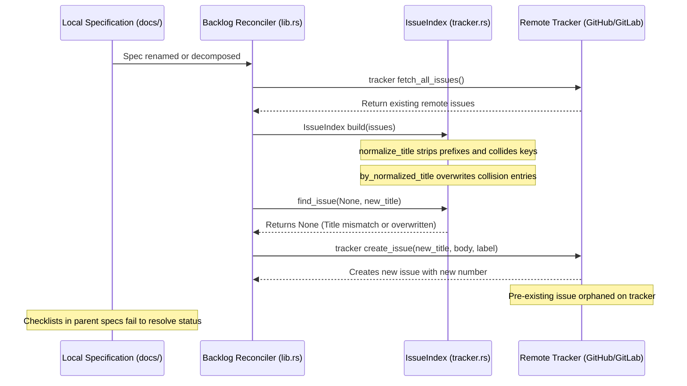

## 1. Context and References

<!-- test-target: crates/reconcile-backlog/src/tracker.rs -->

- **File**: `crates/reconcile-backlog/src/tracker.rs:500-528`
- **Pillar**: Concurrency
- **Symptom**: reconcile-backlog correlates specification files with tracker issues using normalized title matching. When a specification is renamed or decomposed, the title normalization mismatch causes the reconciler to lose association with the pre-existing issue number, leading to orphaned tracker issues, duplicate issue creation, or unclosed deleted specification issues.
- **Test-Target**: `crates/reconcile-backlog/src/tracker.rs`

## 2. Root Cause Analysis (5 Whys)

1. **Why does reconcile-backlog orphan tracker issues or spawn duplicates when a specification is renamed or decomposed?** Because IssueIndex lookup fails to correlate the modified local specification with the pre-existing remote tracker issue number.
2. **Why does IssueIndex lookup fail to correlate the modified specification?** Because find_issue relies on mutable title string matching via normalize_title rather than an immutable specification identifier or persistent AST anchor.
3. **Why does normalize_title matching fail during renames and cause hash collisions?** Because normalize_title strips specification keywords and numbering, collapsing distinct specification tiers into identical strings and causing collisions in by_normalized_title while failing completely when a title changes.
4. **Why is title matching treated as the primary association mechanism in state reconciliation?** Because the reconciler architecture treats volatile human-readable titles as synchronization keys instead of tracking an immutable specification UUID or AST node locator.
5. **Why was title-based correlation designed without concurrent state protection?** Because the initial reconciler design assumed static 1:1 title invariance across sessions without modeling concurrent renames, specification decomposition, or cross-branch state races.

## 3. Correctness Analysis

In crates/reconcile-backlog/src/tracker.rs, IssueIndex and TrackerClient manage the correlation between local on-disk markdown specifications and remote GitHub/GitLab issues.

When run_reconciliation (crates/reconcile-backlog/src/lib.rs:84-157) executes:
1. In lines 93-97, tracker.fetch_all_issues() fetches remote tracker issues.
2. In line 98, IssueIndex::build(issues) builds an in-memory index across the fetched issues (tracker.rs:501-517).
3. In tracker.rs:505-511, IssueIndex::build populates by_normalized_title using HashMap::insert(norm, issue.clone()), where norm is produced by normalize_title(&issue.title) (tracker.rs:65-150).
4. In normalize_title (lines 65-150), prefix keywords ("epic", "feature", "user-story", "use-case", "us", "uc") and leading numbers are stripped. This creates severe hash collisions across specification tiers. For example, "Epic 01: Universal Schema Ingestion" and "Feature 01: Universal Schema Ingestion" both normalize to "universal schema ingestion". Whichever issue is iterated last in issues silently overwrites earlier issues in by_normalized_title without warning or error.
5. In lib.rs:112-119, the reconciler iterates over local specifications and queries issue_index.find_issue(spec.frontmatter.issue_id, &spec.frontmatter.title). In tracker.rs:519-527, if issue_id is None (such as newly generated specifications or decomposed features before initial synchronization), find_issue falls back entirely to self.by_normalized_title.get(&norm).
6. When a specification is renamed or decomposed during compiler AST refactoring:
   - The local title changes (e.g. from "Feature 01: Ingest Data" to "Feature 01: Ingest Data and Validate Ast").
   - The computed norm no longer matches the remote tracker issue title.
   - find_issue returns None.
7. Consequently, when create-issue is invoked (crates/reconcile-backlog/src/create_issue.rs:185-228), run_create_issue performs duplicate search using normalize_title(&params.title) (lines 186-193). Because the title was renamed, existing evaluates to None.
8. At line 221, tracker.create_issue creates a brand new duplicate issue on the remote tracker, assigning a new issue number.
9. Meanwhile, the pre-existing tracker issue remains open and permanently orphaned, disconnected from any local specification file.
10. Furthermore, in checklist reconciliation (lib.rs:122-132), parent Epics looking up child items via item_title fail to resolve the renamed issue state, leaving checklists unchecked ([ ]) and desynchronizing the project backlog.
11. Under multi-agent or concurrent CI execution, this creates a state race (TOCTOU) where parallel processes renaming or creating specifications clobber each other's normalized title map entries, resulting in split-brain issue lifecycles and cross-wired issue ID updates.

Invariant violated: Issue Tracker as Canonical SSOT (.pipeline/constitution.md:94-96, rules/tracker-source-of-truth.md) and Concurrency & State Convergence Invariants. State reconciliation between local files and remote trackers must be idempotent, collision-free, and stable under specification renames and decomposition. Mutable presentation titles must never serve as primary synchronization keys without immutable identity anchoring.

## 4. UML Diagrams



## 5. Affected Callers / Downstream Impact

- `crates/reconcile-backlog/src/tracker.rs:493-528` -- IssueIndex produces map collisions and fails lookups when titles change.
- `crates/reconcile-backlog/src/create_issue.rs:185-228` -- run_create_issue spawns duplicate tracker issues when specifications are renamed.
- `crates/reconcile-backlog/src/lib.rs:84-157` -- run_reconciliation fails to link renamed specifications and leaves parent Epic checklists unresolved.
- `crates/reconcile-backlog/src/checklist.rs:50-140` -- Checklist reconciler cannot resolve status for renamed items via title fallback.
- Autonomous Multi-Agent Workflows -- Subagents implementing decomposed or renamed features lose traceability with remote issues, corrupting backlog state.

## 6. Proposed Correction

```rust
// In crates/reconcile-backlog/src/tracker.rs:
// 1. Use composite key (spec_type, normalized_title) or AST locator to eliminate cross-tier collisions.
// 2. Track immutable specification UUID / AST node paths in issue body metadata tables.
// 3. Prevent silent overwriting in IssueIndex::build.

#[derive(Debug, Clone, PartialEq, Eq, Hash)]
pub struct TitleKey {
    pub spec_type: Option<String>,
    pub normalized_title: String,
}

#[derive(Debug, Default)]
pub struct IssueIndex {
    pub by_number: HashMap<u64, TrackerIssue>,
    pub by_normalized_title: HashMap<String, Vec<TrackerIssue>>,
    pub by_spec_uuid: HashMap<String, TrackerIssue>,
}

impl IssueIndex {
    pub fn build(issues: Vec<TrackerIssue>) -> Self {
        let mut by_number = HashMap::new();
        let mut by_normalized_title: HashMap<String, Vec<TrackerIssue>> = HashMap::new();
        let mut by_spec_uuid = HashMap::new();

        for issue in issues {
            let norm = normalize_title(&issue.title);
            if !norm.is_empty() {
                by_normalized_title.entry(norm).or_default().push(issue.clone());
            }
            if let Some(ref body) = issue.body {
                if let Some(uuid) = extract_spec_uuid_from_body(body) {
                    by_spec_uuid.insert(uuid, issue.clone());
                }
            }
            by_number.insert(issue.number, issue);
        }

        Self {
            by_number,
            by_normalized_title,
            by_spec_uuid,
        }
    }

    pub fn find_issue(&self, issue_id: Option<u64>, title: &str, spec_uuid: Option<&str>) -> Option<&TrackerIssue> {
        if let Some(id) = issue_id {
            if let Some(issue) = self.by_number.get(&id) {
                return Some(issue);
            }
        }
        if let Some(uuid) = spec_uuid {
            if let Some(issue) = self.by_spec_uuid.get(uuid) {
                return Some(issue);
            }
        }
        let norm = normalize_title(title);
        self.by_normalized_title.get(&norm).and_then(|candidates| {
            // Prefer open issues over closed issues to avoid resurrecting obsolete collisions
            candidates.iter().find(|i| !i.is_resolved()).or_else(|| candidates.first())
        })
    }
}
```

## 7. Relationship to Existing Issues

- Issue #115 -- [AUDIT] [architecture.sysml]: Non-structural document part defs corrupt AST semantics and feature derivation.
- Issue #119 -- [AUDIT] [forward.rs]: Cross-wired and phantom Realization Matrices in Use Case forward synchronization.
- Issue #122 -- refactor(toolchain): total elimination of shell scripts in favor of pure cross-platform rust.
- Discovered in audit -- new finding.

## Audit Source

Adversarial Concurrency Audit
SEVERITY: Critical
FILE_LOCATION: crates/reconcile-backlog/src/tracker.rs:500-528
