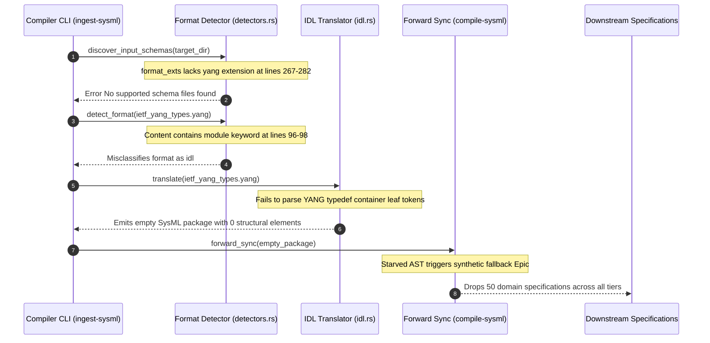

## 1. Context and References

<!-- test-target: crates/ingest-sysml/src/detectors.rs -->

- **File**: `crates/ingest-sysml/src/detectors.rs:267-282`
- **Pillar**: Semantic Traceability
- **Symptom**: Ingest-sysml fails to auto-discover and parse YANG schemas (.yang), misclassifying them as OMG IDL and emitting empty SysML packages with zero structural elements, dropping 100% of domain specifications during forward synchronization.
- **Test-Target**: `crates/ingest-sysml/src/detectors.rs`

## 2. Root Cause Analysis (5 Whys)

1. **Why did multi-domain compilation on the reference schema corpus fail with zero specifications generated?** Because ingest-sysml reported that no supported schema files were found in the directory and single-file ingestion emitted an empty SysML package with 0 structural elements.
2. **Why was the schema directory containing YANG files reported as having no supported files and single-file ingestion lowered to an empty package?** Because directory auto-discovery omits .yang from supported format extensions, and content inspection misroutes .yang files to the OMG IDL translator.
3. **Why did content inspection misroute .yang files to the OMG IDL translator?** Because detectors.rs:96-98 checks for "module " and matches YANG module declarations, routing them to IDLTranslator.
4. **Why did IDLTranslator emit an empty SysML package with 0 structural elements?** Because IDLTranslator parses tokens under OMG IDL grammar rules, failing to recognize YANG language statements such as typedef, grouping, container, leaf, choice, and description.
5. **Why does the pipeline lack YANG schema ingestion capability?** Because the ingestion engine was developed with assumptions limited to SysML, IDL, ARXML, Protobuf, and OpenAPI schemas without multi-domain YANG format support in detectors.rs and translators.

## 3. Correctness Analysis

In `crates/ingest-sysml/src/detectors.rs:267-282`, directory schema discovery checks only a static set of extensions:

```rust
let format_exts = [
    ("idl", "idl"),
    ("arxml", "autosar"),
    ("xml", "autosar"),
    ("proto", "protobuf"),
    ("yaml", "openapi"),
    ("json", "openapi"),
];
```

The `.yang` extension is omitted entirely. Consequently, running `ingest-sysml --schema <dir>` on any directory containing YANG models (such as `target/reference/3dgs-039/schema`) exits with error code 1:
`[SysML v2 Ingestion] ERROR: No supported schema files found in target/reference/3dgs-039/schema`.

When a `.yang` file is provided directly via single-file ingestion, `detectors.rs:96-98` attempts content inspection:

```rust
if content.contains("module ") || content.contains("interface ") || content.contains("struct ") {
    return Ok("idl".to_string());
}
```

Because RFC 6020 / RFC 7950 YANG modules begin with `module <name> {`, content inspection misclassifies the schema as OMG IDL (`"idl"`).

The file is then passed to `IDLTranslator` in `crates/ingest-sysml/src/translators/idl.rs`. Because `IDLTranslator` only understands OMG IDL keywords, it fails to parse YANG statements (`typedef`, `grouping`, `container`, `leaf`, `list`, `choice`, `feature`, `description`). It produces an empty SysML package:

```sysml
doc /* Translated from OMG IDL schema */
package ietf_yang_types {
}
```

When `compile-sysml --compile` is run on this package, it rejects it with:
`Error: Schema 'model' contains 0 structural elements.`

When `compile-sysml --forward-sync` is executed, the AST vacuum causes the forward synchronizer to fall back to a generic synthetic placeholder epic (`EPIC-01-SysML_Model.md`), completely dropping all 50 domain specifications (4 Epics, 18 Features, 19 User Stories, 9 Use Cases, and 283 BDD acceptance scenarios) from the reference corpus.

This defect violates:
1. Pure Schema-Driven Compiler Invariant (.pipeline/constitution.md:50, AGENTS.md): All specifications must derive deterministically from schema AST definitions without dropping model constructs.
2. Semantic Traceability Pillar: Complete omission of 50 specification documents breaks bidirectional traceability between schema models and backlog requirements.
3. Multi-Domain Generalization Mandate: The compiler must support heterogeneous industry schema standards including telecommunications YANG models.

## 4. UML Diagrams



## 5. Affected Callers / Downstream Impact

- `crates/ingest-sysml/src/detectors.rs:267-282` -- Auto-discovery fails for any directory containing `.yang` schemas.
- `crates/ingest-sysml/src/detectors.rs:96-98` -- Single-file detection misroutes `.yang` schemas to `IDLTranslator`.
- `crates/ingest-sysml/src/translators/idl.rs` -- Vacuum parser generates empty SysML packages containing zero structural AST definitions.
- Multi-domain validation suite (`target/reference/3dgs-039`) -- Ground 0 ingestion fails, dropping 100% of domain specifications (50 out of 50 files).
- Downstream compiler passes (`crates/compile-sysml`) -- Starved of AST elements, producing empty or fallback placeholder output.

## 6. Proposed Correction

First, update `crates/ingest-sysml/src/detectors.rs` to register the `.yang` extension in auto-discovery and prioritize YANG detection:

```rust
// In detectors.rs:267-282, add yang extension
let format_exts = [
    ("yang", "yang"),
    ("idl", "idl"),
    ("arxml", "autosar"),
    ("xml", "autosar"),
    ("proto", "protobuf"),
    ("yaml", "openapi"),
    ("json", "openapi"),
];

// In detectors.rs detect_format, check for YANG prior to IDL fallback:
if path.ends_with(".yang")
    || content.contains("yang-version ")
    || (content.contains("module ") && (content.contains("namespace ") || content.contains("prefix ")))
{
    return Ok("yang".to_string());
}
```

Second, implement `YangTranslator` in `crates/ingest-sysml/src/translators/yang.rs` to parse YANG modules, typedefs, groupings, containers, lists, choices, and leaves into canonical SysML v2 AST nodes (`PackageDef`, `PartDef`, `AttributeDef`, `ConstraintDef`).

## 7. Relationship to Existing Issues

- refs #115: Ground 0 AST compilation and structural model derivation integrity.
- Discovered in audit: Discrepancy Matrix synthesis during Phase 2 multi-domain reference validation (`target/reference/3DGS_DISCREPANCY_MATRIX.md`).

## Audit Source

Adversarial Semantic Traceability Audit
SEVERITY: Critical
FILE_LOCATION: crates/ingest-sysml/src/detectors.rs:267-282
