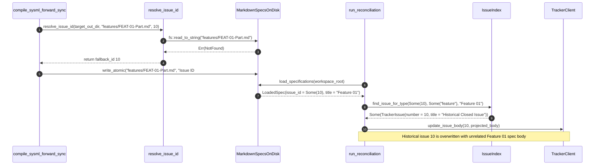

## 1. Context and References

<!-- test-target: crates/compile-sysml/tests/reproducer_tests.rs -->

- **File**: `crates/compile-sysml/src/sync/forward.rs:1640-2162`
- **Pillar**: Semantic Traceability
- **Symptom**: `forward_sync_sysml_to_specs` and `resolve_issue_id` synthesize hardcoded arithmetic fallback GitHub issue IDs (`epic_num + 100` = `101`, `f_num + 9` = `10`, `s_num + 88` = `89`, `u_num + 94` = `95`) when generating new specification files (`EPIC-XX-*.md`, `FEAT-XX-*.md`, `US-XX-*.md`, `UC-XX-*.md`) that do not yet exist on disk. In any repository with existing GitHub issue history, these synthetic IDs collide with unrelated historical issues (`#10`, `#11`, `#89`, `#95`, `#101`, `#102`), causing `reconcile-backlog` to overwrite historical GitHub issue bodies with unrelated specification payloads.
- **Test-Target**: `crates/compile-sysml/tests/reproducer_tests.rs`

## 2. Root Cause Analysis (5 Whys)

1. **Why does running `reconcile-backlog` after `compile-sysml --forward-sync` overwrite unrelated historical GitHub issues (`#10`, `#11`, `#89`, `#95`, `#101`, `#102`)?** Because `reconcile-backlog` reads `frontmatter.issue_id` (`| **Issue ID** | #10 |` and `| **Issue ID** | #101 |`) from the forward-synced markdown files and invokes `tracker.update_issue_body(issue_id, &projected_body)` at `crates/reconcile-backlog/src/lib.rs:415-423`.
2. **Why do newly generated forward-synced markdown files contain `| **Issue ID** | #10 |`, `| **Issue ID** | #89 |`, `| **Issue ID** | #95 |`, and `| **Issue ID** | #101 |` before any tracker issue has been created for them?** Because `forward_sync_sysml_to_specs` calls `resolve_issue_id(&target_out_dir, &rel_path, fallback_id)` with hardcoded arithmetic offsets (`101`, `102`, `epic_num + 100`, `f_num + 9`, `88 + s_num`, `94 + u_num`) at `crates/compile-sysml/src/sync/forward.rs:1640, 1652, 1689, 1725, 1737, 1859, 1998, 2162, 2288, 2302`.
3. **Why does `resolve_issue_id` return a non-zero `usize` fallback ID when the target specification file does not yet exist on disk?** Because `resolve_issue_id` (`crates/compile-sysml/src/sync/forward.rs:393-426`) is typed to return a bare `usize` rather than `Option<usize>`, returning `fallback_id` on line 425 whenever neither exact path lookup nor filename-prefix lookup finds an existing `.md` file with a valid issue ID.
4. **Why were fixed arithmetic offsets (`+ 9`, `+ 88`, `+ 94`, `+ 100`) used as default fallback issue numbers?** Because the forward-sync templates were originally authored assuming a greenfield tracker with pre-allocated contiguous issue number blocks (`#10..#88` for Features, `#89..#94` for User Stories, `#95..#100` for Use Cases, `#101+` for Epics) and never accounted for repositories that already have existing issues in those ranges.
5. **Why did existing unit tests in `crates/compile-sysml/src/sync/forward.rs` pass despite this Semantic Traceability collision?** Because `test_forward_sync_generates_expected_files` (`crates/compile-sysml/src/sync/forward.rs:2578-2603`) only checks that map keys exist in `generated` and never asserts that newly generated specifications omit synthetic unallocated issue IDs when no prior specification file or tracker binding exists.

## 3. Correctness Analysis

The bijective Single Source of Truth (SSOT) traceability invariant (`.pipeline/constitution.md:93-96` and `crates/reconcile-backlog/src/lib.rs:9-10`) requires that every `issue_id` recorded in a specification's metadata table or YAML frontmatter uniquely and exclusively identifies the remote tracker issue allocated for that specific specification.

Tracing the data flow from `compile-sysml --forward-sync` to `reconcile-backlog`:
1. In `forward_sync_sysml_to_specs` (`crates/compile-sysml/src/sync/forward.rs:1626-1657`), for each package in `ordered_packages`, `default_issue_id` is computed as `101` (line 1640), `102` (line 1646), or `epic_num + 100` (line 1652), and passed to `resolve_issue_id(&target_out_dir, &rel_path, default_issue_id)` (line 1657).
2. When `target_out_dir` has no pre-existing specification files on disk, `resolve_issue_id` (`crates/compile-sysml/src/sync/forward.rs:393-426`) fails `fs::read_to_string(&full)` (line 395) and prefix directory scan (lines 401-424), returning `fallback_id` unconditionally at line 425.
3. The same unconditional fallback occurs for Epic feature checklists (`f_num + 9` at line 1689), Epic use-case checklists (`94 + uc_m.u_num` at line 1725), Epic user-story checklists (`88 + s_m.s_num` at line 1737), Feature files (`f_num + 9` at line 1859), User Story files (`s_num + 88` at line 1998), Use Case files (`u_num + 94` at line 2162), and Use Case realization matrix rows (`feat_link_num + 9` at line 2291 and `us_link_num + 88` at line 2305).
4. Consequently, `forward_sync_sysml_to_specs` writes `| **Issue ID** | #101 |`, `| **Issue ID** | #10 |`, `| **Issue ID** | #89 |`, `| **Issue ID** | #95 |`, and checklist items `- [ ] #10 - [Feature 01: ...]` to disk.
5. When `run_reconciliation` executes (`crates/reconcile-backlog/src/lib.rs:294-429`), `load_specifications` parses `| **Issue ID** | #10 |` as `frontmatter.issue_id = Some(10)`. At `crates/reconcile-backlog/src/tracker.rs:1957-1961`, `IssueIndex::find_issue_for_type` checks `self.by_number.get(&id)` first; because issue `#10` exists in the repository's historical tracker index, it returns the unrelated historical issue `#10` without verifying title or specification type parity.
6. At `crates/reconcile-backlog/src/lib.rs:361-365`, if historical issue `#10` is closed, `reconcile_checklist_content` marks the newly generated unimplemented Feature checklist item as `[x]` completed. Then at `crates/reconcile-backlog/src/lib.rs:415-423`, `tracker.update_issue_body(issue_id, &projected_body)` overwrites the remote GitHub issue `#10` body with the new specification's markdown content, corrupting historical tracker records.

## 4. UML Diagrams



## 5. Affected Callers / Downstream Impact

- `forward_sync_sysml_to_specs` (`crates/compile-sysml/src/sync/forward.rs:1640-2318`) -- embeds colliding synthetic issue IDs (`#10..`, `#89..`, `#95..`, `#101..`) into generated Epic, Feature, User Story, and Use Case markdown headers, checklists, and realization matrices whenever files do not already exist on disk.
- `run_reconciliation` (`crates/reconcile-backlog/src/lib.rs:347-425`) -- treats synthetic `frontmatter.issue_id` values as authoritative remote issue links, corrupting historical GitHub issues via `tracker.update_issue_body` and falsely checking off `[x]` items whose colliding historical issue numbers are closed.
- `IssueIndex::find_issue_for_type` (`crates/reconcile-backlog/src/tracker.rs:1951-1961`) -- prioritizes `by_number.get(&id)` lookup unconditionally over `spec_type` and normalized title verification, allowing synthetic fallback IDs to bind to unrelated bug or chore issues.

## 6. Proposed Correction

<!-- MUST NOT use regex (Check 34: deterministic linear slice/char scanning, no regex crate). MUST be domain-agnostic for upstream crates (Check 19). -->

```rust
fn resolve_existing_issue_id(target_out_dir: &Path, rel_path: &str) -> Option<usize> {
    let full = target_out_dir.join(rel_path);
    if let Ok(content) = fs::read_to_string(&full) {
        if let Some(id) = parse_issue_id_from_content(&content) {
            return Some(id);
        }
    }
    if let Some(parent) = Path::new(rel_path).parent() {
        if let Some(file_name) = Path::new(rel_path).file_name().and_then(|f| f.to_str()) {
            let prefix_end = file_name.find('-').and_then(|first_dash| {
                file_name[first_dash + 1..]
                    .find('-')
                    .map(|second_dash| first_dash + 1 + second_dash + 1)
            });
            if let Some(prefix_len) = prefix_end {
                let prefix = &file_name[..prefix_len];
                let dir_path = target_out_dir.join(parent);
                if let Ok(entries) = fs::read_dir(&dir_path) {
                    for entry in entries.flatten() {
                        let name = entry.file_name();
                        let name_str = name.to_string_lossy();
                        if name_str.starts_with(prefix) && name_str.ends_with(".md") {
                            if let Ok(content) = fs::read_to_string(entry.path()) {
                                if let Some(id) = parse_issue_id_from_content(&content) {
                                    return Some(id);
                                }
                            }
                        }
                    }
                }
            }
        }
    }
    None
}

fn format_issue_id_cell(issue_id: Option<usize>) -> String {
    match issue_id {
        Some(id) if id > 0 => format!("#{}", id),
        _ => "TBD".to_string(),
    }
}

fn format_checklist_issue_prefix(issue_id: Option<usize>) -> String {
    match issue_id {
        Some(id) if id > 0 => format!("#{} - ", id),
        _ => String::new(),
    }
}
```

## 7. Relationship to Existing Issues

Discovered in audit -- new finding.

## Audit Source

Adversarial Semantic Traceability Audit
SEVERITY: Critical
FILE_LOCATION: crates/compile-sysml/src/sync/forward.rs:1640-2162
