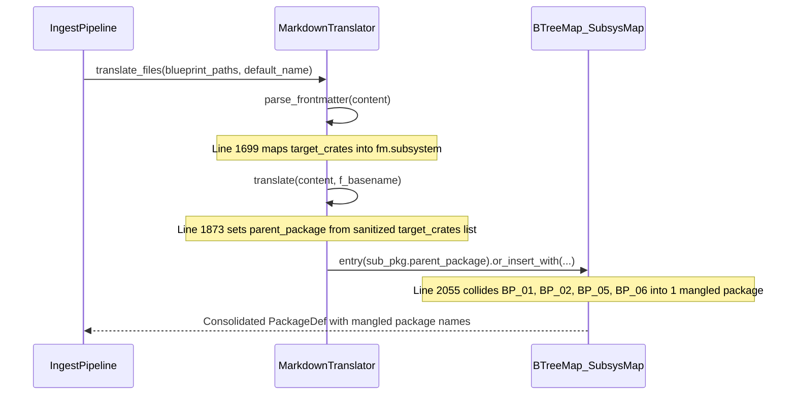

## 1. Context and References

<!-- test-target: crates/ingest-sysml/tests/reproducer_tests.rs -->

- **File**: `crates/ingest-sysml/src/translators/markdown.rs:1699-2060`
- **Pillar**: Semantic Traceability
- **Symptom**: `MarkdownTranslator::parse_frontmatter` aliases `"target_crates"` into `fm.subsystem`, causing `translate` and `translate_files` to collapse distinct architecture blueprints (`BP-01` through `BP-06`) that share the same multi-crate `Target Crates` metadata list into a single mangled `PackageDef` instead of preserving one top-level SysML package per blueprint.
- **Test-Target**: `crates/ingest-sysml/tests/reproducer_tests.rs`

## 2. Root Cause Analysis (5 Whys)

1. **Why do distinct blueprint documents (`blueprint-01`, `blueprint-02`, `blueprint-05`, `blueprint-06`) collapse into a single mangled SysML package during `MarkdownTranslator::translate_files`?** Because `translate_files` groups all requirement-bearing sub-packages into `subsys_map` keyed by `sub_pkg.parent_package` (`crates/ingest-sysml/src/translators/markdown.rs:2050-2060`), and all four blueprints receive the identical `parent_package` string `crates_deap_core_crates_verify_baseline_crates_compile_sysml_crates_ingest_sysml_crates_assemble_conops_crates_reconcile_backlog`.
2. **Why do those four distinct blueprints receive that identical mangled `parent_package` string?** Because in `MarkdownTranslator::translate` (`crates/ingest-sysml/src/translators/markdown.rs:1871-1877`), whenever `frontmatter.id` starts with `"REQ-"`, `"REQ_"`, `"BP-"`, or `"BP_"`, `parent_pkg_name` is computed from `frontmatter.subsystem` via `sanitize_identifier(sub_str, &pkg.name)` instead of preserving the blueprint's own package identifier `pkg.name`.
3. **Why is `frontmatter.subsystem` populated with a comma-separated list of workspace crate paths for blueprint documents?** Because `MarkdownTranslator::parse_frontmatter` (`crates/ingest-sysml/src/translators/markdown.rs:1699-1701`) matches `"subsystem" | "target_crates"` in the 2-column Markdown metadata header table and stores the `Target Crates` cell value directly into `fm.subsystem`.
4. **Why did `parse_frontmatter` conflate `"target_crates"` with `"subsystem"` while storing `"blueprint_id"` into `fm.id` and `fm.title`?** Because blueprint metadata tables use `| **Blueprint ID** | BP-XX-... |` and `| **Target Crates** | crates/... |`, and the table parser treated `Target Crates` as a single subsystem grouping key rather than recognizing that each blueprint (`BP-XX-*`) defines its own top-level architectural package boundary.
5. **Why was this package collision not caught by existing unit tests?** Because existing tests only exercised single-blueprint translation or requirement documents with single-token `Subsystem` values, never asserting that `translate_files` across multiple blueprints sharing a multi-crate `Target Crates` list preserves a 1-to-1 bijection between blueprint documents (`BP-01` through `BP-06`) and top-level `PackageDef` entries.

## 3. Correctness Analysis

When `ingest-sysml` translates level-0 or design Markdown specifications via `MarkdownTranslator::translate_files` (`crates/ingest-sysml/src/translators/markdown.rs:2010-2100`), each file is first translated into an individual `PackageDef` by `MarkdownTranslator::translate` (`crates/ingest-sysml/src/translators/markdown.rs:1748-1981`):

1. **Metadata Extraction (`crates/ingest-sysml/src/translators/markdown.rs:1657-1718`)**:
   - Line `1693-1695` extracts `"blueprint_id"` into `blueprint_id`.
   - Line `1699-1701` matches `"subsystem" | "target_crates"` and assigns `fm.subsystem = Some(val)`. For cross-cutting blueprints (`blueprint-01`, `blueprint-02`, `blueprint-05`, `blueprint-06`), `val` is `"crates/deap-core, crates/verify-baseline, crates/compile-sysml, crates/ingest-sysml, crates/assemble-conops, crates/reconcile-backlog"`.
   - Lines `1711-1716` assign `fm.id = blueprint_id.clone()` and `fm.title = blueprint_id.or(h1_title)`, so `parse_markdown_structure` (`line 2230-2234`) derives `pkg.name` as `BP_01_...` through `BP_06_...`.
2. **Parent Package Override (`crates/ingest-sysml/src/translators/markdown.rs:1865-1877`)**:
   - Because `req_id` starts with `"BP-"` or `"BP_"`, Step 6 executes lines `1871-1877`:
     `let sub_str = frontmatter.subsystem.as_deref().unwrap_or("").trim();`
     `let parent_pkg_name = if !sub_str.is_empty() { sanitize_identifier(sub_str, &pkg.name) } else { pkg.name.clone() };`
     `pkg.parent_package = Some(parent_pkg_name.clone());`
   - This overwrites `pkg.parent_package` with the sanitized multi-crate list `crates_deap_core_crates_verify_baseline_crates_compile_sysml_crates_ingest_sysml_crates_assemble_conops_crates_reconcile_backlog`.
3. **Sub-Package Consolidation Collision (`crates/ingest-sysml/src/translators/markdown.rs:2043-2081`)**:
   - In `translate_files`, lines `2050-2060` key `subsys_map` by `sub_pkg.parent_package.clone().unwrap_or_else(|| sub_pkg.name.clone())`.
   - All blueprints sharing the same `Target Crates` list collide on the same key in `subsys_map`, merging their `requirement_defs` and `part_defs` into a single mangled package and discarding the canonical `BP_01_...` through `BP_06_...` package names.

**Violated Invariant**: Bijective Blueprint-to-Package Traceability Invariant -- every architecture blueprint document with a distinct `blueprint_id` (`BP-*` / `BP_*`) translated by `MarkdownTranslator::translate_files` must preserve its own distinct top-level `PackageDef` named after its canonical blueprint identifier (`pkg.name`), never collapsing multiple blueprints into a comma-joined `target_crates` identifier.

## 4. UML Diagrams



## 5. Affected Callers / Downstream Impact

- `MarkdownTranslator::translate` (`crates/ingest-sysml/src/translators/markdown.rs:1748-1981`) -- assigns a mangled multi-crate string to `pkg.parent_package` and `satisfied_by` fallback component names whenever a blueprint or requirement specification includes a `Target Crates` metadata row.
- `MarkdownTranslator::translate_files` (`crates/ingest-sysml/src/translators/markdown.rs:2010-2100`) -- merges distinct blueprints (`blueprint-01`, `blueprint-02`, `blueprint-05`, `blueprint-06`) that share the same `Target Crates` list into one combined package instead of emitting 6 distinct `BP_01_...` through `BP_06_...` top-level packages.
- Downstream SysML v2 model generation (`.pipeline/schema.sysml`) and `verify-baseline` Check 19 / Check 15 -- receives mangled package and controller names (`crates_deap_core_...Controller`) and loses per-blueprint package boundaries.

## 6. Proposed Correction

<!-- MUST NOT use regex (Check 34: deterministic linear slice/char scanning, no regex crate). MUST be domain-agnostic for upstream crates (Check 19). -->

Do not alias `"target_crates"` into `fm.subsystem` in `MarkdownTranslator::parse_frontmatter`, and ensure blueprint documents (`req_id.starts_with("BP-") || req_id.starts_with("BP_")`) preserve `pkg.name` as their `parent_pkg_name` when no explicit single subsystem override is present:

```rust
// In MarkdownTranslator::parse_frontmatter (crates/ingest-sysml/src/translators/markdown.rs:1699):
"subsystem" if fm.subsystem.is_none() => {
    fm.subsystem = Some(val);
}

// In MarkdownTranslator::translate (crates/ingest-sysml/src/translators/markdown.rs:1871-1877):
let is_blueprint = req_id.starts_with("BP-") || req_id.starts_with("BP_");
let sub_str = frontmatter.subsystem.as_deref().unwrap_or("").trim();
let parent_pkg_name = if !is_blueprint && !sub_str.is_empty() {
    sanitize_identifier(sub_str, &pkg.name)
} else {
    pkg.name.clone()
};
pkg.parent_package = Some(parent_pkg_name.clone());
```

## 7. Relationship to Existing Issues

Discovered in audit -- new finding.

## Audit Source

Adversarial Semantic Traceability Audit
SEVERITY: Important
FILE_LOCATION: crates/ingest-sysml/src/translators/markdown.rs:1699-2060
