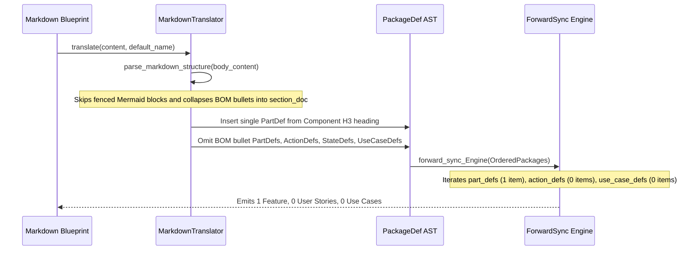

## 1. Context and References

<!-- test-target: crates/ingest-sysml/tests/reproducer_tests.rs -->

- **File**: `crates/ingest-sysml/src/translators/markdown.rs:1768-1940`
- **Pillar**: Semantic Traceability
- **Symptom**: `MarkdownTranslator::translate` emits `PartDef` AST nodes only from `### Component:` headings (`lines 1768-1792`) or Markdown tables (`TableType::Bom` at `lines 1795-1798`), ignoring Bill of Materials (BOM) subcomponent bullet items (`- <Identifier> (Quantity <N>): <Description>`) and omitting fenced Mermaid `sequenceDiagram` blocks (`ActionDef` / `InteractionDef`), `stateDiagram-v2` blocks (`StateDef`), and `### AC-XX` acceptance scenario headings (`UseCaseDef`) from the generated `PackageDef`. Consequently, `compile-sysml --forward-sync` (`crates/compile-sysml/src/sync/forward.rs:1330, 1452, 1590`) generates only 1 Feature per blueprint (omitting all 4 BOM subcomponent Features) and emits 0 User Stories (`US-*.md`) and 0 Use Cases (`UC-*.md`).
- **Test-Target**: `crates/ingest-sysml/tests/reproducer_tests.rs`

## 2. Root Cause Analysis (5 Whys)

1. **Why does `compile-sysml --forward-sync` emit only 1 Feature per architecture blueprint and 0 User Stories or Use Cases?** Because the ingested `PackageDef` for each blueprint contains only the single top-level subsystem `PartDef` and empty `action_defs`, `interaction_defs`, `state_defs`, and `use_case_defs` vectors (`crates/compile-sysml/src/sync/forward.rs:1385, 1452, 1590`).
2. **Why are BOM subcomponent `PartDef` nodes and behavioral `ActionDef`, `StateDef`, and `UseCaseDef` nodes absent from the ingested `PackageDef`?** Because `MarkdownTranslator::translate` (`crates/ingest-sysml/src/translators/markdown.rs:1768-1940`) only creates `PartDef` entries from `sec.component_target` or `TableType::Bom` tables and only binds `extract_acceptance_criteria` outputs as string attributes on `RequirementDef` (`lines 1932-1942`).
3. **Why does `MarkdownTranslator::parse_markdown_structure` (`crates/ingest-sysml/src/translators/markdown.rs:2349-2363`) discard Mermaid behavioral diagrams and BOM bullet lists?** Because `parse_markdown_structure` toggles `in_code_block` on any triple-backtick fence (`lines 2349-2363`) and skips all lines inside fenced blocks without inspecting `mermaid` `sequenceDiagram` or `stateDiagram-v2` payloads, while accumulating non-table bullet lines into unstructured `section_doc` prose (`lines 2572-2578`).
4. **Why were BOM subcomponent bullets and behavioral Mermaid blocks not lowered into discrete SysML v2 AST definitions during Level 0 Markdown translation?** Because `MarkdownTranslator` was initially authored around tabular ICD/BOM formats and requirement attribute projection rather than the 8-part engineering design blueprint contract (`docs/designs/blueprint-01..06-*.md`), which declares subcomponents as `- <Identifier> (Quantity <N>): <Description>` bullets under `### Component: <Subsystem>` and behavioral semantics via Mermaid `sequenceDiagram`, `stateDiagram-v2`, and `### AC-XX` sections.
5. **Why did existing unit tests in `crates/ingest-sysml` not catch this semantic traceability gap?** Because existing tests validated `RequirementDef` attribute extraction and tabular `TableType::Bom` translation in isolation without asserting that blueprint-style BOM bullet items, `sequenceDiagram` messages, `stateDiagram-v2` transitions, and `### AC-XX` headings populate `part_defs`, `action_defs`, `state_defs`, and `use_case_defs` required by `compile-sysml --forward-sync`.

## 3. Correctness Analysis

In `crates/ingest-sysml/src/translators/markdown.rs`, `MarkdownTranslator::translate` (`lines 1748-1980`) performs six steps:
- At `lines 1765-1837` (Step 3), it iterates over `sections` returned by `parse_markdown_structure` (`lines 2223-2590`). For each section, if `sec.component_target` is `Some(target)` (derived from `### Component: <Name>`), it inserts a single `PartDef` into `part_registry` (`lines 1768-1789`) and then only inspects `sec.tables` (`lines 1792-1836`). Any BOM subcomponent bullets (`- <Identifier> (Quantity <N>): <Description>`) inside the section body are collapsed into `sec.section_doc` and never parsed into child or peer `PartDef` nodes in `part_registry`.
- In `parse_markdown_structure` (`lines 2349-2363`), any line starting with ```` ``` ```` toggles `in_code_block`, causing ````mermaid` blocks containing `sequenceDiagram` or `stateDiagram-v2` specifications to be unconditionally skipped (`if in_code_block { i += 1; continue; }`). Consequently, `pkg.action_defs`, `pkg.interaction_defs`, and `pkg.state_defs` remain empty.
- At `lines 1932-1942` (Step 6), `extract_acceptance_criteria(content)` parses `### AC-XX: <Title>` blocks into `(ac_num_str, clean_ac_slug, ac_bdd_text)` tuples, but only attaches them as `AttributeDef` strings and `verified_by` labels on `RequirementDef` instead of lowering each acceptance scenario into a `UseCaseDef` node in `pkg.use_case_defs` (and corresponding `TestCaseDef` / behavioral links).
- Furthermore, in `MarkdownTranslator::translate_files` (`lines 2050-2079`), when `has_requirements` is true, the consolidation loop only copies `sub_pkg.requirement_defs`, `sub_pkg.part_defs`, and `sub_pkg.connection_defs` into the subsystem `PackageDef` entry (`lines 2061-2078`), dropping `action_defs`, `interaction_defs`, `state_defs`, and `use_case_defs` even if `translate` populates them.

This violates the **Data Model Integrity** and **Universal Model Consistency Rules** in `.pipeline/constitution.md:66-88`, as well as **H-INGEST-MD-01** through **H-INGEST-MD-03** (`crates/ingest-sysml/src/translators/markdown.rs:14-25`), which mandate deterministic, zero-loss lowering of structural and behavioral specification constructs into the SysML v2 AST so downstream `compile-sysml --forward-sync` (`crates/compile-sysml/src/sync/forward.rs:1330, 1452, 1590`) can synthesize the complete Agile backlog (Epics, Features, User Stories, and Use Cases).

## 4. UML Diagrams



## 5. Affected Callers / Downstream Impact

- `MarkdownTranslator::translate` (`crates/ingest-sysml/src/translators/markdown.rs:1748-1980`) -- omits BOM bullet `PartDef` nodes, `sequenceDiagram` `ActionDef`/`InteractionDef` nodes, `stateDiagram-v2` `StateDef` nodes, and `### AC-XX` `UseCaseDef` nodes.
- `MarkdownTranslator::translate_files` (`crates/ingest-sysml/src/translators/markdown.rs:2010-2101`) -- when consolidating packages with requirements (`has_requirements`), omits merging `action_defs`, `interaction_defs`, `state_defs`, and `use_case_defs` into the subsystem `PackageDef`.
- `compile-sysml --forward-sync` (`crates/compile-sysml/src/sync/forward.rs:1330-1620`) -- iterates `p.part_defs` (`line 1385`), `p.action_defs` (`line 1452`), and `p.use_case_defs` (`line 1590`), producing only 1 Feature per blueprint instead of 5 (1 subsystem + 4 BOM subcomponents) and 0 User Stories (`US-*.md`) and 0 Use Cases (`UC-*.md`).

## 6. Proposed Correction

<!-- MUST NOT use regex (Check 34: deterministic linear slice/char scanning, no regex crate). MUST be domain-agnostic for upstream crates (Check 19). -->

```rust
/// Scans BOM subcomponent bullet lines (`- <Identifier> (Quantity <N>): <Description>`)
/// and lowers each bullet into a deterministic `PartDef` without using regex.
fn extract_bom_bullet_parts(content: &str, part_registry: &mut BTreeMap<String, PartDef>) {
    let mut in_fence = false;
    for raw_line in content.lines() {
        let line = raw_line.trim();
        if line.starts_with("```") || line.starts_with("~~~") {
            in_fence = !in_fence;
            continue;
        }
        if in_fence {
            continue;
        }
        let Some(after_bullet) = line.strip_prefix("- ").or_else(|| line.strip_prefix("* ")) else {
            continue;
        };
        let Some((left_part, desc_part)) = after_bullet.split_once(':') else {
            continue;
        };
        let left_clean = left_part.replace(['*', '`'], "");
        let left_trimmed = left_clean.trim();
        let Some(open_idx) = left_trimmed.find("(Quantity ") else {
            continue;
        };
        let raw_ident = left_trimmed[..open_idx].trim();
        let after_qty = &left_trimmed[open_idx + "(Quantity ".len()..];
        let Some(close_idx) = after_qty.find(')') else {
            continue;
        };
        let qty_str = after_qty[..close_idx].trim();
        if raw_ident.is_empty() || qty_str.is_empty() || !qty_str.chars().all(|c| c.is_ascii_digit()) {
            continue;
        }
        let part_name = sanitize_identifier(raw_ident, "Subcomponent");
        let doc_text = clean_normative_text(desc_part.trim());
        part_registry.entry(part_name.clone()).or_insert_with(|| PartDef {
            name: part_name,
            doc: Some(format!("Quantity: {} | {}", qty_str, doc_text)),
            is_def: true,
            ..Default::default()
        });
    }
}

/// Scans fenced Mermaid `sequenceDiagram` and `stateDiagram-v2` blocks using linear slice
/// scanning and lowers them into `ActionDef`, `InteractionDef`, and `StateDef` AST nodes,
/// while lowering `extract_acceptance_criteria` items into `UseCaseDef` AST nodes.
fn extract_behavioral_ast_nodes(
    content: &str,
    pkg: &mut PackageDef,
    ac_items: &[(String, String, String)],
) {
    let lines: Vec<&str> = content.lines().collect();
    let mut i = 0;
    while i < lines.len() {
        let trimmed = lines[i].trim();
        if trimmed.starts_with("```mermaid") {
            i += 1;
            let mut block_lines = Vec::new();
            while i < lines.len() && !lines[i].trim().starts_with("```") {
                block_lines.push(lines[i].trim());
                i += 1;
            }
            let first_non_empty = block_lines.iter().copied().find(|l| !l.is_empty() && !l.starts_with("%%"));
            if first_non_empty == Some("sequenceDiagram") {
                let mut lifelines = Vec::new();
                let mut messages = Vec::new();
                for bl in &block_lines {
                    if let Some(rest) = bl.strip_prefix("participant ") {
                        let (alias, label) = rest.split_once(" as ").unwrap_or((rest, rest));
                        let clean_type = sanitize_identifier(label.trim(), alias.trim());
                        lifelines.push(format!("{}: {}", sanitize_identifier(alias.trim(), "p"), clean_type));
                    } else if let Some((_, msg_rhs)) = bl.split_once(':') {
                        if bl.contains("->") {
                            let msg_clean = msg_rhs.trim();
                            if !msg_clean.is_empty() {
                                messages.push(msg_clean.to_string());
                                let action_tok = msg_clean.split(['(', ' ']).next().unwrap_or(msg_clean);
                                let action_name = sanitize_identifier(action_tok, "ExecuteAction");
                                if !pkg.action_defs.iter().any(|a| a.name == action_name) {
                                    pkg.action_defs.push(ActionDef {
                                        name: action_name,
                                        doc: Some(clean_normative_text(msg_clean)),
                                        is_def: true,
                                        ..Default::default()
                                    });
                                }
                            }
                        }
                    }
                }
                if !messages.is_empty() {
                    pkg.interaction_defs.push(InteractionDef {
                        name: format!("{}_Interaction", pkg.name),
                        lifelines,
                        messages,
                        ..Default::default()
                    });
                }
            } else if first_non_empty == Some("stateDiagram-v2") || first_non_empty == Some("stateDiagram") {
                let mut transitions = Vec::new();
                for bl in &block_lines {
                    if let Some((src_raw, rest)) = bl.split_once("-->") {
                        let (tgt_raw, label_opt) = match rest.split_once(':') {
                            Some((t, l)) => (t.trim(), Some(l.trim().to_string())),
                            None => (rest.trim(), None),
                        };
                        transitions.push(deap_core::sysml_ast::TransitionDef {
                            source: Some(sanitize_identifier(src_raw.trim(), "Init")),
                            target: Some(sanitize_identifier(tgt_raw, "Next")),
                            trigger: label_opt,
                            ..Default::default()
                        });
                    }
                }
                if !transitions.is_empty() {
                    pkg.state_defs.push(deap_core::sysml_ast::StateDef {
                        name: format!("{}_StateMachine", pkg.name),
                        transitions,
                        ..Default::default()
                    });
                }
            }
        }
        i += 1;
    }

    let subject_name = pkg.part_defs.first().map(|p| p.name.clone());
    for (ac_num_str, clean_ac_slug, ac_bdd_text) in ac_items {
        let uc_name = format!("AC_{}_{}", ac_num_str, clean_ac_slug);
        if !pkg.use_case_defs.iter().any(|u| u.name == uc_name) {
            pkg.use_case_defs.push(deap_core::sysml_ast::UseCaseDef {
                name: uc_name,
                doc: Some(ac_bdd_text.clone()),
                subject: subject_name.clone(),
                objective: Some(ac_bdd_text.clone()),
                ..Default::default()
            });
        }
    }
}
```

## 7. Relationship to Existing Issues

Discovered in audit -- new finding.

## Audit Source

Adversarial Semantic Traceability Audit
SEVERITY: Important
FILE_LOCATION: crates/ingest-sysml/src/translators/markdown.rs:1768-1940
