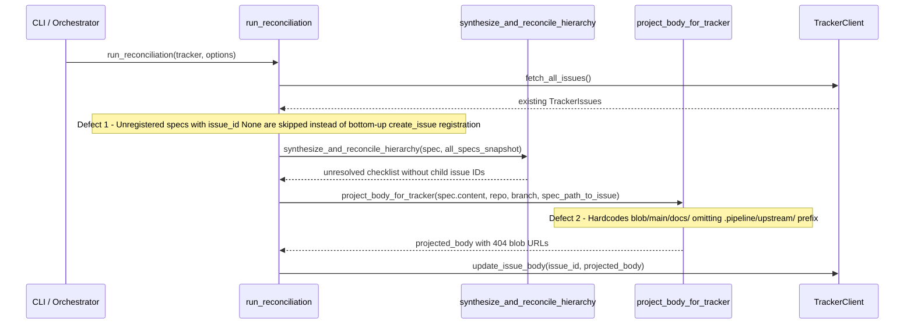

## 1. Context and References

<!-- test-target: crates/reconcile-backlog/tests/reproducer_tests.rs -->

- **File**: `crates/reconcile-backlog/src/lib.rs:346-849`
- **Pillar**: Semantic Traceability
- **Symptom**: `run_reconciliation` (`crates/reconcile-backlog/src/lib.rs:346-425`) only matches existing tracker issues (`issue_index.find_issue_for_type`) and only syncs bodies when `if let Some(issue_id) = spec.frontmatter.issue_id`. Newly forward-synced specifications whose `Issue ID` is unallocated (`None` / `TBD`) are silently skipped instead of being registered bottom-up (`use-case` and `user-story` -> `feature` -> `epic`) via `tracker.create_issue`, having their allocated `#<number>` written back into local spec frontmatter and parent checklists, and having their resolved bodies synced. Additionally, `rewrite_projected_links` (`crates/reconcile-backlog/src/lib.rs:797-849`) and `project_body_for_tracker` (`crates/reconcile-backlog/src/lib.rs:895-932`) rewrite relative links (`../features/`, `../../schema/`, etc.) using hardcoded `blob/<branch>/docs/` and `blob/<branch>/schema/` prefixes without checking whether `workspace_root` is `.pipeline/upstream` (or resides inside `.pipeline/upstream/`), generating broken 404 GitHub blob URLs for self-hosted upstream specifications in `DEAP01-spec-core`.
- **Test-Target**: `crates/reconcile-backlog/tests/reproducer_tests.rs`

## 2. Root Cause Analysis (5 Whys)

1. **Why are newly forward-synced specifications left with `Issue ID: TBD` (`issue_id: None`) and why do projected GitHub issue bodies in `.pipeline/upstream` contain broken 404 blob URLs?** Because `run_reconciliation` (`crates/reconcile-backlog/src/lib.rs:346-425`) only looks up pre-existing issues in `issue_index` without invoking `tracker.create_issue` for unmatched specs, and `rewrite_projected_links` (`crates/reconcile-backlog/src/lib.rs:797-849`) hardcodes `blob/{branch}/docs/` and `blob/{branch}/schema/` without a workspace path prefix.
2. **Why does `run_reconciliation` fail to invoke `tracker.create_issue` when `find_issue_for_type` returns `None`?** Because Step 2 (`crates/reconcile-backlog/src/lib.rs:346-358`) was implemented as a passive lookup against `issue_index` rather than an active bottom-up registration pass over unregistered specification tiers.
3. **Why must unregistered specifications be registered in a strict bottom-up tier order (`use-case` and `user-story` -> `feature` -> `epic`) beforeStep 4 body projection?** Because parent Features and Epics contain hierarchical realization checklists and traceability tables referencing child issue numbers (`#<number>`), which are enforced by `validate_checklist_publish_integrity` (`crates/reconcile-backlog/src/lib.rs:408-412`) and synthesized by `synthesize_and_reconcile_hierarchy` (`crates/reconcile-backlog/src/lib.rs:323-329`).
4. **Why does `rewrite_projected_links` omit `.pipeline/upstream/` when constructing GitHub blob URLs for self-hosted compiler specifications?** Because `rewrite_projected_links` (`crates/reconcile-backlog/src/lib.rs:797-849`) and `project_body_for_tracker` (`crates/reconcile-backlog/src/lib.rs:895-932`) do not receive or inspect the workspace root prefix relative to the Git repository top-level directory (`UPSTREAM_SPEC_CORE_COMPILER` layout under `.pipeline/upstream/`).
5. **Why were existing unit tests passing without catching these two defects?** Because unit tests in `crates/reconcile-backlog/src/lib.rs:935-1386` pre-populated `issue_id` in fixture frontmatter and tested link projection exclusively against root-level `docs/` paths rather than `.pipeline/upstream/docs/` workspaces or unregistered (`issue_id: None`) forward-synced specifications.

## 3. Correctness Analysis

In `.pipeline/constitution.md` (lines 93-95 and 154), the **Unique Backlog Identifiers** and **No Orphan Documents** invariants mandate that every local specification file carry a permanent unique identifier (`issue_id: <int>`) mapped bijectively to its remote tracker issue, and that all cross-references resolve to valid tracker issues and repository blob paths.

Tracing execution through `crates/reconcile-backlog/src/lib.rs`:
1. In `run_reconciliation` (`crates/reconcile-backlog/src/lib.rs:346-358`), when a newly forward-synced specification has `spec.frontmatter.issue_id == None` (or `TBD` in its Markdown metadata table) and no matching title exists yet in `issue_index`, `issue_index.find_issue_for_type(...)` returns `None`.
2. Execution proceeds to Step 4 (`crates/reconcile-backlog/src/lib.rs:387-426`), where `spec_path_to_issue` (`lines 389-399`), `validate_checklist_publish_integrity` (`lines 408-412`), and `tracker.update_issue_body` (`lines 414-425`) all guard on `if let Some(issue_id) = spec.frontmatter.issue_id`. Consequently, any unregistered specification is completely bypassed during remote synchronization, leaving `Issue ID` unallocated locally and absent on GitHub.
3. Furthermore, when `run_reconciliation` executes against `.pipeline/upstream` in `DEAP01-spec-core` (where upstream compiler specifications reside under `.pipeline/upstream/docs/` and `.pipeline/upstream/schema/`), `rewrite_projected_links` (`crates/reconcile-backlog/src/lib.rs:800-848`) and `project_body_for_tracker` (`crates/reconcile-backlog/src/lib.rs:912-927`) format GitHub URLs as `https://github.com/{clean_repo}/blob/{branch}/docs/...` and `https://github.com/{clean_repo}/blob/{branch}/schema/...`. Because the `.pipeline/upstream/` prefix is omitted, every projected link in published GitHub issue bodies resolves to HTTP 404 on GitHub (`Clean Landing Zone Invariant` keeps root `docs/` and `schema/` empty except for `.gitkeep`).

## 4. UML Diagrams



## 5. Affected Callers / Downstream Impact

- `crates/reconcile-backlog/src/main.rs` (`main`) -- Invoking `reconcile-backlog` after `compile-sysml` forward sync fails to register newly synthesized Epics, Features, User Stories, and Use Cases on GitHub and leaves `TBD` issue IDs in local Markdown specifications.
- `crates/reconcile-backlog/src/lib.rs:416` (`run_reconciliation` -> `project_body_for_tracker` -> `rewrite_projected_links`) -- Syncing self-hosted specifications in `.pipeline/upstream` rewrites relative links to `blob/main/docs/...` and `blob/main/schema/...` instead of `blob/main/.pipeline/upstream/docs/...` and `blob/main/.pipeline/upstream/schema/...`, breaking GitHub issue navigation.
- `crates/reconcile-backlog/src/checklist.rs` (`synthesize_and_reconcile_hierarchy`) -- Parent Epic and Feature checklists cannot render `#<number>` links for newly generated child specifications because bottom-up issue registration never occurred prior to hierarchy synthesis.

## 6. Proposed Correction

<!-- MUST NOT use regex (Check 34: deterministic linear slice/char scanning, no regex crate). MUST be domain-agnostic for upstream crates (Check 19). -->

```rust
/// Returns `"/.pipeline/upstream"` or `".pipeline/upstream/"` prefix when `workspace_root` targets `.pipeline/upstream`.
pub fn detect_upstream_prefix(workspace_root: &Path) -> &'static str {
    let normalized = workspace_root.to_string_lossy().replace('\\', "/");
    let trimmed = normalized.trim_end_matches('/');
    if trimmed.ends_with(".pipeline/upstream") || trimmed.contains("/.pipeline/upstream/") {
        ".pipeline/upstream/"
    } else {
        ""
    }
}

/// Registers any specifications missing an `issue_id` bottom-up:
/// Tier 0: `use-case`, `user-story` -> Tier 1: `feature` -> Tier 2: `epic`.
fn register_unallocated_specs_bottom_up<T: TrackerClient>(
    specs: &mut [LoadedSpec],
    issue_index: &mut IssueIndex,
    tracker: &T,
    options: &ReconcileOptions,
    repo_slug: &str,
    default_branch: &str,
) -> Result<usize, String> {
    if options.offline || options.dry_run {
        return Ok(0);
    }
    let mut created_count = 0usize;
    let tiers: &[&[&str]] = &[
        &["use-case", "user-story"],
        &["feature"],
        &["epic"],
    ];

    for tier in tiers {
        let snapshot = specs.to_vec();
        for spec in specs.iter_mut() {
            let canonical_type = tracker::canonicalize_spec_type(&spec.frontmatter.spec_type);
            if !tier.contains(&canonical_type.as_str()) {
                continue;
            }
            if let Some(existing) = issue_index.find_issue_for_type(
                spec.frontmatter.issue_id,
                Some(&spec.frontmatter.spec_type),
                &spec.frontmatter.title,
            ) {
                if spec.frontmatter.issue_id != Some(existing.number) {
                    spec.content = update_frontmatter_issue_id(&spec.content, existing.number);
                    spec.frontmatter.issue_id = Some(existing.number);
                    fs::write(&spec.path, &spec.content)
                        .map_err(|e| format!("Failed to write spec '{}': {}", spec.path.display(), e))?;
                }
                continue;
            }

            if spec.frontmatter.issue_id.is_none() {
                tracker.ensure_label_exists(&canonical_type, options.repo.as_deref())?;
                let synthesized = checklist::synthesize_and_reconcile_hierarchy(
                    spec,
                    &snapshot,
                    repo_slug,
                    default_branch,
                    issue_index,
                );
                let (new_num, new_url) = tracker.create_issue(
                    &spec.frontmatter.title,
                    &synthesized,
                    &canonical_type,
                    options.repo.as_deref(),
                )?;
                spec.content = update_frontmatter_issue_id(&synthesized, new_num);
                spec.frontmatter.issue_id = Some(new_num);
                fs::write(&spec.path, &spec.content)
                    .map_err(|e| format!("Failed to write registered spec '{}': {}", spec.path.display(), e))?;
                issue_index.insert_issue(tracker::TrackerIssue {
                    number: new_num,
                    title: spec.frontmatter.title.clone(),
                    state: "OPEN".to_string(),
                    labels: vec![tracker::TrackerLabel::String(canonical_type)],
                    body: Some(spec.content.clone()),
                    url: Some(new_url),
                });
                created_count += 1;
            }
        }
    }
    Ok(created_count)
}
```

And in `rewrite_projected_links` and `project_body_for_tracker`, thread `workspace_prefix: &str` (computed via `detect_upstream_prefix(&options.workspace_root)`) so all generated blob URLs format as `https://github.com/{clean_repo}/blob/{branch}/{workspace_prefix}docs/...` and `https://github.com/{clean_repo}/blob/{branch}/{workspace_prefix}schema/...`.

## 7. Relationship to Existing Issues

Discovered in audit -- new finding.

## Audit Source

Adversarial Semantic Traceability Audit
SEVERITY: Important
FILE_LOCATION: crates/reconcile-backlog/src/lib.rs:346-849
