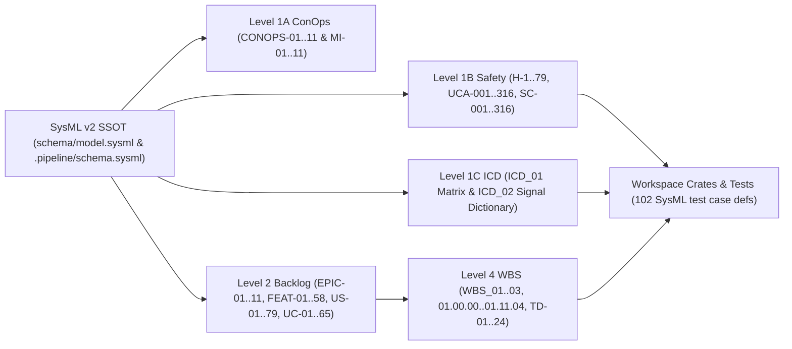

| Attribute | Specification Detail |
| :--- | :--- |
| **Issue ID** | #685, #686, #687, #688, #689, #690, #852, #853, #854, #855, #856, #857, #858, #859, #860, #861, #862 |
| **Title** | Master Bijective Requirements, Architecture, Safety & Verification Traceability Matrix |
| **Type** | traceability_matrix |
| **Standard Baseline** | ISO/IEC/IEEE 29148:2018 / ISO/IEC/IEEE 15288:2023 / DO-178C / DO-330 / MIL-STD-881E |
| **Generation Mode** | subagent |
| **Specification Source** | [schema/model.sysml](../schema/model.sysml) |

# Master Bijective Requirements, Architecture, Safety & Verification Traceability Matrix

## 1. Architectural Governance & Traceability Contracts

- **Contract A (100% Normative OMG SysML v2.0 + KerML 1.0 Grammar Coverage)**: Every traced blueprint (`BP-01..BP-11`), epic (`EPIC-01..EPIC-11`), feature (`FEAT-01..FEAT-58`), user story (`US-01..US-79`), use case (`UC-01..UC-65`), ConOps unit (`CONOPS-01..11`, `MI-01..11`), interface specification (`ICD_01..02`), WBS element (`01.00.00..01.11.04`, `TD-01..TD-24`), and STPA/FMECA safety constraint (`H-1..H-79`, `UCA-001..316`, `SC-001..316`) derives deterministically from the unified SysML v2 Single Source of Truth ([schema/model.sysml](../schema/model.sysml) and [.pipeline/schema.sysml](../.pipeline/schema.sysml), SHA-256 `72ef68f13a9ad6caa2625fe6fd48bf1a9ba0fdb3542ed828ce8fc37490f56480`) across the full OMG SysML v2.0 and KerML 1.0 grammar (`package`, `library package`, `standard library package`, `import`, `alias`, `doc`, `comment`, `rep`, `dependency`, `metadata def`/`metadata`/`@Metadata`/`#user_keyword` for `#hazard`, `#risk`, `#capability`, `#rt_loop`, `#dal`, `#fls` with backward-compatible legacy `hazard def`/`risk def`/`capability def`, `attribute def`/`attribute`, `enum def`/`enum`, `item def`/`item`, `part def`/`part`, `port def`/`port`, `connection def`/`connection`, `interface def`/`interface`, `flow def`/`flow`, `allocation def`/`allocation`, `occurrence def`/`occurrence`, `action def`/`action`, `state def`/`state`, `calc def`/`calc`, `constraint def`/`constraint`, `requirement def`/`requirement`, `concern def`/`concern`, `use case def`/`use case`, `analysis def`/`analysis`, `verification def`/`verification`, `test case def`/`test case`, `interaction def`/`interaction`, `view def`/`view`, `viewpoint def`/`viewpoint`, `rendering def`/`rendering`, `variation`/`variant`, and KerML `:`, `:>`, `:>>`, `::>`, `~`, `ref`, `abstract`, `readonly`, `derived`, `end`, `default`, `:=`, `[lo..hi]`, `[*]`, `{ordered, nonunique}`, `implies`, `xor`, `??`, `->`, `collect`, `select`, `forAll`, `exists`, `ISQ`/`SI`/`ScalarValues`).
- **Contract B (Official `rust-lang/*` Compiler & Tooling Crates -- Zero Legacy Hand-Rolled Scanners)**: Every traced subsystem and work package is realized exclusively via official compiler, lossless CST, incremental query, and formal verification crates (`ra_ap_syntax`, `ra_ap_vfs`, `ra_ap_paths`, `ra_ap_line_index`, `ra_ap_text_edit`, `rowan`, `logos`, `salsa`, `ariadne`, `miette`, `syn`, `proc-macro2`, `quote`, `prettyplease`, `pulldown-cmark`, `pulldown-cmark-to-cmark`, `cargo_metadata`, `cargo-lock`, `cargo-util-schemas`, `cargo-platform`, `toml_edit`, `cargo-dylint`, `cargo miri`, `cargo kani`, `criticalup`) with zero legacy hand-rolled character, line, or string-slice scanners.

---

## 2. Level 1 Blueprint, Epic, ConOps, Safety & WBS Subsystem Traceability Matrix (`BP-01` through `BP-11`)

| Blueprint Package | Issue ID | Normative Requirement | Epic Specification | ConOps & Mission Intent Units | STPA Hazards, UCAs & Safety Constraints | WBS Segment |
| :--- | :--- | :--- | :--- | :--- | :--- | :--- |
| `BP_01` ([blueprint-01](../../../docs/architecture/blueprints/blueprint-01-compiler-lint-and-ast-enforcement.md)) | `#685`, `#852` | `REQ_0601` | [EPIC-01](epics/EPIC-01-BP_01_Compiler_Enforced_Forbid_Lint_Gate_and_Zero_Suppression_AST_Architecture_Blueprint.md) | `CONOPS-01`, `MI-01` | `H-1..H-5`, `UCA-001..UCA-020`, `SC-001..SC-020` | `01.01.00..01.01.05` |
| `BP_02` ([blueprint-02](../../../docs/architecture/blueprints/blueprint-02-check-34-ast-purity-and-anti-gaming.md)) | `#686`, `#852` | `REQ_0602` | [EPIC-02](epics/EPIC-02-BP_02_Check_34_AST_Purity_Fail_Closed_IO_and_Anti_Gaming_Test_Gate_Blueprint.md) | `CONOPS-02`, `MI-02` | `H-6..H-11`, `UCA-021..UCA-044`, `SC-021..SC-044` | `01.02.00..01.02.05` |
| `BP_03` ([blueprint-03](../../../docs/architecture/blueprints/blueprint-03-sysml-ast-bijective-roundtrip-gate.md)) | `#687`, `#852` | `REQ_0603` | [EPIC-03](epics/EPIC-03-BP_03_SysML_v2_AST_Bijective_Roundtrip_and_Token_Stream_Parser_Gate_Blueprint.md) | `CONOPS-03`, `MI-03` | `H-12..H-17`, `UCA-045..UCA-068`, `SC-045..SC-068` | `01.03.00..01.03.05` |
| `BP_04` ([blueprint-04](../../../docs/architecture/blueprints/blueprint-04-deterministic-spec-icd-wbs-compiler.md)) | `#688`, `#852` | `REQ_0604` | [EPIC-04](epics/EPIC-04-BP_04_Deterministic_Specification_ICD_and_WBS_Forward_Compiler_Blueprint.md) | `CONOPS-04`, `MI-04` | `H-18..H-30`, `UCA-069..UCA-120`, `SC-069..SC-120` | `01.04.00..01.04.05` |
| `BP_05` ([blueprint-05](../../../docs/architecture/blueprints/blueprint-05-unified-safety-docstring-synthesizer.md)) | `#689`, `#852` | `REQ_0605` | [EPIC-05](epics/EPIC-05-BP_05_Unified_AST_Safety_Docstring_Synthesizer_and_Check_36_Verification_Blueprint.md) | `CONOPS-05`, `MI-05` | `H-31..H-36`, `UCA-121..UCA-144`, `SC-121..SC-144` | `01.05.00..01.05.05` |
| `BP_06` ([blueprint-06](../../../docs/architecture/blueprints/blueprint-06-static-defect-auditor-and-dossier.md)) | `#690`, `#852` | `REQ_0606` | [EPIC-06](epics/EPIC-06-BP_06_Deterministic_Static_5_Pillar_Code_Auditor_and_Defect_Dossier_Synthesizer_Blueprint.md) | `CONOPS-06`, `MI-06` | `H-37..H-44`, `UCA-145..UCA-176`, `SC-145..SC-176` | `01.06.00..01.06.05` |
| `BP_07` ([blueprint-07](../../../docs/architecture/blueprints/blueprint-07-self-hosting-modular-multi-file-codegen.md)) | `#852` | `REQ_0607` | [EPIC-07](epics/EPIC-07-BP_07_Self_Hosting_4_Level_Modular_Multi_File_Code_Generator_Blueprint.md) | `CONOPS-07`, `MI-07` | `H-45..H-52`, `H-79`, `UCA-177..UCA-208`, `UCA-313..UCA-316`, `SC-177..SC-208`, `SC-313..SC-316` | `01.07.00..01.07.10` |
| `BP_08` ([blueprint-08](../../../docs/architecture/blueprints/blueprint-08-lossless-rust-cst-codemod-and-rustc-json-diagnostics.md)) | `#853` | `REQ_0608` | [EPIC-08](epics/EPIC-08-BP_08_Lossless_Rust_CST_Codemod_Engine_and_Unified_rustc_Compatible_JSON_Diagnostics.md) | `CONOPS-08`, `MI-08` | `H-53..H-58`, `UCA-209..UCA-232`, `SC-209..SC-232` | `01.08.00..01.08.05` (`TD-01..TD-22`) |
| `BP_09` ([blueprint-09](../../../docs/architecture/blueprints/blueprint-09-multi-stage-compiler-and-formal-verification-gatekeeper.md)) | `#854` | `REQ_0609` | [EPIC-09](epics/EPIC-09-BP_09_Multi_Stage_Compiler_and_Formal_Verification_Gatekeeper.md) | `CONOPS-09`, `MI-09` | `H-59..H-65`, `UCA-233..UCA-260`, `SC-233..SC-260` | `01.09.00..01.09.05` (`TD-23..TD-24`) |
| `BP_10` ([blueprint-10](../../../docs/architecture/blueprints/blueprint-10-incremental-lossless-sysml-and-polyglot-compiler-engine.md)) | `#855` | `REQ_0610` | [EPIC-10](epics/EPIC-10-BP_10_Incremental_Lossless_SysML_v2_and_Polyglot_Compiler_Engine.md) | `CONOPS-10`, `MI-10` | `H-66..H-72`, `UCA-261..UCA-288`, `SC-261..SC-288` | `01.10.00..01.10.04` |
| `BP_11` ([blueprint-11](../../../docs/architecture/blueprints/blueprint-11-ferrocene-qualified-toolchain-and-3-ring-certification-architecture.md)) | `#856` | `REQ_0611` | [EPIC-11](epics/EPIC-11-BP_11_Ferrocene_Qualified_Toolchain_FLS_Traceability_Structural_Coverage_and_3_Ring_Rust_Flutter_DO_178C_DO_330_Certification_Architecture.md) | `CONOPS-11`, `MI-11` | `H-73..H-78`, `UCA-289..UCA-312`, `SC-289..SC-312` | `01.11.00..01.11.04` |

---

## 3. Level 2 Component (`part def`), Feature (`FEAT-01..58`), Story (`US-01..79`), Use Case (`UC-01..65`), ICD & Verification Matrix

| WBS Code | SysML `part def` | Feature Specification | Realizing User Stories | Realizing Use Cases | ICD Port / Signal Bindings | SysML `test case def` Verification Anchors |
| :--- | :--- | :--- | :--- | :--- | :--- | :--- |
| `01.01.01` | `CompilerLintEnforcementGate` | [FEAT-01](features/FEAT-01-CompilerLintEnforcementGate.md) | [US-01](user-stories/US-01-ExecuteCargoClippyWorkspaceAllTargets.md), [US-03](user-stories/US-03-ExecuteVerifyBaselineNoDomain.md) | [UC-01](use-cases/UC-01-Rustc_E0453_Hard_Rejection_of_Inner_and_Outer_Clippy_Allow_Attributes.md), [UC-05](use-cases/UC-05-Dogfood_Ingestion_and_SysML_v2_Compilation_of_REQ_0601.md) | `CargoManifestInputPort`, `RustSourceTokenStreamPort`, `BaselineGateVerdictPort` (`SIG-BP01-001..003`) | `TC_REQ_0601_Compiler_Lint_Gate`, `TC_REQ_0601_Blueprint_Conformance`, `Test_ExecuteVerifyBaselineNoDomain` |
| `01.01.02` | `WorkspaceManifestForbidGate` | [FEAT-02](features/FEAT-02-WorkspaceManifestForbidGate.md) | [US-02](user-stories/US-02-ReadWorkspaceLintsClippyForbidTable.md) | [UC-04](use-cases/UC-04-Semantic_Type_Alias_Replacement_for_Type_Complexity.md) | `CargoManifestInputPort`, `ManifestForbidVerdictPort` (`SIG-BP01-004`) | `Test_ReadWorkspaceLintsClippyForbidTable` |
| `01.01.03` | `ClippyAttributeCstParser` | [FEAT-03](features/FEAT-03-ClippyAttributeCstParser.md) | [US-04](user-stories/US-04-RunScanClippyAllowTokensOn.md) | [UC-02](use-cases/UC-02-Check_34_Multi_Line_Whitespace_Insensitive_Suppression_Rejection.md) | `RustSourceTokenStreamPort`, `AttributeScanFindingPort` (`SIG-BP01-005`) | `Test_RunScanClippyAllowTokensOn` |
| `01.01.04` | `CrateRootAttributeSanitizer` | [FEAT-04](features/FEAT-04-CrateRootAttributeSanitizer.md) | [US-03](user-stories/US-03-ExecuteVerifyBaselineNoDomain.md) | [UC-01](use-cases/UC-01-Rustc_E0453_Hard_Rejection_of_Inner_and_Outer_Clippy_Allow_Attributes.md) | `RustSourceTokenStreamPort`, `SanitizedCrateRootPort` (`SIG-BP01-006`) | `Test_ExecuteVerifyBaselineNoDomain` |
| `01.01.05` | `TestTargetLintEnforcer` | [FEAT-05](features/FEAT-05-TestTargetLintEnforcer.md) | [US-05](user-stories/US-05-ExecuteIngestSysmlSchemaBlueprint01.md) | [UC-03](use-cases/UC-03-Unconditional_Test_Target_Enforcement_Without_Conditional_Exemption.md) | `TestTargetClippyPort` (`SIG-BP01-007`) | `Test_ExecuteCargoClippyWorkspaceAllTargets`, `Test_ExecuteIngestSysmlSchemaBlueprint01` |
| `01.02.01` | `AntiGamingTestBodyAuditor` | [FEAT-06](features/FEAT-06-AntiGamingTestBodyAuditor.md) | [US-10](user-stories/US-10-audit_test_integrity_and_anti_gaming.md) | [UC-08](use-cases/UC-08-Anti_Gaming_Test_Body_AST_Enforcement.md) | `TestFunctionAstStreamPort`, `AntiGamingVerdictPort` (`SIG-BP02-012`) | `Test_audit_test_integrity_and_anti_gaming` |
| `01.02.02` | `Check34AstPurityAndAntiGamingGate` | [FEAT-07](features/FEAT-07-Check34AstPurityAndAntiGamingGate.md) | [US-06](user-stories/US-06-check_compiler_ast_purity.md), [US-07](user-stories/US-07-mask_literals_and_comments.md) | [UC-06](use-cases/UC-06-General_Direct_Range_Slice_Indexing_Rejection.md), [UC-10](use-cases/UC-10-Deterministic_Dogfood_Ingestion_into_Canonical_SysML_v2.md) | `WorkspaceRustCstPort`, `TestFunctionAstStreamPort`, `Check34GateStatusPort` (`SIG-BP02-008..010`) | `TC_REQ_0602_Check_34_Ast_Purity`, `TC_REQ_0602_Blueprint_Conformance`, `Test_check_compiler_ast_purity`, `Test_mask_literals_and_comments` |
| `01.02.03` | `FailClosedIoAstVerifier` | [FEAT-08](features/FEAT-08-FailClosedIoAstVerifier.md) | [US-09](user-stories/US-09-audit_fail_closed_io_patterns.md) | [UC-07](use-cases/UC-07-Fail_Closed_Filesystem_and_WalkDir_Enforcement.md) | `WorkspaceRustCstPort`, `FailClosedIoFindingPort` (`SIG-BP02-013`) | `Test_audit_fail_closed_io_patterns` |
| `01.02.04` | `RangeSliceAstDetector` | [FEAT-09](features/FEAT-09-RangeSliceAstDetector.md) | [US-08](user-stories/US-08-contains_direct_range_slice.md) | [UC-06](use-cases/UC-06-General_Direct_Range_Slice_Indexing_Rejection.md) | `WorkspaceRustCstPort`, `RangeSliceFindingPort` (`SIG-BP02-011`) | `Test_contains_direct_range_slice` |
| `01.02.05` | `SsotSymbolDeduplicationGate` | [FEAT-10](features/FEAT-10-SsotSymbolDeduplicationGate.md) | [US-11](user-stories/US-11-audit_ssot_symbol_deduplication.md) | [UC-09](use-cases/UC-09-SSOT_Cryptographic_and_Lexer_Deduplication.md) | `WorkspaceRustCstPort`, `SsotDeduplicationPort` (`SIG-BP02-014`) | `Test_audit_ssot_symbol_deduplication` |
| `01.03.01` | `BijectiveSysmlSerializer` | [FEAT-11](features/FEAT-11-BijectiveSysmlSerializer.md) | [US-16](user-stories/US-16-ast_orig_to_sysml.md) | [UC-14](use-cases/UC-14-Lossless_to_sysml_Serialization_and_Fail_Closed_Bijective_Roundtrip_Gate.md) | `CanonicalSysmlOutputPort` (`SIG-BP03-017`) | `Test_ast_orig_to_sysml` |
| `01.03.02` | `CompilerRoundtripVerificationGate` | [FEAT-12](features/FEAT-12-CompilerRoundtripVerificationGate.md) | [US-15](user-stories/US-15-verify_bijective_ast_roundtrip.md), [US-17](user-stories/US-17-AssertAstOrigEqualsAstReparsed.md) | [UC-14](use-cases/UC-14-Lossless_to_sysml_Serialization_and_Fail_Closed_Bijective_Roundtrip_Gate.md), [UC-15](use-cases/UC-15-Dogfood_Markdown_to_SysML_Ingestion_and_Baseline_Verification.md) | `RoundtripGateVerdictPort` (`SIG-BP03-018`) | `Test_verify_bijective_ast_roundtrip`, `Test_AssertAstOrigEqualsAstReparsed` |
| `01.03.03` | `FailClosedRecursiveDescentParser` | [FEAT-13](features/FEAT-13-FailClosedRecursiveDescentParser.md) | [US-13](user-stories/US-13-parse_package_or_file.md), [US-14](user-stories/US-14-ParseTypeExprAndParseTransition.md) | [UC-12](use-cases/UC-12-Fail_Closed_Inner_Block_and_Composite_Type_Parsing.md), [UC-13](use-cases/UC-13-Token_Stream_State_Transition_Parsing_and_Recursive_MBD_Synthesis.md) | `FailClosedAstNodePort` (`SIG-BP03-020`) | `Test_parse_package_or_file`, `Test_ParseTypeExprAndParseTransition` |
| `01.03.04` | `NativeSigilAndLifetimeLexer` | [FEAT-14](features/FEAT-14-NativeSigilAndLifetimeLexer.md) | [US-12](user-stories/US-12-scan_all.md) | [UC-11](use-cases/UC-11-Native_Lexer_Sigil_and_Lifetime_Tokenization.md) | `SysmlTokenStreamPort` (`SIG-BP03-019`) | `Test_scan_all` |
| `01.03.05` | `SysmlBijectiveRoundtripCompilerGate` | [FEAT-15](features/FEAT-15-SysmlBijectiveRoundtripCompilerGate.md) | [US-15](user-stories/US-15-verify_bijective_ast_roundtrip.md) | [UC-15](use-cases/UC-15-Dogfood_Markdown_to_SysML_Ingestion_and_Baseline_Verification.md) | `RawSysmlSourceInputPort`, `DogfoodMarkdownSpecInputPort` (`SIG-BP03-015..016`) | `TC_REQ_0603_Bijective_Roundtrip_Gate`, `TC_REQ_0603_Blueprint_Conformance` |
| `01.04.01` | `AgileSpecForwardProjector` | [FEAT-16](features/FEAT-16-AgileSpecForwardProjector.md) | [US-18](user-stories/US-18-CompileSysmlForwardSyncDocs.md)..[US-21](user-stories/US-21-EmitSymmetricActionDefSignaturesAndE1.md) | [UC-16](use-cases/UC-16-Deterministic_Multi_Story_Use_Case_and_ConOps_Parent_Epic_Projection.md) | `AgileMarkdownBacklogPort` (`SIG-BP04-022`) | `Test_CompileSysmlForwardSyncDocs`, `Test_ResolveParentEpicByPkgName`, `Test_BindAllPackageStoriesToUse`, `Test_EmitSymmetricActionDefSignaturesAndE1` |
| `01.04.02` | `BidirectionalBacklogReconciler` | [FEAT-17](features/FEAT-17-BidirectionalBacklogReconciler.md) | [US-26](user-stories/US-26-ReconcileBacklogReconcileDocsDirDocs.md)..[US-28](user-stories/US-28-ReconcileChecklistsWithParentInclusiveEpic.md) | [UC-19](use-cases/UC-19-Fail_Closed_Stateful_HTML_Comment_Frontmatter_Guard_and_Parent_Inclusive_Checklist_Reconciliation.md) | `ReconciledBacklogStatusPort` (`SIG-BP04-025`) | `Test_ReconcileBacklogReconcileDocsDirDocs`, `Test_ParseCommonMarkTablesWithInHtml`, `Test_ReconcileChecklistsWithParentInclusiveEpic` |
| `01.04.03` | `DeterministicSpecIcdWbsForwardCompiler` | [FEAT-18](features/FEAT-18-DeterministicSpecIcdWbsForwardCompiler.md) | [US-29](user-stories/US-29-CompileSysmlReverseSyncDocs.md), [US-30](user-stories/US-30-MergeExtractedEntitiesIntoOwningSubpackages.md) | [UC-20](use-cases/UC-20-Fail_Closed_Subpackage_Scoped_Reverse_Sync_and_Dogfood_Blueprint_Ingestion_Parity.md) | `CanonicalSysmlAstInputPort` (`SIG-BP04-021`) | `TC_REQ_0604_Spec_Icd_Wbs_Compiler`, `TC_REQ_0604_Blueprint_Conformance`, `Test_CompileSysmlReverseSyncDocs`, `Test_MergeExtractedEntitiesIntoOwningSubpackages` |
| `01.04.04` | `LogicalIcdMatrixCompiler` | [FEAT-19](features/FEAT-19-LogicalIcdMatrixCompiler.md) | [US-22](user-stories/US-22-CompileSysmlEmitIcdDocsInterfaces.md), [US-23](user-stories/US-23-ProjectNxNConnectionDefMatrixAndFlowDef.md) | [UC-17](use-cases/UC-17-Deterministic_Logical_ICD_Matrix_and_Signal_Dictionary_Synthesis.md) | `LogicalIcdArtifactPort` (`SIG-BP04-023`) | `Test_CompileSysmlEmitIcdDocsInterfaces`, `Test_ProjectNxNConnectionDefMatrixAndFlowDef` |
| `01.04.05` | `MilStd881eWbsExporter` | [FEAT-20](features/FEAT-20-MilStd881eWbsExporter.md) | [US-24](user-stories/US-24-CompileSysmlEmitWbsDocsManagement.md), [US-25](user-stories/US-25-SynthesizeMilStd881eTreeAnd.md) | [UC-18](use-cases/UC-18-Deterministic_MIL_STD_881E_WBS_and_Enterprise_Export_Synthesis.md) | `MilStd881eWbsExportPort` (`SIG-BP04-024`) | `Test_CompileSysmlEmitWbsDocsManagement`, `Test_SynthesizeMilStd881eTreeAnd` |
| `01.05.01` | `Check36AstCompletenessVerifier` | [FEAT-21](features/FEAT-21-Check36AstCompletenessVerifier.md) | [US-34](user-stories/US-34-RunVerifyBaselineNoDomain.md) | [UC-24](use-cases/UC-24-Bit_for_Bit_Idempotency_and_Fail_Closed_Check_34_Per_Function_Normalized_Body_Uniqueness.md) | `Check36CompletenessVerdictPort` (`SIG-BP05-029`) | `Test_RunVerifyBaselineNoDomain` |
| `01.05.02` | `ScopedSchemaContextResolver` | [FEAT-22](features/FEAT-22-ScopedSchemaContextResolver.md) | [US-33](user-stories/US-33-ResolveSchemaContextViaCollectAll.md) | [UC-22](use-cases/UC-22-Strict_Schema_Context_Resolution_and_Recursive_Part_Traversal.md) | `SysmlSchemaTraceabilityPort` (`SIG-BP05-027`) | `Test_ResolveSchemaContextViaCollectAll` |
| `01.05.03` | `SevenSectionDocstringGenerator` | [FEAT-23](features/FEAT-23-SevenSectionDocstringGenerator.md) | [US-31](user-stories/US-31-RunCompileSysmlInjectSafetyDocstrings.md) | [UC-23](use-cases/UC-23-Scoped_mod_tests_Brace_Tracking_unsafe_extern_Classification_and_Arrow_Aware_impl_Headers.md) | `SynthesizedSourceFilePort` (`SIG-BP05-028`) | `Test_RunCompileSysmlInjectSafetyDocstrings` |
| `01.05.04` | `UnifiedRustDartCstParser` | [FEAT-24](features/FEAT-24-UnifiedRustDartCstParser.md) | [US-32](user-stories/US-32-ParseSourceCstViaRustAndDartCst.md), [US-35](user-stories/US-35-TokenizeRsAndDartFilesUsing.md) | [UC-21](use-cases/UC-21-Unified_Rust_and_Dart_Lexical_State_Machine_Without_Magic_Offsets.md) | `RustAndDartSourceCstPort` (`SIG-BP05-026`) | `Test_ParseSourceCstViaRustAndDartCst`, `Test_TokenizeRsAndDartFilesUsing` |
| `01.05.05` | `UnifiedSafetyDocstringSynthesizer` | [FEAT-25](features/FEAT-25-UnifiedSafetyDocstringSynthesizer.md) | [US-36](user-stories/US-36-RunIngestSysmlSchemaBlueprint05.md) | [UC-25](use-cases/UC-25-Dogfood_Ingestion_and_SysML_v2_Compilation_of_REQ_0605.md) | `SynthesizedSourceFilePort` (`SIG-BP05-028`) | `TC_REQ_0605_Safety_Docstring_Synthesizer`, `TC_REQ_0605_Blueprint_Conformance`, `Test_RunIngestSysmlSchemaBlueprint05` |
| `01.06.01` | `ClosedLoopDefectPublisherGate` | [FEAT-26](features/FEAT-26-ClosedLoopDefectPublisherGate.md) | [US-41](user-stories/US-41-run_check_defect.md)..[US-44](user-stories/US-44-GhIssueViewJsonTitleBody.md) | [UC-28](use-cases/UC-28-Idempotent_Local_and_Remote_SSOT_Deduplication.md)..[UC-30](use-cases/UC-30-Fail_Closed_Rejection_on_Malformed_Dossier_Schema_Ephemeral_Paths_or_Payload_Divergence.md) | `DefectDossierMarkdownPort`, `GitHubIssueTrackerSyncPort` (`SIG-BP06-032..033`) | `Test_run_check_defect`, `Test_Execute12CheckValidateDefectDossier`, `Test_GhIssueCreateOrGhIssue`, `Test_GhIssueViewJsonTitleBody` |
| `01.06.02` | `DeterministicDossierSynthesizer` | [FEAT-27](features/FEAT-27-DeterministicDossierSynthesizer.md) | [US-40](user-stories/US-40-synthesize_defect_dossier_markdown.md) | [UC-27](use-cases/UC-27-Deterministic_Seven_Section_Dossier_and_Mermaid_Synthesis.md) | `DefectDossierMarkdownPort` (`SIG-BP06-032`) | `Test_synthesize_defect_dossier_markdown` |
| `01.06.03` | `DeterministicStaticDefectAuditor` | [FEAT-28](features/FEAT-28-DeterministicStaticDefectAuditor.md) | [US-37](user-stories/US-37-VerifyBaselineAuditCodePathCrates.md) | [UC-31](use-cases/UC-31-Dogfood_SysML_v2_Markdown_Ingestion_and_Blueprint_Gate_Conformance.md) | `SourceWorkspaceCstInputPort`, `ActiveSysmlDigestInputPort`, `AuditVerdictExitCodePort` (`SIG-BP06-030..031`, `SIG-BP06-034`) | `TC_REQ_0606_Static_Defect_Auditor`, `TC_REQ_0606_Blueprint_Conformance`, `Test_VerifyBaselineAuditCodePathCrates` |
| `01.06.04` | `FivePillarStaticAstAnalyzer` | [FEAT-29](features/FEAT-29-FivePillarStaticAstAnalyzer.md) | [US-38](user-stories/US-38-ParseRustCstAndParseDartCst.md), [US-39](user-stories/US-39-EvaluateSourceFilePillarsAcross5.md) | [UC-26](use-cases/UC-26-Static_Five_Pillar_AST_Defect_Detection.md) | `PillarFindingStreamPort` (`SIG-BP06-035`) | `Test_ParseRustCstAndParseDartCst`, `Test_EvaluateSourceFilePillarsAcross5` |
| `01.06.05` | `MermaidUmlDiagramGenerator` | [FEAT-30](features/FEAT-30-MermaidUmlDiagramGenerator.md) | [US-40](user-stories/US-40-synthesize_defect_dossier_markdown.md) | [UC-27](use-cases/UC-27-Deterministic_Seven_Section_Dossier_and_Mermaid_Synthesis.md) | `DefectDossierMarkdownPort` (`SIG-BP06-032`) | `TC_REQ_0606_Blueprint_Conformance` |
| `01.07.01` | `FourLevelAstPartitionerAndHoister` | [FEAT-31](features/FEAT-31-FourLevelAstPartitionerAndHoister.md) | [US-46](user-stories/US-46-partition_and_hoist.md) | [UC-33](use-cases/UC-33-Four_Level_Deterministic_Lowering_with_Typed_syn_File_AST_and_prettyplease_Formatting.md) | `PartitionedAstModuleStreamPort` (`SIG-BP07-041`) | `Test_partition_and_hoist` |
| `01.07.02` | `ModularFlutterMultiFileEmitter` | [FEAT-32](features/FEAT-32-ModularFlutterMultiFileEmitter.md) | [US-51](user-stories/US-51-emit_modular_flutter_tree.md) | [UC-35](use-cases/UC-35-Modular_Multi_File_Flutter_Contract_Emission_and_Monolith_Barrel_Decomposition.md) | `ModularFlutterTreeOutputPort` (`SIG-BP07-038`) | `Test_emit_modular_flutter_tree` |
| `01.07.03` | `ModularRustMultiFileEmitter` | [FEAT-33](features/FEAT-33-ModularRustMultiFileEmitter.md) | [US-47](user-stories/US-47-synthesize_module_tokens.md)..[US-50](user-stories/US-50-emit_modular_rust_tree.md) | [UC-36](use-cases/UC-36-Zero_String_Concatenation_Codegen_DO_178C_Seven_Section_Docstring_and_Clippy_Forbid_Compliance.md) | `ModularRustTreeOutputPort` (`SIG-BP07-037`) | `Test_synthesize_module_tokens`, `Test_build_syn_file`, `Test_format_pretty_syn_file`, `Test_emit_modular_rust_tree` |
| `01.07.04` | `SelfHostingModularCodegenCompiler` | [FEAT-34](features/FEAT-34-SelfHostingModularCodegenCompiler.md) | [US-52](user-stories/US-52-verify_fixed_point_digest.md) | [UC-34](use-cases/UC-34-Metacircular_Self_Hosting_Stage_1_to_Stage_2_SHA_256_Fixed_Point_Identity.md), [UC-37](use-cases/UC-37-Dogfood_SysML_v2_Blueprint_Ingestion_and_Twelve_Gate_Closed_Loop_Conformance.md) | `SysmlSchemaAstInputPort`, `BootstrapFixedPointVerdictPort` (`SIG-BP07-036`, `SIG-BP07-039`) | `TC_REQ_0607_Self_Hosting_Modular_Codegen`, `TC_REQ_0607_Blueprint_Conformance`, `Test_verify_fixed_point_digest` |
| `01.07.05` | `TopologicalLayerDagVerifier` | [FEAT-35](features/FEAT-35-TopologicalLayerDagVerifier.md) | [US-45](user-stories/US-45-verify_dag_and_layers.md) | [UC-32](use-cases/UC-32-Fail_Closed_Rejection_on_Directed_Dependency_Cycles_and_Upward_Layer_Imports.md) | `VerifiedLayerDagPort` (`SIG-BP07-040`) | `Test_verify_dag_and_layers` |
| `01.07.06` | `ModularityBoundsSpec` | [FEAT-54](features/FEAT-54-ModularityBoundsSpec.md) (`#857`) | [US-79](user-stories/US-79-ExecuteFourLevelLoweringPipeline.md) (`#862`) | [UC-33](use-cases/UC-33-Four_Level_Deterministic_Lowering_with_Typed_syn_File_AST_and_prettyplease_Formatting.md) | `SchemaPackageAstPort`, `VerifiedModuleGraphPort` (`SIG-BP07-132..133`) | `Test_ExecuteFourLevelLoweringPipeline` |
| `01.07.07` | `LayerHierarchySpec` | [FEAT-55](features/FEAT-55-LayerHierarchySpec.md) (`#858`) | [US-79](user-stories/US-79-ExecuteFourLevelLoweringPipeline.md) (`#862`) | [UC-32](use-cases/UC-32-Fail_Closed_Rejection_on_Directed_Dependency_Cycles_and_Upward_Layer_Imports.md) | `SchemaPackageAstPort`, `VerifiedModuleGraphPort` (`SIG-BP07-132..133`) | `Test_ExecuteFourLevelLoweringPipeline` |
| `01.07.08` | `CompilationUnitSpec` | [FEAT-56](features/FEAT-56-CompilationUnitSpec.md) (`#859`) | [US-79](user-stories/US-79-ExecuteFourLevelLoweringPipeline.md) (`#862`) | [UC-33](use-cases/UC-33-Four_Level_Deterministic_Lowering_with_Typed_syn_File_AST_and_prettyplease_Formatting.md) | `VerifiedModuleGraphPort` (`SIG-BP07-133`) | `Test_ExecuteFourLevelLoweringPipeline` |
| `01.07.09` | `FourLevelLoweringEngineSpec` | [FEAT-57](features/FEAT-57-FourLevelLoweringEngineSpec.md) (`#860`) | [US-79](user-stories/US-79-ExecuteFourLevelLoweringPipeline.md) (`#862`) | [UC-33](use-cases/UC-33-Four_Level_Deterministic_Lowering_with_Typed_syn_File_AST_and_prettyplease_Formatting.md), [UC-34](use-cases/UC-34-Metacircular_Self_Hosting_Stage_1_to_Stage_2_SHA_256_Fixed_Point_Identity.md) | `SchemaPackageAstPort`, `VerifiedModuleGraphPort` (`SIG-BP07-132..133`) | `Test_ExecuteFourLevelLoweringPipeline` |
| `01.07.10` | `ModularEmitterSuiteSpec` | [FEAT-58](features/FEAT-58-ModularEmitterSuiteSpec.md) (`#861`) | [US-79](user-stories/US-79-ExecuteFourLevelLoweringPipeline.md) (`#862`) | [UC-35](use-cases/UC-35-Modular_Multi_File_Flutter_Contract_Emission_and_Monolith_Barrel_Decomposition.md), [UC-36](use-cases/UC-36-Zero_String_Concatenation_Codegen_DO_178C_Seven_Section_Docstring_and_Clippy_Forbid_Compliance.md) | `ModularRustEmitPort`, `ModularFlutterEmitPort` (`SIG-BP07-134..135`) | `Test_ExecuteFourLevelLoweringPipeline` |
| `01.08.01` | `AirGappedCargoLockGovernor` | [FEAT-36](features/FEAT-36-AirGappedCargoLockGovernor.md) | [US-53](user-stories/US-53-verify_offline_locked_build.md) | [UC-44](use-cases/UC-44-Air_Gapped_Offline_Cargo_Lock_Reproducibility_and_Twelve_Gate_Blueprint_Conformance.md) | `CargoLockValidationPort` (`SIG-BP08-046`) | `Test_verify_offline_locked_build` |
| `01.08.02` | `LosslessRustCstAnalyzer` | [FEAT-37](features/FEAT-37-LosslessRustCstAnalyzer.md) | [US-58](user-stories/US-58-analyze_metrics.md) | [UC-38](use-cases/UC-38-Lossless_Red_Green_CST_Roundtrip_and_Exact_DEAP_v2_0_AST_Metrics_Extraction.md) | `LosslessCstMetricsPort` (`SIG-BP08-047`) | `Test_analyze_metrics` |
| `01.08.03` | `StructuredModularCodegenSynthesizer` | [FEAT-38](features/FEAT-38-StructuredModularCodegenSynthesizer.md) | [US-56](user-stories/US-56-verify_stage_fixed_point.md) | [UC-42](use-cases/UC-42-Structured_Codegen_Boundary_Preserving_Stage_1_to_Stage_2_Metacircular_SHA_256_Fixed_Point.md) | `StructuredRustAstPort` (`SIG-BP08-049`) | `Test_verify_stage_fixed_point` |
| `01.08.04` | `UnifiedRustcJsonDiagnosticEmitter` | [FEAT-39](features/FEAT-39-UnifiedRustcJsonDiagnosticEmitter.md) | [US-57](user-stories/US-57-format_ndjson_line.md) | [UC-43](use-cases/UC-43-Unified_rustc_Compatible_Single_Line_JSON_Diagnostics_and_MachineApplicable_Auto_Fix_Across_All_Five_CLIs.md) | `RustcJsonDiagnosticOutputPort` (`SIG-BP08-045`) | `TC_REQ_0608_Lossless_Rust_Cst_Codemod`, `TC_REQ_0608_Blueprint_Conformance`, `Test_format_ndjson_line` |
| `01.08.05` | `ZeroTokenRustSpanCodemodEngine` | [FEAT-40](features/FEAT-40-ZeroTokenRustSpanCodemodEngine.md) | [US-54](user-stories/US-54-list_rust_items.md), [US-55](user-stories/US-55-extract_rust_module.md) | [UC-39](use-cases/UC-39-Deterministic_BTreeMap_Item_Inventory_and_Atomic_Module_Extraction_with_Check_37_Path_Rewriting.md)..[UC-41](use-cases/UC-41-Lossless_Tier_B_C_Docblock_Compaction_Skipping_Self_Hosted_Generated_Modules.md) | `RustSourceWorkspaceInputPort`, `SpliceEditPlanPort`, `CodemodCommitVerdictPort` (`SIG-BP08-042..044`, `SIG-BP08-048`) | `Test_list_rust_items`, `Test_extract_rust_module` |
| `01.09.01` | `FrbIcdBridgeAndMiriUbGate` | [FEAT-41](features/FEAT-41-FrbIcdBridgeAndMiriUbGate.md) | [US-63](user-stories/US-63-guard_inbound_frb_f64.md) | [UC-48](use-cases/UC-48-Stage_3_Deterministic_flutter_rust_bridge_FFI_Synthesis_with_Fail_Closed_ICD_Boundary_Guards.md), [UC-49](use-cases/UC-49-Stage_3_Miri_Tree_Borrows_Abstract_Machine_Undefined_Behavior_Rejection_on_FFI_and_Ring_Buffer_Bridges.md) | `FrbMiriVerificationPort` (`SIG-BP09-055`) | `Test_guard_inbound_frb_f64` |
| `01.09.02` | `IsolatedDylintMirAllocationGate` | [FEAT-42](features/FEAT-42-IsolatedDylintMirAllocationGate.md) | [US-61](user-stories/US-61-evaluate_stage2_dylint_mir.md) | [UC-46](use-cases/UC-46-Stage_2_Isolated_Nightly_Dylint_MIR_Zero_Allocation_Proof_on_Real_Time_Control_Loops.md), [UC-47](use-cases/UC-47-Stage_2_Compile_Time_MIR_Requirement_Binding_Verification_Against_Active_SysML_Digests.md) | `MirAllocationVerdictPort` (`SIG-BP09-054`) | `Test_evaluate_stage2_dylint_mir` |
| `01.09.03` | `KaniCbmcProofSynthesizer` | [FEAT-43](features/FEAT-43-KaniCbmcProofSynthesizer.md) | [US-64](user-stories/US-64-validate_kani_harness_spec.md) | [UC-50](use-cases/UC-50-Stage_4_Deterministic_Kani_CBMC_Proof_Synthesis_and_STPA_Unsafe_Control_Action_Falsification.md) | `KaniProofHarnessPort` (`SIG-BP09-056`) | `Test_validate_kani_harness_spec` |
| `01.09.04` | `MultiStageVerificationOrchestrator` | [FEAT-44](features/FEAT-44-MultiStageVerificationOrchestrator.md) | [US-59](user-stories/US-59-probe_formal_toolchain.md), [US-62](user-stories/US-62-verify_in_process_cst_syntax.md), [US-65](user-stories/US-65-evaluate_four_stage_gatekeeper.md) | [UC-51](use-cases/UC-51-Cross_Platform_Toolchain_Discovery_Modular_Submodule_Layout_and_Fail_Closed_Qualification_Gate.md) | `SysmlConstraintAstInputPort`, `RustWorkspaceSourceInputPort`, `GatekeeperVerdictOutputPort` (`SIG-BP09-050..052`) | `TC_REQ_0609_Multi_Stage_Formal_Gatekeeper`, `TC_REQ_0609_Blueprint_Conformance`, `Test_probe_formal_toolchain`, `Test_verify_in_process_cst_syntax`, `Test_evaluate_four_stage_gatekeeper` |
| `01.09.05` | `StableClippyTotalFunctionGate` | [FEAT-45](features/FEAT-45-StableClippyTotalFunctionGate.md) | [US-60](user-stories/US-60-verify_clippy_policy.md) | [UC-45](use-cases/UC-45-Stage_1_Universal_Stable_Clippy_Total_Function_and_clippy_toml_Threshold_Enforcement.md) | `ClippyTotalFunctionVerdictPort` (`SIG-BP09-053`) | `Test_verify_clippy_policy` |
| `01.10.01` | `FormattingPreservingSyncSplicer` | [FEAT-46](features/FEAT-46-FormattingPreservingSyncSplicer.md) | [US-71](user-stories/US-71-apply_formatting_preserving_splices.md) | [UC-54](use-cases/UC-54-Formatting_Preserving_Bidirectional_CST_Splicing_Across_Forward_and_Reverse_Sync.md) | `FormattingPreservingSplicePort` (`SIG-BP10-061`) | `Test_apply_formatting_preserving_splices` |
| `01.10.02` | `LogosRowanSysmlCstEngine` | [FEAT-47](features/FEAT-47-LogosRowanSysmlCstEngine.md) | [US-67](user-stories/US-67-normalize_line_endings.md)..[US-69](user-stories/US-69-verify_lossless_cst_invariants.md) | [UC-52](use-cases/UC-52-Lossless_logos_and_rowan_Concrete_Syntax_Tree_Full_Fidelity_Roundtrip_and_Cross_Platform_CRLF_Normalization.md), [UC-53](use-cases/UC-53-Resilient_Error_Recovery_Parsing_MAX_AST_DEPTH_Guard_and_Deterministic_Ariadne_Byte_Span_Diagnostics.md) | `LosslessSysmlCstPort` (`SIG-BP10-059`) | `Test_normalize_line_endings`, `Test_parse_lossless_sysml_cst`, `Test_verify_lossless_cst_invariants` |
| `01.10.03` | `SalsaIncrementalCompilerDatabase` | [FEAT-48](features/FEAT-48-SalsaIncrementalCompilerDatabase.md) | [US-70](user-stories/US-70-evaluate_hir_early_cutoff.md) | [UC-55](use-cases/UC-55-Salsa_Early_Cutoff_Durability_Preventing_Downstream_Recomputations_on_Trivia_Edits.md), [UC-56](use-cases/UC-56-Fail_Closed_Salsa_Cycle_Detection_and_Net_Negative_Legacy_Cst_Parser_Retirement.md) | `IncrementalHirDatabasePort` (`SIG-BP10-060`) | `Test_evaluate_hir_early_cutoff` |
| `01.10.04` | `TypedPolyglotIngestionFrontend` | [FEAT-49](features/FEAT-49-TypedPolyglotIngestionFrontend.md) | [US-66](user-stories/US-66-resolve_polyglot_backend.md), [US-72](user-stories/US-72-render_ariadne_diagnostic.md) | [UC-57](use-cases/UC-57-Cohesive_Typed_Polyglot_CST_AST_Lowering_with_Zero_rustc_private_and_Exact_Byte_Span_Diagnostics.md), [UC-58](use-cases/UC-58-Twelve_Gate_Blueprint_Verification_and_Baseline_Cleanliness_Gate_Conformance.md) | `PolyglotSourceInputPort`, `AriadneDiagnosticOutputPort` (`SIG-BP10-057..058`) | `TC_REQ_0610_Incremental_Sysml_Engine`, `TC_REQ_0610_Blueprint_Conformance`, `Test_resolve_polyglot_backend`, `Test_render_ariadne_diagnostic` |
| `01.11.01` | `CertifiedCoreSubsetAndCoverageGate` | [FEAT-50](features/FEAT-50-CertifiedCoreSubsetAndCoverageGate.md) | [US-77](user-stories/US-77-verify_certified_core_and_table_a7_coverage.md) | [UC-61](use-cases/UC-61-Certified_core_Library_Subset_Symbol_Report_Gate_Rejecting_std_alloc_and_Dynamic_Formatting_Symbols.md), [UC-62](use-cases/UC-62-Zero_Overcount_Structural_and_MC_DC_Coverage_Verification_Mapped_to_SysML_Verification_Cases.md) | `CoreSubsetAndCoverageVerdictPort` (`SIG-BP11-067`) | `Test_verify_certified_core_and_table_a7_coverage` |
| `01.11.02` | `DualModeFerroceneToolchainGate` | [FEAT-51](features/FEAT-51-DualModeFerroceneToolchainGate.md) | [US-73](user-stories/US-73-probe_criticalup_toolchain.md), [US-74](user-stories/US-74-verify_dual_toolchain_parity.md) | [UC-59](use-cases/UC-59-Dual_Mode_criticalup_toml_and_rust_toolchain_toml_Parity_Cross_Platform_Discovery_and_DO_330_Fixed_Point_Qualification.md), [UC-65](use-cases/UC-65-Cross_Platform_Execution_Submodule_Layout_Conformance_and_Twelve_Gate_Blueprint_Verification_Gate.md) | `ToolchainQualificationVerdictPort` (`SIG-BP11-065`) | `Test_probe_criticalup_toolchain`, `Test_verify_dual_toolchain_parity` |
| `01.11.03` | `FlsParagraphTraceabilitySynthesizer` | [FEAT-52](features/FEAT-52-FlsParagraphTraceabilitySynthesizer.md) | [US-76](user-stories/US-76-verify_fls_traceability_chain.md) | [UC-60](use-cases/UC-60-End_to_End_FLS_Normative_Paragraph_Traceability_Emission_and_Fail_Closed_Orphan_Detection.md) | `FlsTraceabilityMatrixPort` (`SIG-BP11-066`) | `Test_verify_fls_traceability_chain` |
| `01.11.04` | `ThreeRingAssurancePartitionCompiler` | [FEAT-53](features/FEAT-53-ThreeRingAssurancePartitionCompiler.md) | [US-75](user-stories/US-75-synthesize_three_ring_workspace.md), [US-78](user-stories/US-78-verify_three_ring_edge_and_monitor_readback.md) | [UC-63](use-cases/UC-63-Schema_Driven_3_Ring_Workspace_Partitioning_and_Ring_2_Miri_Guarded_FFI_Precondition_Enforcement.md), [UC-64](use-cases/UC-64-Ring_1_Challenge_Response_Command_Interlock_and_TelemetryFrame_Digest_Readback_SafetyMonitor_Against_Ring_3_Faults.md) | `SysmlSafetyArchitectureInputPort`, `ThreeRingPartitionManifestPort`, `CertificationDossierOutputPort` (`SIG-BP11-062..064`) | `TC_REQ_0611_Ferrocene_Three_Ring_Certification`, `TC_REQ_0611_Blueprint_Conformance`, `Test_synthesize_three_ring_workspace`, `Test_verify_three_ring_edge_and_monitor_readback` |

---

## 4. Consolidated Artifact Directory & Cross-Reference Index

- **Unified SysML v2 Single Source of Truth (SSOT)**:
  - [schema/model.sysml](../schema/model.sysml) (`3,083` lines, `58` `part def`s, `79` `action def`s, `124` `port def`s, `40` `constraint def`s, `12` `state def`s, `102` `test case def`s, `1` `calc def`, SHA-256 `72ef68f13a9ad6caa2625fe6fd48bf1a9ba0fdb3542ed828ce8fc37490f56480`)
  - [.pipeline/schema.sysml](../.pipeline/schema.sysml) (byte-for-byte identical mirror of `schema/model.sysml`)
  - [schema/modular_codegen.sysml](../schema/modular_codegen.sysml) (Stage-1 / Stage-2 self-hosting bootstrap module schema)
- **Level 1B STPA & FMECA Safety Engineering**:
  - [research/FAILURE_MODE_REGISTRY.md](research/FAILURE_MODE_REGISTRY.md) (`58` `part def` components decomposed across all 4 Universal Failure Dimensions + Component Verification & Mitigation Index)
  - [safety/STPA_01_FOUNDATION.md](safety/STPA_01_FOUNDATION.md) (`L-1..L-11`, `H-1..H-79`, `SC-H1..SC-H79`)
  - [safety/STPA_02_CONTROL_STRUCTURE.md](safety/STPA_02_CONTROL_STRUCTURE.md) (`BP-01..BP-11` control loops + `ModularCodegen` lowering & emitter loops)
  - [safety/STPA_03_UNSAFE_CONTROL_ACTIONS.md](safety/STPA_03_UNSAFE_CONTROL_ACTIONS.md) (`UCA-001..UCA-316`)
  - [safety/STPA_04_CAUSAL_SCENARIOS.md](safety/STPA_04_CAUSAL_SCENARIOS.md) (`CS-001..CS-316` & `SC-001..SC-316`)
  - [safety/FMECA_01_FAILURE_MODES.md](safety/FMECA_01_FAILURE_MODES.md) (`FM-001..FM-316` quantitative criticality register)
  - [safety/SAFETY_CASE_01_GSN.md](safety/SAFETY_CASE_01_GSN.md) (Goal Structuring Notation assurance case)
- **Level 1C Logical Interface Control Documents (ICD)**:
  - [icd/ICD_01_SYSTEM_INTERFACE_MATRIX.md](icd/ICD_01_SYSTEM_INTERFACE_MATRIX.md) and [interfaces/ICD_01_SYSTEM_INTERFACE_MATRIX.md](interfaces/ICD_01_SYSTEM_INTERFACE_MATRIX.md) (`135` directional port allocations across `BP-01..BP-11` and `ModularCodegen`)
  - [icd/ICD_02_MASTER_SIGNAL_DICTIONARY.md](icd/ICD_02_MASTER_SIGNAL_DICTIONARY.md) and [interfaces/ICD_02_MASTER_SIGNAL_DICTIONARY.md](interfaces/ICD_02_MASTER_SIGNAL_DICTIONARY.md) (`SIG-BP01-001` through `SIG-BP07-135`)
- **Level 4 MIL-STD-881E Work Breakdown Structure (WBS) & Dispatch Schedules**:
  - [wbs/WBS_01_WORK_BREAKDOWN_STRUCTURE.md](wbs/WBS_01_WORK_BREAKDOWN_STRUCTURE.md) and [management/WBS_01_WORK_BREAKDOWN_STRUCTURE.md](management/WBS_01_WORK_BREAKDOWN_STRUCTURE.md)
  - [wbs/WBS_02_TECHNICAL_REALIZATION_REGISTER.md](wbs/WBS_02_TECHNICAL_REALIZATION_REGISTER.md) and [management/WBS_02_TECHNICAL_REALIZATION_REGISTER.md](management/WBS_02_TECHNICAL_REALIZATION_REGISTER.md)
  - [wbs/WBS_03_ENTERPRISE_EXPORT_SCHEMA.md](wbs/WBS_03_ENTERPRISE_EXPORT_SCHEMA.md) and [management/WBS_03_ENTERPRISE_EXPORT_SCHEMA.md](management/WBS_03_ENTERPRISE_EXPORT_SCHEMA.md)
  - [management/MASTER_ATOMIC_DISPATCH_QUEUE.md](management/MASTER_ATOMIC_DISPATCH_QUEUE.md) and [management/TRACK1_ATOMIC_DISPATCH_QUEUE.md](management/TRACK1_ATOMIC_DISPATCH_QUEUE.md)
