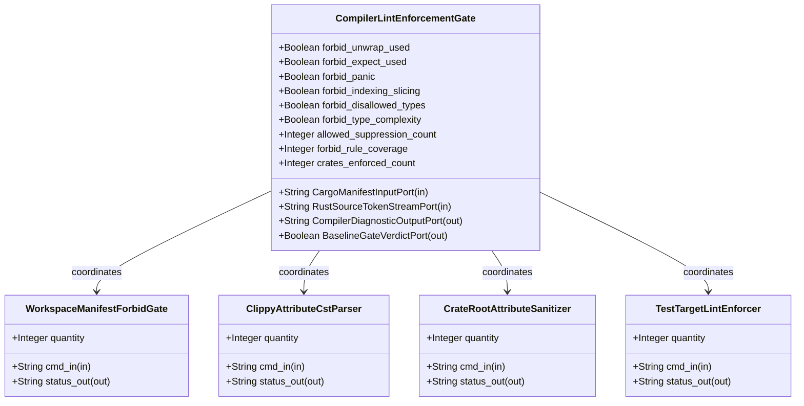
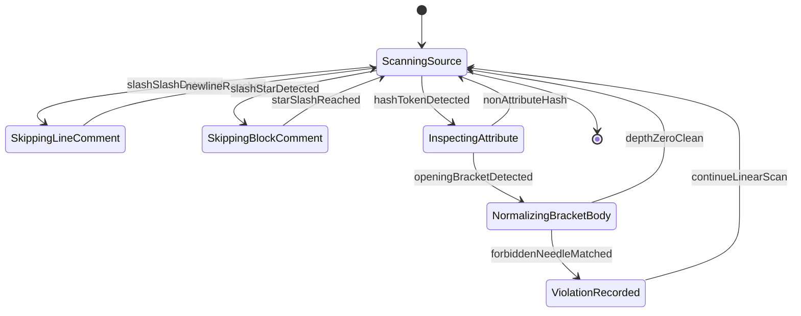

| Attribute | Specification Detail |
| :--- | :--- |
| **Issue ID** | #685 |
| **Title** | Epic 01: BP 01 Compiler Enforced Forbid Lint Gate and Zero Suppression AST Architecture Blueprint |
| **Type** | epic |
| **Package** | BP_01_Compiler_Enforced_Forbid_Lint_Gate_and_Zero_Suppression_AST_Architecture_Blueprint |
| **Subsystem** | BP 01 Compiler Enforced Forbid Lint Gate and Zero Suppression AST Architecture Blueprint |
| **Generation Mode** | subagent |
| **Specification Source** | [schema/model.sysml](../../schema/model.sysml) |

# Epic 01: BP 01 Compiler Enforced Forbid Lint Gate and Zero Suppression AST Architecture Blueprint

## 1. Context
Subsystem package for `BP_01_Compiler_Enforced_Forbid_Lint_Gate_and_Zero_Suppression_AST_Architecture_Blueprint` governing `REQ-0601`. This Epic enforces:
- **Contract A (100% Normative OMG SysML v2.0 + KerML 1.0 Grammar Coverage)**: Full Definition and Usage symmetry across the complete OMG SysML v2.0 and KerML 1.0 textual grammar with zero 16-construct artificial caps (`package`, `library package`, `standard library package`, `import`, `alias`, `doc`, `comment`, `rep`, `dependency`, `metadata def`/`metadata`/`@Metadata`/`#user_keyword` for `#hazard`, `#risk`, `#capability`, `#rt_loop`, `#dal`, `#fls` with backward-compatible legacy `hazard def`/`risk def`/`capability def`, `attribute def`/`attribute`, `enum def`/`enum`, `item def`/`item`, `part def`/`part`, `port def`/`port`, `connection def`/`connection`, `interface def`/`interface`, `flow def`/`flow`, `allocation def`/`allocation`, `occurrence def`/`occurrence`, `action def`/`action`, `state def`/`state`, `calc def`/`calc`, `constraint def`/`constraint`, `requirement def`/`requirement`, `concern def`/`concern`, `use case def`/`use case`, `analysis def`/`analysis`, `verification def`/`verification`, `test case def`/`test case`, `interaction def`/`interaction`, `view def`/`view`, `viewpoint def`/`viewpoint`, `rendering def`/`rendering`, `variation`/`variant`, and KerML 1.0 `:`, `:>`, `:>>`, `::>`, `~`, `ref`, `abstract`, `readonly`, `derived`, `end`, `default`, `:=`, `[lo..hi]`, `[*]`, `{ordered, nonunique}`, `implies`, `xor`, `??`, `->`, `collect`, `select`, `forAll`, `exists`, `ISQ`/`SI`/`ScalarValues`).
- **Contract B (Official Rust Compiler & `rust-analyzer` CST Stack -- Zero Text Scanners)**: Structured compiler diagnostics via `rustc` and `cargo clippy --workspace --all-targets --message-format=json` paired with lossless Rust attribute CST verification using `ra_ap_syntax` (`ast::Attr`, `ast::HasAttrs`), `ra_ap_vfs`, `ra_ap_paths`, `ra_ap_line_index`, `ra_ap_text_edit`, `rowan`, `camino`, `ignore`, `cargo_metadata`, `cargo-lock`, `cargo-util-schemas`, `cargo-platform`, and `toml_edit`, with zero hand-rolled string/line/char-by-char text-scanner lint mandates.
- **3-Layer Definition of Done (DoD) & Legacy Scanner Deletion**: Closes Layer 1 (Domain State & Data Model), Layer 2 (Logic & State Management), and Layer 3 (Presentation & Actuator Interface Binding) inside modular `< 380`-SLOC submodules (`crates/verify-baseline/src/clippy_forbid/` and `crates/deap-core/src/rust_cst/`) with explicit deletion of legacy hand-rolled scanners (`source_ast.rs`, `structural.rs`).

## 2. Requirements & Checklist
- [ ] #655 - [Feature 01: [BP 01 Compiler Enforced Forbid Lint Gate and Zero Suppression AST Architecture Blueprint] CompilerLintEnforcementGate](../features/FEAT-01-CompilerLintEnforcementGate.md)
- [ ] #656 - [Feature 02: [BP 01 Compiler Enforced Forbid Lint Gate and Zero Suppression AST Architecture Blueprint] WorkspaceManifestForbidGate](../features/FEAT-02-WorkspaceManifestForbidGate.md)
- [ ] #657 - [Feature 03: [BP 01 Compiler Enforced Forbid Lint Gate and Zero Suppression AST Architecture Blueprint] ClippyAttributeCstParser](../features/FEAT-03-ClippyAttributeCstParser.md)
- [ ] #658 - [Feature 04: [BP 01 Compiler Enforced Forbid Lint Gate and Zero Suppression AST Architecture Blueprint] CrateRootAttributeSanitizer](../features/FEAT-04-CrateRootAttributeSanitizer.md)
- [ ] #659 - [Feature 05: [BP 01 Compiler Enforced Forbid Lint Gate and Zero Suppression AST Architecture Blueprint] TestTargetLintEnforcer](../features/FEAT-05-TestTargetLintEnforcer.md)

### Associated Use Cases & User Stories

#### Associated Use Cases
- [ ] #624 - [Use Case 01: Rustc E0453 Hard Rejection of Inner and Outer Clippy Allow Attributes](../use-cases/UC-01-Rustc_E0453_Hard_Rejection_of_Inner_and_Outer_Clippy_Allow_Attributes.md)
- [ ] #625 - [Use Case 02: Check 34 Multi Line Whitespace Insensitive Suppression Rejection](../use-cases/UC-02-Check_34_Multi_Line_Whitespace_Insensitive_Suppression_Rejection.md)
- [ ] #626 - [Use Case 03: Unconditional Test Target Enforcement Without Conditional Exemption](../use-cases/UC-03-Unconditional_Test_Target_Enforcement_Without_Conditional_Exemption.md)
- [ ] #627 - [Use Case 04: Semantic Type Alias Replacement for Type Complexity](../use-cases/UC-04-Semantic_Type_Alias_Replacement_for_Type_Complexity.md)
- [ ] #628 - [Use Case 05: Dogfood Ingestion and SysML v2 Compilation of REQ 0601](../use-cases/UC-05-Dogfood_Ingestion_and_SysML_v2_Compilation_of_REQ_0601.md)

#### Associated User Stories
- [ ] #700 - [User Story 01: Execute Cargo Clippy Workspace All Targets](../user-stories/US-01-ExecuteCargoClippyWorkspaceAllTargets.md)
- [ ] #701 - [User Story 02: Read Workspace Lints Clippy Forbid Table](../user-stories/US-02-ReadWorkspaceLintsClippyForbidTable.md)
- [ ] #702 - [User Story 03: Execute Verify Baseline No Domain](../user-stories/US-03-ExecuteVerifyBaselineNoDomain.md)
- [ ] #703 - [User Story 04: Run Scan Clippy Allow Tokens On](../user-stories/US-04-RunScanClippyAllowTokensOn.md)
- [ ] #704 - [User Story 05: Execute Ingest Sysml Schema Blueprint01](../user-stories/US-05-ExecuteIngestSysmlSchemaBlueprint01.md)

## 3. Architecture
Classifiers: `CompilerLintEnforcementGate` (ports: `in CargoManifestInputPort : String`, `in RustSourceTokenStreamPort : String`, `out CompilerDiagnosticOutputPort : String`, `out BaselineGateVerdictPort : Boolean`); `WorkspaceManifestForbidGate` (ports: `in cmd_in : String`, `out status_out : String`); `ClippyAttributeCstParser` (ports: `in cmd_in : String`, `out status_out : String`); `CrateRootAttributeSanitizer` (ports: `in cmd_in : String`, `out status_out : String`); `TestTargetLintEnforcer` (ports: `in cmd_in : String`, `out status_out : String`).

- **Layer 1 (Domain State & Data Model)**: Typed manifest and CST domain structures backed by `cargo_metadata`, `cargo-lock`, `cargo-util-schemas`, `cargo-platform`, `toml_edit`, and lossless `rowan`/`ra_ap_syntax` syntax trees (`ra_ap_vfs`, `ra_ap_paths`, `ra_ap_line_index`, `ra_ap_text_edit`, `camino`, `ignore`), projected from full OMG SysML v2.0 + KerML 1.0 AST definitions (zero 16-construct caps).
- **Layer 2 (Logic & State Management)**: Deterministic `rustc`/`cargo clippy --message-format=json` E0453 enforcement and `ra_ap_syntax::ast::HasAttrs` attribute CST verification inside `< 380`-SLOC submodules (`crates/verify-baseline/src/clippy_forbid/` and `crates/deap-core/src/rust_cst/`), eliminating hand-rolled text scanners and explicitly deleting legacy `source_ast.rs` and `structural.rs`.
- **Layer 3 (Presentation & Actuator Interface Binding)**: Structured JSON diagnostic emission and baseline gate verdict actuation across `CargoManifestInputPort`, `RustSourceTokenStreamPort`, `CompilerDiagnosticOutputPort`, and `BaselineGateVerdictPort` with `ariadne` byte-span diagnostics.

## 4. Operational Considerations
Lifecycle state machines: `BP_01_Compiler_Enforced_Forbid_Lint_Gate_and_Zero_Suppression_AST_Architecture_Blueprint_LifecycleState` (Initial -> ScanningSource; ScanningSource -> SkippingLineComment on slashSlashDetected; SkippingLineComment -> ScanningSource on newlineReached; ScanningSource -> SkippingBlockComment on slashStarDetected; SkippingBlockComment -> ScanningSource on starSlashReached; ScanningSource -> InspectingAttribute on hashTokenDetected; InspectingAttribute -> NormalizingBracketBody on openingBracketDetected; InspectingAttribute -> ScanningSource on nonAttributeHash; NormalizingBracketBody -> ViolationRecorded on forbiddenNeedleMatched; NormalizingBracketBody -> ScanningSource on depthZeroClean; ViolationRecorded -> ScanningSource on continueLinearScan; ScanningSource -> Terminal on endOfStream). Operational actions: `ExecuteCargoClippyWorkspaceAllTargets`, `ReadWorkspaceLintsClippyForbidTable`, `ExecuteVerifyBaselineNoDomain`, `RunScanClippyAllowTokensOn`, `ExecuteIngestSysmlSchemaBlueprint01`. Interaction sequences: `BP_01_Compiler_Enforced_Forbid_Lint_Gate_and_Zero_Suppression_AST_Architecture_Blueprint_SequenceInteraction`. All attribute inspections execute over `ra_ap_syntax` (`ast::Attr`, `ast::HasAttrs`) and `rowan` lossless CST nodes with `ra_ap_line_index` span resolution rather than ad-hoc line or character scanners.

## 5. Security & Governance
Allocated requirements: `REQ-0601 (REQ_0601_BP_01_Compiler_Enforced_Forbid_Lint_Gate_and_Zero_Suppression_AST_Architecture_Blueprint)`. Enforced invariant constraints: `Invariant_REQ_0601_C_LINT_03`, `Invariant_REQ_0601_FormalInvariant`. Enforces Contract A (100% OMG SysML v2.0 + KerML 1.0 grammar coverage with zero 16-construct caps), Contract B (`rustc`/`cargo clippy --message-format=json` + `ra_ap_syntax` attribute CST verification, `ra_ap_vfs`, `ra_ap_paths`, `ra_ap_line_index`, `ra_ap_text_edit`, `rowan`, `camino`, `ignore`, zero text-scanner lint mandates), and 3-Layer DoD `< 380`-SLOC submodule modularity with explicit legacy scanner deletion (`source_ast.rs`, `structural.rs`).

## 6. Source References
- System Architecture Model: `schema/model.sysml`
- Normative Systems Engineering Standard: ISO/IEC/IEEE 15288:2023 §6.4.3 Architecture Definition Process

Subsystem architectural composition and formal invariants derive from `schema/model.sysml` pursuant to ISO/IEC/IEEE 15288.

## System-Level UML Class Diagram

## System State Machine Diagram

