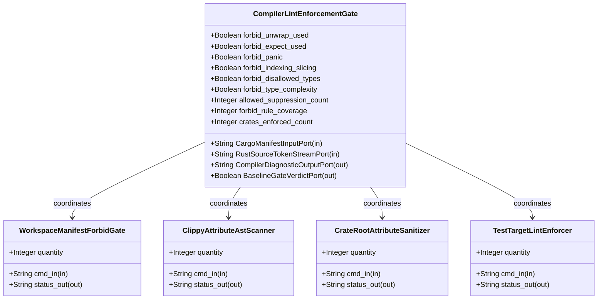
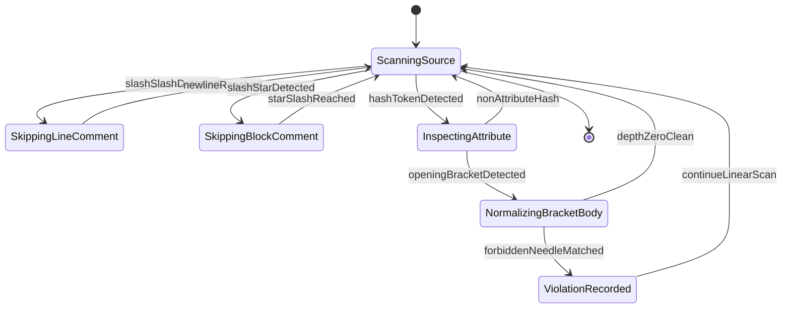

| Attribute | Specification Detail |
| :--- | :--- |
| **Issue ID** | #685 |
| **Title** | Epic 01: BP 01 Compiler Enforced Forbid Lint Gate and Zero Suppression AST Architecture Blueprint |
| **Type** | epic |
| **Package** | BP_01_Compiler_Enforced_Forbid_Lint_Gate_and_Zero_Suppression_AST_Architecture_Blueprint |
| **Subsystem** | BP 01 Compiler Enforced Forbid Lint Gate and Zero Suppression AST Architecture Blueprint |
| **Generation Mode** | subagent |
| **Specification Source** | [schema/model.sysml](../../schema/model.sysml) |

# Epic 01: BP 01 Compiler Enforced Forbid Lint Gate and Zero Suppression AST Architecture Blueprint

## 1. Context
Subsystem package for BP_01_Compiler_Enforced_Forbid_Lint_Gate_and_Zero_Suppression_AST_Architecture_Blueprint

## 2. Requirements & Checklist
- [ ] #655 - [Feature 01: [BP 01 Compiler Enforced Forbid Lint Gate and Zero Suppression AST Architecture Blueprint] CompilerLintEnforcementGate](../features/FEAT-01-CompilerLintEnforcementGate.md)
- [ ] #656 - [Feature 02: [BP 01 Compiler Enforced Forbid Lint Gate and Zero Suppression AST Architecture Blueprint] WorkspaceManifestForbidGate](../features/FEAT-02-WorkspaceManifestForbidGate.md)
- [ ] #657 - [Feature 03: [BP 01 Compiler Enforced Forbid Lint Gate and Zero Suppression AST Architecture Blueprint] ClippyAttributeAstScanner](../features/FEAT-03-ClippyAttributeAstScanner.md)
- [ ] #658 - [Feature 04: [BP 01 Compiler Enforced Forbid Lint Gate and Zero Suppression AST Architecture Blueprint] CrateRootAttributeSanitizer](../features/FEAT-04-CrateRootAttributeSanitizer.md)
- [ ] #659 - [Feature 05: [BP 01 Compiler Enforced Forbid Lint Gate and Zero Suppression AST Architecture Blueprint] TestTargetLintEnforcer](../features/FEAT-05-TestTargetLintEnforcer.md)

### Associated Use Cases & User Stories

#### Associated Use Cases
- [ ] #624 - [Use Case 01: Rustc E0453 Hard Rejection of Inner and Outer Clippy Allow Attributes](../use-cases/UC-01-Rustc_E0453_Hard_Rejection_of_Inner_and_Outer_Clippy_Allow_Attributes.md)
- [ ] #625 - [Use Case 02: Check 34 Multi Line Whitespace Insensitive Suppression Rejection](../use-cases/UC-02-Check_34_Multi_Line_Whitespace_Insensitive_Suppression_Rejection.md)
- [ ] #626 - [Use Case 03: Unconditional Test Target Enforcement Without Conditional Exemption](../use-cases/UC-03-Unconditional_Test_Target_Enforcement_Without_Conditional_Exemption.md)
- [ ] #627 - [Use Case 04: Semantic Type Alias Replacement for Type Complexity](../use-cases/UC-04-Semantic_Type_Alias_Replacement_for_Type_Complexity.md)
- [ ] #628 - [Use Case 05: Dogfood Ingestion and SysML v2 Compilation of REQ 0601](../use-cases/UC-05-Dogfood_Ingestion_and_SysML_v2_Compilation_of_REQ_0601.md)

#### Associated User Stories
- [ ] #700 - [User Story 01: Execute Cargo Clippy Workspace All Targets](../user-stories/US-01-ExecuteCargoClippyWorkspaceAllTargets.md)
- [ ] #701 - [User Story 02: Read Workspace Lints Clippy Forbid Table](../user-stories/US-02-ReadWorkspaceLintsClippyForbidTable.md)
- [ ] #702 - [User Story 03: Execute Verify Baseline No Domain](../user-stories/US-03-ExecuteVerifyBaselineNoDomain.md)
- [ ] #703 - [User Story 04: Run Scan Clippy Allow Tokens On](../user-stories/US-04-RunScanClippyAllowTokensOn.md)
- [ ] #704 - [User Story 05: Execute Ingest Sysml Schema Blueprint01](../user-stories/US-05-ExecuteIngestSysmlSchemaBlueprint01.md)

## 3. Architecture
Classifiers: `CompilerLintEnforcementGate` (ports: `in CargoManifestInputPort : String`, `in RustSourceTokenStreamPort : String`, `out CompilerDiagnosticOutputPort : String`, `out BaselineGateVerdictPort : Boolean`); `WorkspaceManifestForbidGate` (ports: `in cmd_in : String`, `out status_out : String`); `ClippyAttributeAstScanner` (ports: `in cmd_in : String`, `out status_out : String`); `CrateRootAttributeSanitizer` (ports: `in cmd_in : String`, `out status_out : String`); `TestTargetLintEnforcer` (ports: `in cmd_in : String`, `out status_out : String`).

## 4. Operational Considerations
Lifecycle state machines: `BP_01_Compiler_Enforced_Forbid_Lint_Gate_and_Zero_Suppression_AST_Architecture_Blueprint_LifecycleState` (Initial -> ScanningSource; ScanningSource -> SkippingLineComment on slashSlashDetected; SkippingLineComment -> ScanningSource on newlineReached; ScanningSource -> SkippingBlockComment on slashStarDetected; SkippingBlockComment -> ScanningSource on starSlashReached; ScanningSource -> InspectingAttribute on hashTokenDetected; InspectingAttribute -> NormalizingBracketBody on openingBracketDetected; InspectingAttribute -> ScanningSource on nonAttributeHash; NormalizingBracketBody -> ViolationRecorded on forbiddenNeedleMatched; NormalizingBracketBody -> ScanningSource on depthZeroClean; ViolationRecorded -> ScanningSource on continueLinearScan; ScanningSource -> Terminal on endOfStream). Operational actions: `ExecuteCargoClippyWorkspaceAllTargets`, `ReadWorkspaceLintsClippyForbidTable`, `ExecuteVerifyBaselineNoDomain`, `RunScanClippyAllowTokensOn`, `ExecuteIngestSysmlSchemaBlueprint01`. Interaction sequences: `BP_01_Compiler_Enforced_Forbid_Lint_Gate_and_Zero_Suppression_AST_Architecture_Blueprint_SequenceInteraction`.

## 5. Security & Governance
Allocated requirements: `REQ-0601 (REQ_0601_BP_01_Compiler_Enforced_Forbid_Lint_Gate_and_Zero_Suppression_AST_Architecture_Blueprint)`. Enforced invariant constraints: `Invariant_REQ_0601_C_LINT_03`, `Invariant_REQ_0601_FormalInvariant`.

## 6. Source References
- System Architecture Model: `schema/model.sysml`
- Normative Systems Engineering Standard: ISO/IEC/IEEE 15288:2023 §6.4.3 Architecture Definition Process

Subsystem architectural composition and formal invariants derive from `schema/model.sysml` pursuant to ISO/IEC/IEEE 15288.

## System-Level UML Class Diagram

## System State Machine Diagram

