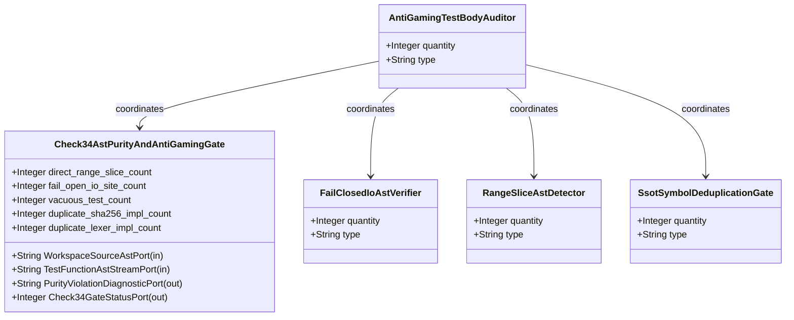
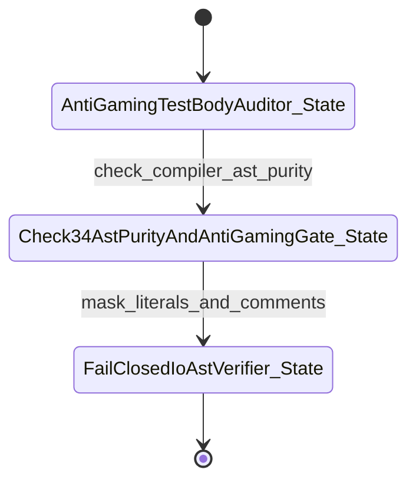

| Attribute | Specification Detail |
| :--- | :--- |
| **Issue ID** | #686 |
| **Title** | Epic 02: BP 02 Check 34 AST Purity Fail Closed IO and Anti Gaming Test Gate Blueprint |
| **Type** | epic |
| **Package** | BP_02_Check_34_AST_Purity_Fail_Closed_IO_and_Anti_Gaming_Test_Gate_Blueprint |
| **Subsystem** | BP 02 Check 34 AST Purity Fail Closed IO and Anti Gaming Test Gate Blueprint |
| **Generation Mode** | subagent |
| **Specification Source** | [schema/model.sysml](../../schema/model.sysml) |

# Epic 02: BP 02 Check 34 AST Purity Fail Closed IO and Anti Gaming Test Gate Blueprint

## 1. Context
Subsystem package for BP_02_Check_34_AST_Purity_Fail_Closed_IO_and_Anti_Gaming_Test_Gate_Blueprint

## 2. Requirements & Checklist
- [ ] #662 - [Feature 06: [BP 02 Check 34 AST Purity Fail Closed IO and Anti Gaming Test Gate Blueprint] AntiGamingTestBodyAuditor](../features/FEAT-06-AntiGamingTestBodyAuditor.md)
- [ ] #664 - [Feature 07: [BP 02 Check 34 AST Purity Fail Closed IO and Anti Gaming Test Gate Blueprint] Check34AstPurityAndAntiGamingGate](../features/FEAT-07-Check34AstPurityAndAntiGamingGate.md)
- [ ] #661 - [Feature 08: [BP 02 Check 34 AST Purity Fail Closed IO and Anti Gaming Test Gate Blueprint] FailClosedIoAstVerifier](../features/FEAT-08-FailClosedIoAstVerifier.md)
- [ ] #660 - [Feature 09: [BP 02 Check 34 AST Purity Fail Closed IO and Anti Gaming Test Gate Blueprint] RangeSliceAstDetector](../features/FEAT-09-RangeSliceAstDetector.md)
- [ ] #663 - [Feature 10: [BP 02 Check 34 AST Purity Fail Closed IO and Anti Gaming Test Gate Blueprint] SsotSymbolDeduplicationGate](../features/FEAT-10-SsotSymbolDeduplicationGate.md)

### Associated Use Cases & User Stories

#### Associated Use Cases
- [ ] #629 - [Use Case 06: General Direct Range Slice Indexing Rejection](../use-cases/UC-06-General_Direct_Range_Slice_Indexing_Rejection.md)
- [ ] #630 - [Use Case 07: Fail Closed Filesystem and Walk Dir Enforcement](../use-cases/UC-07-Fail_Closed_Filesystem_and_WalkDir_Enforcement.md)
- [ ] #631 - [Use Case 08: Anti Gaming Test Body AST Enforcement](../use-cases/UC-08-Anti_Gaming_Test_Body_AST_Enforcement.md)
- [ ] #632 - [Use Case 09: SSOT Cryptographic and Lexer Deduplication](../use-cases/UC-09-SSOT_Cryptographic_and_Lexer_Deduplication.md)
- [ ] #633 - [Use Case 10: Deterministic Dogfood Ingestion into Canonical SysML v2](../use-cases/UC-10-Deterministic_Dogfood_Ingestion_into_Canonical_SysML_v2.md)

#### Associated User Stories
- [ ] #567 - [User Story 06: check compiler ast purity](../user-stories/US-06-check_compiler_ast_purity.md)
- [ ] #568 - [User Story 07: mask literals and comments](../user-stories/US-07-mask_literals_and_comments.md)
- [ ] #570 - [User Story 08: contains direct range slice](../user-stories/US-08-contains_direct_range_slice.md)
- [ ] #571 - [User Story 09: audit fail closed io patterns](../user-stories/US-09-audit_fail_closed_io_patterns.md)
- [ ] #572 - [User Story 10: audit test integrity and anti gaming](../user-stories/US-10-audit_test_integrity_and_anti_gaming.md)
- [ ] #574 - [User Story 11: audit ssot symbol deduplication](../user-stories/US-11-audit_ssot_symbol_deduplication.md)

## 3. Architecture
Classifiers: `AntiGamingTestBodyAuditor`; `Check34AstPurityAndAntiGamingGate` (ports: `in WorkspaceSourceAstPort : String`, `in TestFunctionAstStreamPort : String`, `out PurityViolationDiagnosticPort : String`, `out Check34GateStatusPort : Integer`); `FailClosedIoAstVerifier`; `RangeSliceAstDetector`; `SsotSymbolDeduplicationGate`.

## 4. Operational Considerations
Lifecycle state machines: `BP_02_Check_34_AST_Purity_Fail_Closed_IO_and_Anti_Gaming_Test_Gate_Blueprint_LifecycleState` (Initial -> AntiGamingTestBodyAuditor_State; AntiGamingTestBodyAuditor_State -> Check34AstPurityAndAntiGamingGate_State on check_compiler_ast_purity; Check34AstPurityAndAntiGamingGate_State -> FailClosedIoAstVerifier_State on mask_literals_and_comments; FailClosedIoAstVerifier_State -> Terminal). Operational actions: `check_compiler_ast_purity`, `mask_literals_and_comments`, `contains_direct_range_slice`, `audit_fail_closed_io_patterns`, `audit_test_integrity_and_anti_gaming`, `audit_ssot_symbol_deduplication`. Interaction sequences: `BP_02_Check_34_AST_Purity_Fail_Closed_IO_and_Anti_Gaming_Test_Gate_Blueprint_SequenceInteraction`.

## 5. Security & Governance
Allocated requirements: `REQ-0602 (REQ_0602_BP_02_Check_34_AST_Purity_Fail_Closed_IO_and_Anti_Gaming_Test_Gate_Blueprint)`. Enforced invariant constraints: `Invariant_REQ_0602_SC_01`, `Invariant_REQ_0602_SC_02`.

## 6. Source References
- System Architecture Model: `schema/model.sysml`
- Normative Systems Engineering Standard: ISO/IEC/IEEE 15288:2023 §6.4.3 Architecture Definition Process

Subsystem architectural composition and formal invariants derive from `schema/model.sysml` pursuant to ISO/IEC/IEEE 15288.

## System-Level UML Class Diagram

## System State Machine Diagram

