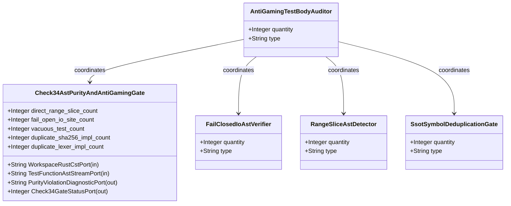
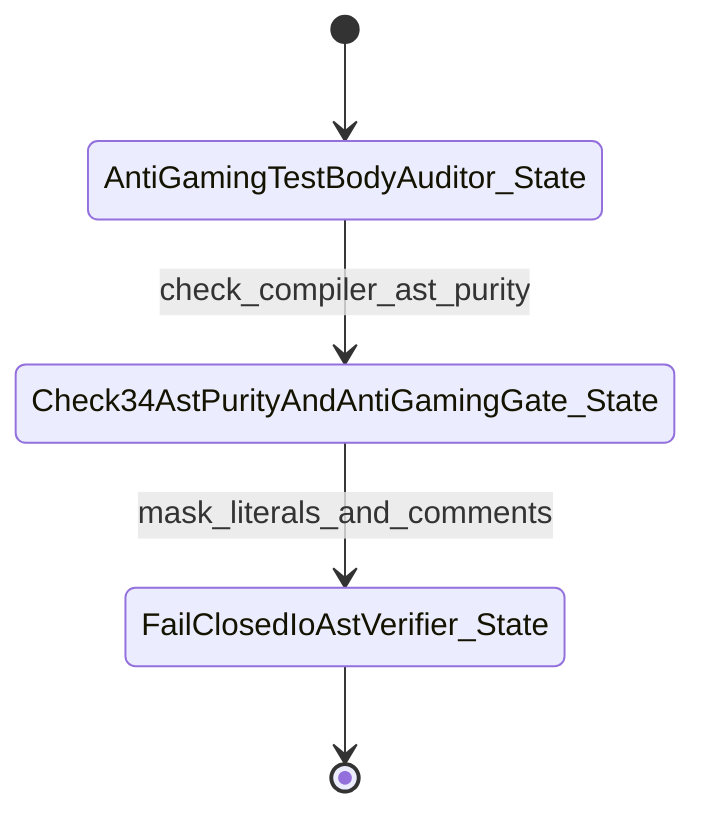

| Attribute | Specification Detail |
| :--- | :--- |
| **Issue ID** | #686 |
| **Title** | Epic 02: BP 02 Check 34 AST Purity Fail Closed IO and Anti Gaming Test Gate Blueprint |
| **Type** | epic |
| **Package** | BP_02_Check_34_AST_Purity_Fail_Closed_IO_and_Anti_Gaming_Test_Gate_Blueprint |
| **Subsystem** | BP 02 Check 34 AST Purity Fail Closed IO and Anti Gaming Test Gate Blueprint |
| **Generation Mode** | subagent |
| **Specification Source** | [schema/model.sysml](../../schema/model.sysml) |

# Epic 02: BP 02 Check 34 AST Purity Fail Closed IO and Anti Gaming Test Gate Blueprint

## 1. Context
Subsystem package for `BP_02_Check_34_AST_Purity_Fail_Closed_IO_and_Anti_Gaming_Test_Gate_Blueprint` (`REQ-0602`). This Epic establishes the deterministic Check 34 AST Purity, Fail-Closed I/O, and Anti-Gaming Test Gate subsystem under two governing architectural contracts:
- **Contract A (100% Normative OMG SysML v2.0 + KerML 1.0 Grammar Coverage, Zero 16-Construct Caps)**: Enforces full Definition and Usage symmetry across the complete OMG SysML v2.0 and KerML 1.0 textual grammar with zero 16-construct artificial caps -- spanning `package` / `library package` / `standard library package`, `import` (`all`, `::*`, `::**`, filter `[...]`), `alias`, `doc`, `comment`, `rep`, `dependency`, `metadata def` / `metadata` / `@Metadata` / `#user_keyword` (`#hazard`, `#risk`, `#capability`, `#rt_loop`, `#dal`, `#fls` and backward-compatible legacy `hazard def` / `risk def` / `capability def`), `part def`/`part`, `item def`/`item`, `attribute def`/`attribute`, `enum def`/`enum`, `port def`/`port` (`in`, `out`, `inout`, `~` conjugation), `connection def`/`connection`, `interface def`/`interface`, `flow def`/`flow`, `allocation def`/`allocation`, `occurrence def`/`occurrence`, `action def`/`action`, `state def`/`state`, `calc def`/`calc`, `constraint def`/`constraint`, `requirement def`/`requirement`, `concern def`/`concern`, `use case def`/`use case`, `analysis def`/`analysis`, `verification def`/`verification`, `test case def`/`test case`, `interaction def`/`interaction`, `view def`/`view`, `viewpoint def`/`viewpoint`, `rendering def`/`rendering`, `variation`/`variant`, and KerML 1.0 specialization/multiplicity/expressions (`:`, `:>`, `:>>`, `::>`, `~`, `ref`, `abstract`, `readonly`, `derived`, `end`, `default`, `:=`, `[lo..hi]`, `[*]`, `{ordered, nonunique}`, `implies`, `xor`, `??`, `->`, `collect`, `select`, `forAll`, `exists`, `ISQ`/`SI`/`ScalarValues`).
- **Contract B (Official Rust Compiler, Cargo & `rust-analyzer` Crate Stack, Zero Hand-Rolled Scanners)**: Enforces 100% typed CST/AST inspection via `ra_ap_syntax` (`ast::{MatchExpr, MatchArmList, CallExpr, MethodCallExpr, TryExpr, IndexExpr, Fn, HasDocComments, HasAttrs}`), `ra_ap_vfs`, `ra_ap_paths`, `ra_ap_line_index`, `ra_ap_text_edit`, `rowan`, `camino`, and `ignore`, paired with official Cargo workspace and manifest crates (`cargo_metadata`, `cargo-lock`, `cargo-util-schemas`, `cargo-platform`, `toml_edit`), `logos` + `rowan` + `salsa` + `ariadne` (`deap_core::sysml_cst`, `deap_core::rust_cst`, `deap_core::dart_cst`), `pulldown-cmark` + `pulldown-cmark-to-cmark`, and `syn` + `proc-macro2` + `quote` + `prettyplease`, with zero hand-rolled string, line, or character-by-character scanners.

## 2. Requirements & Checklist
- [ ] #662 - [Feature 06: [BP 02 Check 34 AST Purity Fail Closed IO and Anti Gaming Test Gate Blueprint] AntiGamingTestBodyAuditor](../features/FEAT-06-AntiGamingTestBodyAuditor.md)
- [ ] #664 - [Feature 07: [BP 02 Check 34 AST Purity Fail Closed IO and Anti Gaming Test Gate Blueprint] Check34AstPurityAndAntiGamingGate](../features/FEAT-07-Check34AstPurityAndAntiGamingGate.md)
- [ ] #661 - [Feature 08: [BP 02 Check 34 AST Purity Fail Closed IO and Anti Gaming Test Gate Blueprint] FailClosedIoAstVerifier](../features/FEAT-08-FailClosedIoAstVerifier.md)
- [ ] #660 - [Feature 09: [BP 02 Check 34 AST Purity Fail Closed IO and Anti Gaming Test Gate Blueprint] RangeSliceAstDetector](../features/FEAT-09-RangeSliceAstDetector.md)
- [ ] #663 - [Feature 10: [BP 02 Check 34 AST Purity Fail Closed IO and Anti Gaming Test Gate Blueprint] SsotSymbolDeduplicationGate](../features/FEAT-10-SsotSymbolDeduplicationGate.md)

### Associated Use Cases & User Stories

#### Associated Use Cases
- [ ] #629 - [Use Case 06: General Direct Range Slice Indexing Rejection](../use-cases/UC-06-General_Direct_Range_Slice_Indexing_Rejection.md)
- [ ] #630 - [Use Case 07: Fail Closed Filesystem and Walk Dir Enforcement](../use-cases/UC-07-Fail_Closed_Filesystem_and_WalkDir_Enforcement.md)
- [ ] #631 - [Use Case 08: Anti Gaming Test Body AST Enforcement](../use-cases/UC-08-Anti_Gaming_Test_Body_AST_Enforcement.md)
- [ ] #632 - [Use Case 09: SSOT Cryptographic and Lexer Deduplication](../use-cases/UC-09-SSOT_Cryptographic_and_Lexer_Deduplication.md)
- [ ] #633 - [Use Case 10: Deterministic Dogfood Ingestion into Canonical SysML v2](../use-cases/UC-10-Deterministic_Dogfood_Ingestion_into_Canonical_SysML_v2.md)

#### Associated User Stories
- [ ] #567 - [User Story 06: Check Compiler Ast Purity](../user-stories/US-06-check_compiler_ast_purity.md)
- [ ] #568 - [User Story 07: Mask Literals And Comments](../user-stories/US-07-mask_literals_and_comments.md)
- [ ] #570 - [User Story 08: Contains Direct Range Slice](../user-stories/US-08-contains_direct_range_slice.md)
- [ ] #571 - [User Story 09: Audit Fail Closed Io Patterns](../user-stories/US-09-audit_fail_closed_io_patterns.md)
- [ ] #572 - [User Story 10: Audit Test Integrity And Anti Gaming](../user-stories/US-10-audit_test_integrity_and_anti_gaming.md)
- [ ] #574 - [User Story 11: Audit Ssot Symbol Deduplication](../user-stories/US-11-audit_ssot_symbol_deduplication.md)

## 3. Architecture
Classifiers: `AntiGamingTestBodyAuditor`; `Check34AstPurityAndAntiGamingGate` (ports: `in WorkspaceRustCstPort : String`, `in TestFunctionAstStreamPort : String`, `out PurityViolationDiagnosticPort : String`, `out Check34GateStatusPort : Integer`); `FailClosedIoAstVerifier`; `RangeSliceAstDetector`; `SsotSymbolDeduplicationGate`.

### Architectural Realization (3-Layer Definition of Done)
- **Layer 1 (Domain State & Data Model)**: Encapsulates typed domain counters (`direct_range_slice_count : Integer`, `fail_open_io_site_count : Integer`, `vacuous_test_count : Integer`, `duplicate_sha256_impl_count : Integer`, `duplicate_lexer_impl_count : Integer`) and lossless `rowan` / `ra_ap_syntax` syntax trees coupled with `cargo_metadata`, `cargo-lock`, `cargo-util-schemas`, `cargo-platform`, and `toml_edit` workspace models across full OMG SysML v2.0 + KerML 1.0 grammar projections (zero 16-construct caps).
- **Layer 2 (Logic & State Management)**: Evaluates Check 34 AST purity, fail-closed I/O (`ast::{MatchExpr, MatchArmList, CallExpr, MethodCallExpr, TryExpr}`), direct range-slice indexing (`ast::IndexExpr`), anti-gaming test body AST rules (`ast::{Fn, MacroCall, IfExpr}`), and SSOT cryptographic/lexer symbol deduplication inside `< 380`-SLOC submodules (`./crates/verify-baseline/src/ast_purity/` and `./crates/deap-core/src/rust_cst/`) with explicit legacy hand-rolled scanner deletion.
- **Layer 3 (Presentation & Actuator Interface Binding)**: Binds `in WorkspaceRustCstPort : String`, `in TestFunctionAstStreamPort : String`, `out PurityViolationDiagnosticPort : String`, and `out Check34GateStatusPort : Integer` to `ariadne` / `miette` span diagnostics and fail-closed CLI exit statuses.

## 4. Operational Considerations
Lifecycle state machines: `BP_02_Check_34_AST_Purity_Fail_Closed_IO_and_Anti_Gaming_Test_Gate_Blueprint_LifecycleState` (Initial -> AntiGamingTestBodyAuditor_State; AntiGamingTestBodyAuditor_State -> Check34AstPurityAndAntiGamingGate_State on check_compiler_ast_purity; Check34AstPurityAndAntiGamingGate_State -> FailClosedIoAstVerifier_State on mask_literals_and_comments; FailClosedIoAstVerifier_State -> Terminal). Operational actions: `check_compiler_ast_purity`, `mask_literals_and_comments`, `contains_direct_range_slice`, `audit_fail_closed_io_patterns`, `audit_test_integrity_and_anti_gaming`, `audit_ssot_symbol_deduplication`. Interaction sequences: `BP_02_Check_34_AST_Purity_Fail_Closed_IO_and_Anti_Gaming_Test_Gate_Blueprint_SequenceInteraction`. All submodules enforce `< 380` executable SLOC per file and explicit deletion of legacy hand-rolled line/character scanners.

## 5. Security & Governance
Allocated requirements: `REQ-0602 (REQ_0602_BP_02_Check_34_AST_Purity_Fail_Closed_IO_and_Anti_Gaming_Test_Gate_Blueprint)`. Enforced invariant constraints: `Invariant_REQ_0602_SC_01`, `Invariant_REQ_0602_SC_02`. Enforces Contract A (full OMG SysML v2.0 + KerML 1.0 grammar coverage, zero 16-construct caps) and Contract B (`ra_ap_syntax` typed `ast::{MatchExpr, MatchArmList, CallExpr, MethodCallExpr, TryExpr}` I/O purity + `cargo_metadata`, `cargo-lock`, `cargo-util-schemas`, `cargo-platform`, `toml_edit`, zero hand-rolled scanner mandates).

## 6. Source References
- System Architecture Model: `schema/model.sysml`
- Normative Systems Engineering Standard: ISO/IEC/IEEE 15288:2023 §6.4.3 Architecture Definition Process

Subsystem architectural composition and formal invariants derive from `schema/model.sysml` pursuant to ISO/IEC/IEEE 15288.

## System-Level UML Class Diagram

## System State Machine Diagram

