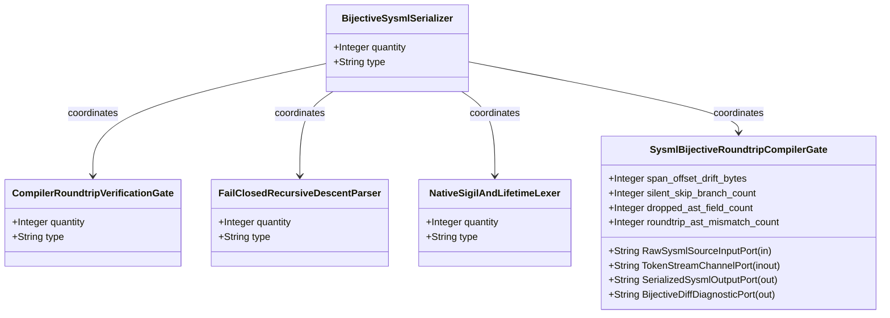
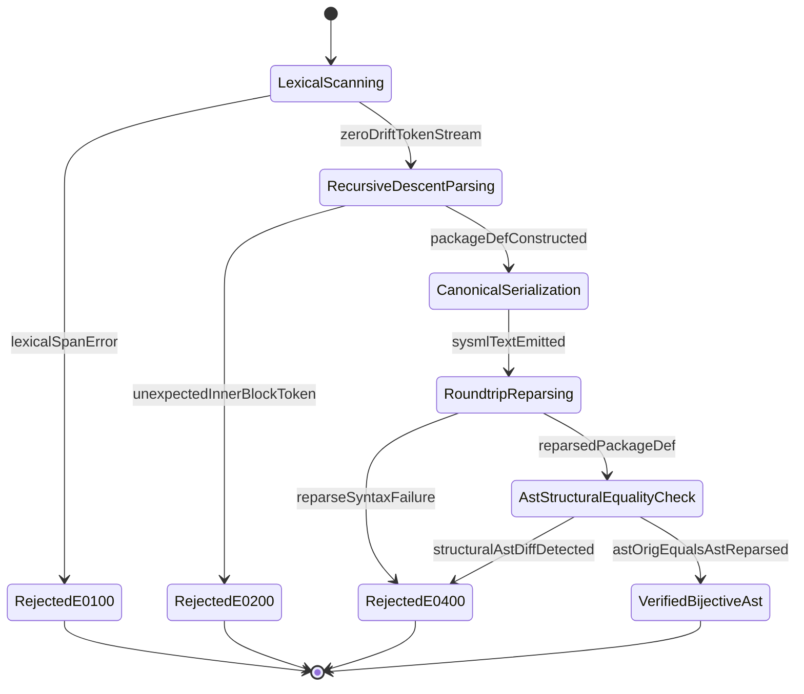

| Attribute | Specification Detail |
| :--- | :--- |
| **Issue ID** | #687 |
| **Title** | Epic 03: BP 03 SysML v2 AST Bijective Roundtrip and Token Stream Parser Gate Blueprint |
| **Type** | epic |
| **Package** | BP_03_SysML_v2_AST_Bijective_Roundtrip_and_Token_Stream_Parser_Gate_Blueprint |
| **Subsystem** | BP 03 SysML v2 AST Bijective Roundtrip and Token Stream Parser Gate Blueprint |
| **Generation Mode** | subagent |
| **Specification Source** | [schema/model.sysml](../../schema/model.sysml) |

# Epic 03: BP 03 SysML v2 AST Bijective Roundtrip and Token Stream Parser Gate Blueprint

## 1. Context
Subsystem package for BP_03_SysML_v2_AST_Bijective_Roundtrip_and_Token_Stream_Parser_Gate_Blueprint

## 2. Requirements & Checklist
- [ ] #667 - [Feature 11: [BP 03 SysML v2 AST Bijective Roundtrip and Token Stream Parser Gate Blueprint] BijectiveSysmlSerializer](../features/FEAT-11-BijectiveSysmlSerializer.md)
- [ ] #668 - [Feature 12: [BP 03 SysML v2 AST Bijective Roundtrip and Token Stream Parser Gate Blueprint] CompilerRoundtripVerificationGate](../features/FEAT-12-CompilerRoundtripVerificationGate.md)
- [ ] #666 - [Feature 13: [BP 03 SysML v2 AST Bijective Roundtrip and Token Stream Parser Gate Blueprint] FailClosedRecursiveDescentParser](../features/FEAT-13-FailClosedRecursiveDescentParser.md)
- [ ] #665 - [Feature 14: [BP 03 SysML v2 AST Bijective Roundtrip and Token Stream Parser Gate Blueprint] NativeSigilAndLifetimeLexer](../features/FEAT-14-NativeSigilAndLifetimeLexer.md)
- [ ] #669 - [Feature 15: [BP 03 SysML v2 AST Bijective Roundtrip and Token Stream Parser Gate Blueprint] SysmlBijectiveRoundtripCompilerGate](../features/FEAT-15-SysmlBijectiveRoundtripCompilerGate.md)

### Associated Use Cases & User Stories

#### Associated Use Cases
- [ ] #634 - [Use Case 11: Native Lexer Sigil and Lifetime Tokenization](../use-cases/UC-11-Native_Lexer_Sigil_and_Lifetime_Tokenization.md)
- [ ] #635 - [Use Case 12: Fail Closed Inner Block and Composite Type Parsing](../use-cases/UC-12-Fail_Closed_Inner_Block_and_Composite_Type_Parsing.md)
- [ ] #636 - [Use Case 13: Token Stream State Transition Parsing and Recursive MBD Synthesis](../use-cases/UC-13-Token_Stream_State_Transition_Parsing_and_Recursive_MBD_Synthesis.md)
- [ ] #637 - [Use Case 14: Lossless to sysml Serialization and Fail Closed Bijective Roundtrip Gate](../use-cases/UC-14-Lossless_to_sysml_Serialization_and_Fail_Closed_Bijective_Roundtrip_Gate.md)
- [ ] #638 - [Use Case 15: Dogfood Markdown to SysML Ingestion and Baseline Verification](../use-cases/UC-15-Dogfood_Markdown_to_SysML_Ingestion_and_Baseline_Verification.md)

#### Associated User Stories
- [ ] #577 - [User Story 12: scan all](../user-stories/US-12-scan_all.md)
- [ ] #579 - [User Story 13: parse package or file](../user-stories/US-13-parse_package_or_file.md)
- [ ] #705 - [User Story 14: Parse Type Expr And Parse Transition](../user-stories/US-14-ParseTypeExprAndParseTransition.md)
- [ ] #582 - [User Story 15: verify bijective ast roundtrip](../user-stories/US-15-verify_bijective_ast_roundtrip.md)
- [ ] #583 - [User Story 16: ast orig to sysml](../user-stories/US-16-ast_orig_to_sysml.md)
- [ ] #706 - [User Story 17: Assert Ast Orig Equals Ast Reparsed](../user-stories/US-17-AssertAstOrigEqualsAstReparsed.md)

## 3. Architecture
Classifiers: `BijectiveSysmlSerializer`; `CompilerRoundtripVerificationGate`; `FailClosedRecursiveDescentParser`; `NativeSigilAndLifetimeLexer`; `SysmlBijectiveRoundtripCompilerGate` (ports: `in RawSysmlSourceInputPort : String`, `inout TokenStreamChannelPort : String`, `out SerializedSysmlOutputPort : String`, `out BijectiveDiffDiagnosticPort : String`).

## 4. Operational Considerations
Lifecycle state machines: `BP_03_SysML_v2_AST_Bijective_Roundtrip_and_Token_Stream_Parser_Gate_Blueprint_LifecycleState` (Initial -> LexicalScanning; LexicalScanning -> RecursiveDescentParsing on zeroDriftTokenStream; LexicalScanning -> RejectedE0100 on lexicalSpanError; RecursiveDescentParsing -> CanonicalSerialization on packageDefConstructed; RecursiveDescentParsing -> RejectedE0200 on unexpectedInnerBlockToken; CanonicalSerialization -> RoundtripReparsing on sysmlTextEmitted; RoundtripReparsing -> AstStructuralEqualityCheck on reparsedPackageDef; RoundtripReparsing -> RejectedE0400 on reparseSyntaxFailure; AstStructuralEqualityCheck -> VerifiedBijectiveAst on astOrigEqualsAstReparsed; AstStructuralEqualityCheck -> RejectedE0400 on structuralAstDiffDetected; RejectedE0100 -> Terminal; RejectedE0200 -> Terminal; RejectedE0400 -> Terminal; VerifiedBijectiveAst -> Terminal). Operational actions: `scan_all`, `parse_package_or_file`, `ParseTypeExprAndParseTransition`, `verify_bijective_ast_roundtrip`, `ast_orig_to_sysml`, `AssertAstOrigEqualsAstReparsed`. Interaction sequences: `BP_03_SysML_v2_AST_Bijective_Roundtrip_and_Token_Stream_Parser_Gate_Blueprint_SequenceInteraction`.

## 5. Security & Governance
Allocated requirements: `REQ-0603 (REQ_0603_BP_03_SysML_v2_AST_Bijective_Roundtrip_and_Token_Stream_Parser_Gate_Blueprint)`. Enforced invariant constraints: `Invariant_REQ_0603_Formal_Bijectivity_Complexity_Invariants`, `Invariant_REQ_0603_SC_04`.

## 6. Source References
- System Architecture Model: `schema/model.sysml`
- Normative Systems Engineering Standard: ISO/IEC/IEEE 15288:2023 §6.4.3 Architecture Definition Process

Subsystem architectural composition and formal invariants derive from `schema/model.sysml` pursuant to ISO/IEC/IEEE 15288.

## System-Level UML Class Diagram

## System State Machine Diagram

