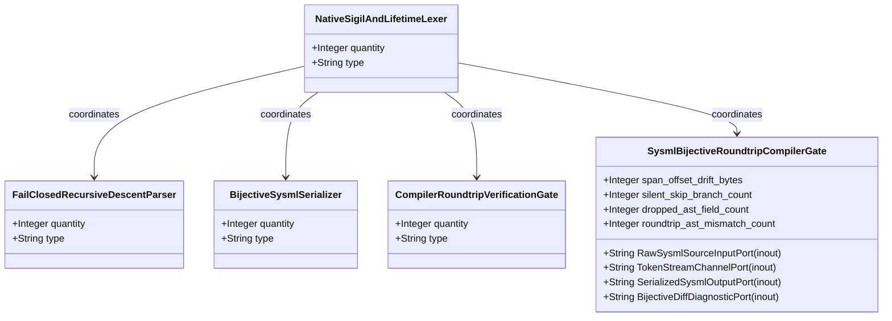
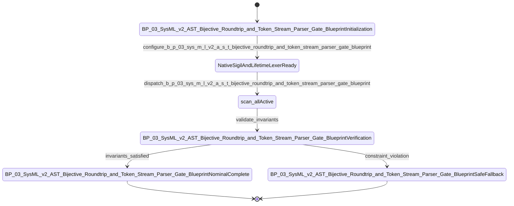

| Attribute | Specification Detail |
| :--- | :--- |
| **Issue ID** | #687 |
| **Title** | Epic 03: BP 03 Sys ML v2 AST Bijective Roundtrip and Token Stream Parser Gate Blueprint |
| **Type** | epic |
| **Package** | BP_03_SysML_v2_AST_Bijective_Roundtrip_and_Token_Stream_Parser_Gate_Blueprint |
| **Subsystem** | BP 03 Sys ML v2 AST Bijective Roundtrip and Token Stream Parser Gate Blueprint |
| **Generation Mode** | subagent |
| **Specification Source** | [schema/model.sysml](../../schema/model.sysml) |

# Epic 03: BP 03 Sys ML v2 AST Bijective Roundtrip and Token Stream Parser Gate Blueprint

## 1. Context
Subsystem package for BP_03_SysML_v2_AST_Bijective_Roundtrip_and_Token_Stream_Parser_Gate_Blueprint

## 2. Requirements & Checklist
- [ ] #665 - [Feature 11: [BP 03 Sys ML v2 AST Bijective Roundtrip and Token Stream Parser Gate Blueprint] NativeSigilAndLifetimeLexer](../features/FEAT-11-NativeSigilAndLifetimeLexer.md) (b_p_03_sys_m_l_v2_a_s_t_bijective_roundtrip_and_token_stream_parser_gate_blueprint.sysml)
- [ ] #666 - [Feature 12: [BP 03 Sys ML v2 AST Bijective Roundtrip and Token Stream Parser Gate Blueprint] FailClosedRecursiveDescentParser](../features/FEAT-12-FailClosedRecursiveDescentParser.md) (b_p_03_sys_m_l_v2_a_s_t_bijective_roundtrip_and_token_stream_parser_gate_blueprint.sysml)
- [ ] #667 - [Feature 13: [BP 03 Sys ML v2 AST Bijective Roundtrip and Token Stream Parser Gate Blueprint] BijectiveSysmlSerializer](../features/FEAT-13-BijectiveSysmlSerializer.md) (b_p_03_sys_m_l_v2_a_s_t_bijective_roundtrip_and_token_stream_parser_gate_blueprint.sysml)
- [ ] #668 - [Feature 14: [BP 03 Sys ML v2 AST Bijective Roundtrip and Token Stream Parser Gate Blueprint] CompilerRoundtripVerificationGate](../features/FEAT-14-CompilerRoundtripVerificationGate.md) (b_p_03_sys_m_l_v2_a_s_t_bijective_roundtrip_and_token_stream_parser_gate_blueprint.sysml)
- [ ] #669 - [Feature 15: [BP 03 Sys ML v2 AST Bijective Roundtrip and Token Stream Parser Gate Blueprint] SysmlBijectiveRoundtripCompilerGate](../features/FEAT-15-SysmlBijectiveRoundtripCompilerGate.md) (assert_span_offset_drift_bytes_range, assert_silent_skip_branch_count_range, assert_dropped_ast_field_count_range, assert_roundtrip_ast_mismatch_count_range)

### Associated Use Cases & User Stories

#### Associated Use Cases
- [ ] #634 - [Use Case 11: UC AC 01 Native Lexer Sigil and Lifetime Tokenization](../use-cases/UC-11-UC_AC_01_Native_Lexer_Sigil_and_Lifetime_Tokenization.md)
- [ ] #635 - [Use Case 12: UC AC 02 Fail Closed Inner Block and Composite Type Parsing](../use-cases/UC-12-UC_AC_02_Fail_Closed_Inner_Block_and_Composite_Type_Parsing.md)
- [ ] #636 - [Use Case 13: UC AC 03 Token Stream State Transition Parsing and Recursive MBD Synthesis](../use-cases/UC-13-UC_AC_03_Token_Stream_State_Transition_Parsing_and_Recursive_MBD_Synthesis.md)
- [ ] #637 - [Use Case 14: UC AC 04 Lossless to sysml Serialization and Fail Closed Bijective Roundtrip Gate](../use-cases/UC-14-UC_AC_04_Lossless_to_sysml_Serialization_and_Fail_Closed_Bijective_Roundtrip_Gate.md)
- [ ] #638 - [Use Case 15: UC AC 05 Dogfood Markdown to Sys ML Ingestion and Baseline Verification](../use-cases/UC-15-UC_AC_05_Dogfood_Markdown_to_SysML_Ingestion_and_Baseline_Verification.md)

#### Associated User Stories
- [ ] #577 - [User Story 16: scan all](../user-stories/US-16-scan_all.md)
- [ ] #578 - [User Story 17: Vec](../user-stories/US-17-Vec.md)
- [ ] #579 - [User Story 18: parse package or file](../user-stories/US-18-parse_package_or_file.md)
- [ ] #580 - [User Story 19: parse type expr](../user-stories/US-19-parse_type_expr.md)
- [ ] #581 - [User Story 20: Canonical](../user-stories/US-20-Canonical.md)
- [ ] #582 - [User Story 21: verify bijective ast roundtrip](../user-stories/US-21-verify_bijective_ast_roundtrip.md)
- [ ] #583 - [User Story 22: ast orig to sysml](../user-stories/US-22-ast_orig_to_sysml.md)
- [ ] #584 - [User Story 23: Reparsed](../user-stories/US-23-Reparsed.md)
- [ ] #585 - [User Story 24: Assert item](../user-stories/US-24-Assert_item.md)
- [ ] #586 - [User Story 25: Ok](../user-stories/US-25-Ok.md)

## 3. Architecture
Subsystem structural composition, port allocations, and directional data connectors realized by NativeSigilAndLifetimeLexer.

## 4. Operational Considerations
Deterministic compilation passes, error containment, and provable polynomial complexity execution.

## 5. Security & Governance
Safety-critical invariant satisfaction, formal trace matrix closure, and zero hardcoded domain semantics.

## 6. Source References
- System Architecture Model: `schema/model.sysml`
- Subsystem Specification Model: `schema/subsystems/b_p_03_sys_m_l_v2_a_s_t_bijective_roundtrip_and_token_stream_parser_gate_blueprint/architecture.sysml`
- Subsystem Requirements Model: `schema/subsystems/b_p_03_sys_m_l_v2_a_s_t_bijective_roundtrip_and_token_stream_parser_gate_blueprint/requirements.sysml`
- Normative Systems Engineering Standard: ISO/IEC/IEEE 15288:2023 §6.4.3 Architecture Definition Process

Subsystem architectural composition and formal invariants derive from `schema/model.sysml` pursuant to ISO/IEC/IEEE 15288.

## System-Level UML Class Diagram

## System State Machine Diagram

