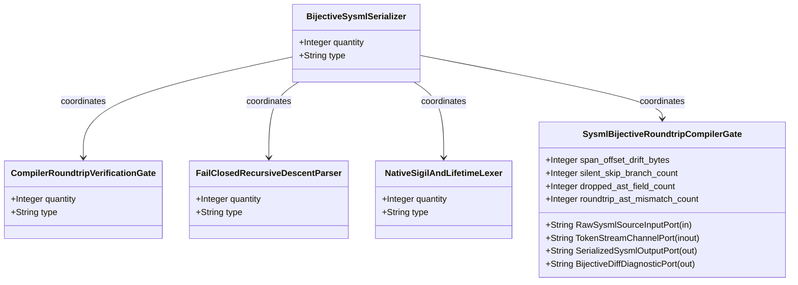
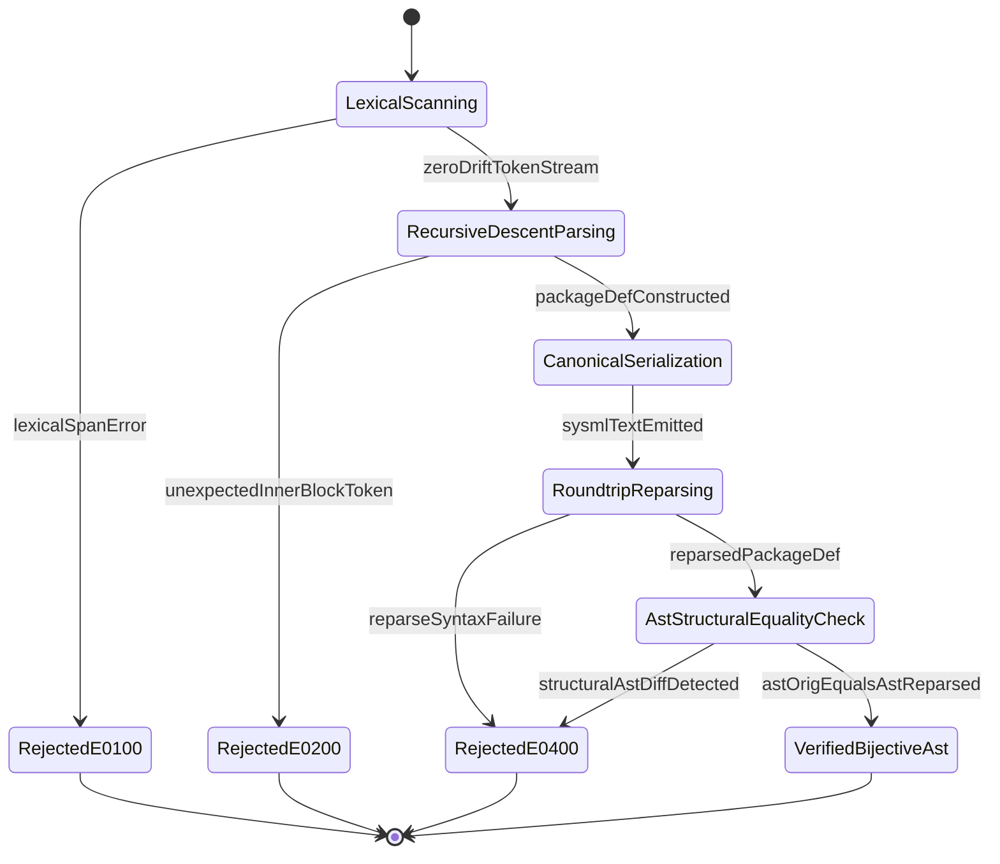

| Attribute | Specification Detail |
| :--- | :--- |
| **Issue ID** | #687 |
| **Title** | Epic 03: BP 03 SysML v2 AST Bijective Roundtrip and Token Stream Parser Gate Blueprint |
| **Type** | epic |
| **Package** | BP_03_SysML_v2_AST_Bijective_Roundtrip_and_Token_Stream_Parser_Gate_Blueprint |
| **Subsystem** | BP 03 SysML v2 AST Bijective Roundtrip and Token Stream Parser Gate Blueprint |
| **Generation Mode** | subagent |
| **Specification Source** | [schema/model.sysml](../../schema/model.sysml) |

# Epic 03: BP 03 SysML v2 AST Bijective Roundtrip and Token Stream Parser Gate Blueprint

## 1. Context
Subsystem package for BP_03_SysML_v2_AST_Bijective_Roundtrip_and_Token_Stream_Parser_Gate_Blueprint (`REQ-0603`). This subsystem governs the lossless SysML v2 Concrete Syntax Tree (CST), typed High-Level Intermediate Representation (HIR/AST) projection, canonical serializer, and Stage-1 == Stage-2 bijective round-trip verification gate:
- **Contract A (100% Normative OMG SysML v2.0 + KerML 1.0 BNF Grammar Coverage)**: Enforces full Definition and Usage symmetry across all 6 normative clauses with zero 16-construct artificial caps:
  1. *Clause 1 -- Namespaces & Metadata*: `package`, `library package`, `standard library package`, `import` (`all`, `::*`, `::**`, filter `[...]`), `alias`, `doc`, `comment`, `rep`, `dependency`, `metadata def` / `metadata` / `@Metadata` / `#user_keyword` (modeling `#hazard`, `#risk`, `#capability`, `#rt_loop`, `#dal`, `#fls` via standard OMG SysML v2 `metadata def` keywords while preserving backward-compatible parsing of legacy `hazard def`, `risk def`, and `capability def` declarations).
  2. *Clause 2 -- Structural & Data Types*: `attribute def`/`attribute`, `enum def`/`enum`, `item def`/`item`, `part def`/`part`, `port def`/`port` (`in`, `out`, `inout`, `~` conjugation), `connection def`/`connection` (`connect ... to ...`), `interface def`/`interface`, `flow def`/`flow` (`of ... from ... to ...`), `allocation def`/`allocation` (`allocate ... to ...`), `occurrence def`/`occurrence` (`individual`, `snapshot`, `timeslice`).
  3. *Clause 3 -- Behavioral & State*: `action def`/`action` (`perform`, `accept`, `send`, `assign`, `if`/`else`, `while`/`loop`, `for`, `fork`, `join`, `merge`, `decide`, `first ... then ...` succession), `state def`/`state` (`exhibit`, `parallel`, `entry`, `do`, `exit`, `transition first ... accept ... if ... do ... then ...`).
  4. *Clause 4 -- Calculations, Constraints & Requirements*: `calc def`/`calc` (`return`), `constraint def`/`constraint` (`assert`, `assume`, `require`), `requirement def`/`requirement` (`subject`, `actor`, `stakeholder`, `framed concern`, `satisfy ... by ...`), `concern def`/`concern`.
  5. *Clause 5 -- Use Cases, Analysis, Verification & Views*: `use case def`/`use case` (`include use case`), `analysis def`/`analysis` (`objective`), `verification def`/`verification` (`verify requirement`), `test case def`/`test case`, `interaction def`/`interaction`, `view def`/`view`, `viewpoint def`/`viewpoint`, `rendering def`/`rendering` (`expose`, `filter`, `render`), `variation`/`variant`.
  6. *Clause 6 -- KerML 1.0 Specialization, Multiplicity & Expressions*: `:` (`defined by`), `:>` (`subsets`), `:>>` (`redefines`), `::>` (`references`), `~` (`conjugates`), `ref`, `abstract`, `readonly`, `derived`, `end`, `default`, `:=`, `[lo..hi]`, `[*]`, `{ordered, nonunique}`, full KerML logical/conditional/relational/arithmetic/collection expressions (`implies`, `xor`, `??`, `->`, `collect`, `select`, `forAll`, `exists`), and `ISQ`/`SI`/`ScalarValues` standard libraries.
- **Contract B (Lossless `logos` + `rowan` CST, `salsa` DB, `ariadne` Diagnostics & Stage-1 == Stage-2 Bijective Gate -- Zero Hand-Rolled Scanners)**: Implements `deap_core::sysml_cst` using `logos` DFA tokenization and `rowan` lossless Red/Green CST nodes (`SyntaxNode::text() == source`), `salsa` incremental query evaluation (`salsa::input`, `salsa::tracked`), `ariadne` span-exact diagnostic rendering (`E0100`, `E0200`, `E0300`, `E0400`), and Stage-1 == Stage-2 bijective round-trip verification (`parse_sysml(to_sysml(ast_orig)) == ast_orig`) with zero hand-rolled string/line/char-by-char scanners, zero `normalize_type_sigils` pre-lexer string rewriting, and zero `skip_until_semi_or_brace` silent-erasure branches.

## 2. Requirements & Checklist
- [ ] #667 - [Feature 11: [BP 03 SysML v2 AST Bijective Roundtrip and Token Stream Parser Gate Blueprint] BijectiveSysmlSerializer](../features/FEAT-11-BijectiveSysmlSerializer.md)
- [ ] #668 - [Feature 12: [BP 03 SysML v2 AST Bijective Roundtrip and Token Stream Parser Gate Blueprint] CompilerRoundtripVerificationGate](../features/FEAT-12-CompilerRoundtripVerificationGate.md)
- [ ] #666 - [Feature 13: [BP 03 SysML v2 AST Bijective Roundtrip and Token Stream Parser Gate Blueprint] FailClosedRecursiveDescentParser](../features/FEAT-13-FailClosedRecursiveDescentParser.md)
- [ ] #665 - [Feature 14: [BP 03 SysML v2 AST Bijective Roundtrip and Token Stream Parser Gate Blueprint] NativeSigilAndLifetimeLexer](../features/FEAT-14-NativeSigilAndLifetimeLexer.md)
- [ ] #669 - [Feature 15: [BP 03 SysML v2 AST Bijective Roundtrip and Token Stream Parser Gate Blueprint] SysmlBijectiveRoundtripCompilerGate](../features/FEAT-15-SysmlBijectiveRoundtripCompilerGate.md)

### Associated Use Cases & User Stories

#### Associated Use Cases
- [ ] #634 - [Use Case 11: Native Lexer Sigil and Lifetime Tokenization](../use-cases/UC-11-Native_Lexer_Sigil_and_Lifetime_Tokenization.md)
- [ ] #635 - [Use Case 12: Fail Closed Inner Block and Composite Type Parsing](../use-cases/UC-12-Fail_Closed_Inner_Block_and_Composite_Type_Parsing.md)
- [ ] #636 - [Use Case 13: Token Stream State Transition Parsing and Recursive MBD Synthesis](../use-cases/UC-13-Token_Stream_State_Transition_Parsing_and_Recursive_MBD_Synthesis.md)
- [ ] #637 - [Use Case 14: Lossless to sysml Serialization and Fail Closed Bijective Roundtrip Gate](../use-cases/UC-14-Lossless_to_sysml_Serialization_and_Fail_Closed_Bijective_Roundtrip_Gate.md)
- [ ] #638 - [Use Case 15: Dogfood Markdown to SysML Ingestion and Baseline Verification](../use-cases/UC-15-Dogfood_Markdown_to_SysML_Ingestion_and_Baseline_Verification.md)

#### Associated User Stories
- [ ] #577 - [User Story 12: scan all](../user-stories/US-12-scan_all.md)
- [ ] #579 - [User Story 13: parse package or file](../user-stories/US-13-parse_package_or_file.md)
- [ ] #705 - [User Story 14: Parse Type Expr And Parse Transition](../user-stories/US-14-ParseTypeExprAndParseTransition.md)
- [ ] #582 - [User Story 15: verify bijective ast roundtrip](../user-stories/US-15-verify_bijective_ast_roundtrip.md)
- [ ] #583 - [User Story 16: ast orig to sysml](../user-stories/US-16-ast_orig_to_sysml.md)
- [ ] #706 - [User Story 17: Assert Ast Orig Equals Ast Reparsed](../user-stories/US-17-AssertAstOrigEqualsAstReparsed.md)

## 3. Architecture
Classifiers: `BijectiveSysmlSerializer`; `CompilerRoundtripVerificationGate`; `FailClosedRecursiveDescentParser`; `NativeSigilAndLifetimeLexer`; `SysmlBijectiveRoundtripCompilerGate` (ports: `in RawSysmlSourceInputPort : String`, `inout TokenStreamChannelPort : String`, `out SerializedSysmlOutputPort : String`, `out BijectiveDiffDiagnosticPort : String`).
- **Layer 1 (Domain State & Data Model)**: Lossless `rowan` Red/Green `SyntaxNode` (`deap_core::sysml_cst`), `salsa` incremental query inputs/tracked projections (`salsa::input`, `salsa::tracked`), and typed `PackageDef` HIR/AST covering 100% of the 6 normative OMG SysML v2.0 + KerML 1.0 BNF grammar clauses (including `#hazard`, `#risk`, `#capability`, `#rt_loop`, `#dal`, `#fls` `metadata def` annotations and backward-compatible `hazard def`, `risk def`, `capability def` blocks) with telemetry counters (`span_offset_drift_bytes`, `silent_skip_branch_count`, `dropped_ast_field_count`, `roundtrip_ast_mismatch_count`).
- **Layer 2 (Logic & State Management)**: Zero-drift `logos` lexical tokenization (`scan_all`), fail-closed recursive-descent CST/AST parsing (`parse_package_or_file`, `ParseTypeExprAndParseTransition`), lossless canonical serialization (`ast_orig_to_sysml`), and Stage-1 == Stage-2 bijective round-trip verification (`verify_bijective_ast_roundtrip`, `AssertAstOrigEqualsAstReparsed`) bounded inside `< 380` exec SLOC submodules (`./crates/deap-core/src/sysml_cst/` and `./crates/compile-sysml/src/roundtrip/`) with explicit deletion of legacy hand-rolled scanner/parser monoliths (`-2,400+` SLOC retired).
- **Layer 3 (Presentation & Actuator Interface Binding)**: CLI and pipeline port bindings across `RawSysmlSourceInputPort`, `TokenStreamChannelPort`, `SerializedSysmlOutputPort`, and `BijectiveDiffDiagnosticPort` emitting `ariadne` source-span diagnostics (`E0100`, `E0200`, `E0300`, `E0400`).

## 4. Operational Considerations
Lifecycle state machines: `BP_03_SysML_v2_AST_Bijective_Roundtrip_and_Token_Stream_Parser_Gate_Blueprint_LifecycleState` (Initial -> LexicalScanning; LexicalScanning -> RecursiveDescentParsing on zeroDriftTokenStream; LexicalScanning -> RejectedE0100 on lexicalSpanError; RecursiveDescentParsing -> CanonicalSerialization on packageDefConstructed; RecursiveDescentParsing -> RejectedE0200 on unexpectedInnerBlockToken; CanonicalSerialization -> RoundtripReparsing on sysmlTextEmitted; RoundtripReparsing -> AstStructuralEqualityCheck on reparsedPackageDef; RoundtripReparsing -> RejectedE0400 on reparseSyntaxFailure; AstStructuralEqualityCheck -> VerifiedBijectiveAst on astOrigEqualsAstReparsed; AstStructuralEqualityCheck -> RejectedE0400 on structuralAstDiffDetected; RejectedE0100 -> Terminal; RejectedE0200 -> Terminal; RejectedE0400 -> Terminal; VerifiedBijectiveAst -> Terminal). Operational actions: `scan_all`, `parse_package_or_file`, `ParseTypeExprAndParseTransition`, `verify_bijective_ast_roundtrip`, `ast_orig_to_sysml`, `AssertAstOrigEqualsAstReparsed`. Interaction sequences: `BP_03_SysML_v2_AST_Bijective_Roundtrip_and_Token_Stream_Parser_Gate_Blueprint_SequenceInteraction`.

## 5. Security & Governance
Allocated requirements: `REQ-0603 (REQ_0603_BP_03_SysML_v2_AST_Bijective_Roundtrip_and_Token_Stream_Parser_Gate_Blueprint)`. Enforced invariant constraints: `Invariant_REQ_0603_Formal_Bijectivity_Complexity_Invariants`, `Invariant_REQ_0603_SC_04`. All submodule implementations enforce `< 380` exec SLOC modularity caps, explicit legacy hand-rolled scanner deletion, zero 16-construct artificial grammar caps, and fail-closed Stage-1 == Stage-2 bijective round-trip parity.

## 6. Source References
- System Architecture Model: `schema/model.sysml`
- Normative Systems Engineering Standard: ISO/IEC/IEEE 15288:2023 §6.4.3 Architecture Definition Process

Subsystem architectural composition and formal invariants derive from `schema/model.sysml` pursuant to ISO/IEC/IEEE 15288.

## System-Level UML Class Diagram

## System State Machine Diagram

