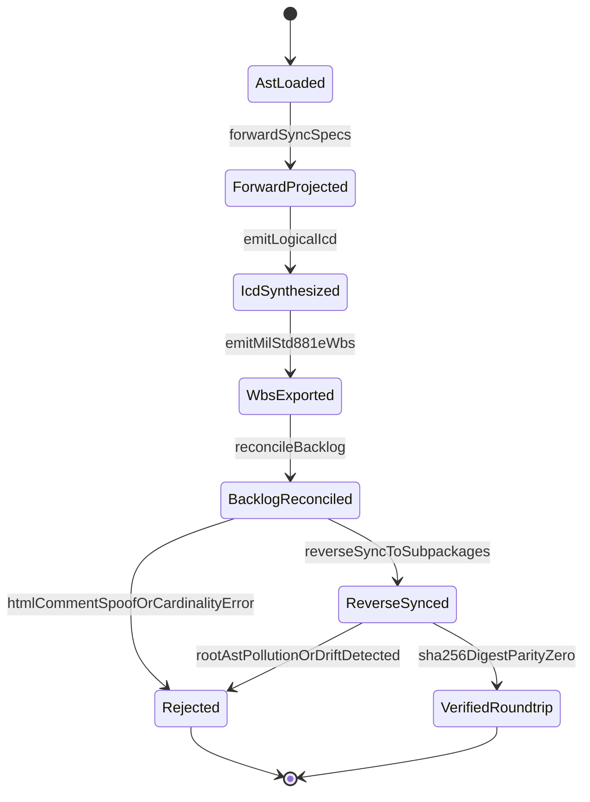

| Attribute | Specification Detail |
| :--- | :--- |
| **Issue ID** | #688 |
| **Title** | Epic 04: BP 04 Deterministic Specification ICD and WBS Forward Compiler Blueprint |
| **Type** | epic |
| **Package** | BP_04_Deterministic_Specification_ICD_and_WBS_Forward_Compiler_Blueprint |
| **Subsystem** | BP 04 Deterministic Specification ICD and WBS Forward Compiler Blueprint |
| **Generation Mode** | subagent |
| **Specification Source** | [schema/model.sysml](../../schema/model.sysml) |

# Epic 04: BP 04 Deterministic Specification ICD and WBS Forward Compiler Blueprint

## 1. Context
Subsystem package for BP_04_Deterministic_Specification_ICD_and_WBS_Forward_Compiler_Blueprint

## 2. Requirements & Checklist
- [ ] #670 - [Feature 16: [BP 04 Deterministic Specification ICD and WBS Forward Compiler Blueprint] AgileSpecForwardProjector](../features/FEAT-16-AgileSpecForwardProjector.md)
- [ ] #671 - [Feature 17: [BP 04 Deterministic Specification ICD and WBS Forward Compiler Blueprint] BidirectionalBacklogReconciler](../features/FEAT-17-BidirectionalBacklogReconciler.md)
- [ ] #672 - [Feature 18: [BP 04 Deterministic Specification ICD and WBS Forward Compiler Blueprint] DeterministicSpecIcdWbsForwardCompiler](../features/FEAT-18-DeterministicSpecIcdWbsForwardCompiler.md)
- [ ] #673 - [Feature 19: [BP 04 Deterministic Specification ICD and WBS Forward Compiler Blueprint] LogicalIcdMatrixCompiler](../features/FEAT-19-LogicalIcdMatrixCompiler.md)
- [ ] #674 - [Feature 20: [BP 04 Deterministic Specification ICD and WBS Forward Compiler Blueprint] MilStd881eWbsExporter](../features/FEAT-20-MilStd881eWbsExporter.md)

### Associated Use Cases & User Stories

#### Associated Use Cases
- [ ] #639 - [Use Case 16: Deterministic Multi Story Use Case and Con Ops Parent Epic Projection](../use-cases/UC-16-Deterministic_Multi_Story_Use_Case_and_ConOps_Parent_Epic_Projection.md)
- [ ] #640 - [Use Case 17: Deterministic Logical ICD Matrix and Signal Dictionary Synthesis](../use-cases/UC-17-Deterministic_Logical_ICD_Matrix_and_Signal_Dictionary_Synthesis.md)
- [ ] #641 - [Use Case 18: Deterministic MIL STD 881 E WBS and Enterprise Export Synthesis](../use-cases/UC-18-Deterministic_MIL_STD_881E_WBS_and_Enterprise_Export_Synthesis.md)
- [ ] #642 - [Use Case 19: Fail Closed Stateful HTML Comment Frontmatter Guard and Parent Inclusive Checklist Reconciliation](../use-cases/UC-19-Fail_Closed_Stateful_HTML_Comment_Frontmatter_Guard_and_Parent_Inclusive_Checklist_Reconciliation.md)
- [ ] #643 - [Use Case 20: Fail Closed Subpackage Scoped Reverse Sync and Dogfood Blueprint Ingestion Parity](../use-cases/UC-20-Fail_Closed_Subpackage_Scoped_Reverse_Sync_and_Dogfood_Blueprint_Ingestion_Parity.md)

#### Associated User Stories
- [ ] #707 - [User Story 18: Compile Sysml Forward Sync Docs](../user-stories/US-18-CompileSysmlForwardSyncDocs.md)
- [ ] #708 - [User Story 19: Resolve Parent Epic By Pkg Name](../user-stories/US-19-ResolveParentEpicByPkgName.md)
- [ ] #709 - [User Story 20: Bind All Package Stories To Use](../user-stories/US-20-BindAllPackageStoriesToUse.md)
- [ ] #710 - [User Story 21: Emit Symmetric Action Def Signatures And E1](../user-stories/US-21-EmitSymmetricActionDefSignaturesAndE1.md)
- [ ] #711 - [User Story 22: Compile Sysml Emit Icd Docs Interfaces](../user-stories/US-22-CompileSysmlEmitIcdDocsInterfaces.md)
- [ ] #712 - [User Story 23: Project Nx N Connection Def Matrix And Flow Def](../user-stories/US-23-ProjectNxNConnectionDefMatrixAndFlowDef.md)
- [ ] #713 - [User Story 24: Compile Sysml Emit Wbs Docs Management](../user-stories/US-24-CompileSysmlEmitWbsDocsManagement.md)
- [ ] #714 - [User Story 25: Synthesize Mil Std881 e Tree And](../user-stories/US-25-SynthesizeMilStd881eTreeAnd.md)
- [ ] #715 - [User Story 26: Reconcile Backlog Reconcile Docs Dir Docs](../user-stories/US-26-ReconcileBacklogReconcileDocsDirDocs.md)
- [ ] #716 - [User Story 27: Parse CommonMark Tables With In Html](../user-stories/US-27-ParseCommonMarkTablesWithInHtml.md)
- [ ] #717 - [User Story 28: Reconcile Checklists With Parent Inclusive Epic](../user-stories/US-28-ReconcileChecklistsWithParentInclusiveEpic.md)
- [ ] #718 - [User Story 29: Compile Sysml Reverse Sync Docs](../user-stories/US-29-CompileSysmlReverseSyncDocs.md)
- [ ] #719 - [User Story 30: Merge Extracted Entities Into Owning Subpackages](../user-stories/US-30-MergeExtractedEntitiesIntoOwningSubpackages.md)

## 3. Architecture
Classifiers: `AgileSpecForwardProjector` (ports: `in packageAstInPort : String`, `out specMarkdownOutPort : String`); `BidirectionalBacklogReconciler` (ports: `inout specDocsInOutPort : String`, `out subpackageSyncOutPort : String`); `DeterministicSpecIcdWbsForwardCompiler` (ports: `in SysmlPackageAstInputPort : String`, `out MarkdownSpecSuiteOutputPort : String`, `out IcdMatrixArtifactPort : String`, `out WbsEnterpriseExportPort : String`); `LogicalIcdMatrixCompiler` (ports: `in interconnectAstInPort : String`, `out icdMarkdownOutPort : String`); `MilStd881eWbsExporter` (ports: `in wbsAstMetadataInPort : String`, `out wbsArtifactsOutPort : String`).

## 4. Operational Considerations
Lifecycle state machines: `BP_04_Deterministic_Specification_ICD_and_WBS_Forward_Compiler_Blueprint_LifecycleState` (Initial -> AstLoaded; AstLoaded -> ForwardProjected on forwardSyncSpecs; ForwardProjected -> IcdSynthesized on emitLogicalIcd; IcdSynthesized -> WbsExported on emitMilStd881eWbs; WbsExported -> BacklogReconciled on reconcileBacklog; BacklogReconciled -> ReverseSynced on reverseSyncToSubpackages; BacklogReconciled -> Rejected on htmlCommentSpoofOrCardinalityError; ReverseSynced -> VerifiedRoundtrip on sha256DigestParityZero; ReverseSynced -> Rejected on rootAstPollutionOrDriftDetected; Rejected -> Terminal; VerifiedRoundtrip -> Terminal). Operational actions: `CompileSysmlForwardSyncDocs`, `ResolveParentEpicByPkgName`, `BindAllPackageStoriesToUse`, `EmitSymmetricActionDefSignaturesAndE1`, `CompileSysmlEmitIcdDocsInterfaces`, `ProjectNxNConnectionDefMatrixAndFlowDef`, `CompileSysmlEmitWbsDocsManagement`, `SynthesizeMilStd881eTreeAnd`, `ReconcileBacklogReconcileDocsDirDocs`, `ParseCommonMarkTablesWithInHtml`, `ReconcileChecklistsWithParentInclusiveEpic`, `CompileSysmlReverseSyncDocs`, `MergeExtractedEntitiesIntoOwningSubpackages`. Interaction sequences: `BP_04_Deterministic_Specification_ICD_and_WBS_Forward_Compiler_Blueprint_SequenceInteraction`.

## 5. Security & Governance
Allocated requirements: `REQ-0604 (REQ_0604_BP_04_Deterministic_Specification_ICD_and_WBS_Forward_Compiler_Blueprint)`. Enforced invariant constraints: `Invariant_REQ_0604_SC_01`, `Invariant_REQ_0604_SC_02`.

## 6. Source References
- System Architecture Model: `schema/model.sysml`
- Normative Systems Engineering Standard: ISO/IEC/IEEE 15288:2023 §6.4.3 Architecture Definition Process

Subsystem architectural composition and formal invariants derive from `schema/model.sysml` pursuant to ISO/IEC/IEEE 15288.

## System-Level UML Class Diagram

## System State Machine Diagram

